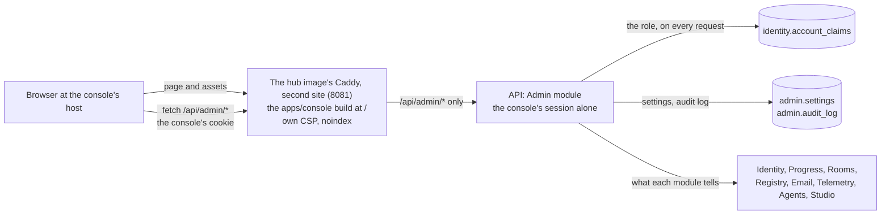
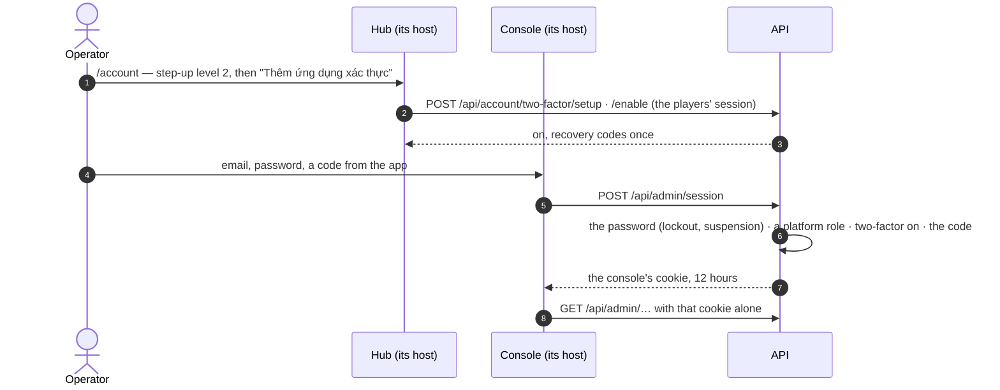
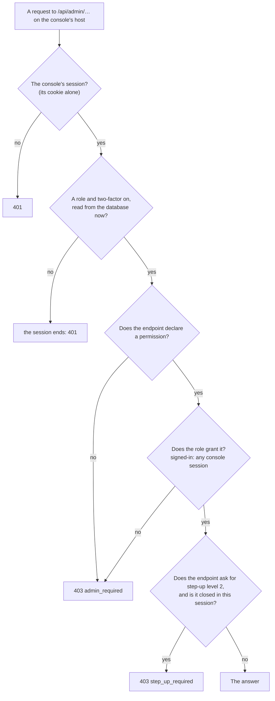
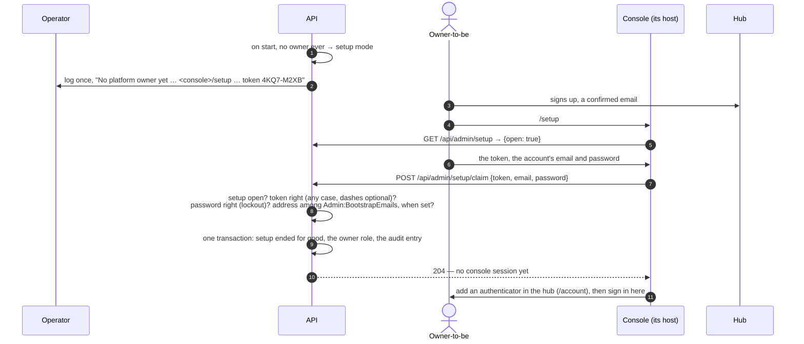
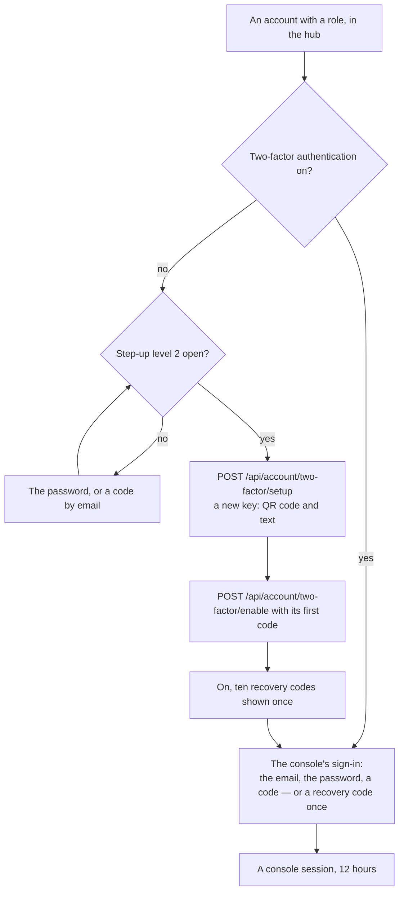
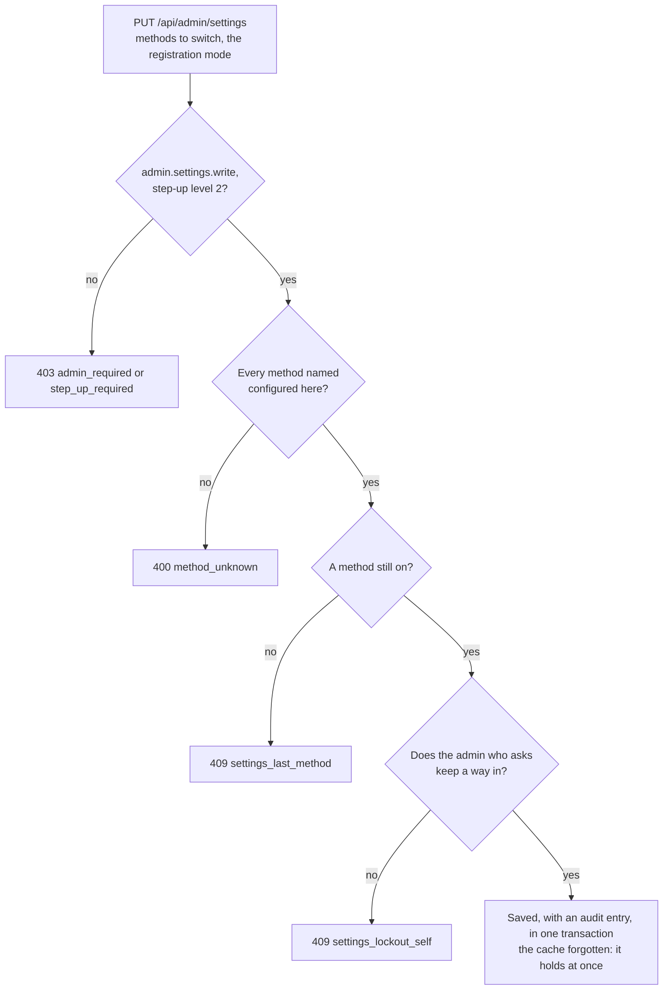

Decisions: [ADR 0027](../decisions/0027-platform-admin-and-the-first-owner.md),
[ADR 0028](../decisions/0028-sign-in-and-registration-at-run-time.md),
[ADR 0042](../decisions/0042-hosts-by-trust-paths-by-component.md),
[ADR 0051](../decisions/0051-an-asset-studio-for-game-assets.md),
[ADR 0052](../decisions/0052-agent-tokens-and-the-scopes-no-agent-gets.md). This page describes what exists: the
console's app and API on a host of its own, its sign-in and session, roles and permissions, the first owner's setup,
two-factor authentication, the audit log, the read-only pages, the users, sign-in and registration with communities,
agents with their tokens, and the Studio's members.

## Where it lives

The console has a host of its own ([ADR 0042](../decisions/0042-hosts-by-trust-paths-by-component.md)):
`console.toheplay.io.vn` in production, behind Cloudflare Access; `http://localhost:4721` in development and
`http://10.100.0.2:4821` on UAT ([Hosts and paths](hosts-and-paths.md)). A flaw in a page of the hub cannot act with an
operator's session: the console has a sign-in and a session of its own, and an operator signed in as a player is not
signed in to the console.



- **`apps/console`** — React with TanStack Router and Query and the design tokens; desktop first, usable on a phone. It
  is built into the hub's image under `/srv/console` and served at the root of the console's host by a second site of
  the hub's Caddy, on port 8081 (`deploy/docker/Caddyfile.hub`). That site serves the console's namespaces of the map in
  `@tohe/routes` (`consoleNamespaces`, generated into `console-routes.caddy`), proxies the API's console routes
  `/api/admin/…` and nothing else of the API, and answers any other path — the hub's pages, `/admin` — with a `404`.
  Its CSP allows only its own origin — no WebSocket, no inline styles — and frames the games origin only to watch a
  ranked run in the game itself ([ADR 0032](../decisions/0032-watch-a-ranked-run-in-the-game-itself.md)), which is why
  the games origin lets the console's origin embed it; every answer carries `X-Robots-Tag: noindex, nofollow` and HSTS
  like the hub's. It has no service worker and no `robots.txt`. The hub's host no longer serves `/admin`: a `404`.
- **Its links back to the hub** are absolute, to the hub's public URL the API tells it (`GET /api/admin/config`,
  `App:PublicUrl`): a root-relative link on the console's host would be a `404` of its own host. A test of the hub
  (`apps/hub/src/routes.test.ts`) fails when one appears.
- **`/api/admin/*`** — the Admin module (`services/api/src/Tohe.Api/Modules/Admin`), described by its own OpenAPI
  document, `/api/openapi/admin.json` where the API reference is switched on
  ([Configuration](../guides/configuration.md#api)). The build writes it to `services/api/openapi/tohe-api_admin.json`, and
  `pnpm --filter @tohe/hub generate:api` (which writes both apps' types) turns it into
  `apps/console/src/api/schema.gen.ts`. Its tables live in the `admin` schema.
- **Locally** `pnpm dev` starts the console's dev server on <http://localhost:4721>, at the root, proxying the API's
  console routes to the API; `docker compose up` publishes the hub container's port 8081 there.
- **Cloudflare Access** asks first in production (the owner sets it up). The API does not check Access's token yet: the
  console's own sign-in is what lets someone in.

## The console's session



- **Its own sign-in.** `POST /api/admin/session` takes the email, the password and a code from the authenticator — or
  a recovery code, once. Only an account with a platform role and two-factor authentication on gets a console session;
  a wrong password, a wrong or used code, no code, no role, no authenticator, no such account: all answer `401
  invalid_credentials`, so the console tells nobody which accounts hold a role. It never checks a player's password:
  the account is looked up first, and one without a role or an authenticator is checked as no account is — against a
  hash nobody has, as long as a wrong password takes — so its lockout stays untouched and the console is no place to
  try the players' passwords. It shares the players' checks (`PasswordSignIn`): Identity's lockout (wrong codes count
  with wrong passwords, 10 in a row, 5 minutes), the `auth` rate-limit bucket, and suspension, told
  (`account_suspended`) only to whoever brought the right password and code. An account its owner asked to delete is
  refused (`account_deleting`): signing in to the hub keeps it, the console does not. Both are told only after the
  proof, so a refused sign-in has spent it: the recovery code is gone, the authenticator's code cannot work again for
  three minutes. On purpose — nothing about the account is told before the password and the code. The switch of the
  players' password sign-in (ADR 0028) does not apply here: the console signs in with the password, and the switch goes
  back on in the console.
- **Its own cookie.** `__Host-tohe.console` when the console's URL is HTTPS, `tohe.console` otherwise — `HttpOnly`,
  `Secure` over HTTPS, **`SameSite=Strict`**, `Path=/`, no `Domain`. It lasts **12 hours from the sign-in**, never
  longer: no sliding, and re-issuing it after step-up keeps its end (the `tohe:console_until` claim). A new security
  stamp — a new password, a suspension, "sign out everywhere", two-factor authentication turned off — ends it at the
  next request; so does taking the role away. `DELETE /api/admin/session` ends the console's session only; signing out
  of the hub leaves it.
- **Apart, both ways, by scheme.** On localhost and on UAT the hub and the console share a host name and differ by port,
  and browsers send both cookies to both. So the API keeps them apart by authentication scheme, not by origin: the
  console's routes authenticate with the console's scheme (`ConsoleSession.Scheme`) alone — a player's cookie there is
  a `401` — and every other route with the players' (the default scheme), so the console's cookie authenticates nothing
  outside them. The routes themselves answer on the console's host alone (`App:ConsoleUrl`, `ConsoleRoutes`): a console
  route on the hub's host, or any other route on the console's host, is a `404`, whatever proxy is in front. And the
  API's same-origin check accepts the console's `Origin` only for the console's routes, and only it for them.
- **Step-up level 2** happens inside the console session: `POST /api/admin/session/step-up` with the password, or a
  code from the authenticator, opens what changes something for 10 minutes — its `tohe:secure_until` claim lives in
  the console's cookie. The hub's step-up opens nothing in the console.

## Who gets in

An account holds at most one platform role — `owner`, `admin`, `moderator` or `viewer` — kept as one account claim,
`tohe:role` (`PlatformRoles`). Code checks permissions, never role names (`AdminPermissions`):

| Permission | What it opens | Held by |
| --- | --- | --- |
| `signed-in` | Step-up level 2 in the console session | any console session |
| `admin.read` | The read-only pages, and the account's own two-factor authentication | every role |
| `admin.audit.read` | The audit log | owner, admin |
| `admin.users.read` | Find accounts and see one: sign-in methods, role, suspension, profiles and their names | owner, admin, moderator |
| `admin.users.write` | Suspend an account or lift it, end its sessions, delete one whose seven days are over | owner, admin |
| `admin.roles.write` | Give or take platform roles | owner |
| `admin.profiles.moderate` | Rename a profile, hide it from public boards | owner, admin, moderator |
| `admin.settings.write` | Switch sign-in methods and the registration mode; make communities and invite codes, revoke codes | owner, admin |
| `admin.results.review` | Review what the integrity engine held: approve, reject, reopen ([Review](#review)) | owner, admin, moderator |
| `admin.agents.read` | See agents, their tokens — never a token itself — and each agent's audit ([Agent tokens](agent-tokens.md)) | owner, admin |
| `admin.agents.write` | Create and disable agents, make and revoke their tokens | owner |
| `admin.studio.write` | Give and take studio roles ([Asset Studio](asset-studio.md#members-and-the-studios-session)) | owner |

A permission to change something new arrives with the page that changes it, given to the roles that should hold it.



The role and whether two-factor authentication is on are read again on every request, so taking a role away — or
turning two-factor authentication off — ends the console's session on the next request, everywhere. An endpoint added
without `.RequirePermission(…)` answers 403 to everyone; `AdminTests` checks that each admin endpoint declares one, but
the few a console needs before its session: its configuration, who is signed in, signing in and out, and setup.

The console asks `GET /api/admin/me` first — `204` when nobody is signed in, as the hub's `/api/auth/me` — and shows its
sign-in in place of any page until someone is. The hub's `GET /api/auth/me` carries the account's `role`, and for an
account with one the console's address (`consoleUrl`): Quản lý tài khoản links there, and adds the authenticator.

## The first owner

While no account has ever been owner, the deployment is in setup mode. When the API starts in setup mode it logs one
warning: `No platform owner yet: open <console>/setup and give the setup token XXXX-XXXX` — a token it makes up at
start — or, with `Admin:SetupToken` set, names that setting instead of printing it. Without `App:ConsoleUrl` it says so.



- Two-factor authentication is not asked yet: the claim makes the account owner and starts no session. The page then
  sends the owner to the hub's account page to add an authenticator, and back to sign in.
- The account needs a confirmed email; an account from before email sign-in adds one first (`email_required`). A wrong
  password is `invalid_credentials`, under Identity's lockout; a suspended account is `account_suspended`, one waiting
  to be deleted `account_deleting`.
- Tries count in the `auth-gate` bucket, 10 a minute per address; a wrong token is `setup_token_invalid` — checked
  before the password, so it says nothing about the account — an address outside `Admin:BootstrapEmails` is
  `setup_email_not_allowed`.
- Setup ends once, in the database (`admin.settings`, `setup.completed_at`): when two claims race, one wins and the
  other is `setup_closed`. An owner granted by the command ends it too, and so does the migration for a deployment
  that already has one. Losing every owner later never opens it again: the command is the way back.

## Two-factor authentication

The console signs in with an authenticator app (TOTP: six digits, every 30 seconds). It is added in the hub — nobody
signs in to the console without one, so the console cannot add it — and managed in the console.



- **In the hub**, Quản lý tài khoản → Bảo mật tài khoản → Xác thực hai lớp, for an account with a platform role only
  (`admin_required` otherwise): players do not sign in with one. The account needs a password of its own — the
  console's sign-in asks for it — so one that signs in only with a provider (Google…) is refused
  (`password_required`), and the page points to setting a password first. Turning it on leaves other sessions alone —
  the account only got safer — and tells the account's address, as every change to how it signs in is told (ADR 0024,
  0026).
- **In the console**, Bảo mật: new recovery codes, or turning it off — both behind step-up level 2 in the console
  session. Turning it off gives the account a new security stamp and a new key: every session ends, the console's
  included, and the console's sign-in refuses the account until an authenticator is added again in the hub. The
  account's address is told.
- **Wrong codes** count towards Identity's lockout, like wrong passwords (10 in a row, 5 minutes), and the `auth`
  bucket limits sign-ins per address. A code that worked cannot work again for three minutes: one seen over a shoulder
  opens nothing elsewhere.

## The audit log

Every change in or for the console lands in `admin.audit_log`, in the same transaction as the change: who acted (the
account, or `command line`), what, on what, more as JSON, and from which address. A PostgreSQL trigger refuses every
`UPDATE`, `DELETE` and `TRUNCATE` on the table — the API cannot rewrite history, and nor can someone with its database
credentials, short of dropping the trigger. Owners and admins read it in the console, newest first.

It keeps a year ([ADR 0034](../decisions/0034-delete-accounts-and-profiles-for-good.md)): entries name accounts, some
by their email. The `audit-retention` job deletes, once a day, the entries older than 365 days by the database's
clock — the trigger's one exception, open only in a transaction that set `tohe.purge` to `audit`, and only for those
entries.

| Action | When |
| --- | --- |
| `setup.claim` | The first owner claimed the deployment |
| `role.grant`, `role.revoke` | A role given or taken away, from the console or the command |
| `user.suspend`, `user.unsuspend` | An account suspended — the reason in the details — or the suspension lifted |
| `user.sign-out` | Every session of an account ended |
| `user.delete` | An account deleted for good, its seven days over — how many profiles went with it in the details ([ADR 0038](../decisions/0038-an-account-waits-for-an-admin-after-its-seven-days.md)) |
| `profile.rename` | A profile renamed, with the names before and after |
| `profile.hide`, `profile.show` | A profile hidden from public boards — the reason in the details — or let back |
| `profile.withdraw` | A profile — an account's or a device's — taken off its tables |
| `link.revoke` | A share link revoked, with its maker's profile id ([Entry links](entry-links.md#the-console)) |
| `result.approve`, `result.reject`, `result.reopen` | A person's decision about a result (target `result {id}`), with the levels before and after and the note |
| `settings.change` | Sign-in methods or the registration mode switched, with the new values |
| `community.create` | A community made |
| `invite.create`, `invite.revoke` | An invite code made — its community, end and limit of uses in the details — or revoked |
| `two-factor.enable`, `two-factor.disable` | Two-factor authentication turned on or off |
| `two-factor.recovery-codes` | New recovery codes |
| `console.open` | A sign-in to the console, with how: `authenticator` or `recovery-code` |
| `agent.create`, `agent.disable` | An agent made, or disabled — how many tokens that revoked in the details ([Agent tokens](agent-tokens.md)) |
| `agent.token.create`, `agent.token.revoke` | A token made for an agent — its id, scopes and expiry in the details, never the token — or revoked |
| `studio.member.grant`, `studio.member.revoke` | A studio role given or changed — the role, and the one before, in the details — or taken away ([Asset Studio](asset-studio.md#members-and-the-studios-session)) |

## Users

Accounts are found by email, username, display name or profile name, or by the first four digits or more of a profile
ID; nothing typed lists the newest. An account's page shows how it signs in, its role, two-factor authentication,
whether it is suspended and why, whether its owner asked to delete it and when its seven days end ("Chờ xoá",
[Identity](identity.md#deleting)), and each profile with the names it had. What may be done to it, behind step-up
level 2 and in the audit log:

- **Suspend**, with a reason only admins see: no way in — the password, a provider, finishing a link, a new password
  by email — and a new security stamp, so its sessions end within the session check. Until then a session it still
  holds cannot renew itself: whatever would re-issue it answers `account_suspended` and ends it. A sign-in with the
  right password is told
  `account_suspended`; a wrong one hears `invalid_credentials` as always, so nobody learns which accounts are
  suspended. With a provider, the hub shows the same at `/account/sign-in?external=suspended`. **Lift** undoes it.
- **Sign out everywhere**: a new security stamp alone.
- **Delete for good** an account whose owner asked and whose seven days are over
  ([ADR 0038](../decisions/0038-an-account-waits-for-an-admin-after-its-seven-days.md)), after one more confirmation: every profile and their data go
  with it, as [Identity](identity.md#deleting) lists. Before the day it answers `deletion_not_due`; when its owner
  never asked, or signed in since, `deletion_not_requested`. "Chờ xoá" (`?deleting=true`) lists the accounts
  waiting, the soonest due first, and the overview counts those due — nothing deletes them by itself.
- **Role** (owners): give one or take it away. The platform keeps at least one owner (`last_owner`).
- **Rename a profile** (moderators too), under the same name rules as its owner (ADR 0023). A database trigger keeps
  every name a profile had — on creation and on any rename, by its owner or a moderator — so moderation sees what it
  was called; the history goes with the profile when it is deleted.
- **Hide a profile from public boards** (moderators too), with a reason only admins see, and let it back
  ([ADR 0031](../decisions/0031-people-decide-what-the-engine-held.md)). The owner's switch stays as it is and does not
  bring the profile back; the hub tells the owner it is hidden. The account's own board is unchanged.
- **Take a profile off its tables** (moderators too, "Mời khỏi bàn chơi"): it leaves every table it sits at or watches —
  a bot finishes a hand in progress — and invitations to it end, as when it is deleted; nothing it stored goes.

**Device profiles on the server** ([ADR 0043](../decisions/0043-device-profiles-and-identity-levels.md),
[Identity](identity.md#device-profiles-on-the-server)) have no account: the Users page lists them apart, under "Hồ sơ trên
máy", found by name or id, the latest used first — when they were made and last used, the terms their player accepted,
the names they had. A moderator renames one, which is how a name is hidden: the name sticks — the device sending its
copy again keeps the moderator's name and takes it from the answer (`name_moderated_at`) — and its seats at live tables
show it at once. A moderator also takes it off its tables, as above. It is on no public board, so there is nothing to
hide it from.

Nobody acts on their own account here (`admin_self`) — that is what the hub is for — nor on an account whose role is as
strong as theirs (`admin_rank`), except an owner on another owner.

## Review

What the integrity engine held waits for a person in **Xem xét kết quả**, oldest first; results people decided about or
the engine rejected are found again under **Đã quyết**, to reopen one. A decision — approve, reject, reopen — needs
step-up level 2, takes an optional note, and nobody makes one about their own account's results (`admin_self`). The
levels, the evidence and the rules: [Integrity and boards](integrity.md#review). Rejecting does not suspend; the result
links to its account for whoever may. A ranked run plays back in the game itself, in the build that played it, while
the games origin still serves that build: the console hosts the game in a sandboxed iframe, loads the host only then,
and keeps nothing the game sends.

## Sign-in and registration

The deployment decides which sign-in methods can exist — a provider needs its secrets
([Configuration](../guides/configuration.md#api)); the console decides which are on and who may make an account
([ADR 0028](../decisions/0028-sign-in-and-registration-at-run-time.md)). The switches live in `admin.settings`. The one
API process caches them and forgets the cache whenever the console saves, so a change holds at once — and the hub
learns it from `GET /api/config`. Unset, every configured method is on and registration is open.



- **Đăng nhập & đăng ký**, `/settings`: each method — on, off, or not configured — with how many accounts sign
  in by it alone. Switching one off that some rely on asks once more: they cannot sign in until it is on again or they
  get another way linked. Off means no signing in and no signing up with it — and for email and password no forgotten
  password either ([Sign-in methods](identity.md#sign-in-methods)).
- **Registration**: `open`, anyone; `invite`, only with a usable invite code; `closed`, nobody new
  ([Registration](identity.md#registration)). The page warns when nobody could sign up by email anyway — email not
  sent, or the password off.
- **Chống bot đăng ký**: the [proof-of-work](identity.md#proof-of-work) before signing up and a password reset
  ([ADR 0037](../decisions/0037-proof-of-work-before-a-code-by-email.md)), off by default; `proofOfWork` in the same
  `PUT /api/admin/settings`, under the same step-up, in the same audit entry.
- **Cộng đồng**, `/communities`: a community is a name, unique. Its invite codes are given (`BAN-CO-6A`) or made
  up (`K7Q2-M9XD`, Crockford's base 32: no I, L, O or U to misread); they may end on a day and may be used a set number
  of times, and once revoked are never used again. A usable code shows its link — on the hub's host, `<hub>/account/register?invite=CODE` — to share.
  How many accounts came with a community is counted from the accounts.

## Granting a role

Roles also come from a command run inside the API's container — the same image and configuration as the running
API: the way back when every owner is lost, and the quick way on development and UAT. Each change is audited as
`command line`; granting an owner ends setup mode. An account from before email sign-in is named by its username.

```sh
docker compose exec api dotnet Tohe.Api.dll admin grant bo@example.org --role owner        # compose: local, UAT
kubectl exec deploy/<release>-api -- dotnet Tohe.Api.dll admin grant bo@example.org --role owner   # the chart
dotnet Tohe.Api.dll admin revoke bo@example.org
dotnet Tohe.Api.dll admin list
```

It exits with 0 when done, 1 when no account signs in with the address, 2 for a mistyped command.

## Pages

| Page | Shows | Asks |
| --- | --- | --- |
| Tổng quan, `/` | Accounts and profiles: total, last day, last week · players — profiles that saved a game or recorded a score — in the last day and week · open rooms, rooms in a hand, profiles connected · results waiting for a person · accounts due for deletion · device errors in the last day · the catalog and its last sync · the email outbox | `IdentityFacts`, `ProgressFacts`, `RoomRegistry.Live()`, `IntegrityReview`, `TelemetryFacts`, `RegistryFacts` and the catalog worker, `EmailFacts` |
| Game, `/games` | Every game in the registry, listed or not, with its players in the last week and its open rooms | `RegistryFacts`, `ProgressFacts`, `RoomRegistry` |
| Sức khoẻ thiết bị, `/health?days=1\|7\|30` | The device telemetry report ([Device telemetry](telemetry.md)): devices, errors, frames and metrics per game version, plays and errors per day | `TelemetryReports` |
| Hệ thống, `/system` | The build, environment and start time · migrations applied and pending · what each background worker last did · settings — the hub's and the console's addresses among them — never secrets | `BackgroundWork`, EF Core, options |
| Người dùng, `/users`, `/users/{id}` | Accounts found — or those waiting to be deleted, the soonest due first — then one account and its profiles, with what may be done to them | `AccountsAdmin` |
| Xem xét kết quả, `/review?list=held\|decided`, `/review/{id}` | The held results, oldest first, or the decided ones, latest first; then one result — its evidence, a ranked run played back in the game itself, its profile's history on the board, every change of level — and the decision | `IntegrityReview`, `AccountsAdmin`, `RegistryFacts` |
| Link chia sẻ, `/links?code=` | A share link found by its code: its game, level, maker, state, uses and every count by day; revoking it | `ShareLinksAdmin` ([Entry links](entry-links.md#the-console)) |
| Cộng đồng, `/communities` | Communities with how many accounts came with each, their invite codes and links; new ones, revoking | `CommunitiesAdmin` |
| Đăng nhập & đăng ký, `/settings` | Each sign-in method and who relies on it alone; the registration mode; switching both | `RuntimeSettings`, `IdentityFacts` |
| Studio, `/studio` | Who holds a studio role — `contributor` or `reviewer` — whether a reviewer can sign in (two-factor on), who gave it and when; giving one by email, changing it, taking it away ([Asset Studio](asset-studio.md#in-the-console)) | `studio.members`, Identity's accounts |
| Agent, `/agents` | Agents, their tokens and each agent's audit; making and disabling agents, making a token — shown once — and revoking one ([Agent tokens](agent-tokens.md#in-the-console)) | `agents.agents`, `agents.tokens`, `agents.audit` |
| Nhật ký, `/audit` | The audit log, newest first, a page at a time | `admin.audit_log` |
| Bảo mật, `/security` | The account's two-factor authentication: until when this console session lasts, recovery codes left; new recovery codes, or turning it off | Identity's two-factor stores |

Modules keep their tables ([ADR 0003](../decisions/0003-backend-dotnet-modular-monolith-postgres.md)): each exposes a
small `…Facts` service, and the Admin module only puts their answers together. Infrastructure — CPU, memory, disks —
stays in the cluster's Prometheus and Grafana.

### Background work

Each worker reports its runs to `BackgroundWork`, which lives in memory — one API process runs every worker — so the
System page tells what happened since the API started. A failed run keeps its error (300 characters at most) and
counts the failures in a row until a run goes well. The same two numbers go to Prometheus
(`tohe_worker_failures_in_row`, `tohe_worker_last_success_age_seconds`, [Metrics](metrics.md)), which alerts on
three failures in a row without anyone opening the page.

| Worker | Runs |
| --- | --- |
| `catalog-sync` | when the API starts, then every `Registry:SyncInterval` |
| `email-delivery` | every `Email:PollInterval` |
| `telemetry-maintenance` | every `Telemetry:MaintenanceInterval` |
| `ranked-replays` | every `Integrity:ReplayInterval` ([ranked runs](integrity.md#ranked-runs)) |
| `audit-retention` | once a day: audit entries older than a year ([above](#the-audit-log)) |
| `device-cleanup` | once a day: device profiles unused for 90 days, and devices unseen for 90 days, deleted on the server ([Identity](identity.md#device-profiles-on-the-server)) |

## API

| Endpoint | Permission | Answers |
| --- | --- | --- |
| `GET /api/admin/config` | — | What the console needs first: the hub's address |
| `GET /api/admin/me` | — | The account signed in to the console, its role, its permissions, until when the session lasts and step-up is open; `204` when nobody is |
| `POST /api/admin/session` · `DELETE /api/admin/session` | — | The console's sign-in: email, password and a code or a recovery code — its cookie for 12 hours · sign out of the console only |
| `POST /api/admin/session/step-up` | `signed-in` | The password, or a code from the authenticator: step-up level 2 in this console session for 10 minutes |
| `GET /api/admin/setup` · `POST /api/admin/setup/claim` | — | Whether setup is open · the token, with an account's email and password, makes it the first owner |
| `GET /api/admin/two-factor` | `admin.read` | On, until when this console session lasts, recovery codes left |
| `POST /api/admin/two-factor/recovery-codes` · `DELETE /api/admin/two-factor` | `admin.read`, step-up | New recovery codes · turn it off: every session ends, this one too |
| `GET /api/admin/overview` | `admin.read` | The platform at a glance |
| `GET /api/admin/games` | `admin.read` | Every game in the registry |
| `GET /api/admin/health?days=7` | `admin.read` | The device telemetry report over 1 to 30 days |
| `GET /api/admin/system` | `admin.read` | The running deployment |
| `GET /api/admin/audit?before=&limit=50` | `admin.audit.read` | A page of the audit log, newest first |
| `GET /api/admin/users?q=&deleting=` · `GET /api/admin/users/{id}` | `admin.users.read` | Accounts found, fifty at most — with `deleting=true`, those waiting to be deleted, the soonest due first · one account |
| `POST` · `DELETE /api/admin/users/{id}/suspend` | `admin.users.write`, step-up | Suspend, with a reason · lift it |
| `POST /api/admin/users/{id}/sign-out` | `admin.users.write`, step-up | End every session of the account |
| `POST /api/admin/users/{id}/delete` | `admin.users.write`, step-up | Delete for good an account whose seven days are over ([ADR 0038](../decisions/0038-an-account-waits-for-an-admin-after-its-seven-days.md)) |
| `PUT /api/admin/users/{id}/role` | `admin.roles.write`, step-up | Give a role, or none |
| `PATCH /api/admin/profiles/{id}` | `admin.profiles.moderate`, step-up | Rename a profile |
| `POST` · `DELETE /api/admin/profiles/{id}/hidden` | `admin.profiles.moderate`, step-up | Hide a profile from public boards, with a reason · let it back |
| `POST /api/admin/profiles/{id}/withdraw` | `admin.profiles.moderate`, step-up | Take a profile — an account's or a device's — off its tables |
| `GET /api/admin/device-profiles?q=` | `admin.users.read` | Device profiles on the server by name or id, fifty at most |
| `PATCH /api/admin/device-profiles/{id}` | `admin.profiles.moderate`, step-up | Rename a device profile on the server |
| `GET /api/admin/links/{code}` | `admin.users.read` | A share link by its code: its maker, state and every count by day ([Entry links](entry-links.md#the-console)) |
| `POST /api/admin/links/{code}/revoke` | `admin.profiles.moderate`, step-up | Revoke it; revoking again logs nothing |
| `GET /api/admin/review?after=` · `GET /api/admin/review/decided?before=` | `admin.results.review` | Held results, oldest first · results people decided about or the engine rejected, the latest decision first; fifty at a time, with whose they are, how many are held, and the cursor of the next page |
| `GET /api/admin/review/{id}` | `admin.results.review` | One result: where it stands and why, its evidence, its profile's history on the board, every change of level |
| `GET /api/admin/review/{id}/run` | `admin.results.review` | A ranked run's seed and moves, and the build that played it — its entry URL — while the games origin serves it; 404 for a result with no ranked run |
| `POST /api/admin/review/{id}/approve` · `/reject` · `/reopen` | `admin.results.review`, step-up | A decision, with an optional note; the result as it stands after |
| `GET /api/admin/settings` | `admin.read` | Each sign-in method — configured, on, accounts relying on it alone — the registration mode, whether email is sent |
| `PUT /api/admin/settings` | `admin.settings.write`, step-up | Switch methods by id and the registration mode; what is left out stays |
| `GET /api/admin/communities` | `admin.read` | Communities, their member counts and invite codes |
| `POST /api/admin/communities` | `admin.settings.write`, step-up | A new community |
| `POST /api/admin/communities/{id}/codes` | `admin.settings.write`, step-up | A new invite code — given or made up, an end and a limit of uses if wanted |
| `DELETE /api/admin/invite-codes/{code}` | `admin.settings.write`, step-up | Revoke an invite code |
| `GET /api/admin/agents` · `GET /api/admin/agents/scopes` | `admin.agents.read` | Agents and their tokens, never a token itself · the scopes a token may hold ([Agent tokens](agent-tokens.md#in-the-console)) |
| `GET /api/admin/agents/{id}/audit?before=&limit=50` | `admin.agents.read` | A page of the agent's audit, newest first |
| `POST /api/admin/agents` · `POST /api/admin/agents/{id}/disable` | `admin.agents.write`, step-up | A new agent · disable one, revoking its tokens |
| `POST /api/admin/agents/{id}/tokens` · `POST /api/admin/agents/{id}/tokens/{tokenId}/revoke` | `admin.agents.write`, step-up | A new token, in this answer once · revoke one |
| `GET /api/admin/studio/members` | `admin.users.read` | Every account with a studio role, reviewers first |
| `POST /api/admin/studio/members` · `DELETE /api/admin/studio/members/{accountId}` | `admin.studio.write`, step-up | Give a studio role — or change it — to an account named by its email or its id · take it away |

Every one of them answers on the console's host alone; anywhere else, `404`.

In the hub, behind the players' session: `GET /api/account/two-factor` (on or not), `POST /api/account/two-factor/setup`
(a new key) and `/enable` (its first code turns it on; the recovery codes once) — for an account with a platform role
and a password, the last two within step-up level 2.

Refusals: 401 without a console session, or `invalid_credentials` from the sign-in; 404 `account_not_found`,
`studio_member_not_found`; 403 `admin_required`,
`step_up_required`, `password_invalid`, `account_suspended`, `account_deleting`, `email_required`, `setup_token_invalid`,
`setup_email_not_allowed`, `admin_self`, `admin_rank`; 429 `locked_out`;
409 `setup_closed`, `two_factor_enabled`, `password_required`, `authenticator_not_set_up`, `last_owner`, `settings_last_method`,
`settings_lockout_self`, `community_exists`, `invite_code_exists`, `review_not_allowed`, `agent_exists`, `agent_disabled`; 400 with field codes `code_invalid`, `code_used`,
`locked_out`, `reason_required`, `reason_too_long`, `role_invalid`, `registration_invalid`, `method_unknown`,
`invite_code_invalid`, `max_uses_invalid`, `expires_in_past`, `note_too_long`, `scopes_required`, `scope_unknown`,
`days_invalid`, `account_required` and the name rules'.
Generated reference: [Admin API](/reference/admin-api/).
