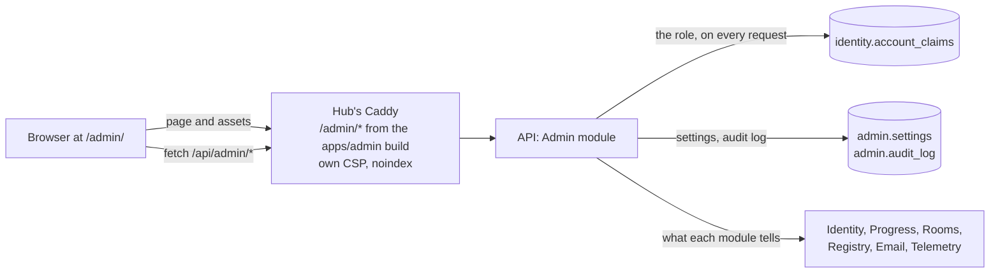
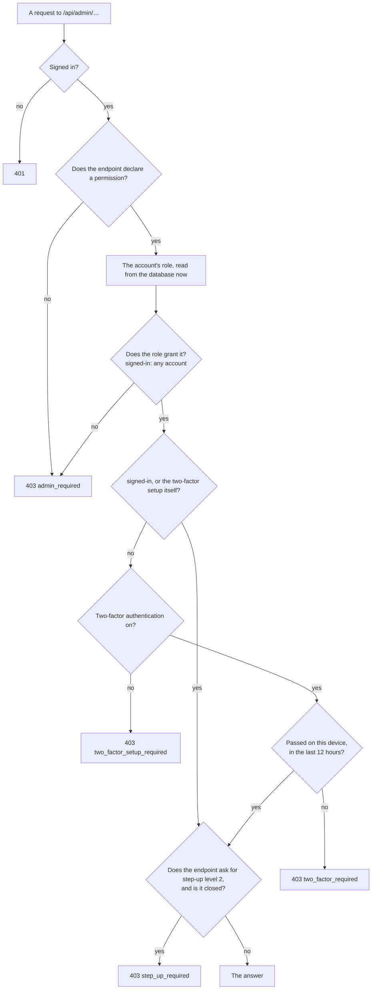
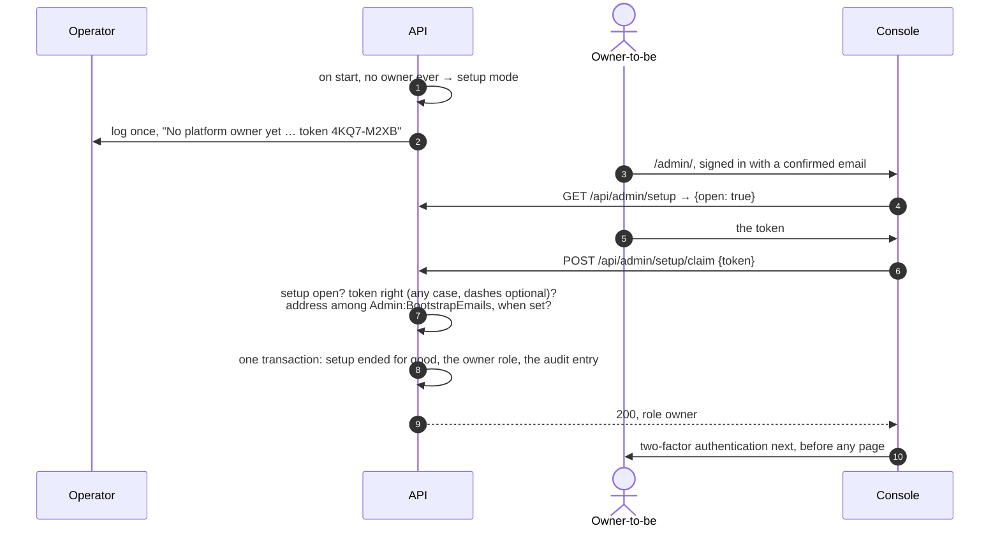
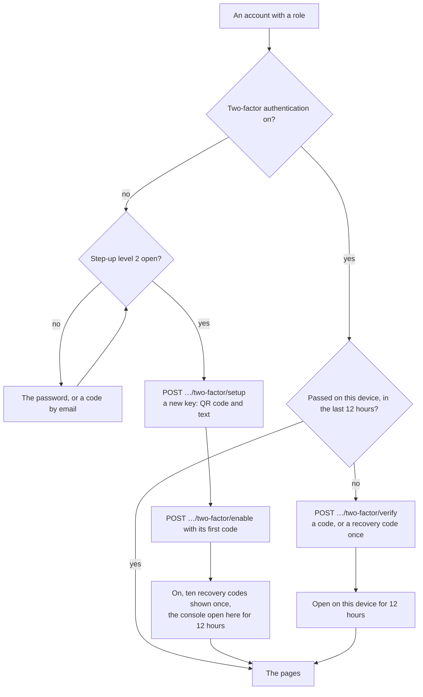
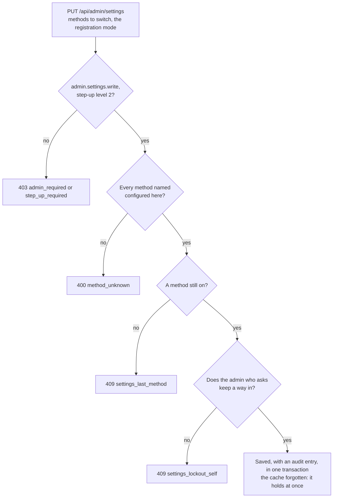

Decisions: [ADR 0027](../decisions/0027-platform-admin-and-the-first-owner.md),
[ADR 0028](../decisions/0028-sign-in-and-registration-at-run-time.md). This page describes what exists: the console's
app and API, roles and permissions, the first owner's setup, two-factor authentication, the audit log, the read-only
pages, the users, and sign-in and registration with communities.

## Where it lives



- **`apps/admin`** — React with TanStack Router and Query and the design tokens; desktop first, usable on a phone. It
  is built into the hub's image under `/srv/admin` and served at `/admin/` by the hub's Caddy: the hub's origin, so
  the hub's session cookie. Its CSP allows only its own origin — no games, no WebSocket, no inline styles — and it is
  sent with `X-Robots-Tag: noindex`. It has no service worker, and the hub's leaves `/admin/` alone.
- **`/api/admin/*`** — the Admin module (`services/api/src/Tohe.Api/Modules/Admin`), described by its own OpenAPI
  document, `/api/openapi/admin.json`. The build writes it to `services/api/openapi/tohe-api_admin.json`, and
  `pnpm --filter @tohe/admin generate:api` (which regenerates the hub's types too) turns it into
  `apps/admin/src/api/schema.gen.ts`. Its tables live in the `admin` schema.
- **Locally** `pnpm dev` starts the console's dev server on 4721; open it through the hub, at
  <http://localhost:4720/admin/>, as in production.

## Who gets in

An account holds at most one platform role — `owner`, `admin`, `moderator` or `viewer` — kept as one account claim,
`tohe:role` (`PlatformRoles`). Code checks permissions, never role names (`AdminPermissions`):

| Permission | What it opens | Held by |
| --- | --- | --- |
| `signed-in` | `GET /api/admin/me` — who is asking, their role if any — and setup | any signed-in account |
| `admin.read` | The read-only pages, and the account's own two-factor authentication | every role |
| `admin.audit.read` | The audit log | owner, admin |
| `admin.users.read` | Find accounts and see one: sign-in methods, role, suspension, profiles and their names | owner, admin, moderator |
| `admin.users.write` | Suspend an account or lift it, end its sessions | owner, admin |
| `admin.roles.write` | Give or take platform roles | owner |
| `admin.profiles.moderate` | Rename a profile | owner, admin, moderator |
| `admin.settings.write` | Switch sign-in methods and the registration mode; make communities and invite codes, revoke codes | owner, admin |

A permission to change something new — boards — arrives with the page that changes it, given to the roles that should
hold it.



The role and whether two-factor authentication is on are read again on every request, so taking a role away — or
turning two-factor authentication off — works on the next request, in every session. An endpoint added without
`.RequirePermission(…)` answers 403 to everyone; `AdminTests` checks that each admin endpoint declares one.

The console asks `GET /api/admin/me` first and walks people to what is missing: the hub's sign-in when signed out;
how a role comes without one — or the claim of a new deployment's first owner; the two-factor setup; a code on this
device. A page that comes back refused for one of these sends the console back to its gate. The hub's
`GET /api/auth/me` carries the account's `role` too, and Quản lý tài khoản links to the console when there is one.

## The first owner

While no account has ever been owner, the deployment is in setup mode. When the API starts in setup mode it logs one
warning: `No platform owner yet: open <hub>/admin/setup and give the setup token XXXX-XXXX` — a token it makes up at
start — or, with `Admin:SetupToken` set, names that setting instead of printing it.



- The account needs a confirmed email; an account from before email sign-in adds one first (`email_required`).
- Tries count in the `auth-gate` bucket, 10 a minute per address; a wrong token is `setup_token_invalid`, an address
  outside `Admin:BootstrapEmails` is `setup_email_not_allowed`.
- Setup ends once, in the database (`admin.settings`, `setup.completed_at`): when two claims race, one wins and the
  other is `setup_closed`. An owner granted by the command ends it too, and so does the migration for a deployment
  that already has one. Losing every owner later never opens it again: the command is the way back.

## Two-factor authentication

The console needs an authenticator app (TOTP: six digits, every 30 seconds) — on the account once, then a code on each
device.



- **Per device, for a working day.** A code opens the console on the device for 12 hours: the session's
  `tohe:admin_until` claim. Like both step-up levels, choosing who plays or locking the page closes it.
- **Turning it on** leaves other sessions alone — the account only got safer. **Turning it off** (step-up level 2)
  gives the account a new security stamp and a new key: other sessions end within the session check, and the console
  closes on every device at once, since each request checks that two-factor authentication is on.
- **New recovery codes** need step-up level 2 and replace the old ones.
- **Wrong codes** count towards Identity's lockout, like wrong passwords (10 in a row, 5 minutes), and the `auth-code`
  bucket limits them per address. A code that worked cannot work again for three minutes (`code_used`): one seen over
  a shoulder opens nothing elsewhere.

## The audit log

Every change in or for the console lands in `admin.audit_log`, in the same transaction as the change: who acted (the
account, or `command line`), what, on what, more as JSON, and from which address. A PostgreSQL trigger refuses every
`UPDATE`, `DELETE` and `TRUNCATE` on the table — the API cannot rewrite history, and nor can someone with its database
credentials, short of dropping the trigger. Owners and admins read it in the console, newest first.

| Action | When |
| --- | --- |
| `setup.claim` | The first owner claimed the deployment |
| `role.grant`, `role.revoke` | A role given or taken away, from the console or the command |
| `user.suspend`, `user.unsuspend` | An account suspended — the reason in the details — or the suspension lifted |
| `user.sign-out` | Every session of an account ended |
| `profile.rename` | A profile renamed, with the names before and after |
| `settings.change` | Sign-in methods or the registration mode switched, with the new values |
| `community.create` | A community made |
| `invite.create`, `invite.revoke` | An invite code made — its community, end and limit of uses in the details — or revoked |
| `two-factor.enable`, `two-factor.disable` | Two-factor authentication turned on or off |
| `two-factor.recovery-codes` | New recovery codes |
| `console.open` | The console opened on a device, with how: `authenticator` or `recovery-code` |

## Users

Accounts are found by email, username, display name or profile name, or by the first four digits or more of a profile
ID; nothing typed lists the newest. An account's page shows how it signs in, its role, two-factor authentication,
whether it is suspended and why, and each profile with the names it had. What may be done to it, behind step-up
level 2 and in the audit log:

- **Suspend**, with a reason only admins see: no way in — the password, a provider, finishing a link, a new password
  by email — and a new security stamp, so its sessions end within the session check. Until then a session it still
  holds cannot renew itself: whatever would re-issue it answers `account_suspended` and ends it. A sign-in with the
  right password is told
  `account_suspended`; a wrong one hears `invalid_credentials` as always, so nobody learns which accounts are
  suspended. With a provider, the hub shows the same at `/welcome?external=suspended`. **Lift** undoes it.
- **Sign out everywhere**: a new security stamp alone.
- **Role** (owners): give one or take it away. The platform keeps at least one owner (`last_owner`).
- **Rename a profile** (moderators too), under the same name rules as its owner (ADR 0023). A database trigger keeps
  every name a profile had — on creation and on any rename, by its owner or a moderator — so moderation sees what it
  was called; the history goes with the profile when it is deleted.

Nobody acts on their own account here (`admin_self`) — that is what the hub is for — nor on an account whose role is as
strong as theirs (`admin_rank`), except an owner on another owner.

## Sign-in and registration

The deployment decides which sign-in methods can exist — a provider needs its secrets
([Configuration](../guides/configuration.md#api)); the console decides which are on and who may make an account
([ADR 0028](../decisions/0028-sign-in-and-registration-at-run-time.md)). The switches live in `admin.settings`. The one
API process caches them and forgets the cache whenever the console saves, so a change holds at once — and the hub
learns it from `GET /api/config`. Unset, every configured method is on and registration is open.



- **Đăng nhập & đăng ký**, `/admin/settings`: each method — on, off, or not configured — with how many accounts sign
  in by it alone. Switching one off that some rely on asks once more: they cannot sign in until it is on again or they
  get another way linked. Off means no signing in and no signing up with it — and for email and password no forgotten
  password either ([Sign-in methods](identity.md#sign-in-methods)).
- **Registration**: `open`, anyone; `invite`, only with a usable invite code; `closed`, nobody new
  ([Registration](identity.md#registration)). The page warns when nobody could sign up by email anyway — email not
  sent, or the password off.
- **Cộng đồng**, `/admin/communities`: a community is a name, unique. Its invite codes are given (`BAN-CO-6A`) or made
  up (`K7Q2-M9XD`, Crockford's base 32: no I, L, O or U to misread); they may end on a day and may be used a set number
  of times, and once revoked are never used again. A usable code shows its link, `/register?invite=CODE`, to share.
  How many accounts came with a community is counted from the accounts.

## Granting a role

Roles also come from a command run inside the API's container — the same image and configuration as the running
API: the way back when every owner is lost, and the quick way on development and UAT. Each change is audited as
`command line`; granting an owner ends setup mode. An account from before email sign-in is named by its username.

```sh
docker compose exec api dotnet Tohe.Api.dll admin grant bo@example.org --role owner        # compose: local, UAT
kubectl exec deploy/<release>-api -- dotnet Tohe.Api.dll admin grant bo@example.org --role owner   # the chart
dotnet Tohe.Api.dll admin revoke bo@example.org
dotnet Tohe.Api.dll admin list
```

It exits with 0 when done, 1 when no account signs in with the address, 2 for a mistyped command.

## Pages

| Page | Shows | Asks |
| --- | --- | --- |
| Tổng quan, `/admin/` | Accounts and profiles: total, last day, last week · players — profiles that saved a game or recorded a score — in the last day and week · open rooms, rooms in a hand, profiles connected · device errors in the last day · the catalog and its last sync · the email outbox | `IdentityFacts`, `ProgressFacts`, `RoomRegistry.Live()`, `TelemetryFacts`, `RegistryFacts` and the catalog worker, `EmailFacts` |
| Game, `/admin/games` | Every game in the registry, listed or not, with its players in the last week and its open rooms | `RegistryFacts`, `ProgressFacts`, `RoomRegistry` |
| Sức khoẻ thiết bị, `/admin/health?days=1\|7\|30` | The device telemetry report ([Device telemetry](telemetry.md)): devices, errors, frames and metrics per game version, plays and errors per day | `TelemetryReports` |
| Hệ thống, `/admin/system` | The build, environment and start time · migrations applied and pending · what each background worker last did · settings, never secrets | `BackgroundWork`, EF Core, options |
| Người dùng, `/admin/users`, `/admin/users/{id}` | Accounts found, then one account and its profiles, with what may be done to them | `AccountsAdmin` |
| Cộng đồng, `/admin/communities` | Communities with how many accounts came with each, their invite codes and links; new ones, revoking | `CommunitiesAdmin` |
| Đăng nhập & đăng ký, `/admin/settings` | Each sign-in method and who relies on it alone; the registration mode; switching both | `RuntimeSettings`, `IdentityFacts` |
| Nhật ký, `/admin/audit` | The audit log, newest first, a page at a time | `admin.audit_log` |
| Bảo mật, `/admin/security` | The account's two-factor authentication: until when the console is open here, recovery codes left; new recovery codes, or turning it off | Identity's two-factor stores |

Modules keep their tables ([ADR 0003](../decisions/0003-backend-dotnet-modular-monolith-postgres.md)): each exposes a
small `…Facts` service, and the Admin module only puts their answers together. Infrastructure — CPU, memory, disks —
stays in the cluster's Prometheus and Grafana.

### Background work

Each worker reports its runs to `BackgroundWork`, which lives in memory — one API process runs every worker — so the
System page tells what happened since the API started. A failed run keeps its error (300 characters at most) and
counts the failures in a row until a run goes well.

| Worker | Runs |
| --- | --- |
| `catalog-sync` | when the API starts, then every `Registry:SyncInterval` |
| `email-delivery` | every `Email:PollInterval` |
| `telemetry-maintenance` | every `Telemetry:MaintenanceInterval` |
| `ranked-replays` | every `Integrity:ReplayInterval` ([ranked runs](integrity.md#ranked-runs)) |

## API

| Endpoint | Permission | Answers |
| --- | --- | --- |
| `GET /api/admin/me` | `signed-in` | The account, its role (or none), its permissions, and the console's state here: two-factor on, open until, step-up until |
| `GET /api/admin/setup` · `POST /api/admin/setup/claim` | `signed-in` | Whether setup is open · the token makes this account the first owner |
| `GET /api/admin/two-factor` | `admin.read`, before two-factor | On or off, open here until, recovery codes left |
| `POST /api/admin/two-factor/setup` · `/enable` | `admin.read`, before two-factor, step-up | A new key · its first code turns it on and opens the console; recovery codes once |
| `POST /api/admin/two-factor/verify` | `admin.read`, before two-factor | A code or a recovery code opens the console here for 12 hours |
| `POST /api/admin/two-factor/recovery-codes` · `DELETE /api/admin/two-factor` | `admin.read`, step-up | New recovery codes · turn it off |
| `GET /api/admin/overview` | `admin.read` | The platform at a glance |
| `GET /api/admin/games` | `admin.read` | Every game in the registry |
| `GET /api/admin/health?days=7` | `admin.read` | The device telemetry report over 1 to 30 days |
| `GET /api/admin/system` | `admin.read` | The running deployment |
| `GET /api/admin/audit?before=&limit=50` | `admin.audit.read` | A page of the audit log, newest first |
| `GET /api/admin/users?q=` · `GET /api/admin/users/{id}` | `admin.users.read` | Accounts found, fifty at most · one account |
| `POST` · `DELETE /api/admin/users/{id}/suspend` | `admin.users.write`, step-up | Suspend, with a reason · lift it |
| `POST /api/admin/users/{id}/sign-out` | `admin.users.write`, step-up | End every session of the account |
| `PUT /api/admin/users/{id}/role` | `admin.roles.write`, step-up | Give a role, or none |
| `PATCH /api/admin/profiles/{id}` | `admin.profiles.moderate`, step-up | Rename a profile |
| `GET /api/admin/settings` | `admin.read` | Each sign-in method — configured, on, accounts relying on it alone — the registration mode, whether email is sent |
| `PUT /api/admin/settings` | `admin.settings.write`, step-up | Switch methods by id and the registration mode; what is left out stays |
| `GET /api/admin/communities` | `admin.read` | Communities, their member counts and invite codes |
| `POST /api/admin/communities` | `admin.settings.write`, step-up | A new community |
| `POST /api/admin/communities/{id}/codes` | `admin.settings.write`, step-up | A new invite code — given or made up, an end and a limit of uses if wanted |
| `DELETE /api/admin/invite-codes/{code}` | `admin.settings.write`, step-up | Revoke an invite code |

Refusals: 401 signed out; 403 `admin_required`, `two_factor_setup_required`, `two_factor_required`,
`step_up_required`, `email_required`, `setup_token_invalid`, `setup_email_not_allowed`, `admin_self`, `admin_rank`;
409 `setup_closed`, `two_factor_enabled`, `authenticator_not_set_up`, `last_owner`, `settings_last_method`,
`settings_lockout_self`, `community_exists`, `invite_code_exists`; 400 with field codes `code_invalid`, `code_used`,
`locked_out`, `reason_required`, `reason_too_long`, `role_invalid`, `registration_invalid`, `method_unknown`,
`invite_code_invalid`, `max_uses_invalid`, `expires_in_past` and the name rules'.
Generated reference: [Admin API](/docs/reference/admin-api/).
