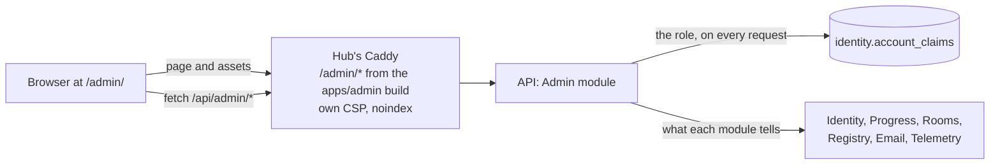
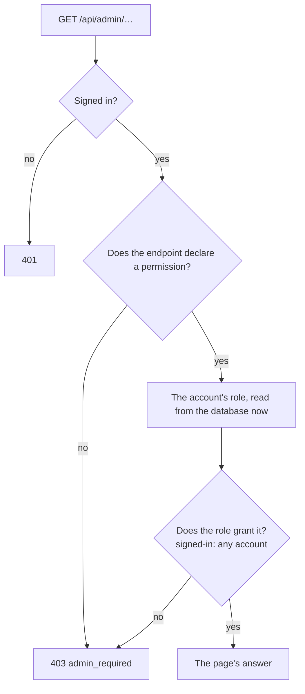

Decision: [ADR 0027](../decisions/0027-platform-admin-and-the-first-owner.md). This page describes what exists today:
the console's app, its API, roles and the read-only pages. Setup mode for the first owner, two-factor authentication,
step-up for admin actions and the audit log come next, and production waits for them.

## Where it lives



- **`apps/admin`** — React with TanStack Router and Query and the design tokens; desktop first, usable on a phone. It
  is built into the hub's image under `/srv/admin` and served at `/admin/` by the hub's Caddy: the hub's origin, so
  the hub's session cookie. Its CSP allows only its own origin — no games, no WebSocket, no inline styles — and it is
  sent with `X-Robots-Tag: noindex`. It has no service worker, and the hub's leaves `/admin/` alone.
- **`/api/admin/*`** — the Admin module (`services/api/src/Tohe.Api/Modules/Admin`), described by its own OpenAPI
  document, `/api/openapi/admin.json`. The build writes it to `services/api/openapi/tohe-api_admin.json`, and
  `pnpm --filter @tohe/admin generate:api` (which regenerates the hub's types too) turns it into
  `apps/admin/src/api/schema.gen.ts`.
- **Locally** `pnpm dev` starts the console's dev server on 4721; open it through the hub, at
  <http://localhost:4720/admin/>, as in production.

## Roles and permissions

An account holds at most one platform role — `owner`, `admin`, `moderator` or `viewer` — kept as one account claim,
`tohe:role` (`PlatformRoles`). Code checks permissions, never role names (`AdminPermissions`):

| Permission | What it opens | Held by |
| --- | --- | --- |
| `signed-in` | `GET /api/admin/me`: who is asking, and their role if any | any signed-in account |
| `admin.read` | The read-only pages: overview, games, device health, system | every role |

A permission to change something — users, sign-in settings, boards — arrives with the page that changes it, given to
the roles that should hold it.



The role is read again on every request, so taking it away works on the next one, in every session. An endpoint
added without `.RequirePermission(…)` answers 403 to everyone; `AdminTests` checks that each admin endpoint declares
one. The console asks `GET /api/admin/me` first: signed out, it sends people to the hub's sign-in; without a role,
it says how one is granted; with one, it opens.

The hub's `GET /api/auth/me` carries the account's `role` too, and Quản lý tài khoản links to the console when there
is one.

## Granting a role

Until setup mode exists, roles come from a command run inside the API's container — the same image and configuration
as the running API. Roles: `owner`, `admin`, `moderator`, `viewer`. An account from before email sign-in is named by
its username.

```sh
docker compose exec api dotnet Tohe.Api.dll admin grant bo@example.org --role owner        # compose: local, UAT
kubectl exec deploy/<release>-api -- dotnet Tohe.Api.dll admin grant bo@example.org --role owner   # the chart
dotnet Tohe.Api.dll admin revoke bo@example.org
dotnet Tohe.Api.dll admin list
```

It exits with 0 when done, 1 when no account signs in with the address, 2 for a mistyped command.

## Pages

| Page | Shows | Asks |
| --- | --- | --- |
| Tổng quan, `/admin/` | Accounts and profiles: total, last day, last week · players — profiles that saved a game or recorded a score — in the last day and week · open rooms, rooms in a hand, profiles connected · device errors in the last day · the catalog and its last sync · the email outbox | `IdentityFacts`, `ProgressFacts`, `RoomRegistry.Live()`, `TelemetryFacts`, `RegistryFacts` and the catalog worker, `EmailFacts` |
| Game, `/admin/games` | Every game in the registry, listed or not, with its players in the last week and its open rooms | `RegistryFacts`, `ProgressFacts`, `RoomRegistry` |
| Sức khoẻ thiết bị, `/admin/health?days=1\|7\|30` | The device telemetry report ([Device telemetry](telemetry.md)): devices, errors, frames and metrics per game version, plays and errors per day | `TelemetryReports` |
| Hệ thống, `/admin/system` | The build, environment and start time · migrations applied and pending · what each background worker last did · settings, never secrets | `BackgroundWork`, EF Core, options |

Modules keep their tables ([ADR 0003](../decisions/0003-backend-dotnet-modular-monolith-postgres.md)): each exposes a
small `…Facts` service, and the Admin module only puts their answers together. Infrastructure — CPU, memory, disks —
stays in the cluster's Prometheus and Grafana.

### Background work

Each worker reports its runs to `BackgroundWork`, which lives in memory — one API process runs every worker — so the
System page tells what happened since the API started. A failed run keeps its error (300 characters at most) and
counts the failures in a row until a run goes well.

| Worker | Runs |
| --- | --- |
| `catalog-sync` | when the API starts, then every `Registry:SyncInterval` |
| `email-delivery` | every `Email:PollInterval` |
| `telemetry-maintenance` | every `Telemetry:MaintenanceInterval` |

## API

| Endpoint | Permission | Answers |
| --- | --- | --- |
| `GET /api/admin/me` | `signed-in` | The account, its role (or none) and its permissions |
| `GET /api/admin/overview` | `admin.read` | The platform at a glance |
| `GET /api/admin/games` | `admin.read` | Every game in the registry |
| `GET /api/admin/health?days=7` | `admin.read` | The device telemetry report over 1 to 30 days |
| `GET /api/admin/system` | `admin.read` | The running deployment |

Refusals: 401 signed out, 403 `admin_required`. Generated reference: [Admin API](/docs/reference/admin-api/).
