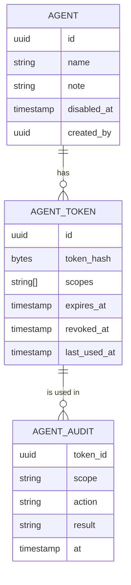
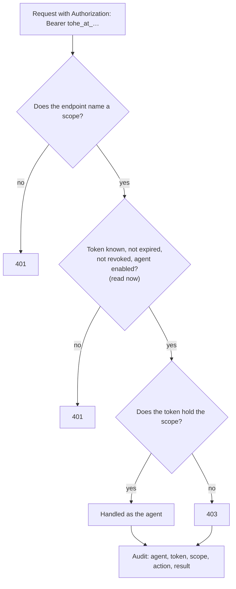

Decision: [ADR 0052](../decisions/0052-agent-tokens-and-the-scopes-no-agent-gets.md). This page describes the design;
**nothing of it runs yet** (2026-10-24).

## Model

- A token is `tohe_at_` followed by 32 random bytes in base64url. Only its SHA-256 is stored; it is shown once, when it
  is made.
- Expiry: 30 days by default, at most 90. Disabling an agent revokes all its tokens.

## A request

An agent token is never a session: it reaches only endpoints that name a scope, on the host of the app they belong to.

## Scopes

| Scope | Allows | Where |
| --- | --- | --- |
| `studio.draft` | create and change the agent's own drafts, upload draft files, run the checks without saving | `studio.` · `/api/studio/…` ([Asset Studio](asset-studio.md)) |

A new scope is a code change with its area's ADR.

## What no agent ever gets

A test fails if an endpoint in one of these areas names an agent scope, or if a scope's name falls in one of these
families:

| Never | Areas |
| --- | --- |
| Players' data | accounts, profiles, progress, scores, rooms, links |
| Signing in | sessions, sign-in methods, two-factor authentication |
| Power over people | platform roles, studio roles, agent tokens |
| Final decisions | deleting anything; approving, deprecating or withdrawing assets |
| Secrets and settings | the platform's settings, keys |

## In the console

The owner (platform role `owner`, with its second factor) creates and disables agents, makes tokens — choosing scopes
and an expiry — and revokes them, and reads each agent's audit.
