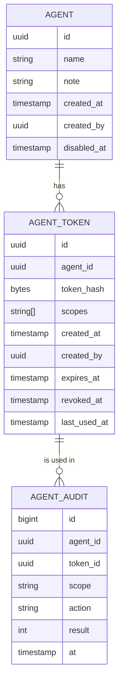
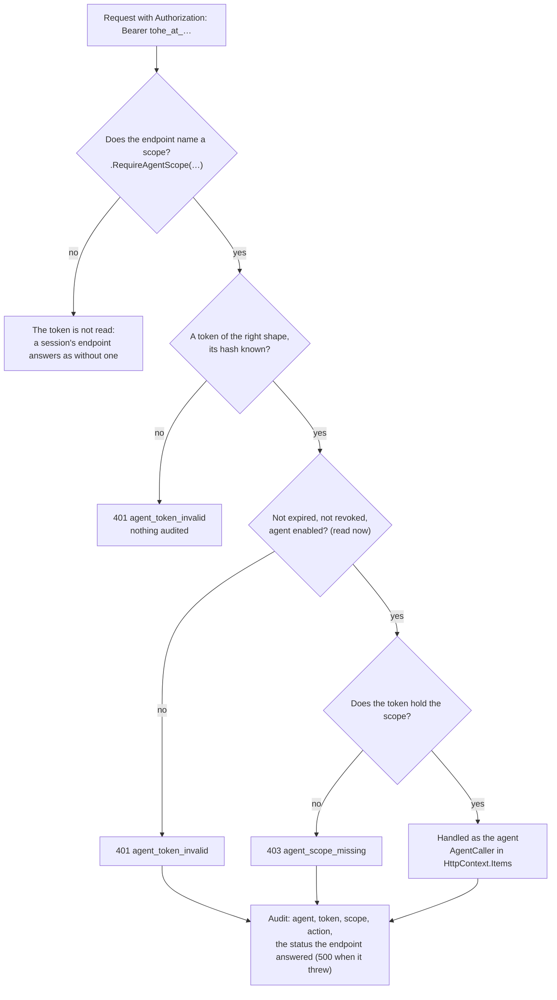

Decision: [ADR 0052](../decisions/0052-agent-tokens-and-the-scopes-no-agent-gets.md). This page describes what exists:
agents and their tokens in the `Agents` module (`services/api/src/Tohe.Api/Modules/Agents`), the scope check endpoints
opt in to, the test of the forbidden areas, and the console's page. No endpoint names a scope yet: the Studio's, which
name `studio.draft`, arrive with the [Asset Studio](asset-studio.md).

## Model

The tables live in the `agents` schema.

- **`agents.agents`**: a name, unique, 1 to 60 characters, and a note of at most 200; who made it and when; when it
  was disabled. An agent is never deleted, so its audit keeps naming it, and a disabled agent stays disabled.
- **`agents.tokens`**: a token is `tohe_at_` followed by 32 random bytes in base64url (`AgentTokens.New`). Only its
  SHA-256 is stored, under a unique index; the token is in the console's answer once, when it is made, and nowhere
  else — not in a list, not in the console's audit log. Its scopes, its expiry — 30 days by default, 1 to 90 — and when
  it was revoked. Disabling an agent revokes all its tokens, and a token of a disabled agent is refused even if it was
  not. `last_used_at` is written at most once a minute.
- **`agents.audit`**: every use of a token: the agent, the token, the scope the endpoint names, the action — the
  method and the endpoint's route pattern, e.g. `POST /api/studio/drafts/{id}` — the status code of the answer, and
  when.

## A request

- **An endpoint opts in** with `.RequireAgentScope(AgentScopes.X)`: metadata (`AgentScopeRequired`) and an endpoint
  filter (`AgentAccess`). Only a scope of `AgentScopes` is accepted; any other throws when the API starts.
- **Read on every request**: the token, its agent and its expiry come from the database each time, so a revocation, a
  disabled agent or an expiry holds at the next request.
- **The audit** is written in a unit of work of its own, so it never saves what the endpoint left unsaved, and is
  written for refusals too — a 401 when the token row exists, a 403 — but not for a token nobody knows.
- **Agent or person**: the check is also a service, `AgentTokens.AuthenticateAsync(http, scope)`, which answers the
  agent or the refusal — and audits refusals — so an endpoint can accept either an agent's token or a person's session;
  it then writes its own use with `AgentTokens.RecordAsync`.
- **Never a session.** A token is sent as a header, never a cookie, so no cross-site request forgery; the endpoints
  behind a player's or an operator's session do not read it, and an endpoint that names a scope does not read a
  session. It reaches only endpoints that name a scope, on the host of the app they belong to.

## Scopes

`AgentScopes` (`Modules/Agents/AgentScopes.cs`) is the closed list; a scope's name is `area.verb` in lower-case letters.

| Scope | Allows | Where |
| --- | --- | --- |
| `studio.draft` | create and change the agent's own drafts, upload draft files, run the checks without saving | `studio.` · `/api/studio/…` ([Asset Studio](asset-studio.md)) |

A new scope is a code change with its area's ADR.

## What no agent ever gets

| Never | Areas |
| --- | --- |
| Players' data | accounts, profiles, progress, scores, rooms, links |
| Signing in | sessions, sign-in methods, two-factor authentication |
| Power over people | platform roles, studio roles, agent tokens |
| Final decisions | deleting anything; approving, deprecating or withdrawing assets |
| Secrets and settings | the platform's settings, keys |

The API's tests (`AgentTokensTests`, in `pnpm verify`) fail when:

- an endpoint that names a scope is under one of the forbidden route prefixes: `/api/admin` (the console — roles,
  users, settings, agents), `/api/agents`, `/api/auth`, `/api/session`, `/api/account`, `/api/profiles`,
  `/api/devices`, `/api/progress`, `/api/boards`, `/api/runs`, `/api/rooms`, `/api/links`, `/api/previews`. Each but
  `/api/agents` must still match endpoints of the API, so a module that moves its routes moves the list too;
- a scope's name falls in a forbidden family (`AgentScopes.IsAllowedName`): its area is one of `players`, `accounts`,
  `profiles`, `progress`, `scores`, `rooms`, `links`, `identity`, `auth`, `sessions`, `roles`, `agents`, `admin`,
  `secrets` or `settings`; or a segment is `delete`, `approve`, `deprecate` or `withdraw`.

## In the console

**Agent**, `/agents` ([Admin console](admin.md#pages)): owners and admins see the agents, their tokens — scopes,
made, expiry, revoked, last used, never the token — and each agent's audit, newest first. The owner — with step-up level
2 — creates and disables agents, makes tokens, choosing scopes and days, and revokes them. A new token shows once, with
a button to copy it and a warning that it will not show again. Each change is in the console's audit log:
`agent.create`, `agent.disable` (with how many tokens it revoked), `agent.token.create` (the token's id, scopes and
expiry), `agent.token.revoke`.

| Endpoint | Permission | Answers |
| --- | --- | --- |
| `GET /api/admin/agents` | `admin.agents.read` | Every agent and its tokens, never a token itself |
| `GET /api/admin/agents/scopes` | `admin.agents.read` | The scopes, with what each allows |
| `POST /api/admin/agents` | `admin.agents.write`, step-up | A new agent: name, note |
| `POST /api/admin/agents/{id}/disable` | `admin.agents.write`, step-up | Disable it, revoking its tokens; again, nothing changes |
| `POST /api/admin/agents/{id}/tokens` | `admin.agents.write`, step-up | A new token — scopes, days — in this answer once |
| `POST /api/admin/agents/{id}/tokens/{tokenId}/revoke` | `admin.agents.write`, step-up | Revoke it; again, nothing changes |
| `GET /api/admin/agents/{id}/audit?before=&limit=50` | `admin.agents.read` | A page of the agent's audit, newest first |

Refusals: 400 with field codes `name_required`, `name_too_long`, `note_too_long`, `scopes_required`, `scope_unknown`,
`days_invalid`; 409 `agent_exists`, `agent_disabled`; and the console's own (`admin_required`, `step_up_required`).
