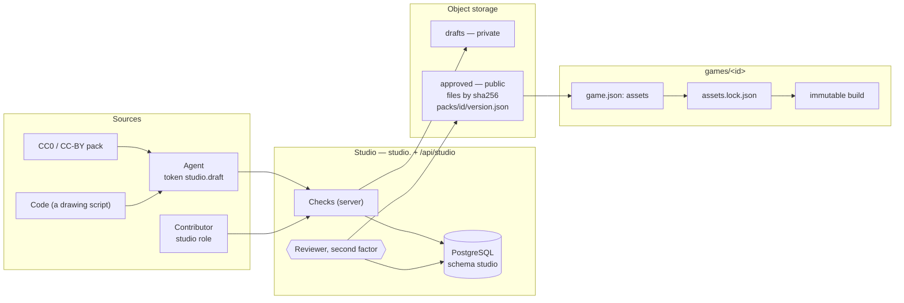
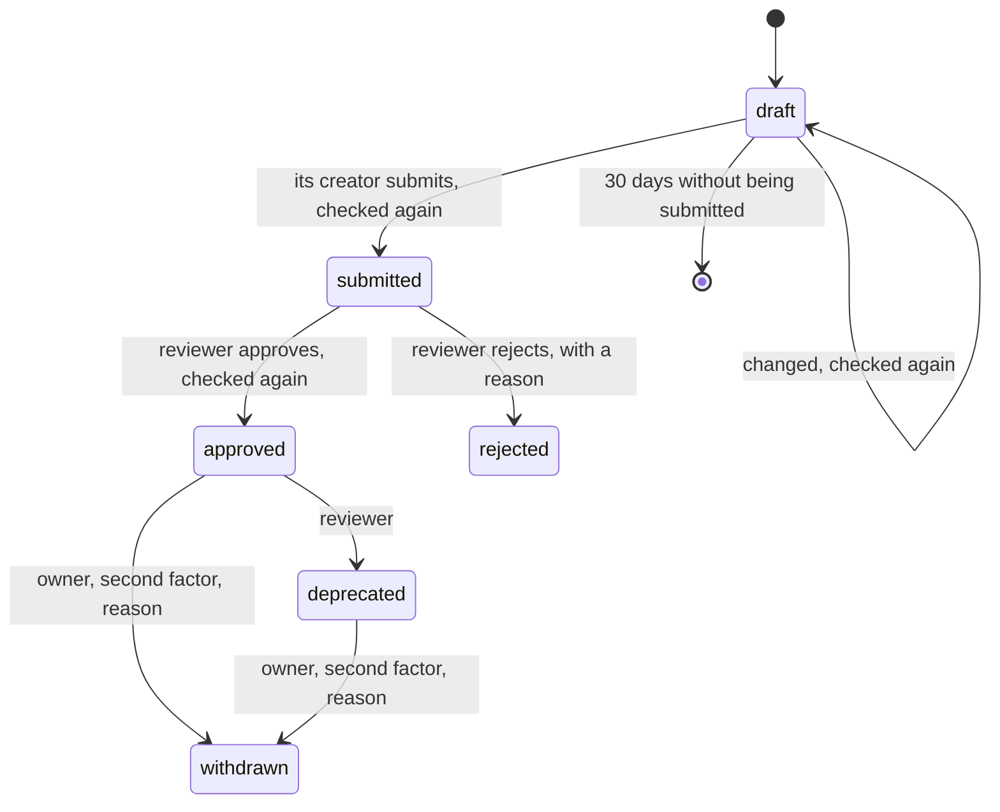
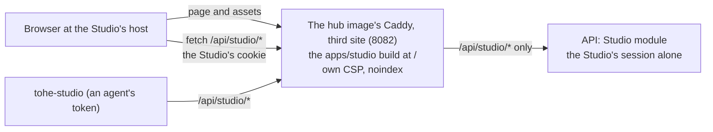
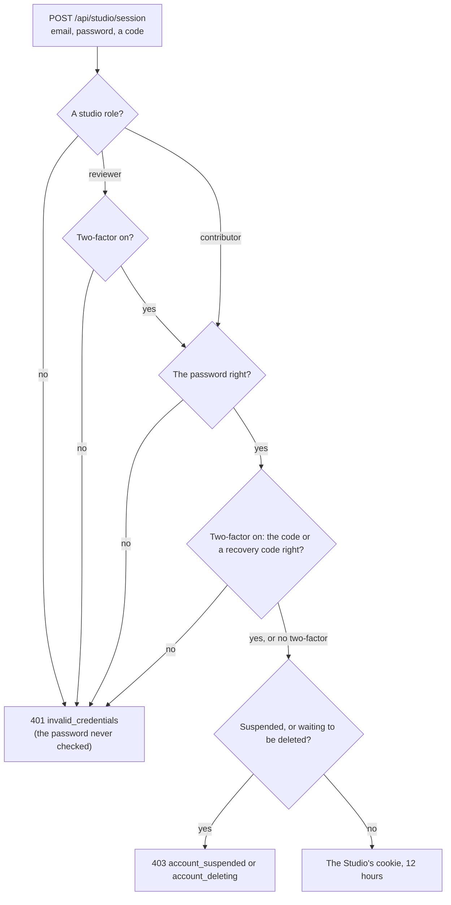

Decisions: [ADR 0050](../decisions/0050-a-game-declares-what-it-depends-on.md),
[ADR 0051](../decisions/0051-an-asset-studio-for-game-assets.md),
[ADR 0052](../decisions/0052-agent-tokens-and-the-scopes-no-agent-gets.md). This page describes the design; it arrives in
steps, and each part says when it exists. **What runs** (2026-10-24): the Studio's members, its session and its
permissions in the API, and giving and taking studio roles in the console ([Members and the Studio's
session](#members-and-the-studios-session)); styles, packs, drafts, review and the library in object storage in the API
([The library in the API](#the-library-in-the-api)); the server's checks and approving styles ([Checks](#checks)); the
Studio app on a host of its own, with its sign-in, the library to read, and reviewing packs and styles
([The Studio app](#the-studio-app), [Reviewing in the app](#reviewing-in-the-app)).

## The picture

## Packs

A **pack** is a set of assets in one style for one purpose, released together under semver: `farm-crops@1.2.0`.

| Change | Version |
| --- | --- |
| Pixels change; sizes, frames and names do not | patch |
| An asset is added | minor |
| An asset is removed, renamed or resized; frames change | major |

Each asset in a pack has:

| Field | Holds |
| --- | --- |
| `id` | unique in the pack, `a-z`, digits, `-`, `/` for folders (`crops/carrot`) |
| `kind` | `image` · `spritesheet` (frame size, frames, animations) · `tileset` (tile size, optional Wang edges — autotile rules later) · `audio` · `font` · `palette` |
| `file` | its sha256, bytes, format, width and height |
| `source` | a JSON object with its `type`: `pack` (`name`, `url`, `author`) · `upload` (`by`) · `ai` (`vendor`, `model`, `prompt`, `seed`, `date`) · `code` (`script`) |
| `licence` | an SPDX identifier from the [allowed list](#licences), and the attribution when it needs one |
| `tags` | words to find it by |

A pack has a `style`, a description, and a **status** per version:

An approved version never changes. `deprecated` keeps it working for games that pinned it and warns a game that pins it
anew. `withdrawn` deletes its files; a game pinned to it fails to build, naming why.

## Styles

A **style** is an art bible kept in the Studio: palette (optional — a painted style has none), tile size, view
(top-down, side, isometric), outline, and sample pictures. A pack names one. Tò He's own style is the default for a game
with no idea of its own; a game may choose or make another, and its `SPEC.md` says which and why.

A style is a draft its creator changes until a reviewer **approves** it — then it never changes — or **rejects** it with a
reason; a rejected style is changed again by its creator and is a draft again. A pack may be drafted and submitted on a
style in any status, but a version is approved only once its style is ([Checks](#checks)).

## Licences

| Licence | Accepted |
| --- | --- |
| `CC0-1.0`, `CC-BY-4.0`, `OFL-1.1`, `MIT`, `BSD-2-Clause`, `BSD-3-Clause`, `Apache-2.0` | yes |
| `CC-BY-SA-4.0` | the owner decides each case, when the pack is reviewed; a game's conformance accepts it once approved |
| `LicenseRef-Tohe-Internal` | for what is made for Tò He, until the repository has a licence |
| NC, ND, "free for personal use", unknown | never |

An `ai` source also needs a vendor on the Studio's list of vendors whose terms were checked (`studio.vendors`, with
`terms_checked_at` set; empty until the owner checks one, so an `ai` source fails the checks until then). Credits for a
game are generated from its lock.

The list is `ACCEPTED_ASSET_LICENCES` of `@tohe/contract`; the API keeps a copy (`StudioLicences`), and a test fails when
the two differ. `CC0-1.0` and `LicenseRef-Tohe-Internal` need no attribution; every other accepted licence does.
`CC-BY-SA-4.0` passes on submitting and is accepted on approving only when the reviewer allows it for that version, with a
reason, recorded on the version.

## Storage

| What | Where |
| --- | --- |
| Styles, packs, versions, assets, reviews, the audit log | PostgreSQL, schema `studio`, module `Studio` of the API |
| Draft files | object storage, `drafts/<versionId>/<sha256>.<ext>`, private |
| A style's sample pictures | object storage, `styles/<styleId>/<sha256>.<ext>`, private |
| Approved files | object storage, `blobs/sha256/<sha256>.<ext>`, public to read |
| A version's manifest | object storage, `packs/<id>/<version>.json`, public to read, written on approval, never changed |

`blobs/` and `packs/` are the registry layout the build tool reads
([Use assets in a game](../guides/use-assets-in-a-game.md#2-point-at-the-registry)); whatever serves the bucket to the
public serves those two prefixes and nothing else of it.

One library serves every environment: builds carry their files and are promoted by tag
([ADR 0041](../decisions/0041-promote-one-build-through-the-environments-by-tag.md)). Production's storage is Cloudflare
R2; the dev stack and the API's tests run SeaweedFS (Apache-2.0, S3-compatible) — MinIO's community edition stopped
shipping images in 2025.

## Building a game with assets

1. The game declares packs in `game.json` ([Game Contract, Assets](../contracts/game-contract-v1.md#assets),
   [ADR 0053](../decisions/0053-assets-in-the-game-contract.md)).
2. `pnpm assets:resolve` reads each version's manifest, writes `assets.lock.json` (every file's sha256, bytes, licence
   and attribution) and `src/assets.gen.ts` (typed keys). Both are generated files.
3. The build reads only the lock — never resolves anew — fetches files by hash through a cache shared by every worktree
   on the machine (and CI's cache), checks each hash, and copies the files the game uses as they are to
   `dist/studio/<sha256>.<ext>`, with `dist/studio/lock.json` (a copy of the lock) and `dist/studio/credits.json`.
   `--offline` fails naming what is missing. Packing files into atlases is a later optimisation (ADR 0053).
4. Conformance checks the lock against `assets`, every file in `studio/` against the lock by hash, and the licences
   and credits.

## The Studio app

`apps/studio` on `studio.toheplay.io.vn` (decided in [ADR 0051](../decisions/0051-an-asset-studio-for-game-assets.md);
serving once its DNS, ingress and storage exist) — `http://localhost:4722` locally, `http://10.100.0.2:4822` on UAT. A
third site of the hub image's Caddy serves it, with its own CSP, and passes on `/api/studio/*` and nothing else of the
API — the same shape as the console ([Admin console](admin.md#where-it-lives)).

| Who | Signs in with | May |
| --- | --- | --- |
| Agent | a token with `studio.draft` ([Agent tokens](agent-tokens.md)) | create and change its drafts, upload draft files, check without saving |
| `contributor` | a Tò He account with that studio role | the same, in the app |
| `reviewer` | a Tò He account with that studio role and two-factor authentication | approve, reject, deprecate; approve and reject styles |
| owner | as a reviewer | also withdraw |
| CI, builds | nothing | read approved files and manifests |

Studio roles are an account claim of their own, given and taken in the console; they are not platform roles.

*Runs:* signing in, reading the library, and reviewing pack versions and styles
([Reviewing in the app](#reviewing-in-the-app)).

- **The app** — React with TanStack Router and Query and the design tokens, light and dark, in Vietnamese; a copy of the
  console's structure. Built into the hub's image under `/srv/studio` and served at the root of the Studio's host by the
  third site of the hub's Caddy, on port 8082 (`deploy/docker/Caddyfile.hub`). That site serves the Studio's namespaces
  of the map in `@tohe/routes` (`studioNamespaces`, generated into `studio-routes.caddy`), proxies `/api/studio/…` and
  nothing else of the API, and answers any other path with a `404`. Its CSP allows only its own origin — no inline
  script or style, no frame, no WebSocket — and pictures from its own origin, `blob:`, `data:` and the library's public
  storage (`STUDIO_STORAGE_ORIGIN`, [Configuration](../guides/configuration.md#hub)); every answer carries
  `X-Robots-Tag: noindex, nofollow` and HSTS like the hub's. It has no service worker and no `robots.txt`.
- **Its pages:**

  | Path | Page |
  | --- | --- |
  | `/` | The library: every pack, its style, its versions and their status; for a reviewer, first, what waits for review |
  | `/packs/<packId>` | A pack: its description, style and versions |
  | `/packs/<packId>/<versionId>` | A version: its status and review, and each asset — its picture, kind, size, file, licence and attribution, source and tags; for a reviewer, the gallery, the checklist and the review's actions |
  | `/styles`, `/styles/<styleId>` | The styles, and one: its status, tile size, view, palette, outline and sample pictures; for a reviewer, approving or rejecting a draft |
  | `/sign-in` | The Studio's sign-in: email, password, and a code or a recovery code; `?redirect=` the page to go back to |

  Every page but `/sign-in` sits behind the Studio's session: without one, the app sends the browser to
  `/sign-in?redirect=<the page>`, and back there once signed in. Signing out ends the Studio's session only. Pictures
  come from the API's file endpoints (`/api/studio/versions/{versionId}/files/{sha256}`,
  `/api/studio/styles/{id}/samples/{sha256}`) with the Studio's cookie, drawn pixel for pixel.
- **Its links to the hub** are absolute, to the hub's public URL the API tells it (`GET /api/studio/config`,
  `App:PublicUrl`): "Quên mật khẩu?" leads to the hub's page for it.
- **Its types** come from the Studio's OpenAPI document, `services/api/openapi/tohe-api_studio.json`, turned into
  `apps/studio/src/api/schema.gen.ts` by `pnpm --filter @tohe/codegen api-types` (with the hub's and the console's).
- **The API keeps the host** (`App:StudioUrl`, [Configuration](../guides/configuration.md#api)): set, the Studio's routes
  answer on the Studio's host alone — the hub's and the console's hosts answer them `404` — and nothing else of the API
  answers there; a browser's state-changing request to them must come from the Studio's origin, and the Studio's origin
  reaches nothing else; the Studio's cookie is `__Host-tohe.studio` when the address is HTTPS. **Unset** — production,
  until the Studio's DNS, ingress and bucket exist — the Studio's routes answer on any host but the console's, as before
  the app, and the log says so once: an agent's CLI reaches them through the hub's address meanwhile.
- **Locally** `pnpm dev` starts the Studio's dev server on <http://localhost:4722>, at the root, proxying the API's
  Studio routes to the API; `docker compose up` publishes the hub container's port 8082 there
  ([Local development](../guides/local-development.md)).

### Reviewing in the app

*Runs.* A session with `studio.review` reviews in the app; one without it sees none of what follows. The app only hides
what a session may not do: the API decides every action ([The library in the API](#the-library-in-the-api)).

- **What waits** — the library (`/`) starts, for a reviewer, with **Chờ duyệt**: every version `submitted`, oldest
  submission first, and every style still `draft`, the one changed longest ago first, each linking to its page.
- **A version's page** gains, for a reviewer:
  - **the gallery** — every picture at 1× and at 2×, drawn pixel for pixel (`image-rendering: pixelated`), each on a light
    and on a dark backdrop (the design tokens' light and dark page, whatever the app's own theme); a sprite sheet also
    shows its frames one by one, and a tileset its grid (its `frames`, or else the style's tile). Beside it, the style's
    sample pictures and palette, to compare with.
  - each asset's metadata, its licence and attribution, and its source, its `url` a link;
  - **the checklist** — suitable for children (no gore, nothing frightening, no text, logos or real people's likeness);
    not a near copy of a known character or game; in the style; readable at its real size; a plausible source. Approve
    stays disabled until every line is ticked. The ticks are the reviewer's own check: they are not stored, and they
    start empty on every visit.
  - **the actions**, by the version's status: `submitted` — approve or reject; `approved` — deprecate. Each asks for
    step-up first, as the console does: while it is not open the app asks for a fresh code from the authenticator
    (`POST /api/studio/session/step-up`), then shows the actions for its ten minutes. Rejecting needs a reason;
    deprecating takes one if given. A version with a `CC-BY-SA-4.0` asset is approved only with the switch "allow
    share-alike" on and a reason, sent as `allowShareAlike` and `shareAlikeReason`.
  - **Withdraw**, for an `approved` or `deprecated` version: a section of its own, marked in the danger colour, apart from
    the others. It asks for a reason, a fresh code (in the request, not step-up) and a ticked confirmation that names what
    breaks: every game pinned to the version fails to build until it pins another. The Studio's session does not say
    whether the account is the platform's owner, so the app shows Withdraw to every reviewer and the API refuses anyone
    else (`403 owner_required`), which the app says in words.
  - **A refused approval** shows the server's report: each problem's code, its asset (or the whole version) and its
    message, as the API gave them ([Checks](#checks)). Any other refusal is said in Vietnamese.
- **A style's page** gains, for a reviewer and a style in `draft`: approve, or reject with a reason, behind the same
  step-up, beside its palette and samples. Approve stays disabled while a sample is not uploaded.
- While a request runs its buttons are disabled; once it answers, the page shows the version or the style as the API
  returned it. A `403 step_up_required` — step-up ran out meanwhile — asks for the code again.

## Members and the Studio's session

*Runs.* The `Studio` module of the API (`services/api/src/Tohe.Api/Modules/Studio`) holds who may use the Studio and
signs them in, with a session of the Studio's own, a copy of the console's
([Admin console](admin.md#the-consoles-session)).

### Studio roles

`studio.members` holds one row per account with a studio role:

| Column | Holds |
| --- | --- |
| `account_id` | the account (the key); the row goes when the account is deleted for good |
| `role` | `contributor` or `reviewer` |
| `granted_by`, `granted_at` | who gave it in the console, and when |

[ADR 0051](../decisions/0051-an-asset-studio-for-game-assets.md) calls a studio role an account claim of its own. It is
kept in the Studio's schema rather than among Identity's account claims, because each module keeps its own tables
([ADR 0003](../decisions/0003-backend-dotnet-modular-monolith-postgres.md)); it is still a fact about an account, given
and taken in the console. It is not a platform role: it opens nothing in the console, and a platform role opens nothing
in the Studio — the owner who reviews holds `reviewer` as well.

Code checks permissions, never role names (`StudioPermissions`):

| Permission | What it opens | Held by |
| --- | --- | --- |
| `studio.read` | Reading styles, packs and drafts | `contributor`, `reviewer` |
| `studio.contribute` | Making and changing drafts, uploading draft files, running the checks | `contributor`, `reviewer` |
| `studio.review` | Approving, rejecting and deprecating a pack version, behind step-up; the step-up itself | `reviewer` |

An endpoint under `/api/studio` declares the permission it needs (`.RequireStudioPermission(…)`) and, for a review
action, step-up (`.RequireStudioStepUp()`); one that declares none answers `403 studio_required` to everyone.

### Signing in

- **Its own sign-in**, `POST /api/studio/session`: the email, the password and a code from the authenticator — or a
  recovery code, once. The account must hold a studio role; a `reviewer` must have two-factor authentication on and give
  a code; a `contributor` gives a code when it has two-factor on, and the password alone otherwise. Everything else —
  a wrong password, a wrong or missing code, no studio role, a reviewer without an authenticator, no such account —
  answers `401 invalid_credentials`, so the Studio tells nobody who holds a role. As in the console, the password of an
  account that may not sign in here is never checked (its lockout stays untouched), and the checks of the players'
  sign-in apply: Identity's lockout (`429 locked_out`), the `auth` rate-limit bucket, and suspension and a pending
  deletion, told (`403 account_suspended`, `account_deleting`) only to whoever brought the right password and code. The
  switch of the players' password sign-in ([ADR 0028](../decisions/0028-sign-in-and-registration-at-run-time.md)) does
  not apply: the Studio signs in with the password.
- **Its own cookie.** `__Host-tohe.studio` on an HTTPS deployment, `tohe.studio` over plain HTTP (development, UAT) —
  `HttpOnly`, `SameSite=Strict`, `Path=/`, no `Domain`. Whether it is HTTPS is read from the Studio's address
  (`App:StudioUrl`), or from the hub's (`App:PublicUrl`) while that is unset. It lasts **12 hours
  from the sign-in**, never longer: no sliding, and re-issuing it after step-up keeps its end (the `tohe:studio_until`
  claim). Its authentication scheme (`Tohe.Studio`) is its own, and so is the data-protection purpose that seals it.
  `DELETE /api/studio/session` ends the Studio's session only.
- **Apart, both ways, by scheme.** The Studio's routes authenticate with the Studio's scheme alone: a player's or the
  console's cookie there is a `401`, and the Studio's cookie authenticates nothing outside them. The console's host
  answers `404` to `/api/studio/…`, as to every route but the console's. A session refused on a Studio route — an
  account suspended or waiting to be deleted — ends the Studio's session, never the player's.
- **Read again on every request** (`StudioAccess`): the security stamp — a new password, a suspension, "sign out
  everywhere" or two-factor authentication turned off end the session — the studio role, and for a reviewer two-factor
  authentication, all from the database. Taking the role away in the console ends the session at the next request.
- **Step-up** for review actions: `POST /api/studio/session/step-up` with a fresh code from the authenticator — never
  the password — opens 10 minutes inside the Studio's session (`tohe:secure_until` in its cookie); a review action asks
  for it with `403 step_up_required`. The hub's and the console's step-up open nothing here.
- **Where it answers.** With `App:StudioUrl` set, on the Studio's host alone, as the console's routes do on the
  console's; `studio.`'s Caddy site passes on `/api/studio/*` and nothing else. Unset, on any host but the console's
  ([The Studio app](#the-studio-app)).

### In the console

The owner gives and takes studio roles on the console's **Studio** page (`/studio`), behind step-up level 2, with the
permission `admin.studio.write`; owners, admins and moderators see who holds one (`admin.users.read`). Each change is in
the console's audit log: `studio.member.grant` (the role, and the one before) and `studio.member.revoke`
([Admin console](admin.md#the-audit-log)).

### API

| Endpoint | Permission | Answers |
| --- | --- | --- |
| `GET /api/studio/config` | — | What the app needs before anyone signs in: the hub's public URL (`hubUrl`, for "Quên mật khẩu?") and the API's version |
| `GET /api/studio/session` | — | The account signed in to the Studio, its role, its permissions, until when the session lasts and step-up is open; `204` when nobody is |
| `POST /api/studio/session` · `DELETE /api/studio/session` | — | The Studio's sign-in: email, password, and a code or a recovery code when two-factor is on — its cookie for 12 hours · sign out of the Studio only |
| `POST /api/studio/session/step-up` | `studio.review` | A code from the authenticator: step-up for 10 minutes in this Studio session |
| `GET /api/admin/studio/members` | `admin.users.read` | Every account with a studio role, reviewers first |
| `POST /api/admin/studio/members` | `admin.studio.write`, step-up | Give a studio role — or change it — to an account named by its email or its id |
| `DELETE /api/admin/studio/members/{accountId}` | `admin.studio.write`, step-up | Take it away: the account's Studio session ends at its next request |

The Studio's routes are described by an OpenAPI document of their own, `studio` (`services/api/openapi/tohe-api_studio.json`).
Refusals: `401` without a Studio session, or `invalid_credentials` from the sign-in; `403 studio_required`,
`step_up_required`, `account_suspended`, `account_deleting`; `429 locked_out`; `400` with the field codes `code_invalid`,
`code_used`, `locked_out`, `account_required`, `role_invalid`; `404 account_not_found`, `studio_member_not_found`.

## The library in the API

*Runs.* The `Studio` module keeps styles and packs, takes drafts from agents and contributors, and lets a reviewer
approve, reject and deprecate a pack version — and the owner withdraw one. Approving publishes the version's files by
hash and its manifest to object storage, where builds read them ([Use assets in a game](../guides/use-assets-in-a-game.md)).
The server's [checks](#checks) run on every upload, on submitting, again on approving, and on a dry run.

### Tables

In the schema `studio`:

| Table | Holds |
| --- | --- |
| `styles` | `id` (a slug, as a pack's id), `name`, `status` (`draft`, `approved`, `rejected`), `tile_size` (optional), `view` (`top-down`, `side`, `isometric`, `other`), `palette` (hex colours; none for a painted style), `outline` (a note), who made it — an agent or an account — and when; `reviewed_by`, `reviewed_at` and `reason` of its last review |
| `style_samples` | a style's sample pictures: `sha256`, `ext`, `bytes`, when uploaded |
| `packs` | `id` (the pack's id), `style_id`, `description`, who made it and when |
| `pack_versions` | `pack_id`, `version` (semver), `status`, who made it (`created_by_agent` or `created_by_account`), `submitted_at`; `reviewed_by`, `reviewed_at` and `reason` of the approval or rejection; `deprecated_by`/`_at`, `withdrawn_by`/`_at` and `withdraw_reason`; `manifest_sha256` once approved; `share_alike_allowed` and `share_alike_reason`, when the reviewer allowed `CC-BY-SA-4.0` in it |
| `assets` | per version and asset id: `kind`, `sha256`, `ext`, `bytes`, `width`, `height`, `frames` (`{width, height, count}`), `wang` (a tileset's Wang edges, below), `tags`, `licence` (SPDX), `attribution`, `source` (JSON) and when its file was uploaded |
| `vendors` | the AI vendors an `ai` source may name: `id` (what the source's `vendor` holds), `name`, `terms_url`, `terms_checked_at` (null until the owner checked its terms), `note`. Empty for now; no page changes it yet |
| `audit` | every action (below), with who: an agent or an account |

**A tileset's Wang edges** (`wang`, optional, a `tileset` only): `{"tiles": [["n", "e", "s", "w"], …]}` — per tile, in the
order of its grid (left to right, then top to bottom), a label for its north, east, south and west edge (`a-z`, digits,
`-`, up to 32 characters). The tiles are the size of the asset's `frames`, or else the style's tile. Edges with the same
label meet, so they must hold the same outermost pixels ([Checks](#checks)). The manifest does not carry them.

**A draft belongs to who made it** — an agent (any of its tokens) or an account — and only they change it, upload its
files or submit it. A pack is shared: anyone who may draft starts a version of any pack; the pack's style is fixed by
its first draft. Two versions of a pack may be drafted with the same number; only one is ever published. A pack names a
style in any status; its versions are approved only once the style is.

### A version's life

| Step | Who | What happens |
| --- | --- | --- |
| Draft | its creator | `POST /drafts` names the pack (and, for a new pack, its style and description), the version and every asset's metadata; `PUT /drafts/{versionId}` replaces them. A file is uploaded once its asset names it: `PUT /drafts/{versionId}/files/{sha256}`, the body the file itself — the server checks its sha256, its size against the asset's `bytes`, the limit per file and the creator's quota, then runs the file's checks and strips its metadata. The answer is the file as kept: its `sha256` and `bytes` — new when metadata was stripped (`stripped: true`), and every asset that named the file names the new ones — and its `width` and `height`, read from the file, which the assets take. The old sha256 is no longer the draft's: a later `PUT /drafts/{versionId}` sends the new one |
| Check | its creator | `POST /drafts/{versionId}/check`: every check of a submission on the draft as it stands, the files uploaded so far — a dry run that saves nothing. The answer is the report, `{ ok, problems }` |
| Submit | its creator | Every asset's file uploaded, at least one asset, the version greater than every version of the pack ever approved (semver precedence; the patch, minor and major rule is one of the checks), the checks pass: `submitted`, and nobody changes it again |
| Approve | a reviewer, step-up | `submitted` only; the version still greater than every one approved meanwhile; the checks again — the style approved now, and `CC-BY-SA-4.0` only with `allowShareAlike: true` and a `shareAlikeReason` in the request. Every file is copied from `drafts/` to `blobs/sha256/<sha256>.<ext>` (a blob already there stays as it is), the manifest is written to `packs/<id>/<version>.json`, and the version is `approved` with who and when. The draft copies are deleted |
| Reject | a reviewer, step-up | `submitted` only, with a reason (at most 1000 characters): `rejected`; its draft files are deleted, its metadata kept. A fix is a new draft |
| Deprecate | a reviewer, step-up | `approved` only, an optional reason: `deprecated`. Its files and manifest stay |
| Withdraw | a reviewer who holds the platform role `owner` | `approved` or `deprecated`, a reason, and a fresh code from the authenticator in the request: the manifest and every blob of the version no other approved or deprecated version uses are deleted, and it is `withdrawn` |
| Expire | the API, once a day | a version still `draft` 30 days after it was made: its files and its rows are deleted, and its pack too when it has no version left |

**The manifest** is the build tool's format exactly — `manifestVersion: 1`, `id`, `version`, `files[]` with `id`,
`kind`, `sha256`, `ext`, `bytes`, `licence` and, when they are set, `attribution`, `width`, `height` and `frames`
([The manifest](../guides/use-assets-in-a-game.md#the-manifest)) — with its files sorted by id and every object's keys in
ordinal order, indented by two spaces, UTF-8, so the same version always makes the same bytes. Its sha256 is the
version's `manifest_sha256`. It is written once and never overwritten: when one is already there, approving goes on only
if it holds exactly the same bytes (a retry after a failure), and otherwise answers `409 manifest_exists`.

**Drafts' limits** (configuration, [below](#configuration)): at most `Studio:MaxFileBytes` per file, and at most
`Studio:DraftQuotaBytes` of uploaded files across the versions a creator has in `draft` or `submitted`.

**The audit** — `studio.audit` — records `style.create`, `style.update`, `style.sample.upload`, `style.approve`,
`style.reject`, `draft.create`,
`draft.update`, `draft.file.upload`, `version.submit`, `version.approve`, `version.reject`, `version.deprecate`,
`version.withdraw` and `draft.expire`, with the agent or the account, the target (`farm-crops@1.0.0`, a style's id) and
the details, in the same transaction as the change. An agent's every call is also in the agents' own audit
([Agent tokens](agent-tokens.md)).

### Who calls

- **Reading** — styles, packs, versions with their assets and status, and their files — takes a Studio session with
  `studio.read`, or an agent token with `studio.draft`.
- **Drafting** — styles, versions, uploads, submitting — takes a Studio session with `studio.contribute`, or an agent
  token with `studio.draft`. A request with an `Authorization` header is an agent's: the token is checked
  (`AgentTokens.AuthenticateAsync`) and the session, if any, is not read; without one it is a person's.
- **Reviewing** takes a Studio session with `studio.review` and step-up; withdrawing takes `studio.review`, the platform
  role `owner` (read through Identity's `PlatformRoles`, as the console reads it) and a code in the request instead of
  step-up. No agent token reaches either.
- **Without storage** (no `Studio:Storage:*`), every endpoint below answers `503 studio_storage_not_configured` once the
  caller is known, and the rest of the API runs: production runs before its bucket exists.

### Endpoints

| Endpoint | Who | Answers |
| --- | --- | --- |
| `GET /api/studio/styles` · `GET /api/studio/styles/{id}` | read | The styles, newest first · one, with its samples |
| `GET /api/studio/styles/{id}/samples/{sha256}` | read | A sample picture |
| `POST /api/studio/styles` · `PUT /api/studio/styles/{id}` | draft | Make a style draft — id, name, tile size, view, palette, outline, samples' metadata · change it (its creator, while `draft`) |
| `PUT /api/studio/styles/{id}/samples/{sha256}` | draft | Upload a sample its metadata names |
| `POST /api/studio/styles/{id}/approve` · `…/reject` | `studio.review`, step-up | Approve a style draft whose samples are all uploaded · reject it, with a reason (at most 1000 characters) |
| `GET /api/studio/packs` · `GET /api/studio/packs/{id}` | read | The packs with their versions' status · one |
| `GET /api/studio/versions/{versionId}` | read | A version, its assets, status, review and manifest |
| `GET /api/studio/versions/{versionId}/files/{sha256}` | read | One of its files: from `drafts/` until approved, from `blobs/` after |
| `POST /api/studio/drafts` · `PUT /api/studio/drafts/{versionId}` | draft | Make a draft version, creating its pack when new · change it |
| `PUT /api/studio/drafts/{versionId}/files/{sha256}` | draft | Upload a file of the draft: the file as kept — `sha256`, `bytes`, `width`, `height`, `stripped` |
| `POST /api/studio/drafts/{versionId}/check` | draft | The checks' report, nothing saved |
| `POST /api/studio/drafts/{versionId}/submit` | draft | Submit it for review |
| `POST /api/studio/versions/{versionId}/approve` · `…/reject` · `…/deprecate` | `studio.review`, step-up | Approve and publish (optionally `allowShareAlike` and `shareAlikeReason`) · reject, with a reason · deprecate |
| `POST /api/studio/versions/{versionId}/withdraw` | `studio.review`, owner | Withdraw: a reason and a code |

They are in the Studio's OpenAPI document, `studio`. Refusals: `401` (no session, or `agent_token_invalid`);
`403 studio_required`, `step_up_required`, `agent_scope_missing`, `not_yours` (a draft or style someone else made),
`owner_required`; `404 style_not_found`, `pack_not_found`, `version_not_found`, `file_not_found`, `file_not_in_draft`;
`409 style_exists`, `pack_exists` (made by someone else that moment: send again), `not_a_draft`, `style_mismatch`,
`files_missing` (with the `assets`, or a style's `samples`), `version_not_greater`, `version_not_submitted`,
`version_not_approved`, `version_changed`, `style_changed`, `manifest_exists`, `drafts_quota_exceeded`;
`413 file_too_large` (with `maxBytes`); `422 checks_failed` (with the report's `ok` and `problems`,
[Checks](#checks)); `503 studio_storage_not_configured`; `400` with field codes for the metadata
(`id_invalid`, `version_invalid`, `asset_id_invalid`, `asset_id_repeated`, `kind_invalid`, `sha256_invalid`,
`ext_invalid`, `bytes_invalid`, `file_conflict`, `licence_invalid`, `attribution_invalid`, `size_invalid`,
`frames_invalid`, `wang_invalid`, `tags_invalid`, `source_invalid`, `assets_required`, `too_many_assets`, `name_required`,
`view_invalid`, `palette_invalid`, `outline_too_long`, `too_many_samples`, `style_required`, `description_too_long`,
`reason_required`, `reason_too_long`, `sha256_mismatch`, `bytes_mismatch`) and for a code (`code_invalid`, `code_used`,
`locked_out`).

### Object storage

Object storage through the S3 API (the AWS SDK for .NET, path-style, so Cloudflare R2 and SeaweedFS alike), behind an
interface of the module's own (`IStudioStorage`): put, copy, read, check and delete an object, and list a prefix. One
bucket holds the layout in [Storage](#storage) above. Published objects carry `Cache-Control: public, max-age=31536000,
immutable`.

The bucket's public side is the storage's, not the API's: in production a public address that serves `blobs/` and
`packs/` alone; locally, SeaweedFS lets anyone read those two prefixes and nothing else
([Local development](../guides/local-development.md)).

### Configuration

| Key | What | Default |
| --- | --- | --- |
| `Studio:Storage:ServiceUrl` | The S3 endpoint, e.g. `https://<account>.r2.cloudflarestorage.com` | unset: no storage |
| `Studio:Storage:Bucket` | The bucket | unset: no storage |
| `Studio:Storage:AccessKey`, `Studio:Storage:SecretKey` | Its credentials, from the secret store | unset: no storage |
| `Studio:Storage:PublicBaseUrl` | The registry's public address (`TOHE_ASSETS_REGISTRY` of the build tool): the API names manifests' and files' public URLs under it | unset: no public URLs in the answers |
| `Studio:MaxFileBytes` | The most bytes of one uploaded file | `8388608` (8 MiB) |
| `Studio:DraftQuotaBytes` | The most bytes of uploaded files one creator keeps in `draft` and `submitted` versions | `268435456` (256 MiB) |
| `Studio:MaxPackBytes` | The most bytes of a version's files together (`too_large`) | `67108864` (64 MiB) |
| `Studio:MaxPixels` | The most pixels of one picture, read from its header before decoding (`too_many_pixels`) | `16777216` (4096×4096) |
| `Studio:DraftCleanupEnabled` | Remove, once a day, drafts not submitted within 30 days | `true` |

Storage counts as configured with the first four. Locally, `compose.yaml` runs SeaweedFS with a bucket `tohe-studio`;
`appsettings.Development.json` and the compose API point at it ([Local development](../guides/local-development.md#the-asset-studios-storage)).
The Helm chart reads the five `Studio:Storage:*` from optional keys of its Secret (`studio-storage-service-url`…,
[Configuration](../guides/configuration.md#in-the-helm-chart)), so in production they live in the secret store and no
value is in the repository; without them the chart runs the API with no storage.

## Checks

*Runs.* The server's checks are the gate of every draft (`IStudioChecks`, `StudioFileChecks`, `StudioVersionChecks` in the
`Studio` module; pictures read with SkiaSharp, MIT):

| When | What runs | A problem |
| --- | --- | --- |
| Every upload of a draft's file | the file's checks, on that file | `422 checks_failed`; nothing kept |
| `POST /drafts/{versionId}/check` (the CLI's `check --dry-run`) | all of them, on the draft as it stands: its metadata and every file uploaded so far | in the report; nothing saved |
| Submitting | all of them | `422 checks_failed`; still a draft |
| Approving | all of them again, the style approved now, `CC-BY-SA-4.0` only with the reviewer's allowance | `422 checks_failed`; still submitted, nothing published |

**The report** is `{ ok, problems: [{ asset, code, message }] }`: `asset` is the asset's id, or none for a problem of the
whole version; `code` is one of the codes below, stable; `message` says what is wrong, in English. A refusal is a problem
details with `code: checks_failed`, `ok: false` and the `problems`. A problem of a file names the first asset (by id)
that names the file.

| Code | Group | The check |
| --- | --- | --- |
| `format_not_allowed` | File | PNG or WebP; not animated (APNG, animated WebP: a sprite sheet holds an animation). Audio and fonts come later |
| `magic_mismatch` | File | the bytes are what the extension says, a whole file that decodes |
| `too_large` | File, version | a file within `Studio:MaxFileBytes`, a version's files together within `Studio:MaxPackBytes` |
| `too_many_pixels` | File | width × height within `Studio:MaxPixels`, read from the header before any decoding |
| `size_not_tile_multiple` | Picture | for a style with a tile size, the width and height multiples of it |
| `frames_mismatch` | Picture | a sprite sheet names its `frames`, its size is a grid of them, they fit it and its last row is not empty; a Wang tileset's tiles fit its grid |
| `colour_not_in_palette` | Picture | for a style with a palette, every opaque pixel (alpha 255) one of its colours |
| `alpha_not_binary` | Picture | for a style with a palette, alpha only 0 or 255 |
| `tile_edges_differ` | Picture | for a tileset with `wang`, every east and west edge with the same label the same pixels, and every south and north edge |
| `id_duplicate` | Metadata | the assets' ids unique in the version |
| `style_unknown` | Metadata | the pack's style exists |
| `style_not_approved` | Metadata | on approving: the style approved |
| `source_incomplete` | Metadata | the `source` has a known `type` and its fields ([Packs](#packs)): text, a `url` that is an http(s) address, a `seed` a number or text, a `date` an ISO date |
| `licence_not_accepted` | Licence | the SPDX id on the [list](#licences); `CC-BY-SA-4.0`, on approving, only with the reviewer's allowance |
| `attribution_missing` | Licence | an attribution when the licence needs one |
| `vendor_not_checked` | Licence | an `ai` source's `vendor` in `studio.vendors` with `terms_checked_at` set |
| `semver_too_small` | Semver | against the version approved last: an asset removed or renamed, resized, its frames or its kind changed needs a new major; an asset added a new minor |

**Metadata stripped.** On upload a PNG keeps only its picture's chunks and those that say how to show its colours
(`IHDR`, `PLTE`, `IDAT`, `IEND`, `tRNS`, `gAMA`, `cHRM`, `sRGB`, `iCCP`, `sBIT`, `cICP`, `mDCV`, `cLLI`) and nothing after
`IEND`; a WebP keeps `VP8 `, `VP8L`, `VP8X`, `ALPH` and `ICCP`, its `VP8X` flags for EXIF and XMP cleared. Nothing is
re-encoded: the pixels stay exactly as sent. A file with nothing to strip is kept byte for byte; one with something gets a
new sha256, which the upload's answer gives.

**The pixels** are read as they are in the file — unpremultiplied RGBA, no colour conversion — so a palette is matched
exactly.

**Approving a style.** A reviewer, with step-up, approves a style draft whose sample pictures are all uploaded
(`POST /api/studio/styles/{id}/approve`), or rejects it with a reason (`…/reject`); both are in the Studio's audit
(`style.approve`, `style.reject`). An approved style never changes; a rejected one is changed again by its creator and is
a draft again, its last reason kept until the next review. A review of a style changed meanwhile, or a change of one
reviewed meanwhile, is `409 style_changed`.

What a reviewer looks at: suitable for children (no gore, nothing frightening, no text, logos or real people's
likeness), not a near copy of a known character or game, in the style, readable at its real size (previews at 1× and 2×,
on light and dark), a plausible source.

## The CLI

`tohe-studio` (`packages/studio`), for agents with a shell, with a token in `TOHE_STUDIO_TOKEN`:

| Command | Does |
| --- | --- |
| `style list`, `style show <id>` | read the art bibles |
| `pack init <id>` | start a pack |
| `import <known pack>` | take files from a known CC0 or CC-BY pack, source and licence filled in |
| `draw <script>` | run a drawing script that writes PNG files; the script is kept with the draft |
| `prepare` | fit to the style's palette, snap to the pixel grid, trim, strip metadata |
| `check --dry-run` | the server's checks, nothing saved |
| `submit`, `status` | send the draft; read the review and its reason |

Later: `generate` through vendors whose terms were checked, once the owner sets a budget, and an MCP server over the same
core.
