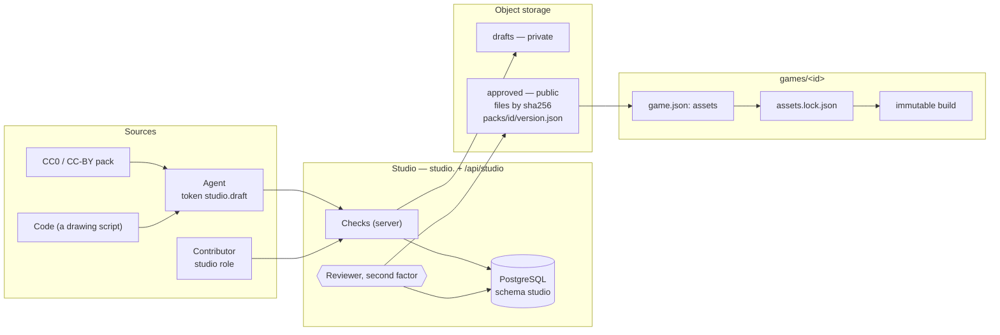
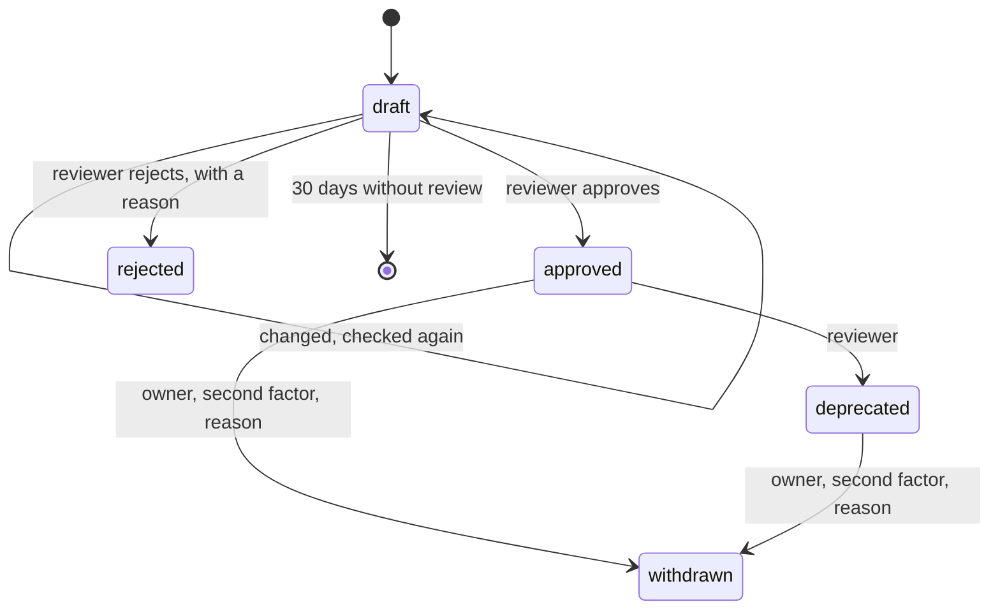
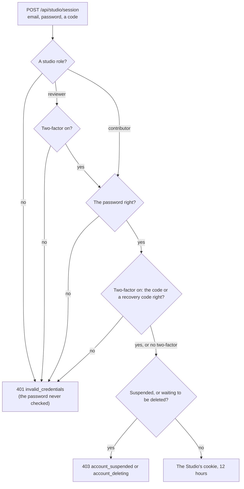

Decisions: [ADR 0050](../decisions/0050-a-game-declares-what-it-depends-on.md),
[ADR 0051](../decisions/0051-an-asset-studio-for-game-assets.md),
[ADR 0052](../decisions/0052-agent-tokens-and-the-scopes-no-agent-gets.md). This page describes the design; it arrives in
steps, and each part says when it exists. **What runs** (2026-10-24): the Studio's members, its session and its
permissions in the API, and giving and taking studio roles in the console ([Members and the Studio's
session](#members-and-the-studios-session)). Packs, styles, storage, checks and the app come next.

## The picture

## Packs

A **pack** is a set of assets in one style for one purpose, released together under semver: `farm-crops@1.2.0`.

| Change | Version |
| --- | --- |
| Pixels change; sizes, frames and names do not | patch |
| An asset is added | minor |
| An asset is removed, renamed or resized; frames change | major |

Each asset in a pack has:

| Field | Holds |
| --- | --- |
| `id` | unique in the pack, `a-z`, digits, `-`, `/` for folders (`crops/carrot`) |
| `kind` | `image` · `spritesheet` (frame size, frames, animations) · `tileset` (tile size, optional Wang or autotile rules) · `audio` · `font` · `palette` |
| `file` | its sha256, bytes, format, width and height |
| `source` | `pack` (name, URL, author) · `upload` (who) · `ai` (vendor, model, prompt, seed, date) · `code` (the script, kept as a file of the draft) |
| `licence` | an SPDX identifier from the [allowed list](#licences), and the attribution when it needs one |
| `tags` | words to find it by |

A pack has a `style`, a description, and a **status** per version:

An approved version never changes. `deprecated` keeps it working for games that pinned it and warns a game that pins it
anew. `withdrawn` deletes its files; a game pinned to it fails to build, naming why.

## Styles

A **style** is an art bible kept in the Studio: palette (optional — a painted style has none), tile size, view
(top-down, side, isometric), outline, and sample pictures. A pack names one. Tò He's own style is the default for a game
with no idea of its own; a game may choose or make another, and its `SPEC.md` says which and why.

## Licences

| Licence | Accepted |
| --- | --- |
| `CC0-1.0`, `CC-BY-4.0`, `OFL-1.1`, `MIT`, `BSD-2-Clause`, `BSD-3-Clause`, `Apache-2.0` | yes |
| `CC-BY-SA-4.0` | the owner decides each case, when the pack is reviewed; a game's conformance accepts it once approved |
| `LicenseRef-Tohe-Internal` | for what is made for Tò He, until the repository has a licence |
| NC, ND, "free for personal use", unknown | never |

An `ai` source also needs a vendor on the Studio's list of vendors whose terms were checked. Credits for a game are
generated from its lock.

## Storage

| What | Where |
| --- | --- |
| Styles, packs, versions, assets, reviews, the audit log | PostgreSQL, schema `studio`, module `Studio` of the API |
| Draft files | object storage, `drafts/<draft>/<sha256>`, private |
| Approved files | object storage, `blobs/sha256/<sha256>`, public to read |
| A version's manifest | object storage, `packs/<id>/<version>.json`, written on approval, never changed |

One library serves every environment: builds carry their files and are promoted by tag
([ADR 0041](../decisions/0041-promote-one-build-through-the-environments-by-tag.md)). Production's storage is Cloudflare
R2; the dev stack and the API's tests run SeaweedFS (Apache-2.0, S3-compatible) — MinIO's community edition stopped
shipping images in 2025.

## Building a game with assets

1. The game declares packs in `game.json` ([Game Contract, Assets](../contracts/game-contract-v1.md#assets),
   [ADR 0053](../decisions/0053-assets-in-the-game-contract.md)).
2. `pnpm assets:resolve` reads each version's manifest, writes `assets.lock.json` (every file's sha256, bytes, licence
   and attribution) and `src/assets.gen.ts` (typed keys). Both are generated files.
3. The build reads only the lock — never resolves anew — fetches files by hash through a cache shared by every worktree
   on the machine (and CI's cache), checks each hash, and copies the files the game uses as they are to
   `dist/studio/<sha256>.<ext>`, with `dist/studio/lock.json` (a copy of the lock) and `dist/studio/credits.json`.
   `--offline` fails naming what is missing. Packing files into atlases is a later optimisation (ADR 0053).
4. Conformance checks the lock against `assets`, every file in `studio/` against the lock by hash, and the licences
   and credits.

## The Studio app

`apps/studio` on `studio.toheplay.io.vn` (decided in [ADR 0051](../decisions/0051-an-asset-studio-for-game-assets.md);
serving once its DNS, ingress and storage exist). A third site of the hub image's Caddy serves it, with its own CSP, and
passes on `/api/studio/*` and nothing else of the API.

| Who | Signs in with | May |
| --- | --- | --- |
| Agent | a token with `studio.draft` ([Agent tokens](agent-tokens.md)) | create and change its drafts, upload draft files, check without saving |
| `contributor` | a Tò He account with that studio role | the same, in the app |
| `reviewer` | a Tò He account with that studio role and two-factor authentication | approve, reject, deprecate |
| owner | as a reviewer | also withdraw |
| CI, builds | nothing | read approved files and manifests |

Studio roles are an account claim of their own, given and taken in the console; they are not platform roles.

## Members and the Studio's session

*Runs.* The `Studio` module of the API (`services/api/src/Tohe.Api/Modules/Studio`) holds who may use the Studio and
signs them in, with a session of the Studio's own, a copy of the console's
([Admin console](admin.md#the-consoles-session)).

### Studio roles

`studio.members` holds one row per account with a studio role:

| Column | Holds |
| --- | --- |
| `account_id` | the account (the key); the row goes when the account is deleted for good |
| `role` | `contributor` or `reviewer` |
| `granted_by`, `granted_at` | who gave it in the console, and when |

[ADR 0051](../decisions/0051-an-asset-studio-for-game-assets.md) calls a studio role an account claim of its own. It is
kept in the Studio's schema rather than among Identity's account claims, because each module keeps its own tables
([ADR 0003](../decisions/0003-backend-dotnet-modular-monolith-postgres.md)); it is still a fact about an account, given
and taken in the console. It is not a platform role: it opens nothing in the console, and a platform role opens nothing
in the Studio — the owner who reviews holds `reviewer` as well.

Code checks permissions, never role names (`StudioPermissions`):

| Permission | What it opens | Held by |
| --- | --- | --- |
| `studio.read` | Reading styles, packs and drafts | `contributor`, `reviewer` |
| `studio.contribute` | Making and changing drafts, uploading draft files, running the checks | `contributor`, `reviewer` |
| `studio.review` | Approving, rejecting and deprecating a pack version, behind step-up; the step-up itself | `reviewer` |

An endpoint under `/api/studio` declares the permission it needs (`.RequireStudioPermission(…)`) and, for a review
action, step-up (`.RequireStudioStepUp()`); one that declares none answers `403 studio_required` to everyone.

### Signing in

- **Its own sign-in**, `POST /api/studio/session`: the email, the password and a code from the authenticator — or a
  recovery code, once. The account must hold a studio role; a `reviewer` must have two-factor authentication on and give
  a code; a `contributor` gives a code when it has two-factor on, and the password alone otherwise. Everything else —
  a wrong password, a wrong or missing code, no studio role, a reviewer without an authenticator, no such account —
  answers `401 invalid_credentials`, so the Studio tells nobody who holds a role. As in the console, the password of an
  account that may not sign in here is never checked (its lockout stays untouched), and the checks of the players'
  sign-in apply: Identity's lockout (`429 locked_out`), the `auth` rate-limit bucket, and suspension and a pending
  deletion, told (`403 account_suspended`, `account_deleting`) only to whoever brought the right password and code. The
  switch of the players' password sign-in ([ADR 0028](../decisions/0028-sign-in-and-registration-at-run-time.md)) does
  not apply: the Studio signs in with the password.
- **Its own cookie.** `__Host-tohe.studio` on an HTTPS deployment, `tohe.studio` over plain HTTP (development, UAT) —
  `HttpOnly`, `SameSite=Strict`, `Path=/`, no `Domain`. Until the Studio has an address of its own in the configuration
  (with the app), whether the deployment is HTTPS is read from the hub's address (`App:PublicUrl`). It lasts **12 hours
  from the sign-in**, never longer: no sliding, and re-issuing it after step-up keeps its end (the `tohe:studio_until`
  claim). Its authentication scheme (`Tohe.Studio`) is its own, and so is the data-protection purpose that seals it.
  `DELETE /api/studio/session` ends the Studio's session only.
- **Apart, both ways, by scheme.** The Studio's routes authenticate with the Studio's scheme alone: a player's or the
  console's cookie there is a `401`, and the Studio's cookie authenticates nothing outside them. The console's host
  answers `404` to `/api/studio/…`, as to every route but the console's.
- **Read again on every request** (`StudioAccess`): the security stamp — a new password, a suspension, "sign out
  everywhere" or two-factor authentication turned off end the session — the studio role, and for a reviewer two-factor
  authentication, all from the database. Taking the role away in the console ends the session at the next request.
- **Step-up** for review actions: `POST /api/studio/session/step-up` with a fresh code from the authenticator — never
  the password — opens 10 minutes inside the Studio's session (`tohe:secure_until` in its cookie); a review action asks
  for it with `403 step_up_required`. The hub's and the console's step-up open nothing here.
- **Where it answers.** The Studio's routes answer on any host but the console's for now; the Studio's app brings
  `studio.`'s Caddy site, which passes on `/api/studio/*` and nothing else, and the API's check that they answer on that
  host alone, as the console's routes do on the console's.

### In the console

The owner gives and takes studio roles on the console's **Studio** page (`/studio`), behind step-up level 2, with the
permission `admin.studio.write`; owners, admins and moderators see who holds one (`admin.users.read`). Each change is in
the console's audit log: `studio.member.grant` (the role, and the one before) and `studio.member.revoke`
([Admin console](admin.md#the-audit-log)).

### API

| Endpoint | Permission | Answers |
| --- | --- | --- |
| `GET /api/studio/session` | — | The account signed in to the Studio, its role, its permissions, until when the session lasts and step-up is open; `204` when nobody is |
| `POST /api/studio/session` · `DELETE /api/studio/session` | — | The Studio's sign-in: email, password, and a code or a recovery code when two-factor is on — its cookie for 12 hours · sign out of the Studio only |
| `POST /api/studio/session/step-up` | `studio.review` | A code from the authenticator: step-up for 10 minutes in this Studio session |
| `GET /api/admin/studio/members` | `admin.users.read` | Every account with a studio role, reviewers first |
| `POST /api/admin/studio/members` | `admin.studio.write`, step-up | Give a studio role — or change it — to an account named by its email or its id |
| `DELETE /api/admin/studio/members/{accountId}` | `admin.studio.write`, step-up | Take it away: the account's Studio session ends at its next request |

The Studio's routes are described by an OpenAPI document of their own, `studio` (`services/api/openapi/tohe-api_studio.json`).
Refusals: `401` without a Studio session, or `invalid_credentials` from the sign-in; `403 studio_required`,
`step_up_required`, `account_suspended`, `account_deleting`; `429 locked_out`; `400` with the field codes `code_invalid`,
`code_used`, `locked_out`, `account_required`, `role_invalid`; `404 account_not_found`, `studio_member_not_found`.

## Checks

The server runs them on every draft upload and again on approval; `check --dry-run` runs them without saving.

| Group | Checks |
| --- | --- |
| Files | allowed formats (PNG and WebP to begin with); magic bytes match the format; metadata stripped; at most a set number of pixels and bytes per file, and of bytes per pack |
| Pictures | sizes in multiples of the style's tile; a sprite sheet's frame grid matches its metadata; for a pixel-art style every opaque pixel in the palette and alpha only 0 or 255; a Wang tileset's edges meet |
| Metadata | ids unique; the style exists; tags valid; source complete |
| Licence | in the allowed list; an attribution when the licence needs one; an `ai` source from a checked vendor |
| Semver | the version against the previous approved one |

What a reviewer looks at: suitable for children (no gore, nothing frightening, no text, logos or real people's
likeness), not a near copy of a known character or game, in the style, readable at its real size (previews at 1× and 2×,
on light and dark), a plausible source.

## The CLI

`tohe-studio` (`packages/studio`), for agents with a shell, with a token in `TOHE_STUDIO_TOKEN`:

| Command | Does |
| --- | --- |
| `style list`, `style show <id>` | read the art bibles |
| `pack init <id>` | start a pack |
| `import <known pack>` | take files from a known CC0 or CC-BY pack, source and licence filled in |
| `draw <script>` | run a drawing script that writes PNG files; the script is kept with the draft |
| `prepare` | fit to the style's palette, snap to the pixel grid, trim, strip metadata |
| `check --dry-run` | the server's checks, nothing saved |
| `submit`, `status` | send the draft; read the review and its reason |

Later: `generate` through vendors whose terms were checked, once the owner sets a budget, and an MCP server over the same
core.
