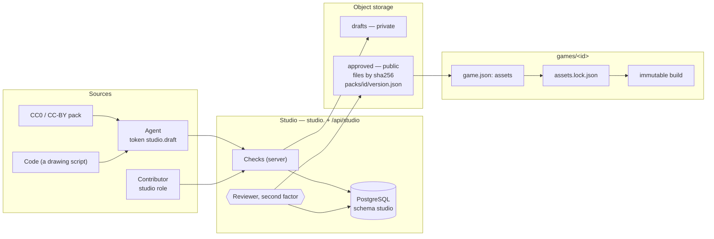
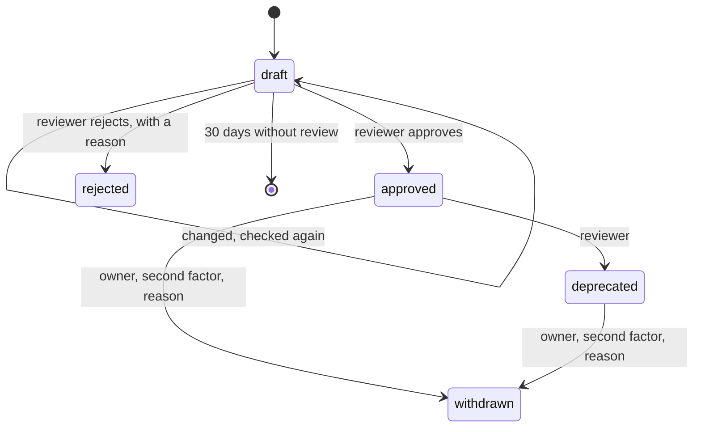

Decisions: [ADR 0050](../decisions/0050-a-game-declares-what-it-depends-on.md),
[ADR 0051](../decisions/0051-an-asset-studio-for-game-assets.md),
[ADR 0052](../decisions/0052-agent-tokens-and-the-scopes-no-agent-gets.md). This page describes the design; it arrives in
steps, and each part says when it exists. **Nothing of it runs yet** (2026-10-24).

## The picture

## Packs

A **pack** is a set of assets in one style for one purpose, released together under semver: `farm-crops@1.2.0`.

| Change | Version |
| --- | --- |
| Pixels change; sizes, frames and names do not | patch |
| An asset is added | minor |
| An asset is removed, renamed or resized; frames change | major |

Each asset in a pack has:

| Field | Holds |
| --- | --- |
| `id` | unique in the pack, `a-z`, digits, `-`, `/` for folders (`crops/carrot`) |
| `kind` | `image` · `spritesheet` (frame size, frames, animations) · `tileset` (tile size, optional Wang or autotile rules) · `audio` · `font` · `palette` |
| `file` | its sha256, bytes, format, width and height |
| `source` | `pack` (name, URL, author) · `upload` (who) · `ai` (vendor, model, prompt, seed, date) · `code` (the script, kept as a file of the draft) |
| `licence` | an SPDX identifier from the [allowed list](#licences), and the attribution when it needs one |
| `tags` | words to find it by |

A pack has a `style`, a description, and a **status** per version:

An approved version never changes. `deprecated` keeps it working for games that pinned it and warns a game that pins it
anew. `withdrawn` deletes its files; a game pinned to it fails to build, naming why.

## Styles

A **style** is an art bible kept in the Studio: palette (optional — a painted style has none), tile size, view
(top-down, side, isometric), outline, and sample pictures. A pack names one. Tò He's own style is the default for a game
with no idea of its own; a game may choose or make another, and its `SPEC.md` says which and why.

## Licences

| Licence | Accepted |
| --- | --- |
| `CC0-1.0`, `CC-BY-4.0`, `OFL-1.1`, `MIT`, `BSD-2-Clause`, `BSD-3-Clause`, `Apache-2.0` | yes |
| `CC-BY-SA-4.0` | the owner decides each case, when the pack is reviewed; a game's conformance accepts it once approved |
| `LicenseRef-Tohe-Internal` | for what is made for Tò He, until the repository has a licence |
| NC, ND, "free for personal use", unknown | never |

An `ai` source also needs a vendor on the Studio's list of vendors whose terms were checked. Credits for a game are
generated from its lock.

## Storage

| What | Where |
| --- | --- |
| Styles, packs, versions, assets, reviews, the audit log | PostgreSQL, schema `studio`, module `Studio` of the API |
| Draft files | object storage, `drafts/<draft>/<sha256>`, private |
| Approved files | object storage, `blobs/sha256/<sha256>`, public to read |
| A version's manifest | object storage, `packs/<id>/<version>.json`, written on approval, never changed |

One library serves every environment: builds carry their files and are promoted by tag
([ADR 0041](../decisions/0041-promote-one-build-through-the-environments-by-tag.md)). Production's storage is Cloudflare
R2; the dev stack and the API's tests run SeaweedFS (Apache-2.0, S3-compatible) — MinIO's community edition stopped
shipping images in 2025.

## Building a game with assets

1. The game declares packs in `game.json` ([Game Contract, Assets](../contracts/game-contract-v1.md#assets),
   [ADR 0053](../decisions/0053-assets-in-the-game-contract.md)).
2. `pnpm assets:resolve` reads each version's manifest, writes `assets.lock.json` (every file's sha256, bytes, licence
   and attribution) and `src/assets.gen.ts` (typed keys). Both are generated files.
3. The build reads only the lock — never resolves anew — fetches files by hash through a cache shared by every worktree
   on the machine (and CI's cache), checks each hash, and copies the files the game uses as they are to
   `dist/studio/<sha256>.<ext>`, with `dist/studio/lock.json` (a copy of the lock) and `dist/studio/credits.json`.
   `--offline` fails naming what is missing. Packing files into atlases is a later optimisation (ADR 0053).
4. Conformance checks the lock against `assets`, every file in `studio/` against the lock by hash, and the licences
   and credits.

## The Studio app

`apps/studio` on `studio.toheplay.io.vn` (decided in [ADR 0051](../decisions/0051-an-asset-studio-for-game-assets.md);
serving once its DNS, ingress and storage exist). A third site of the hub image's Caddy serves it, with its own CSP, and
passes on `/api/studio/*` and nothing else of the API.

| Who | Signs in with | May |
| --- | --- | --- |
| Agent | a token with `studio.draft` ([Agent tokens](agent-tokens.md)) | create and change its drafts, upload draft files, check without saving |
| `contributor` | a Tò He account with that studio role | the same, in the app |
| `reviewer` | a Tò He account with that studio role and two-factor authentication | approve, reject, deprecate |
| owner | as a reviewer | also withdraw |
| CI, builds | nothing | read approved files and manifests |

Studio roles are an account claim of their own, given and taken in the console; they are not platform roles.

## Checks

The server runs them on every draft upload and again on approval; `check --dry-run` runs them without saving.

| Group | Checks |
| --- | --- |
| Files | allowed formats (PNG and WebP to begin with); magic bytes match the format; metadata stripped; at most a set number of pixels and bytes per file, and of bytes per pack |
| Pictures | sizes in multiples of the style's tile; a sprite sheet's frame grid matches its metadata; for a pixel-art style every opaque pixel in the palette and alpha only 0 or 255; a Wang tileset's edges meet |
| Metadata | ids unique; the style exists; tags valid; source complete |
| Licence | in the allowed list; an attribution when the licence needs one; an `ai` source from a checked vendor |
| Semver | the version against the previous approved one |

What a reviewer looks at: suitable for children (no gore, nothing frightening, no text, logos or real people's
likeness), not a near copy of a known character or game, in the style, readable at its real size (previews at 1× and 2×,
on light and dark), a plausible source.

## The CLI

`tohe-studio` (`packages/studio`), for agents with a shell, with a token in `TOHE_STUDIO_TOKEN`:

| Command | Does |
| --- | --- |
| `style list`, `style show <id>` | read the art bibles |
| `pack init <id>` | start a pack |
| `import <known pack>` | take files from a known CC0 or CC-BY pack, source and licence filled in |
| `draw <script>` | run a drawing script that writes PNG files; the script is kept with the draft |
| `prepare` | fit to the style's palette, snap to the pixel grid, trim, strip metadata |
| `check --dry-run` | the server's checks, nothing saved |
| `submit`, `status` | send the draft; read the review and its reason |

Later: `generate` through vendors whose terms were checked, once the owner sets a budget, and an MCP server over the same
core.
