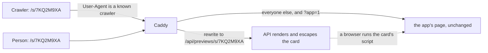
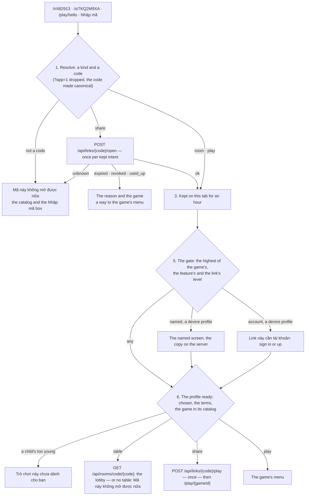

A link, a QR code or a code typed by hand is an **entry**: the hub resolves it to a typed intent, keeps it through
signing in and the terms, readies the player and the profile, and opens the table's lobby or the game
([ADR 0044](../decisions/0044-entry-links.md)). This page is the spec of the server's part — share links, their
counts, link previews (step I3a) — and of the hub's part that follows it (step I3b) — and of a game receiving an entry
and asking for a share (step I4, [ADR 0045](../decisions/0045-games-declare-identity-and-entries.md);
[Game Contract](../contracts/game-contract-v1.md#entries-and-identity)).

## Kinds of entry

| Kind | Address | Leads to | Least level ([ADR 0043](../decisions/0043-device-profiles-and-identity-levels.md)) |
| --- | --- | --- | --- |
| `site` | `/`, `/games/<gameId>/` | the public pages | — |
| `play` | `/play/<gameId>` | the game's menu | the game's |
| `room` | `/r/<six digits>` | that table's lobby ([Rooms](rooms.md#5-joining-with-a-link)) | the highest of the game's `play`, its `rooms` and the table's door — `named` by default |
| `share` | `/s/<eight characters>` | the game's menu — or, for an `entry` link, the place inside the game its payload names (ADR 0045) | the highest of the game's and the link's |
| `community` | `/account/register?invite=` | signing up into a community (not in the pipeline yet) | `account` |
| `profile` | in the app, by 12-digit ID ([ADR 0033](../decisions/0033-invite-a-profile-by-its-id.md)) | an invitation on the catalog | `account` |

### Codes

| Code | Shape | Read as |
| --- | --- | --- |
| A table's | six digits | digits only, spaces and hyphens ignored (I, L and O are a share link's reading, not a table's) |
| A share link's | eight characters of Crockford base32: `0-9 A-Z` without `I L O U` | case-insensitively, ignoring spaces and hyphens, `I` and `L` read as `1`, `O` as `0` |

Six digits are a table, eight characters a share link. The hub's **"Nhập mã"** box takes either ([below](#the-screens)). The API reads a
share link's code the same way (`LinkCodes.TryNormalize`) and answers it in its canonical form, eight upper-case
characters.

## Share links

A share link is a row on the server (`links.share_links`), made by a profile through the hub — never by a game on its
own, never carrying a free path (no open redirect).

| Field | What |
| --- | --- |
| Code | Eight characters, drawn at random (40 bits); unique among every link the server keeps, so a code is never given to a second link while the first exists |
| Kind | `game` — opens the game's menu. `entry` — a place in the game: a payload the game alone reads (JSON, at most 2 KB as UTF-8, `400 payload_too_large`), made by the hub on the game's request (ADR 0045), only for a game whose current build declares `entries: ["share"]` (`400 entry_not_supported`) |
| Payload | For an `entry` link only (`links.share_links.payload`, `text`: the compact JSON exactly as measured against the 2 KB — `jsonb` would rewrite numbers and refuse `\u0000`): given to the game in `init.entry` by `play`, and to nobody else — never in a preview, the console's view, nor the maker's list |
| Game and version | The game's id and the version the registry lists when the link is made — read from the registry, never from the request. Only a listed game, and one the maker's age band may see (`too_young`) |
| Level | `any`, `named` or `account`: the least level the link asks of whoever opens it, raised to the game's `identity.play` when it is made (ADR 0045); the identity gate takes the highest of the game's, the feature's and the link's |
| Maker | A profile: an account's or a device's on the server |
| Expiry | 30 days by default; the maker may choose between one hour and 90 days (`expiresInHours`, 1 to 2160), at making and later |
| Maximum uses | Optional, 1 to 1000. A use is a resolve that opens the game, never a crawler's fetch |
| Uses | Taken atomically: two players at the same moment never take the last use twice |
| Revoked | By its maker, or by the console; a revoked link stays revoked |
| Language | `vi` or `en` (`links.share_links.language`, `vi` by default and for every link made before it was kept): the language the maker's hub spoke when it made the link, sent as `language` (anything else, `400 invalid_options`). Its [preview card](#link-previews) speaks it ([ADR 0047](../decisions/0047-two-languages-and-an-introduction-surface-that-grows.md)); the link itself carries none — whoever opens it reads the app in their own language |

### Who may make one

Making a link is a `named` feature — others see the maker's name:

- a **device profile** acts with its device key and must have its server copy with the terms the hub shows accepted
  (`412 terms_required`, `404 device_profile_not_found` — the same answers as at a table);
- an **account's** profile acts with the account's session; a **child's** profile makes links only while its
  account's owner keeps "Chơi online với người ngoài" on (`403 play_with_others_off`);
- **limits**: 30 links a day per profile (counted from the links it made in the last 24 hours, `Links:MakesPerProfilePerDay`),
  and 60 a day per device key — or, for an account's session that carries no device key, per account
  (`Links:MakesPerDevicePerDay`, kept in memory). Past either: `429 link_limit`.

### Its state

A link resolves to one state, checked in this order:

| State | When |
| --- | --- |
| `unknown` | No link has this code — never made, or its maker was deleted with its links |
| `revoked` | Revoked by its maker or the console — or its maker's **account is suspended or waiting to be deleted**, or its maker is a **child whose "Chơi online với người ngoài" is off**: it resolves as revoked, and shows no name, for as long as that lasts |
| `expired` | Its expiry has passed |
| `used_up` | Its maximum uses are taken |
| `ok` | It opens |

### Counts

Per link and per day (`links.share_link_days`, UTC days), totals only — never who:

| Count | Counted when |
| --- | --- |
| `opened` | A resolve of an `ok` link (`POST /api/links/{code}/open`) |
| `played` | A resolve that opens the game (`POST /api/links/{code}/play`), which also takes one use |
| `accountsMade` | An account is made from that entry: the hub passes the code once, as `entryCode` on the request that makes the account |

**The maker** sees `opened` and `played` for its links, and `accountsMade` only from **three** upward — below that it
reads as none, so a link sent to one friend never tells the maker that this friend signed up. **The console** sees every
count. The threshold is a courtesy, not a guarantee: a maker who signs up twice from its own link reaches three with one
friend; nothing more is stored to stop it.

**Accounts made** rides on the request that makes the account — `POST /api/auth/register/confirm` and
`POST /api/auth/external/pending/signup` take an optional `entryCode` — and is counted only when that request did make
an account, after it is committed. It is the least abusable shape: each account is made once, so each counts at most
once, and inflating the count costs a real sign-up (the email code or a provider, the proof-of-work when the console
asks). Nothing is stored on the account or the profile; a code that names no link counts nothing, and a refused or
malformed code never fails the sign-up.

### Its life

| Event | Its links |
| --- | --- |
| The maker is deleted — on its device, by its account's owner, with its account, or cleaned up after 90 days unused | Deleted with their counts (`IProfileData`); their codes resolve as `unknown` |
| The maker, a device profile, is merged into an account's profile | Move to the target, as the target's ([merge aliases](identity.md#merge-aliases)) |
| The maker moves to another device with a transfer code | Stay with it: the same id |
| The maker's account is suspended, or waits to be deleted | Resolve as `revoked` and show no name; lifting the suspension, or keeping the account, brings them back |
| The maker is a child, and its account's owner turns "Chơi online với người ngoài" off — links merged into a child's profile too | Resolve as `revoked` and show no name; turned on again, they come back |

### The console

The console finds a link by its code — its kind, game, level, maker (name, and the account or the device), state, every
count by day — and revokes it, with step-up level 2 and an audit entry (`link.revoke`). It reads with the permission to
find accounts (`admin.users.read`) and revokes with the moderators' (`admin.profiles.moderate`)
([Admin console](admin.md)).

## Link previews

Zalo, Messenger and the others fetch a link to draw its card. The app's page carries the hub's own generic card;
`/r/<code>` and `/s/<code>` get a card of their own, rendered by the API **for crawlers only**:

- **Who is a crawler**: a `User-Agent` with `facebookexternalhit`, `Facebot`, `Twitterbot`, `TelegramBot`, `Slackbot`,
  `Discordbot`, `WhatsApp/`, `LinkedInBot` or `Zalo` (Messenger's cards are fetched by `facebookexternalhit`) — and
  none of the marks of a phone's browser or an in-app browser (`Mobile`, `FBAN`, `FBAV`, `FB_IAB`, `Instagram`), so a
  person who opens the link inside Zalo or Messenger still gets the app. The list is `linkPreviewCrawlers` in
  `@tohe/routes`; the matcher and the rewrite in the hub's Caddy are generated from it. A spoofed `User-Agent` only
  gets the same card. **Zalo's crawler is not documented**: matching it by `Zalo` is a guess, to be confirmed from UAT's
  Caddy access log after the deploy (the `User-Agent` of the requests that fetch a link pasted into Zalo).
- **A person is never stuck on the card**, whatever the guess catches — Zalo's in-app browser on a tablet says no
  `Mobile`. The card carries one static script, `location.replace(location.pathname + '?app=1')`, which crawlers do
  not run and a browser runs at once; with scripts off, its link **"Mở Tò He"** leads to the same address. A request
  with `?app=` always gets the app's page, whatever its `User-Agent` (`not query app=*` in the generated matcher); the
  hub ignores the parameter: `/r/$code` and `/s/$code` drop it from the address ([step 1](#the-hubs-entry-pipeline)).
  The script does nothing once `app=` is in the address, so the card asked for at its API path never reloads itself.
- **The card keeps its own CSP**: `default-src 'none'` and the script allowed by its SHA-256 hash, nothing else. The
  hub's Caddy gives its own CSP to every request but a card's (`@notLinkPreview`, generated with the matcher).
- **`Vary: User-Agent`** on the card and on the app's page at `/r/*` and `/s/*`, as one address answers both: a cache
  in front (Cloudflare in production) keeps them apart.
- **Only well-formed codes**: `/r/` or `/s/` followed by one segment of letters, digits and hyphens (at most 20); any
  other path is the app's.
- **Caddy never fills API output into a template**: it rewrites the request to the API and passes the answer through,
  as any other API answer. The app's page is untouched.
- **The API renders and escapes every value**: `&`, `<`, `>`, quotes, backticks and braces become character
  references, control characters go — so neither HTML nor a template's `{{ }}` survives in a name.
- **200 every time**: an unknown, expired, revoked or used-up code gets the generic card, and so does a request past the
  preview's limits (per address, `Links:PreviewsPerMinute`, and for the whole server,
  `Links:PreviewsPerMinuteGlobal`), which then reads nothing from the database. `X-Robots-Tag: noindex`.
- **The payload never appears** (ADR 0045), nor anything but what the table below lists.

| Address | Card (Vietnamese · English) | Language |
| --- | --- | --- |
| `/r/<code>` of a table listed publicly (public, and not kept to its host's account) | "Lời mời vào bàn {game}" · "An invite to a {game} table" — the game only | the table's |
| `/r/<code>` of any other table, closed or unknown | "Lời mời vào bàn chơi Tò He" — the same for all, so a card never confirms that a private table's code exists, nor whose it is | Vietnamese, always: not even its language tells a private table from no table |
| `/s/<code>` of an `ok` link | "{maker} mời bạn chơi {game}" · "{maker} invites you to play {game}" — the maker's **current** name on the server, so a name a moderator changed is the one shown | the link's |
| `/s/<code>` of an `ok` link made by a child's profile | "Lời mời chơi {game}" · "An invite to play {game}" — no name, no avatar (the owner's opt-in arrives later) | the link's |
| `/s/<code>` of any other link | The hub's generic card ("Tò He") | Vietnamese, always |

**A card speaks the language of the link's maker, or of the table's host**
([ADR 0047](../decisions/0047-two-languages-and-an-introduction-surface-that-grows.md)): a card is read before anyone
opens the app, beside the maker's own message. The hub sends its language (`vi` or `en`, the app's current one) as
`language` when it makes a link (`POST /api/links`) or opens a table (`POST /api/rooms`); the API keeps it with the link
(`links.share_links.language`) or the table (`rooms.rooms.language`, so it outlives a restart) — `vi` when none is sent,
and for everything made before it was kept — and the card takes its words, `<html lang>` and `og:locale` (`vi_VN`,
`en_US`) from it. A table keeps the language it was opened in when the host role passes to another player. Only a card
that names a game speaks it; every other card is Vietnamese. The words live in `CardWords` (the API's
`Modules/Links/CardWords.cs`); the description is the app's own, in its language — `apps/hub/index.html` and the
English home page's (`apps/web/src/content/home.ts`). A link or a code carries no language: whoever opens it reads
the app in their own.

`{game}` is the game's name in the card's language — the lookup of
[ADR 0048](../decisions/0048-a-standard-name-and-words-per-language-for-each-game.md) (`GameWords`): `names.vi`, else the
standard `name`, on a Vietnamese card; `names.en`, else the standard `name`, on an English one.

Each card has `og:title`, `og:description`, `og:url` (the link itself), `og:image` (the hub's `/og.png`),
`og:site_name`, `og:locale` and the matching `twitter:` tags, and one link to the app ("Mở Tò He" · "Open Tò He"). A
card Zalo or Facebook already cached cannot be called back: revoking or deleting stops new cards only.

## The API

| Endpoint | Auth | Purpose |
| --- | --- | --- |
| `POST /api/links` | a player (session, or device key naming a device profile) | Make a link: `kind`, `gameId`, `level`, `expiresInHours`, `maxUses`, `language` (`vi` by default, or `en`: its card's); for `entry`, `payload` — and `text`, the message the player would send, checked and answered as `message` when it may go (below), never stored |
| `GET /api/links/mine` | a player | Its links, newest first (100 at most), with their state, totals and language |
| `PATCH /api/links/{code}` | its maker | A new expiry, from now (`expiresInHours`) |
| `POST /api/links/{code}/revoke` | its maker | Revoke it |
| `POST /api/links/{code}/open` | — | Resolve to a typed intent; counts `opened` |
| `POST /api/links/{code}/play` | — (the player, when the link asks `named` or `account`) | Resolve to open the game: takes a use and counts `played`; for an `entry` link, the intent carries `entry`: `{ payload, version, makerAvatar }`; `403 level_required` (with `level`) when the request's player does not meet the link's level |
| `GET`/`HEAD /api/previews/r/{code}` · `GET`/`HEAD /api/previews/s/{code}` | — | The crawler's card, HTML (not in the OpenAPI document) |
| `GET /api/admin/links/{code}` · `POST /api/admin/links/{code}/revoke` | the console | Find · revoke |

The intent is `{ code, state, kind, gameId, gameName, gameNames, level, makerName }`: for `unknown`, only the state; for
`expired`, `revoked` and `used_up`, the kind and the game too — its standard name and its names per language, which the
hub shows in its own language (ADR 0048) — so the hub can offer the game's menu as a way out; the maker's name only for
`ok`, and never a child's. Resolving is public and limited per client address — the address the trusted proxy
chain gives, an IPv6 address by its /64 (`ClientAddress`), `Links:ResolvesPerMinute`; past it, `429`. There is no limit
for the whole server: a handful of addresses could use it up and switch every link off for everyone.

**`play` is called once per reached intent**: when the hub opens the game for it, never again on a reload or on going
back. **`maxUses` is no protection** against whoever holds the code — anyone may call `play` until the uses are gone;
it only bounds how far a link travels.

## Rooms: a closed table's code

A closed table's code is not given out again for a day (`Rooms:ClosedCodeReserved`), so an old table link never opens a
stranger's table; it resolves as no table — the same as a code never used ([Rooms](rooms.md#a-rooms-life)).

## The hub's entry pipeline

Every way in goes through one pipeline in the hub (`apps/hub/src/entry/`): a table's link `/r/<code>`, a share link
`/s/<code>`, a game's own address `/play/<gameId>`, and a code typed into "Nhập mã" — which only leads to `/r/` or
`/s/`. It replaces the room link's own handling.

1. **Resolve.** The address or the typed code becomes a typed intent — a kind (`room`, `share`, `play`) and a code
   checked against its shape (`entry/codes.ts`): six digits, eight Crockford characters, or a game's id. The hub builds
   the path back from these two alone, so nothing kept or typed is ever a free path. `/r/$code` and `/s/$code` drop the
   query (`?app=1` from a preview card) and put the code in its canonical form (`/s/7kq2-m9xa` → `/s/7KQ2M9XA`) with a
   redirect that replaces the address. A share link resolves at once (`open`); a **table's code resolves only after the
   gate** (step 5): there is no anonymous lookup of a table, which would be the oracle for private tables that ADR 0044
   forbids.
2. **Still good?** An `unknown` code — never made, or a table that closed (`room_not_found`, `room_closed`, or a bare
   `404` from the rooms) — shows "Mã này không mở được nữa", with "Về danh sách trò chơi" and the "Nhập mã" box: nothing
   more is said. Any other refusal — a device profile's copy gone (`device_profile_not_found`) — is the device's trouble,
   and the intent stays. An `expired`, `revoked` or `used_up` share link shows its reason and its game, with "Chơi
   {game}" to the game's menu when the game is in the catalog of whoever plays here. A request that failed on the way —
   offline, `429 resolve_limit` — says so in words, with "Thử lại". A dead end ends the intent.
3. **Keep the intent** (`entry/intent.ts`): `tohe:entry` in `sessionStorage` — per tab, gone with it — as
   `{kind, code, at, player?}`, with a share link's resolution once `open` answered, so a reload, a sign-in, a provider's
   round trip, an email code and the terms never open it twice. It lives an **hour** from when it was kept; read back, it
   is checked again as an address would be, and the resolution for its shape and level. Once the gate lets a player
   through, the intent is **that player's**: the picker goes on to it only as that player, and another player — on a
   shared phone — finds it forgotten. Before the gate it is anyone's, so signing in from the `named` screen, or making an
   account for a link that asks one, goes on to it. The profile picker goes on to the kept intent after signing in or
   choosing a profile; a page remembered since (`tohe:next`, not an entry's) goes first and the intent is forgotten. It
   is **cleared** when reached (the lobby shown, the game opened) or at a dead end, and **forgotten** — with the share
   link it came from and an entry's path waiting after sign-in — when another profile is chosen by hand on a shared
   device ("Đổi người chơi", not the picker the hub sent someone to), a new device profile is made ("Thêm người chơi"),
   the profile playing is deleted, a profile arrives with a transfer code, or the account signs out (the profile picker,
   the sign-in screen, the terms prompt). Installing the app on iPhone does not carry it: "Nhập mã" does.
4. **In an in-app browser** (Zalo, Messenger, Facebook, Instagram): every screen, the entry's included, opens with the
   strip "Mở bằng trình duyệt" and its "Chép link" — the address without `?app=1`. It never blocks; "Ẩn" hides it.
5. **The identity gate**: the highest of the game's level (its `identity.play`, ADR 0045 — asked where the game opens,
   once the game is known: its menu, or its table's preview), the feature's and the link's (`EntryGate`). A table asks for `named`: a device profile gets the `named` screen the first time, as before. A share
   link asking `named` shows the same screen with its own words ("Trước khi vào chơi"); asking `account`, a device
   profile is asked to sign in or make an account ("Link này cần tài khoản"), and comes back to the link.
6. **The profile is ready**: chosen (the picker), the terms accepted (the terms prompt), its copy on the server when the
   level asks for a name. A child's switches are the server's: a child whose "Chơi online với người ngoài" is off is
   refused a seat at a table (`parent_permission`, said in words). The game is checked against the profile's age by its
   catalog — the API lists a child only the games for its age band (a device profile has none): a game missing from it
   is "Trò chơi này chưa dành cho bạn" for a child, "Không tìm thấy trò chơi" otherwise.
7. **Open**: a table's lobby — the preview with "Vào ngồi" — or, for a share link, `POST /api/links/{code}/play` and
   then the game's menu, `/play/{gameId}`, replacing the link's address. Should `play` answer `403 level_required` — the
   API's backstop — the player goes back through the gate at the level it names (the `named` screen, or signing in), and
   `play` is asked again behind it. `play` is called **once per reached intent**: the request is shared by every drawing
   of the screen for that kept intent, and once reached nothing is kept to reach again, so a reload of the game or going
   back never calls it. A game's own address that a child's catalog does not list says "Trò chơi này chưa dành cho
   bạn". An `entry` link opens the game at its place: `play`'s answer — payload, version, and the maker's name and
   avatar when they may be shown — waits on the tab (`tohe:game-entry`, an hour, taken once, gone with the intent) and
   becomes the game's `init.entry` ([below](#a-game-opened-by-an-entry)). The link is never resolved again for it.
8. **Afterwards**: the counts are the server's; the nudges come at their moment (installing after the first finished
   game, keeping progress on the catalog's strip). The share link a tab came from is kept apart from the intent, an hour
   from when it first opened — opening it again does not push the hour (`tohe:entry-source`): an account made on that
   tab within the hour — by email (`register/confirm`) or with a provider (`external/pending/signup`) — sends it once as
   `entryCode`, after reaching the game too, since that is when a newcomer decides to keep their progress.

A device profile acts on share links with its device key, as at tables: the hub names it on `/api/links/*`
(`X-Tohe-Device-Profile`, `X-Tohe-Terms`) exactly while it acts, and an account's session never does.

### A game opened by an entry

[ADR 0045](../decisions/0045-games-declare-identity-and-entries.md): the hub sends `init.entry` only to a build that
declares the kind in `entries`, and waits **5 s** for the game's `entry` answer. On `unsupported`, `invalid`, no answer,
  or a build that does not declare it, it shows its own notice over the game's menu — "Lời mời này không mở được trong bản
game này" — and the game plays as usual; a `handled` that comes later takes the notice back. A game asking the hub for more in the middle of play:

- **One sheet at a time**: while a sheet is open, or before the game showed its first screen, a request is `busy`. The
  game gets `pause` when a sheet opens and `resume` when it closes.
- **`identity.require`**: `ok` at once for a level the profile has (an account's profile has them all; a device profile
  is `named` once its copy is on the server with the terms). Otherwise the hub's sheet, in its own words for the reason
  (`others`, `ranked`, `sync`, `friends`): the `named` screen ("Đặt tên cho hồ sơ"), or "Cần tài khoản Tò He" with
  "Đăng nhập", "Tạo tài khoản" and "Để sau". "Để sau" answers `declined`, and every request of that game for that
  profile is `declined` without asking for ten minutes. Signing in pauses the game, waits up to a second for its save,
  keeps the game's intent and its entry on the tab, and the game **opens again** after signing in, for the profile the
  player ends up on ("Đã đăng nhập — đang mở lại {game}…"); the request never settles.
- **`share`**: a `named` feature — a device profile gets the `named` screen first, in the sheet. Then "Gửi" (the
  system's share, where there is one), "Chép link" and "Mã QR": **the link is made on the first tap**, an `entry` link
  with the game's payload and level, so closing the sheet leaves nothing behind. The message is the game's text when the
  API accepts it — one line, at most 120 characters, no invisible formatting characters, no address, domain or email
  (in any script, with full-width and ideographic dots too), no seven digits or more — counted across single spaces,
  dots and dashes, so `0901 234 567` is one, stricter than ADR 0045's "run of seven digits": a refusal only means the
  hub's words go instead — and through the name filter
  ([ADR 0035](../decisions/0035-filter-offensive-names-and-limit-renames.md)); else the hub's "Chơi {game} với mình trên
  Tò He nhé!", shown in the sheet once the link is made. `ok` once sent, copied or shown; otherwise `cancelled`, or why
  the link could not be made (`limit`, `offline`, `not_allowed`, `unavailable`).
- **`can`**: both false at a table and in a replay; `share` also for a game without `entries` and for a child kept to
  its account.

### The screens

| Screen | Where | What |
| --- | --- | --- |
| **"Nhập mã"** | A button at the top of Trò chơi (the catalog), and a one-line box in Chơi cùng (`/together`, [Surfaces](surfaces.md)): "Có mã? Gõ mã hoặc dán link." — the 6 and 8 rule is only in the error | Six digits or eight characters, read as the API reads them, or a pasted link; it says which it found ("Bàn chơi 482 913", "Link mời 7KQ2 M9XA") and opens it. The catalog is the first screen of a newcomer and of the installed app on an iPhone, which cannot follow a link: the button is in sight there, without opening anything |
| **"Rủ bạn"** | A labelled button under each game's name in the catalog (*Bảng điểm* has the other) | A sheet: a device profile first gets the `named` screen in it ("Trước khi chia sẻ"); then the link, its QR code, its code, "Chia sẻ" (the system's share, where the browser has one) and "Chép link", how long it lasts, and "Xem link của tôi". The profile's own live `game` link to that game — asking nothing, no maximum of uses, a day or more left, made in the app's language now (its card speaks that one) — is shown again rather than a new one made: opening the sheet twice is not sharing twice, and a profile makes 30 a day. `link_limit`, `play_with_others_off`, `too_young`, offline: said in words, with "Thử lại" |
| **"Link của tôi"** | `/account/links`, from Chơi cùng — which shows the newest three and "Xem tất cả" — and the share sheet | The profile's links, newest first: the game, the code, the state, opened, played and new accounts (`—` below three, with a line saying why), until when; "Chép link", "Đổi hạn" (1 hour to 90 days, from now) and "Thu hồi" (confirmed; a revoked link stays revoked). A device profile with no copy on the server has made none, and is not asked for a name to see that |
| **Dead ends** | `/r/…`, `/s/…` | As in step 2 |
| **"Đã cài app Tò He?"** | The screens of `/r/…` and `/s/…` (the table's preview, the `named` screen), on an iPhone or an iPad outside the installed app | One line: "Đã cài app Tò He? Mở app, bấm Nhập mã rồi gõ 482 913." A link there opens in Safari or a chat app's browser, whose storage the installed app does not share; Chromium hands it to the open app instead (`launch_handler`, [Surfaces](surfaces.md#coming-back)). Not on a dead end |
