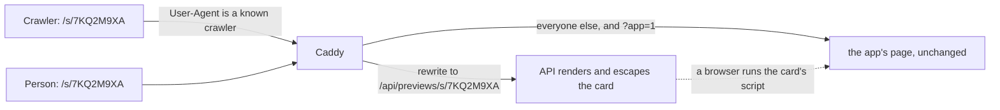

A link, a QR code or a code typed by hand is an **entry**: the hub resolves it to a typed intent, keeps it through
signing in and the terms, readies the player and the profile, and opens the table's lobby or the game
([ADR 0044](../decisions/0044-entry-links.md)). This page is the spec of the server's part — share links, their
counts, link previews (step I3a) — and of the hub's part that follows it (step I3b). A game receiving an entry, or
asking for a share, is step I4 (ADR 0045).

## Kinds of entry

| Kind | Address | Leads to | Least level ([ADR 0043](../decisions/0043-device-profiles-and-identity-levels.md)) |
| --- | --- | --- | --- |
| `site` | `/`, `/games/<gameId>/` | the public pages | — |
| `play` | `/play/<gameId>` | the game's menu | the game's |
| `room` | `/r/<six digits>` | that table's lobby ([Rooms](rooms.md#5-joining-with-a-link)) | the highest of the game's and the table's door — `named` by default |
| `share` | `/s/<eight characters>` | the game's menu; from I4, a place inside the game | the highest of the game's and the link's |
| `community` | `/account/register?invite=` | signing up into a community (not in the pipeline yet) | `account` |
| `profile` | in the app, by 12-digit ID ([ADR 0033](../decisions/0033-invite-a-profile-by-its-id.md)) | an invitation on the catalog | `account` |

### Codes

| Code | Shape | Read as |
| --- | --- | --- |
| A table's | six digits | digits only; spaces ignored |
| A share link's | eight characters of Crockford base32: `0-9 A-Z` without `I L O U` | case-insensitively, ignoring spaces and hyphens, `I` and `L` read as `1`, `O` as `0` |

Six digits are a table, eight characters a share link. The hub's **"Nhập mã"** box takes either (I3b). The API reads a
share link's code the same way (`LinkCodes.TryNormalize`) and answers it in its canonical form, eight upper-case
characters.

## Share links

A share link is a row on the server (`links.share_links`), made by a profile through the hub — never by a game on its
own, never carrying a free path (no open redirect).

| Field | What |
| --- | --- |
| Code | Eight characters, drawn at random (40 bits); unique among every link the server keeps, so a code is never given to a second link while the first exists |
| Kind | `game` — opens the game's menu, the only kind made in step I3. `entry` — a payload for the game — arrives with step I4 and is refused until then (`400 kind_not_supported`) |
| Game and version | The game's id and the version the registry lists when the link is made — read from the registry, never from the request. Only a listed game, and one the maker's age band may see (`too_young`) |
| Level | `any`, `named` or `account`: the least level the link asks of whoever opens it; the identity gate takes the highest of the game's, the feature's and the link's |
| Maker | A profile: an account's or a device's on the server |
| Expiry | 30 days by default; the maker may choose between one hour and 90 days (`expiresInHours`, 1 to 2160), at making and later |
| Maximum uses | Optional, 1 to 1000. A use is a resolve that opens the game, never a crawler's fetch |
| Uses | Taken atomically: two players at the same moment never take the last use twice |
| Revoked | By its maker, or by the console; a revoked link stays revoked |

### Who may make one

Making a link is a `named` feature — others see the maker's name:

- a **device profile** acts with its device key and must have its server copy with the terms the hub shows accepted
  (`412 terms_required`, `404 device_profile_not_found` — the same answers as at a table);
- an **account's** profile acts with the account's session; a **child's** profile makes links only while its
  account's owner keeps "Chơi online với người ngoài" on (`403 play_with_others_off`);
- **limits**: 30 links a day per profile (counted from the links it made in the last 24 hours, `Links:MakesPerProfilePerDay`),
  and 60 a day per device key — or, for an account's session that carries no device key, per account
  (`Links:MakesPerDevicePerDay`, kept in memory). Past either: `429 link_limit`.

### Its state

A link resolves to one state, checked in this order:

| State | When |
| --- | --- |
| `unknown` | No link has this code — never made, or its maker was deleted with its links |
| `revoked` | Revoked by its maker or the console — or its maker's **account is suspended or waiting to be deleted**, or its maker is a **child whose "Chơi online với người ngoài" is off**: it resolves as revoked, and shows no name, for as long as that lasts |
| `expired` | Its expiry has passed |
| `used_up` | Its maximum uses are taken |
| `ok` | It opens |

### Counts

Per link and per day (`links.share_link_days`, UTC days), totals only — never who:

| Count | Counted when |
| --- | --- |
| `opened` | A resolve of an `ok` link (`POST /api/links/{code}/open`) |
| `played` | A resolve that opens the game (`POST /api/links/{code}/play`), which also takes one use |
| `accountsMade` | An account is made from that entry: the hub passes the code once, as `entryCode` on the request that makes the account |

**The maker** sees `opened` and `played` for its links, and `accountsMade` only from **three** upward — below that it
reads as none, so a link sent to one friend never tells the maker that this friend signed up. **The console** sees every
count. The threshold is a courtesy, not a guarantee: a maker who signs up twice from its own link reaches three with one
friend; nothing more is stored to stop it.

**Accounts made** rides on the request that makes the account — `POST /api/auth/register/confirm` and
`POST /api/auth/external/pending/signup` take an optional `entryCode` — and is counted only when that request did make
an account, after it is committed. It is the least abusable shape: each account is made once, so each counts at most
once, and inflating the count costs a real sign-up (the email code or a provider, the proof-of-work when the console
asks). Nothing is stored on the account or the profile; a code that names no link counts nothing, and a refused or
malformed code never fails the sign-up.

### Its life

| Event | Its links |
| --- | --- |
| The maker is deleted — on its device, by its account's owner, with its account, or cleaned up after 90 days unused | Deleted with their counts (`IProfileData`); their codes resolve as `unknown` |
| The maker, a device profile, is merged into an account's profile | Move to the target, as the target's ([merge aliases](identity.md#merge-aliases)) |
| The maker moves to another device with a transfer code | Stay with it: the same id |
| The maker's account is suspended, or waits to be deleted | Resolve as `revoked` and show no name; lifting the suspension, or keeping the account, brings them back |
| The maker is a child, and its account's owner turns "Chơi online với người ngoài" off — links merged into a child's profile too | Resolve as `revoked` and show no name; turned on again, they come back |

### The console

The console finds a link by its code — its kind, game, level, maker (name, and the account or the device), state, every
count by day — and revokes it, with step-up level 2 and an audit entry (`link.revoke`). It reads with the permission to
find accounts (`admin.users.read`) and revokes with the moderators' (`admin.profiles.moderate`)
([Admin console](admin.md)).

## Link previews

Zalo, Messenger and the others fetch a link to draw its card. The app's page carries the hub's own generic card;
`/r/<code>` and `/s/<code>` get a card of their own, rendered by the API **for crawlers only**:

- **Who is a crawler**: a `User-Agent` with `facebookexternalhit`, `Facebot`, `Twitterbot`, `TelegramBot`, `Slackbot`,
  `Discordbot`, `WhatsApp/`, `LinkedInBot` or `Zalo` (Messenger's cards are fetched by `facebookexternalhit`) — and
  none of the marks of a phone's browser or an in-app browser (`Mobile`, `FBAN`, `FBAV`, `FB_IAB`, `Instagram`), so a
  person who opens the link inside Zalo or Messenger still gets the app. The list is `linkPreviewCrawlers` in
  `@tohe/routes`; the matcher and the rewrite in the hub's Caddy are generated from it. A spoofed `User-Agent` only
  gets the same card. **Zalo's crawler is not documented**: matching it by `Zalo` is a guess, to be confirmed from UAT's
  Caddy access log after the deploy (the `User-Agent` of the requests that fetch a link pasted into Zalo).
- **A person is never stuck on the card**, whatever the guess catches — Zalo's in-app browser on a tablet says no
  `Mobile`. The card carries one static script, `location.replace(location.pathname + '?app=1')`, which crawlers do
  not run and a browser runs at once; with scripts off, its link **"Mở Tò He"** leads to the same address. A request
  with `?app=` always gets the app's page, whatever its `User-Agent` (`not query app=*` in the generated matcher); the
  hub ignores the parameter (`/r/$code` reads no query; I3b's `/s/$code` drops it). The script does nothing once
  `app=` is in the address, so the card asked for at its API path never reloads itself.
- **The card keeps its own CSP**: `default-src 'none'` and the script allowed by its SHA-256 hash, nothing else. The
  hub's Caddy gives its own CSP to every request but a card's (`@notLinkPreview`, generated with the matcher).
- **`Vary: User-Agent`** on the card and on the app's page at `/r/*` and `/s/*`, as one address answers both: a cache
  in front (Cloudflare in production) keeps them apart.
- **Only well-formed codes**: `/r/` or `/s/` followed by one segment of letters, digits and hyphens (at most 20); any
  other path is the app's.
- **Caddy never fills API output into a template**: it rewrites the request to the API and passes the answer through,
  as any other API answer. The app's page is untouched.
- **The API renders and escapes every value**: `&`, `<`, `>`, quotes, backticks and braces become character
  references, control characters go — so neither HTML nor a template's `{{ }}` survives in a name.
- **200 every time**: an unknown, expired, revoked or used-up code gets the generic card, and so does a request past the
  preview's limits (per address, `Links:PreviewsPerMinute`, and for the whole server,
  `Links:PreviewsPerMinuteGlobal`), which then reads nothing from the database. `X-Robots-Tag: noindex`.
- **The payload never appears** (I4), nor anything but what the table below lists.

| Address | Card |
| --- | --- |
| `/r/<code>` of a table listed publicly (public, and not kept to its host's account) | "Lời mời vào bàn {game}" — the game only |
| `/r/<code>` of any other table, closed or unknown | "Lời mời vào bàn chơi Tò He" — the same for all, so a card never confirms that a private table's code exists, nor whose it is |
| `/s/<code>` of an `ok` link | "{maker} mời bạn chơi {game}" — the maker's **current** name on the server, so a name a moderator changed is the one shown |
| `/s/<code>` of an `ok` link made by a child's profile | "Lời mời chơi {game}" — no name, no avatar (the owner's opt-in arrives later) |
| `/s/<code>` of any other link | The hub's generic card |

Each card has `og:title`, `og:description`, `og:url` (the link itself), `og:image` (the hub's `/og.png`),
`og:site_name`, `og:locale` and the matching `twitter:` tags, and one link to the app. A card Zalo or Facebook already
cached cannot be called back: revoking or deleting stops new cards only.

## The API

| Endpoint | Auth | Purpose |
| --- | --- | --- |
| `POST /api/links` | a player (session, or device key naming a device profile) | Make a link: `kind`, `gameId`, `level`, `expiresInHours`, `maxUses` |
| `GET /api/links/mine` | a player | Its links, newest first (100 at most), with their state and totals |
| `PATCH /api/links/{code}` | its maker | A new expiry, from now (`expiresInHours`) |
| `POST /api/links/{code}/revoke` | its maker | Revoke it |
| `POST /api/links/{code}/open` | — | Resolve to a typed intent; counts `opened` |
| `POST /api/links/{code}/play` | — (the player, when the link asks `named` or `account`) | Resolve to open the game: takes a use and counts `played`; `403 level_required` (with `level`) when the request's player does not meet the link's level |
| `GET`/`HEAD /api/previews/r/{code}` · `GET`/`HEAD /api/previews/s/{code}` | — | The crawler's card, HTML (not in the OpenAPI document) |
| `GET /api/admin/links/{code}` · `POST /api/admin/links/{code}/revoke` | the console | Find · revoke |

The intent is `{ code, state, kind, gameId, gameName, level, makerName }`: for `unknown`, only the state; for `expired`,
`revoked` and `used_up`, the kind and the game too, so the hub can offer the game's menu as a way out; the maker's name
only for `ok`, and never a child's. Resolving is public and limited per client address — the address the trusted proxy
chain gives, an IPv6 address by its /64 (`ClientAddress`), `Links:ResolvesPerMinute`; past it, `429`. There is no limit
for the whole server: a handful of addresses could use it up and switch every link off for everyone.

**`play` is called once per reached intent**: when the hub opens the game for it, never again on a reload or on going
back. **`maxUses` is no protection** against whoever holds the code — anyone may call `play` until the uses are gone;
it only bounds how far a link travels.

## Rooms: a closed table's code

A closed table's code is not given out again for a day (`Rooms:ClosedCodeReserved`), so an old table link never opens a
stranger's table; it resolves as no table — the same as a code never used ([Rooms](rooms.md#a-rooms-life)).

## The hub's entry pipeline (step I3b)

Not built yet; the API above is ready for it.

1. **Resolve**: the address or the typed code becomes a typed intent — a kind and a code, never a free path. A share
   link resolves at once (`open`, public). A **table's code resolves only after the identity gate** (step 5): looking a
   table up needs a player's session and is limited per profile; there is no anonymous lookup of a table, which would be
   the oracle for private tables that ADR 0044 forbids.
2. **Still good?** An `unknown` code: "Mã này không mở được nữa", with the catalog and the "Nhập mã" box. An `expired`,
   `revoked` or `used_up` share link: the reason and the game, with the game's menu as the way out.
3. **Keep the intent** on the device, for an hour, per tab, through signing in, a provider's round trip, an email code
   and the terms; cleared when reached, or when another profile is chosen on a shared device. Installing the app on
   iPhone does not carry it: the "Nhập mã" box does.
4. **In an in-app browser** (Zalo, Messenger): suggest opening in the browser, without blocking.
5. **The identity gate**: the highest of the game's, the feature's and the link's level.
6. **The profile is ready**: chosen, a child's switches respected, the terms accepted; the game checked against the
   profile's age.
7. **Open**: the table's lobby, or the game's menu (`POST /api/links/{code}/play`); from I4, the place inside the game.
8. **Afterwards**: the counts, and the nudges at their moment; `entryCode` when an account is made from the entry.

And the screens: the **"Nhập mã"** box (six digits or eight characters), the **"Chia sẻ"** button that makes a `game`
link with its QR code, **"Link của tôi"** — the profile's links with their counts, a new expiry, revoking — and the dead
ends with their ways out.
