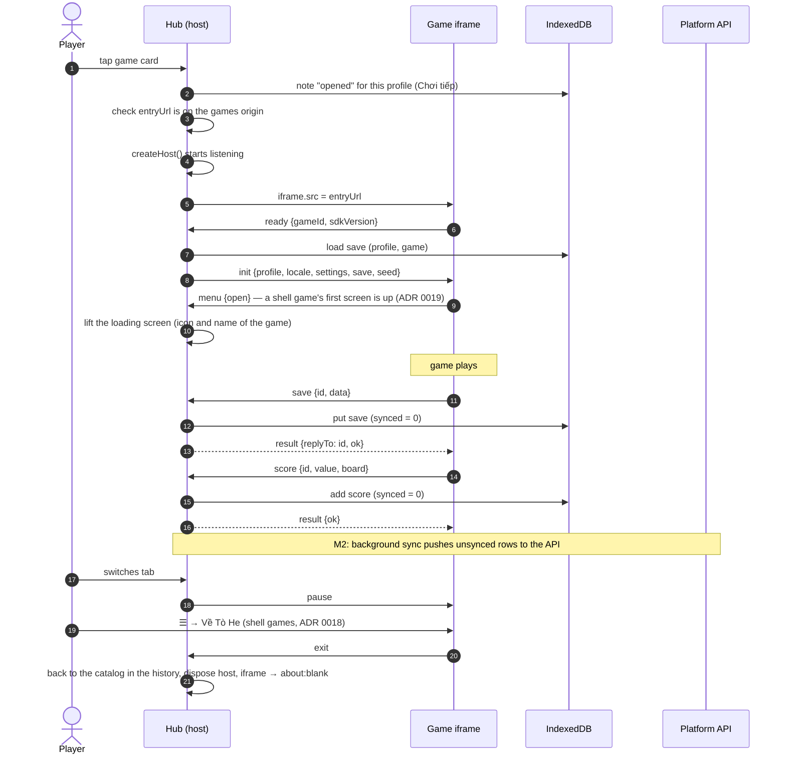

## Rules

- The hub **starts listening before** it sets `iframe.src`, so `ready` can never be missed.
- While the game loads, the hub shows the game's icon and name. For a `shell` game it keeps them up until the game's
  first `menu` message — its title screen, or play at a table — so a half-drawn game never shows; at most 8 s after
  the handshake ([ADR 0019](../decisions/0019-game-shell-2-title-screen-hud-and-first-screen.md)).
- The hub only accepts messages whose `source` is that iframe's window **and** whose `origin` is the games
  origin; everything else is ignored.
- Every incoming message is validated with the Zod schemas from `@tohe/contract`. Invalid messages are dropped
  and reported through `onProtocolError` (logged to the console in the hub).
- `save` and `score` are only accepted if the game declared the `save` / `scores` capability in `game.json`.
- Saves are limited to 64 KB of JSON. Larger saves are rejected with `ok: false`.
- The seed is the local date (`YYYYMMDD`), so everybody gets the same randomness on the same day — the basis for
  daily challenges.
- Opening a game's menu, or the lobby of a game played at tables, notes that this profile opened it, on the device
  (`launcher/recent.ts`): Trò chơi's first screen offers it as *Chơi tiếp* next time ([Surfaces](surfaces.md#coming-back)).
  Nothing of the game's own goes into it; the game says what is left unfinished on its title screen.

## Leaving and phone Back

The hub's history is the way the player walked: catalog → game → lobby → table → replay. Leaving a screen (its ←,
a game's "Về Tò He", leaving a table, a profile chosen) goes **back** to its target when the player came from there,
and **replaces** the screen otherwise (a room link opened from a chat, a reload); it never pushes the target on top.
So phone Back on the catalog leaves Tò He instead of reopening the game just left, and the lobby's ← returns to the
game's main menu without stacking another copy of it. Steps of signing in (welcome → profiles → catalog) replace each
other for the same reason.

- `apps/hub/src/navigation/trail.ts` remembers the path of every history entry of the visit; `useLeaveTo()` and
  `<BackLink>` (`navigation/leave.tsx`) go back to the target or replace with it. Going back skips a game's Back
  handling (`useBlocker`), which only catches the player's own Back.
- After a reload the older entries are unknown, so leaving replaces rather than guessing.
- Phone Back in a shell game is blocked (the browser steps back, the router steps forward again) and sent to the
  game; when the game answers by leaving (Back on its title screen), the hub waits for that forward step to land
  (at most 500 ms) before going back to the catalog — two history traversals at once and the browser drops one.
- Going deeper (a game card, **Chơi online**, a room, a replay) pushes as usual, so Back returns.

## Offline

- The hub's service worker precaches the hub; `GET /api/games` and `GET /api/config` are cached network-first,
  and the hub additionally keeps the last good copy in IndexedDB.
- A new version of the hub never takes over a game in play: its service worker waits until every page of the app is
  closed, and the page keeps the files it started with, so opening a game after a deploy loads the version the page
  runs, with no reload. Going out of sight in a game reloads nothing either; only out of sight on a screen of the
  frame with nothing in progress does the page take the new version ([Surfaces](surfaces.md#coming-back);
  `pnpm --filter @tohe/hub updates`).
- Saves and scores are written to IndexedDB first. Nothing waits for the network.
- Game builds are immutable and served with long cache lifetimes, so a game played once is in the browser cache.
  A dedicated games-origin service worker is a planned spike ([walking skeleton](../roadmap/walking-skeleton.md#spikes)).
- **A game that was never opened has nothing in any cache**, so with no connection its iframe never answers. The loading
  screen does not wait for ever: once the device is offline and the game has still not answered after a short grace
  (3 s — a game in the HTTP cache answers within it), or when the handshake times out while offline, it says "Trò này
  cần mạng để mở lần đầu." with *Về Tò He* (`launcher/offline.ts`). Online, a game that does not answer fails as before.
- The catalog's strip follows the browser's `online` and `offline` events, not one reading of `navigator.onLine`: "Đang mất
  mạng. Trò đã mở trước đó vẫn chơi được." The install sheet claims no offline play: no game guarantees it yet
  ([Surfaces](surfaces.md#the-introduction-surface), `facts.json`).
