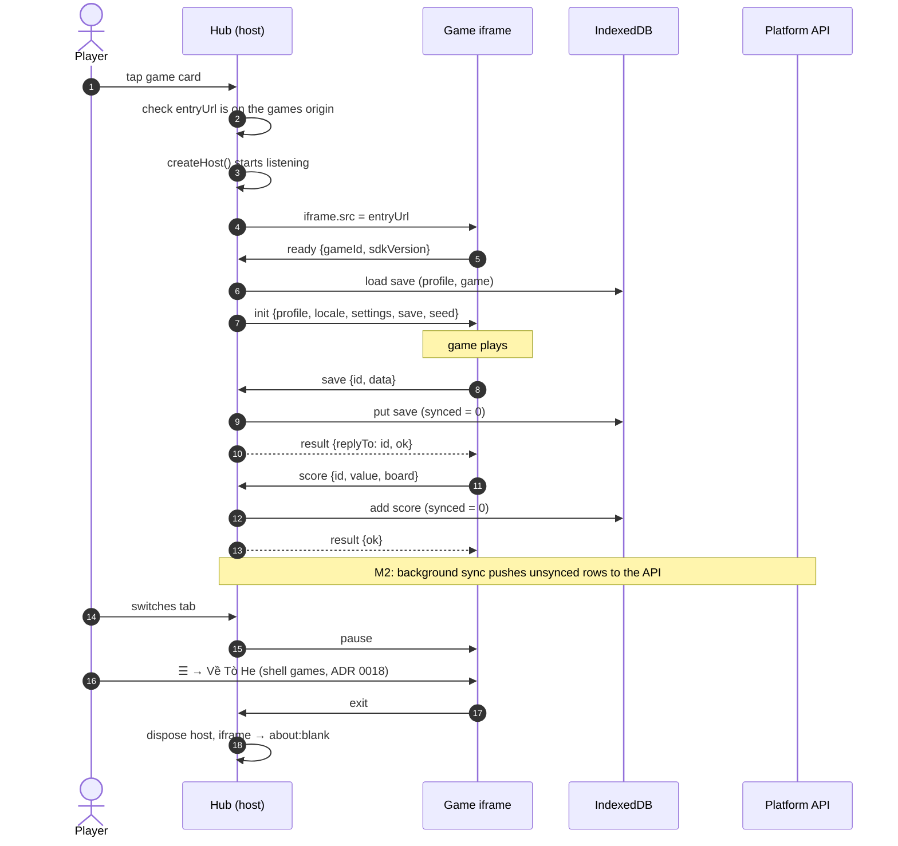

## Rules

- The hub **starts listening before** it sets `iframe.src`, so `ready` can never be missed.
- The hub only accepts messages whose `source` is that iframe's window **and** whose `origin` is the games
  origin; everything else is ignored.
- Every incoming message is validated with the Zod schemas from `@tohe/contract`. Invalid messages are dropped
  and reported through `onProtocolError` (logged to the console in the hub).
- `save` and `score` are only accepted if the game declared the `save` / `scores` capability in `game.json`.
- Saves are limited to 64 KB of JSON. Larger saves are rejected with `ok: false`.
- The seed is the local date (`YYYYMMDD`), so everybody gets the same randomness on the same day — the basis for
  daily challenges.

## Offline

- The hub's service worker precaches the hub; `GET /api/games` and `GET /api/config` are cached network-first,
  and the hub additionally keeps the last good copy in IndexedDB.
- Saves and scores are written to IndexedDB first. Nothing waits for the network.
- Game builds are immutable and served with long cache lifetimes, so a game played once is in the browser cache.
  A dedicated games-origin service worker is a planned spike ([walking skeleton](../roadmap/walking-skeleton.md#spikes)).
