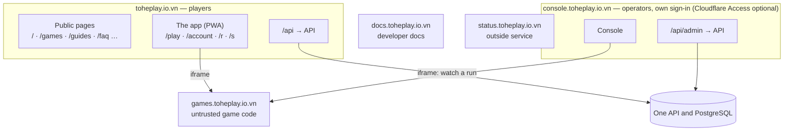
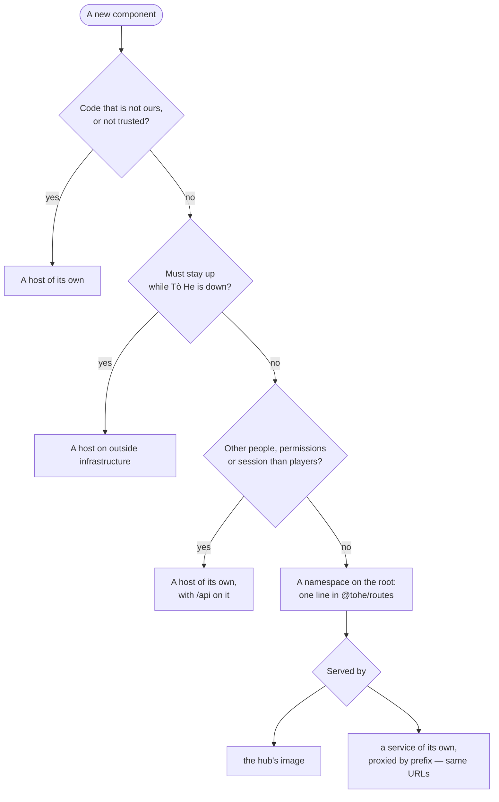

Decision: [ADR 0042](../decisions/0042-hosts-by-trust-paths-by-component.md) (amends [ADR 0040](../decisions/0040-all-of-tohe-on-one-domain-of-its-own.md), [0027](../decisions/0027-platform-admin-and-the-first-owner.md)
and [0021](../decisions/0021-release-production-through-the-tohe-chart.md)).

## The standard

| Layer | Rule | Changes when |
| --- | --- | --- |
| Domain | One: `toheplay.io.vn` | never |
| Host | One trust boundary and one audience | rarely — a new host is an ADR |
| Namespace | Inside a host, each component owns a few path prefixes, listed in `@tohe/routes` | a component is added — one line, reviewed |
| Common rules | Sessions, the API, headers, indexing, the app, mail, environments, configuration | almost never |

## Hosts

| Host | Role | Session | Indexed | Served by |
| --- | --- | --- | --- | --- |
| `toheplay.io.vn` | Players: public pages, the app, the API | `__Host-tohe.session`, `SameSite=Lax` | public pages only | the hub image's Caddy: the public pages (`apps/web`, in `/srv/web`) and the app (`/srv`), proxying `/api` |
| `console.toheplay.io.vn` | Operators: the console, the API's console routes | `__Host-tohe.console`, `SameSite=Strict`; Cloudflare Access first once the owner turns it on (optional for now) | no | the hub image's Caddy, a second site |
| `games.toheplay.io.vn` | Game builds, the catalog | none | no | the games image |
| `docs.toheplay.io.vn` | Developer docs at the root of the host, generated API references, `llms.txt` | none | yes | the docs image (`apps/docs`) |
| `status.toheplay.io.vn` | Status and incidents | none | yes | a service outside Tò He's infrastructure |
| `notify.toheplay.io.vn` | Sends transactional mail; no web | — | — | the mail provider |
| `www.toheplay.io.vn` | Redirects to the root | — | — | Cloudflare |

Mail to people: `hello@` and `security@toheplay.io.vn`, forwarded by Cloudflare Email Routing. `send.toheplay.io.vn` is
the mail provider's return path.

Kept for later, without DNS: `api.`, `account.`, `studio.`, `media.`, `uat.` ([ADR 0042](../decisions/0042-hosts-by-trust-paths-by-component.md)).

## Namespaces on the root

| Namespace | Component | Served | Indexed |
| --- | --- | --- | --- |
| `/` (the root only), `/games/`, `/guides/`, `/faq`, `/about`, `/terms`, `/privacy` | public pages (`apps/web`) | static HTML | yes |
| `/_web/…` | public pages — the scripts, styles and images their build adds, hashed names | static | no |
| `/play`, `/play/<gameId>/…` | the app — the catalog, and only game ids under `/play/`, so a game named like a page never collides: `/play/<gameId>`, `/play/<gameId>/rooms`, `/play/<gameId>/rooms/<roomId>`, `/play/<gameId>/rooms/<roomId>/replay/<hand>` | the app's page | no |
| `/account/…` | the app — signing in and up (`/account/sign-in`, `/account/register`), password, email, profiles, what telemetry sends (`/account/data`), the account itself (`/account`) | the app's page | no |
| `/r/<code>`, `/s/<code>` | the app's short links | the app's page | no |
| the app's assets, manifest and service worker | the app | static | — |
| `/api/…` | the API | proxied | — |
| `/.well-known/…`, `/robots.txt`, `/sitemap.xml` | the platform | generated | — |
| anything else | — | a real `404` | — |

This table is the standard; the map in `@tohe/routes` holds the namespaces served today and moves to it step by step
(see *Where things stand*). From the map the build generates the hub's Caddy
routes, the service worker's list of app pages, `robots.txt` and the API's links to the hub, and a test fails when two
namespaces overlap or a component serves a path outside its own.

### The public pages

`apps/web` (Astro, static, Vietnamese) is built into the hub image and served by its Caddy from `/srv/web`, so its
`index.html` is never the app's. Today it is the home page at `/`; `/terms` and `/privacy` are still rendered by the app
(a later pull request serves them as static pages at the same URLs).

- **Indexed**: no `X-Robots-Tag: noindex`, canonical and Open Graph links with the hub's own URL.
- **Its own CSP**: no third-party script, no inline script and no inline style, no frame, no form, no connection. Every
  script and stylesheet is a file under `/_web/` (the build's `scripts/check-build.ts` fails when one is inlined); the
  Caddy test in `@tohe/routes` checks the header.
- **A returning player goes to the app**: a small blocking script in `<head>` sends a browser that already has this
  origin's `tohe:guest` (a guest on the device) or `tohe:telemetry:device` (the id the app's telemetry gives a device)
  in `localStorage` to `/play` with `location.replace`. The session cookie is `HttpOnly`, so it cannot be the signal.
  `/?stay` (any `stay` parameter) never redirects, so the page can still be looked at. *Chơi ngay* links to `/play`.
- **One image for every environment**: the build writes the hub's and the docs host's URLs as placeholders that the
  hub's Caddy fills in from `TOHE_HUB_URL` and `TOHE_DOCS_URL` when the container starts
  ([Configuration](../guides/configuration.md)).
- **`/sitemap.xml` and `robots.txt`** are generated from the map: the sitemap lists every indexed namespace (a tree
  such as `/games/` needs its pages listed first — the generator refuses it until then), with absolute URLs from
  `TOHE_HUB_URL`; `robots.txt` allows `/`, keeps crawlers out of `/api/` and names the sitemap.
- **The docs host** serves the docs at its root: an old `/docs/<page>` answers `301` to `/<page>`, the query kept, and
  `/play` leads to the hub's `/play`.

### Old paths

The app lived at thirteen prefixes on the root before the move. The paths that emails already sent may carry answer
`301` to the new ones, the query kept; they are listed in the map (`hubRedirects`) and kept without an end date:

| Old | New |
| --- | --- |
| `/welcome` | `/account/sign-in` |
| `/sign-in/…` | `/account/sign-in/…` |
| `/register`, `/register/…` | `/account/register`, `/account/register/…` |
| `/password/…` | `/account/password/…` |
| `/profiles` | `/account/profiles` |
| `/data` | `/account/data` |
| `/legal/terms`, `/legal/privacy` | `/terms`, `/privacy` |
| `/rooms/<gameId>` | `/play/<gameId>/rooms` |

`/room/<roomId>` and `/replay/<roomId>/<hand>` were only reached from inside the app and need a game id an old link
does not carry: they answer `404`.

## Namespaces on the console's host

| Namespace | Component | Served | Indexed |
| --- | --- | --- | --- |
| `/`, `/games`, `/health`, `/system`, `/users/…`, `/review/…`, `/communities`, `/settings`, `/audit`, `/security`, `/setup` | the console (`apps/console`) | the console's page | no |
| `/assets/…`, `/index.html`, `/theme-init.js`, `/favicon.svg` | the console | static | no |
| `/api/admin/…` | the API's console routes — and no other route of the API | proxied | — |
| anything else — the hub's pages, `/admin`, `/robots.txt` | — | a real `404` | — |

`consoleNamespaces` in `@tohe/routes` generates the second site's matchers (`console-routes.caddy`); the console's own
test checks its router against them. The API answers its console routes on this host alone, and nothing else there
(`App:ConsoleUrl`).

## Common rules

- **Sessions**: each front door serves `/api` on its own origin (the backend-for-frontend pattern of RFC 10017).
  Cookies are `__Host-`, `HttpOnly`, `Secure`, `Path=/`, never with a `Domain`. No CORS.
- **The API** is one service with several front doors; it learns its origins from configuration.
- **No third-party script** on the root or on `console.`; a CSP for each host and namespace.
- **HSTS** `max-age=31536000; includeSubDomains`; no preload list.
- **The app**: manifest `id: "/"`, `start_url: "/play"`, `scope: "/"`. The service worker serves the app's page only for
  the app's namespaces.
- **Environments keep the role names**: production `<role>.toheplay.io.vn`; UAT, once it has HTTPS,
  `<role>.uat.toheplay.io.vn`; development on `localhost` ports ([Environments and releases](../guides/environments.md)).
- **Hosts come from configuration** (`publicUrls` in the chart, [Configuration](../guides/configuration.md)).

## Adding a component

A new host needs an ADR, DNS, `publicUrls`, the chart's ingress and `platform-infra`. A new namespace needs one line in the
map and a review.

## Where things stand

The standard arrives in steps; until a step lands, the layout of [ADR 0040](../decisions/0040-all-of-tohe-on-one-domain-of-its-own.md)
stays in force for its part.

| Part | Today | In place when |
| --- | --- | --- |
| The map, real `404`s, `robots.txt`, `security.txt`, HSTS for subdomains, the API reference behind a switch | in place: `packages/routes`, with today's namespaces; `security.txt` once `hub.securityContact` is set in `platform-infra` | the map's pull request |
| The app under `/play` and `/account`, the manifest's `id` | in place: `/play`, `/account`, `/r`, and `/terms`, `/privacy` for now; manifest `id: "/"`, `start_url: "/play"`, `scope: "/"`; the old paths answer `301` | the routes' pull request |
| Public pages and `sitemap.xml` at the root; the docs at the root of `docs.` | in place: `apps/web` is built into the hub image and serves the home page at `/` (indexed, its own CSP, a script that sends a returning player to `/play`), with `/sitemap.xml` and `robots.txt` from the map; `apps/docs` serves the docs at the root of `docs.toheplay.io.vn` (`/docs/<page>` answers `301`); the chart's `site` values are `docs`. More pages (games, guides, FAQ, about, static terms and privacy) are the next pull requests | the public pages' pull request |
| The console on `console.` | in place: the hub image's second site (port 8081) at the root of `console.toheplay.io.vn` — `http://localhost:4721` locally, `http://10.100.0.2:4821` on UAT — with its own sign-in and its `__Host-tohe.console` session ([Admin console](admin.md#the-consoles-session)); `/admin` on the root is a `404`. Cloudflare Access in front is the owner's setup, optional for now (2026-10-20); the API does not check Access's token yet | the console's pull request |
| Mail from `notify.`; `status.` | mail from the root; no status page | the owner's setup ([Mail and the status page](../guides/mail-and-status.md)) |
