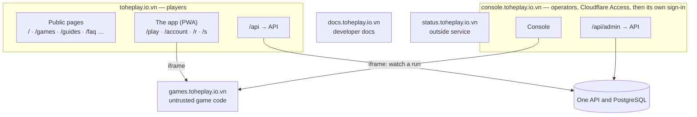

Decision: [ADR 0042](../decisions/0042-hosts-by-trust-paths-by-component.md) (amends [ADR 0040](../decisions/0040-all-of-tohe-on-one-domain-of-its-own.md), [0027](../decisions/0027-platform-admin-and-the-first-owner.md)
and [0021](../decisions/0021-release-production-through-the-tohe-chart.md)), amended by [ADR 0046](../decisions/0046-player-surfaces-two-zones-one-frame.md)
(`/together`, no redirect on `/`, the planes and the games' isolation ladder, Access on the console)
and [ADR 0047](../decisions/0047-two-languages-and-an-introduction-surface-that-grows.md) (`/en/…`, `/promise/`, crawlers
by name). What players see in these namespaces: [Surfaces](surfaces.md).

## The standard

| Layer | Rule | Changes when |
| --- | --- | --- |
| Domain | One: `toheplay.io.vn` | never |
| Host | One trust boundary and one audience | rarely — a new host is an ADR |
| Namespace | Inside a host, each component owns a few path prefixes, listed in `@tohe/routes` | a component is added — one line, reviewed |
| Common rules | Sessions, the API, headers, indexing, the app, mail, environments, configuration | almost never |

## Hosts

| Host | Role | Session | Indexed | Served by |
| --- | --- | --- | --- | --- |
| `toheplay.io.vn` | Players: public pages, the app, the API | `__Host-tohe.session`, `SameSite=Lax` | public pages only | the hub image's Caddy: the public pages (`apps/web`, in `/srv/web`) and the app (`/srv`), proxying `/api` |
| `console.toheplay.io.vn` | Operators: the console, the API's console routes | `__Host-tohe.console`, `SameSite=Strict`; Cloudflare Access first (on since 2026-10-22), then the console's own sign-in | no | the hub image's Caddy, a second site |
| `games.toheplay.io.vn` | Game builds, the catalog | none | no | the games image |
| `docs.toheplay.io.vn` | Developer docs at the root of the host, generated API references, `llms.txt` | none | yes | the docs image (`apps/docs`) |
| `status.toheplay.io.vn` | Status and incidents | none | yes | a service outside Tò He's infrastructure |
| `notify.toheplay.io.vn` | Sends transactional mail; no web | — | — | the mail provider |
| `www.toheplay.io.vn` | Redirects to the root | — | — | Cloudflare |

Mail to people: `hello@` and `security@toheplay.io.vn`, forwarded by Cloudflare Email Routing. `send.toheplay.io.vn` is
the mail provider's return path.

Kept for later, without DNS: `api.`, `account.`, `studio.`, `media.`, `uat.` ([ADR 0042](../decisions/0042-hosts-by-trust-paths-by-component.md)).

**The hosts as planes** ([ADR 0046](../decisions/0046-player-surfaces-two-zones-one-frame.md)): players (the root), games
(`games.`), operators (`console.`), developers (`docs.`, later `studio.`), edge (`status.`, `notify.`). The games plane is
at isolation level **L1** — an origin of its own, enough while every game is one the owner adds to this repository.
**Before the first game the owner did not add**, the owner chooses L2 (a registrable domain of its own) or L3 (a site per
game); the games origin is configuration (`publicUrls.games`), so L2 is a change of configuration and DNS, while L3 also
needs a URL per game from the API, the hub's CSP to allow each game's host, and a games host serving many names.

## Namespaces on the root

| Namespace | Component | Served | Indexed |
| --- | --- | --- | --- |
| `/` (the root only), `/games/`, `/guides/`, `/faq/`, `/about/`, `/promise/`, `/terms/`, `/privacy/` | public pages (`apps/web`), Vietnamese | static HTML | yes |
| `/en/…` — the same pages in English, under the same names ([ADR 0047](../decisions/0047-two-languages-and-an-introduction-surface-that-grows.md)), but for the pages declared Vietnamese-only (`vietnameseOnlyPages` in the map: `/terms/` and `/privacy/` until their English texts land) | public pages (`apps/web`), English | static HTML | yes |
| `/_web/…` | public pages — the scripts, styles and images their build adds, hashed names | static | no |
| `/og.png`, `/llms.txt` | public pages — the picture a link preview shows, and the list of the pages for AI readers | static | not in the sitemap |
| `/play`, `/play/<gameId>/…` | the app — the catalog, and only game ids under `/play/`, so a game named like a page never collides: `/play/<gameId>`, `/play/<gameId>/rooms`, `/play/<gameId>/rooms/<roomId>`, `/play/<gameId>/rooms/<roomId>/replay/<hand>` | the app's page | no |
| `/together` | the app — playing together: a code, the player's tables, invitations, the newest links they sent (the full list stays at `/account/links`) ([Surfaces](surfaces.md)) | the app's page | no |
| `/account/…` | the app — signing in and up (`/account/sign-in`, `/account/register`), password, email, profiles, what telemetry sends (`/account/data`), moving a device profile (`/account/transfer`), the share links a profile made (`/account/links`, [Entry links](entry-links.md)), the account itself (`/account`) | the app's page | no |
| `/r/<code>`, `/s/<code>` | the app's short links: a table's, a share link's ([Entry links](entry-links.md)); a known link-preview crawler gets the API's card for them instead, through a rewrite to `/api/previews/…` that the map generates | the app's page | no |
| the app's assets, manifest and service worker | the app | static | — |
| `/api/…` | the API | proxied | — |
| `/.well-known/…`, `/robots.txt`, `/sitemap.xml` | the platform | generated | — |
| anything else | — | a real `404` | — |

This table is the standard; the map in `@tohe/routes` holds the namespaces served today and moves to it step by step
(see *Where things stand*). From the map the build generates the hub's Caddy
routes, the service worker's list of app pages, `robots.txt` and the API's links to the hub, and a test fails when two
namespaces overlap or a component serves a path outside its own.

### The public pages

`apps/web` (Astro, static) is built into the hub image and served by its Caddy from `/srv/web`, so its `index.html` is
never the app's. It speaks two languages ([ADR 0047](../decisions/0047-two-languages-and-an-introduction-surface-that-grows.md)):
Vietnamese, the face, at the paths below — the URLs already indexed — and English, the support, at the same paths under
`/en/` (`/en/`, `/en/games/<gameId>/`, `/en/guides/install/`…), through Astro's i18n routing (Vietnamese without a
prefix). Its pages:

| Page | What it is |
| --- | --- |
| `/` | The home page: what Tò He is in five seconds, *Chơi ngay* to `/play`, the games, the way to install |
| `/games/`, `/games/<gameId>/` | The games, and one page per game, made at build time from the game's own `game.json` and icon (and the how-to copy in `apps/web/src/content/games.ts`, in both languages) |
| `/guides/`, `/guides/install/` | Guides; how to put Tò He on the home screen — Android, iPhone, inside Zalo or Messenger, a computer |
| `/faq/` | Short answers to what people ask first |
| `/about/` | What Tò He is, who runs it, `hello@toheplay.io.vn` |
| `/terms/`, `/privacy/` | The terms of use and the privacy notice, rendered at build time from `apps/hub/src/legal/documents.ts` — the one source; the app has no page of its own for them and its links are a full navigation to these. **Vietnamese only** for now |
| `/og.png`, `/llms.txt` | The shared 1200×630 picture of every link preview (made by `pnpm --filter @tohe/web generate:og` and committed), and `llms.txt`, written at build time from the same pages, both languages in one file |

A page's address ends in `/`: the path without it answers `308` to the one with it.

**The pages without an English text.** The terms and the privacy notice are declared Vietnamese-only in one list,
`vietnameseOnlyPages` in `@tohe/routes`: they have no `/en/` page and no alternates in the sitemap, and English pages link
to them labelled as Vietnamese ("Terms (in Vietnamese)", `hreflang="vi"`). The build allows exactly that list to stand
alone and nothing else. **The list empties when the English texts land** — with their clause ids and the test that keeps
the two in step (ADR 0047), the item of the launch review in which the owner syncs the legal texts.

**Switching language.** The header has a VI | EN switch: two links, to this page and to the same page in the other
language (on a Vietnamese-only page, EN leads to `/en/`). A Vietnamese page shows a reader whose browser's first
language is not Vietnamese — or who chose English before — a suggestion, "View in English →", and never redirects. A
choice, made with the switch or the suggestion, is remembered in `localStorage` ([Surfaces](surfaces.md#languages)).
Links from an English page into the app carry `?lang=en`. Both scripts are files under `/_web/`.

**Where the words are.** All copy is in `apps/web/src/content/` — one file per page (`home.ts`, `install.ts`, `faq.ts`,
`about.ts`, `games.ts`, `site.ts` for the navigation, the switch and the footer), each with a Vietnamese text and an
English one of the same shape (TypeScript and `content.test.ts` hold them together). A page's layout is written once, in
`apps/web/src/views/`; the page files in `src/pages/` and `src/pages/en/` only name it, and the view reads the page's
language from Astro. Proper names and established terms stay as they are in either language (*Tiến lên miền Nam*,
"combo"). The terms and the privacy notice are not copy of this app: change them in `documents.ts`, with
`TERMS_VERSION`, as before.

**Search and AI readers**, checked by the build (`scripts/check-build.ts`, which fails the build):

- every page has its own `<title>` and meta description, `og:title`, `og:description`, `og:url`, `og:image` (`/og.png`,
  which must exist), `twitter:card` and exactly one `<h1>`;
- every page says its language (`scripts/language-rules.ts`, whose tests break a page on purpose for each rule): `<html
  lang>` is its path's language; `og:locale` is that language's (`vi_VN`, `en_US`) and `og:locale:alternate` names the
  other one when the page has a pair, and is absent when it has none; the canonical link is the page itself; every
  JSON-LD block has the page's `inLanguage` (an `Organization` has none); a link to a page of the other language says so
  with `hreflang`, and the switch leads to the page's pair; an English page's links into the app carry `?lang=en`;
- every page the sitemap lists has its pair in the other language, but the pages of `vietnameseOnlyPages` — exactly
  those, each of them a Vietnamese page of the sitemap without an English one;
- JSON-LD on every page, parsed by the check: `WebSite` and `Organization` on `/` and `/en/`, `VideoGame` on each
  game's page, `FAQPage` on the FAQ with as many questions as the page shows, `CollectionPage`, `WebPage` or
  `AboutPage` on the others;
- the pages the build wrote are exactly the pages the sitemap lists (`sitemapPaths` in `@tohe/routes`), every file lies
  in a public namespace of the map, and every link on a page leads somewhere the map knows (a public page is checked
  to exist);
- `robots.txt` carries Cloudflare's content signals, `Content-Signal: search=yes, ai-input=yes, ai-train=no`: search
  engines and AI answers may use the pages, training may not (the owner's choice, 2026-10-20). It also names crawlers
  ([ADR 0047](../decisions/0047-two-languages-and-an-introduction-surface-that-grows.md)): the ones that fetch for search
  and answers (`searchCrawlers` in the map — Googlebot, Bingbot, `OAI-SearchBot`, `Claude-SearchBot`, `PerplexityBot`,
  Applebot, `coccocbot-web`) in a group with the same rules as every crawler, since a crawler follows only the group that
  names it (RFC 9309); the crawlers and tokens only for training models (`trainingCrawlers` — `GPTBot`, `ClaudeBot`,
  `CCBot`, and the tokens `Google-Extended` and `Applebot-Extended`, which say whether what Googlebot and Applebot fetch
  may train models) with `Disallow: /`.

- **Indexed**: no `X-Robots-Tag: noindex`, canonical and Open Graph links with the hub's own URL.
- **Its own CSP**: no third-party script, no inline script and no inline style, no frame, no form, no connection. Every
  script and stylesheet is a file under `/_web/` (the build's `scripts/check-build.ts` fails when one is inlined); the
  Caddy test in `@tohe/routes` checks the header.
- **A returning player goes to the app** — until the introduction surface's pull request, which replaces the redirect
  with a *Continue* button ([ADR 0046](../decisions/0046-player-surfaces-two-zones-one-frame.md)): a small blocking script in `<head>` sends a browser that already has this
  origin's `tohe:guest` (the device plays as its device profiles; the key kept from guest mode) or `tohe:telemetry:device` (the id the app's telemetry gives a device)
  in `localStorage` to `/play` with `location.replace`. The session cookie is `HttpOnly`, so it cannot be the signal.
  `/?stay` (any `stay` parameter) never redirects, so the page can still be looked at. *Chơi ngay* links to `/play`.
  The English home page, `/en/`, does the same and sends the browser to `/play?lang=en`, as every link of an English
  page into the app.
- **One image for every environment**: the build writes the hub's and the docs host's URLs as placeholders that the
  hub's Caddy fills in from `TOHE_HUB_URL` and `TOHE_DOCS_URL` when the container starts
  ([Configuration](../guides/configuration.md)). The app's own page gets the same for its link preview: `og:url`
  (the address asked for) and `og:image` (`/og.png`).
- **`/sitemap.xml` and `robots.txt`** are generated from the map: the sitemap lists every indexed namespace (a tree
  such as `/games/` needs its pages listed first — the generator refuses it until then; the games' pages come from
  `games/*/public/game.json`, so a new game is a change of the generated sitemap, which the drift check shows), with
  absolute URLs from `TOHE_HUB_URL`. It is the one place `hreflang` is declared: each page of a language pair names
  its alternates — `vi`, `en` and `x-default`, the English page — and a Vietnamese-only page names none; the generator
  refuses a page whose pair is not listed, unless `vietnameseOnlyPages` declares it. `robots.txt` allows `/`, keeps
  crawlers out of `/api/`, gives the content signals,
  names the search and the training crawlers (above) and names the sitemap.
- **The docs host** serves the docs at its root: an old `/docs/<page>` answers `301` to `/<page>`, the query kept, and
  `/play` leads to the hub's `/play`.

### Adding or changing a public page

1. A page of a tree that exists (`/guides/…`), always in both languages: its layout in `apps/web/src/views/`, a page
   file naming it in `apps/web/src/pages/` and another in `apps/web/src/pages/en/`, its words in
   `apps/web/src/content/` in Vietnamese and in English, JSON-LD with the page's `inLanguage`, and its Vietnamese path
   in `publicPages` in `packages/routes/src/map.ts` (the English one follows from it); then
   `pnpm --filter @tohe/routes build`. A page with only one language fails the build, but for those of `vietnameseOnlyPages`,
   which holds the legal texts until their English lands.
2. A new top-level path is a namespace first (above); its English pages live under `/en/`, which needs no namespace of
   its own.
3. A game needs no page of its own: `games/<id>/public/game.json` makes `/games/<id>/` and `/en/games/<id>/`. What to
   add by hand is the how-to in `apps/web/src/content/games.ts`, in Vietnamese and English, with an English
   `description` (the manifest's is Vietnamese; a test fails without either), and, because the sitemap changes, the
   regenerated files (`pnpm --filter @tohe/routes build`).

### Old paths

The app lived at thirteen prefixes on the root before ADR 0042 moved it under `/play` and `/account`. Their `301`s to the
new paths were removed on 2026-10-22 — production had no player but the owner, who decided it ("làm như mới",
[ADR 0046](../decisions/0046-player-surfaces-two-zones-one-frame.md)): `/welcome`, `/sign-in/…`, `/register/…`,
`/legal/terms` and the rest are a `404` like any path in no namespace, and the map has no redirects at all. A path that
moves from now on moves with every link to it, in the same pull request.

## Namespaces on the console's host

| Namespace | Component | Served | Indexed |
| --- | --- | --- | --- |
| `/`, `/games`, `/health`, `/system`, `/users/…`, `/review/…`, `/communities`, `/links`, `/settings`, `/audit`, `/security`, `/setup` | the console (`apps/console`) | the console's page | no |
| `/assets/…`, `/index.html`, `/theme-init.js`, `/favicon.svg` | the console | static | no |
| `/api/admin/…` | the API's console routes — and no other route of the API | proxied | — |
| anything else — the hub's pages, `/admin`, `/robots.txt` | — | a real `404` | — |

`consoleNamespaces` in `@tohe/routes` generates the second site's matchers (`console-routes.caddy`); the console's own
test checks its router against them. The API answers its console routes on this host alone, and nothing else there
(`App:ConsoleUrl`).

## Common rules

- **Sessions**: each front door serves `/api` on its own origin (the backend-for-frontend pattern of RFC 10017).
  Cookies are `__Host-`, `HttpOnly`, `Secure`, `Path=/`, never with a `Domain`. No CORS.
- **The API** is one service with several front doors; it learns its origins from configuration.
- **No third-party script** on the root or on `console.`; a CSP for each host and namespace.
- **HSTS** `max-age=31536000; includeSubDomains`; no preload list.
- **The app**: manifest `id: "/"`, `start_url: "/play"`, `scope: "/"`. The service worker serves the app's page only for
  the app's namespaces.
- **Environments keep the role names**: production `<role>.toheplay.io.vn`; UAT, once it has HTTPS,
  `<role>.uat.toheplay.io.vn`; development on `localhost` ports ([Environments and releases](../guides/environments.md)).
- **Hosts come from configuration** (`publicUrls` in the chart, [Configuration](../guides/configuration.md)).

## Adding a component

A new host needs an ADR, DNS, `publicUrls`, the chart's ingress and `platform-infra`. A new namespace needs one line in the
map and a review.

## Where things stand

The standard arrives in steps; until a step lands, the layout of [ADR 0040](../decisions/0040-all-of-tohe-on-one-domain-of-its-own.md)
stays in force for its part.

| Part | Today | In place when |
| --- | --- | --- |
| The map, real `404`s, `robots.txt`, `security.txt`, HSTS for subdomains, the API reference behind a switch | in place: `packages/routes`, with today's namespaces; `security.txt` once `hub.securityContact` is set in `platform-infra` | the map's pull request |
| The app under `/play` and `/account`, the manifest's `id` | in place: `/play`, `/account`, `/r`, `/s` (the pages of the entry pipeline, [Entry links](entry-links.md)); manifest `id: "/"`, `start_url: "/play"`, `scope: "/"`; the old paths are a `404` since 2026-10-22 | the routes' pull request |
| Public pages and `sitemap.xml` at the root; the docs at the root of `docs.` | in place: `apps/web` is built into the hub image and serves the home page, the games' pages, the install guide, the FAQ, about, and the terms and privacy notice at the root, and the same in English under `/en/` but for the terms and the privacy notice (indexed, its own CSP; a script on `/` sends a returning player to `/play`), with `/sitemap.xml`, `robots.txt`, `llms.txt` and the link-preview picture; `apps/docs` serves the docs at the root of `docs.toheplay.io.vn` (`/docs/<page>` answers `301`); the chart's `site` values are `docs` | the public pages' pull request |
| The console on `console.` | in place: the hub image's second site (port 8081) at the root of `console.toheplay.io.vn` — `http://localhost:4721` locally, `http://10.100.0.2:4821` on UAT — with its own sign-in and its `__Host-tohe.console` session ([Admin console](admin.md#the-consoles-session)); `/admin` on the root is a `404`. Cloudflare Access in front is the owner's setup, optional for now (2026-10-20) and required before the launch ([ADR 0046](../decisions/0046-player-surfaces-two-zones-one-frame.md)); the API does not check Access's token yet | the console's pull request |
| Mail from `notify.`; `status.` | mail from the root; no status page | the owner's setup ([Mail and the status page](../guides/mail-and-status.md)) |
| Crawlers by name in `robots.txt` ([ADR 0047](../decisions/0047-two-languages-and-an-introduction-surface-that-grows.md)) | in place: `searchCrawlers` and `trainingCrawlers` in the map | the routes' pull request |
| The English public pages, `/en/…` ([ADR 0047](../decisions/0047-two-languages-and-an-introduction-surface-that-grows.md)) | in place: the namespace `en`, the English pages, the sitemap's `hreflang` alternates, the VI \| EN switch and the suggestion; the terms and the privacy notice Vietnamese-only (`vietnameseOnlyPages`) | the languages' pull request; the legal texts' English with the review's item for them |
| The namespaces `/together`, `/promise/` | `/together` is in the map ahead of its page, so the app frame's pull request changes no generated file while the introduction surface's does (one worker at a time on them, [Working with agents](../guides/working-with-agents.md)); until then the app shows its own not-found there. `/promise/` arrives with its page, which the build's check — the pages written are the sitemap's — needs | the app frame's and the introduction surface's pull requests |
