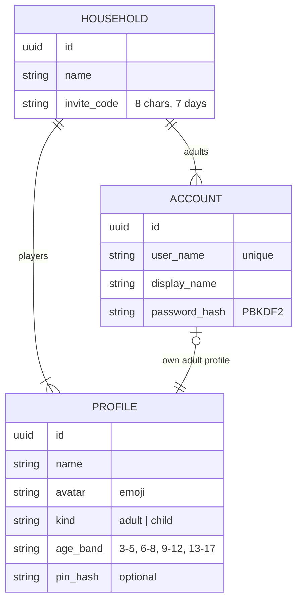
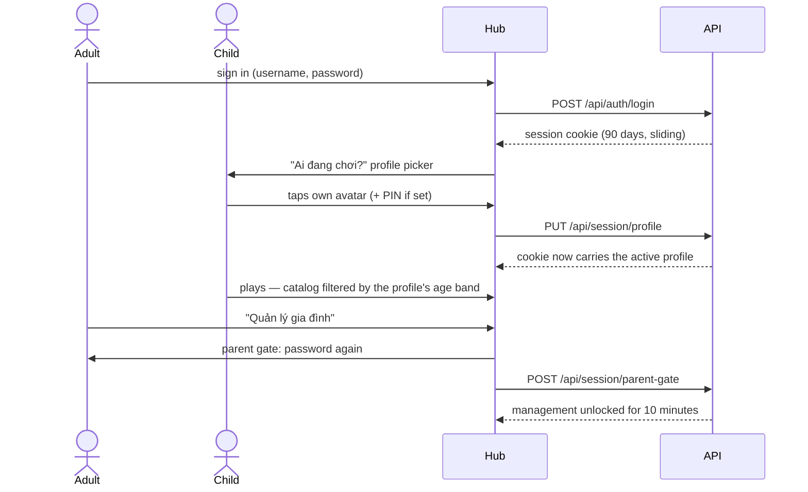

Decisions: [ADR 0004](../decisions/0004-identity-households-and-profiles.md) (model) and
[ADR 0011](../decisions/0011-password-sign-in-first.md) (password sign-in, sessions, parent gate).

## Model

- An **account** is an adult who can sign in. Every account has one **adult profile** created with it.
- A **household** groups adults and the profiles they manage. Adults join an existing household with an invite code.
- A **profile** is a player. Children only ever have profiles — never accounts or passwords.
- Saves and scores belong to a profile (on the device today; synced with milestone M2).

Tables live in the `identity` (accounts) and `households` (households, profiles) schemas. Data Protection keys
(used to encrypt session cookies) live in `platform.data_protection_keys`.

## A device's life

## Rules

| Rule | Where it is enforced |
| --- | --- |
| Household management needs the parent gate (password within the last 10 minutes) | `Parent` authorization policy on `/api/household/*` |
| Only child profiles can be deleted; an adult profile belongs to its account | Households module |
| An adult profile can only be edited by its own account | Households module |
| A PIN is exactly 4 digits and stored hashed; wrong PINs are rate limited | Session endpoints |
| Children see only games whose `minAge` is at most the lower bound of their age band | Registry, via `IActiveProfile` |
| Unsafe `/api` requests from another origin (`Sec-Fetch-Site` ≠ `same-origin`) are rejected | `SameOriginGuard` middleware |
| Sign-in, registration, PIN and parent gate: 10 requests per minute per client IP | Rate limiter policy `auth` |
| 10 wrong passwords lock an account for 5 minutes | ASP.NET Core Identity lockout |

## Guest mode

"Chơi thử" lets anyone play without an account, with one local guest profile per device (saves stay on the
device). The first time a real profile is chosen on that device, the hub offers to move the guest's progress to it.

## API

| Endpoint | Auth | Purpose |
| --- | --- | --- |
| `POST /api/auth/register` | — | Create an account; new household, or join one with an invite code |
| `POST /api/auth/login` / `POST /api/auth/logout` | — / session | Sign in / out |
| `GET /api/auth/me` | session | Account, household, members, profiles, active profile, parent-gate expiry |
| `PUT /api/session/profile` / `DELETE` | session | Choose (PIN if set) / clear the active profile |
| `POST /api/session/parent-gate` / `DELETE` | session | Unlock / lock household management |
| `GET /api/profiles/options` | — | Allowed avatars and age bands |
| `PATCH /api/household` | parent | Rename the household |
| `POST /api/household/invite` / `DELETE` | parent | Create / revoke the invite code |
| `POST /api/household/profiles` | parent | Add a child profile |
| `PATCH` / `DELETE /api/household/profiles/{id}` | parent | Edit / remove a profile |

Errors are problem details; a machine-readable `code` (e.g. `invalid_credentials`, `pin_required`, `pin_invalid`,
`parent_gate_required`, `username_taken`, `invite_invalid`) lets the hub show a Vietnamese message.
