Decisions: [ADR 0026](../decisions/0026-sign-in-methods-and-account-linking.md) (Google, GitHub and an OpenID
Connect issuer, linked by subject after proof), [ADR 0025](../decisions/0025-step-up-in-two-levels-and-consent-at-sign-up.md) (step-up in two levels,
16 or older and the terms at sign-up), [ADR 0024](../decisions/0024-email-identifies-an-account.md) (email identifies
an account, codes bound to attempts), [ADR 0023](../decisions/0023-accounts-own-their-profiles.md) (accounts own profiles, public IDs, names),
[ADR 0011](../decisions/0011-password-sign-in-first.md) (passwords, sessions, parent gate). ADR 0004 (households) is
superseded.

## Model

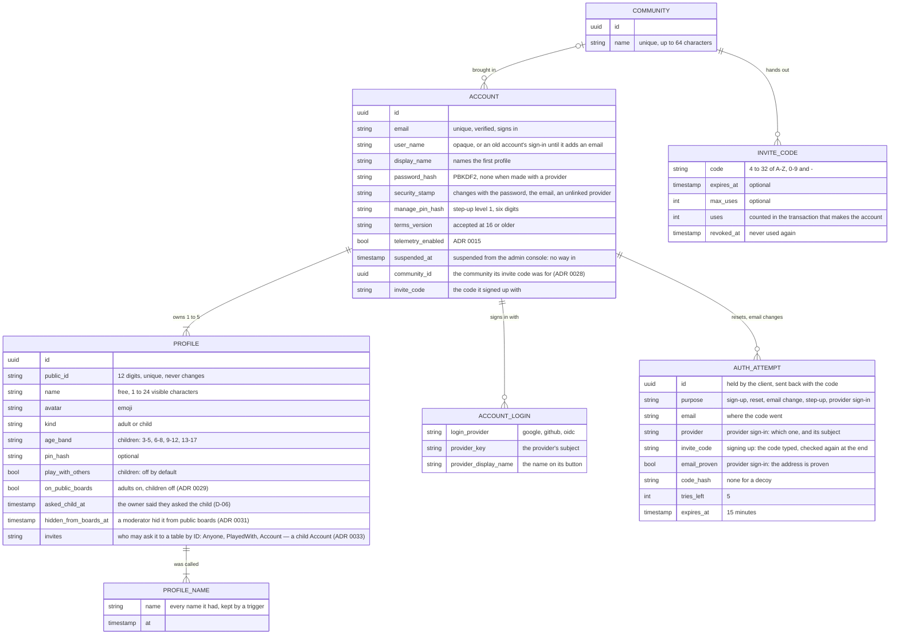

- An **account** is someone who signs in, with one **verified email** that nobody else ever sees. It owns one to five
  **profiles**: the first is created with the account and named with its display name, and the last can never be
  removed. A family is one account with a profile per player. It may also sign in with Google, GitHub or the
  deployment's OpenID Connect issuer, each linked by the provider's subject ([Signing in with a
  provider](#signing-in-with-a-provider)).
- A **profile** is a player. Children only ever have profiles — never accounts, emails or passwords. Any profile may
  have a PIN.
- Every profile has a **public ID**: 12 digits shown as `1234 5678 9012`. The first 11 are random (the first never 0),
  the last is a [Damm](https://en.wikipedia.org/wiki/Damm_algorithm) check digit, so a single mistyped digit or two
  swapped neighbours never point at another profile. It never changes and is not a secret — an address, never a way to
  sign in (`ProfileIds`, mirrored in the hub's `session/profileIds.ts`).
- **Names** are free and not unique: the ID tells profiles apart. See [Names](#names).
- A **community** is a group an invite code belongs to. An account remembers the community it came with, one for now
  ([Registration](#registration)).
- An **attempt** waits for a code sent by email — signing up, a forgotten password, a new sign-in email — or for the
  last step of a sign-in back from a provider.
- Saves and scores belong to a profile; boards show the profiles of one account.

Tables live in the `identity` schema (`accounts`, `account_logins`, `profiles`, `profile_names`, `auth_attempts`,
`communities`, `invite_codes`); the console's switches in `admin.settings` ([Admin console](admin.md#sign-in-and-registration)). Data Protection keys (used to encrypt
session cookies) live in `platform.data_protection_keys`.

## Signing up

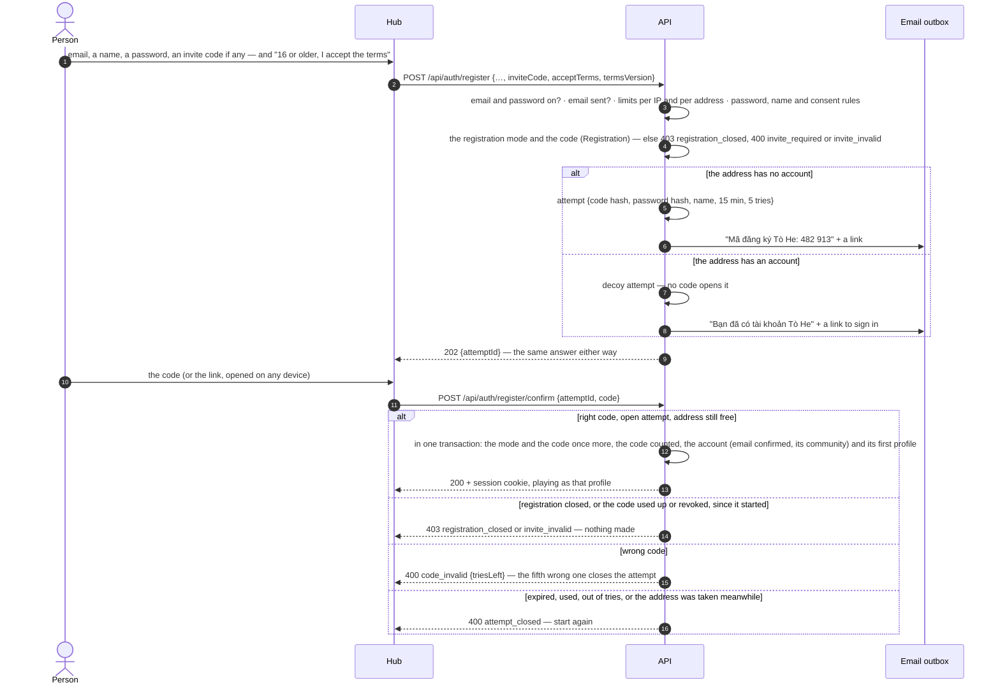

There is no "unverified" account: the password, the name and the accepted terms wait in the attempt until the code
comes back. Under 16, a child plays as a profile a parent makes (ADR 0023) instead of signing up. Since a code opens only
the attempt it was sent for, someone who signed up first with another person's address cannot use the code that
person receives, and the owner's own attempt is unaffected by theirs.

## Registration

Who may make an account is the admin console's ([ADR 0028](../decisions/0028-sign-in-and-registration-at-run-time.md),
[Admin console](admin.md#sign-in-and-registration)): `open`, `invite` or `closed`. Every way an account is made obeys
it — signing up by email when it starts and when its code comes back, and the first sign-in with a provider.

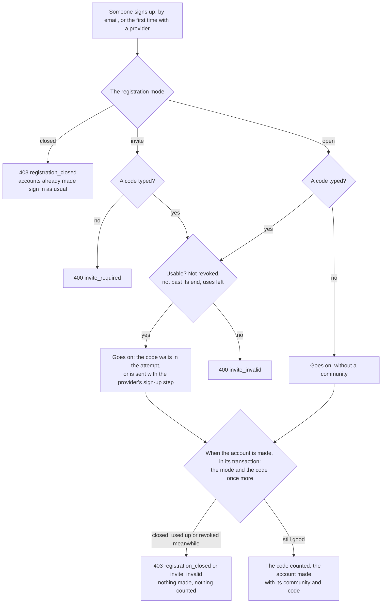

- A code is 4 to 32 letters A–Z, digits and dashes; what is typed is trimmed and upper-cased. A code typed must be
  usable in every mode, so a typo never silently leaves someone outside the community they were invited to.
- The code is counted by one `UPDATE … SET uses = uses + 1 WHERE … uses < max_uses` in the transaction that makes the
  account: two people using its last use at the same moment get one account and one `invite_invalid`.
- Codes travel as links, `/register?invite=CODE`. The hub fills the field from it and keeps the code on that tab
  (`sessionStorage`, `tohe.invite`) through a trip to a provider, for the provider's sign-up step; it forgets the code
  once an account is made.

### Proof-of-work

A switch of the console, off by default ([ADR 0037](../decisions/0037-proof-of-work-before-a-code-by-email.md),
E-09): on, signing up by email and asking for a password reset — the two requests that send a code to any address,
without a session — take a solved challenge, before anything else is checked.

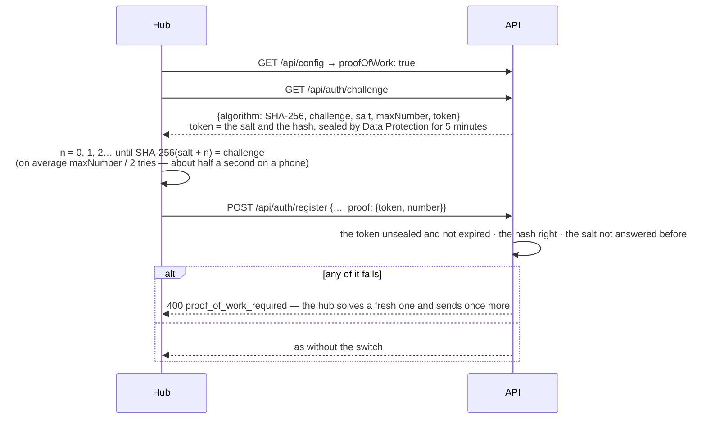

- The hash is computed in the hub's own code (`session/proofOfWork.ts`), not `crypto.subtle`: that exists only on
  HTTPS, and UAT is plain HTTP.
- `Identity:ProofOfWorkMaxNumber` (50 000) sets the difficulty, `Identity:ProofOfWorkLifetime` (5 minutes) how long a
  challenge waits. Answered salts are remembered in memory until their challenge would have expired: one API process
  (ADR 0016).
- It stops cheap bots, not someone with many machines; it costs a person nothing they notice and sends nothing outside
  Tò He. Launch is by invite (E-09 Q1); turn it on before registration opens to everyone.
- The hub reads the mode from `GET /api/config`: by invite, the code field comes first and is needed; open, it comes
  last and is welcome; closed, the sign-up pages say so and the welcome page stops offering "Tạo tài khoản".

## One-time codes

| For | Sent to | Link in the email |
| --- | --- | --- |
| Signing up | the address signing up | `/register/confirm?attempt=…&code=…` |
| A forgotten password | the account's address | `/password/reset?attempt=…&code=…` |
| A new sign-in email | the new address | `/account/email?attempt=…&code=…` |
| Step-up level 2 without the password | the account's address | — (typed where it was asked for; lives 10 minutes) |
| An address for a provider that vouched for none | the address typed | — (typed on `/sign-in/continue`) |
| Linking a provider to the account that has the address | the account's address | — (typed on `/sign-in/continue`) |

Every code: six random digits, stored hashed, used once, bound to its attempt, alive 15 minutes, five tries — counted in
the database, so tries made at the same moment all count. One address gets one code a minute and five an hour,
whatever they are for (`code_cooldown`, `too_many_codes`). Links need `App:PublicUrl`; without it the email carries the
code alone. Attempts a day past their end are deleted when the next one starts.

## Signing in

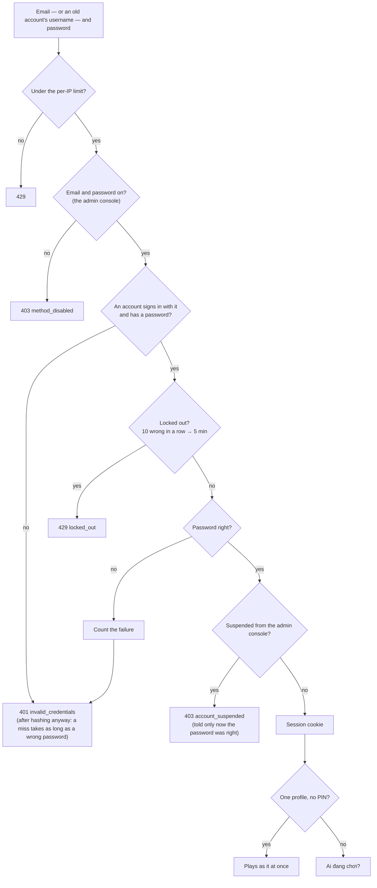

An account from before email sign-in still signs in with its username. Right after it does, the hub asks for an email
and sends the password just typed along as the proof; once the code comes back, only the email signs in.

## Signing in with a provider

Production only: a deployment offers the providers it has secrets for ([Configuration](../guides/configuration.md#api))
and the admin console has on (ADR 0028), and the hub shows "Tiếp tục với …" for each on the sign-in and sign-up
screens.

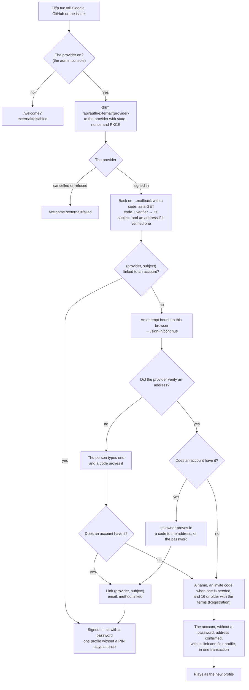

- The provider's subject is the identity. The address only finds an account, and only when the provider verified it:
  Google and an OpenID Connect issuer say `email_verified` (in the ID token or from their userinfo endpoint); GitHub's
  primary address counts when GitHub marks it `verified`. A provider that vouched for none asks for an address.
- What waits is an attempt — 15 minutes, five tries for its code — that a sealed cookie, `tohe.external` (path
  `/api/auth/external`), binds to the browser that came back. A step that sends a code replaces the attempt with a new
  one; "Huỷ" closes it.
- OpenID Connect answers in the query, as a GET: the same-origin guard, which refuses cross-site POSTs to `/api`,
  stays whole.
- The provider is asked about again when it comes back and at every step after: switched off meanwhile, nothing is
  linked and nothing is made (`method_disabled`; `/welcome?external=disabled` for the navigation back).

## Proof before a link

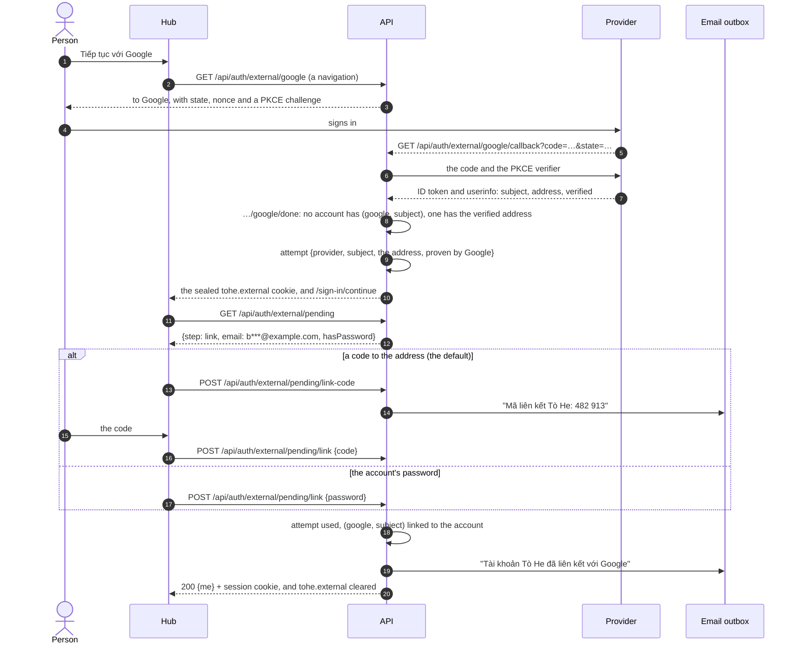

When the person proved the address with our own code during this sign-in — the provider vouched for none — that code
is the proof, and the account that has the address is linked at once. Proving with a provider the account already has
is not offered: the account was found by its address, so a code always reaches its owner (ADR 0026).

## A forgotten password

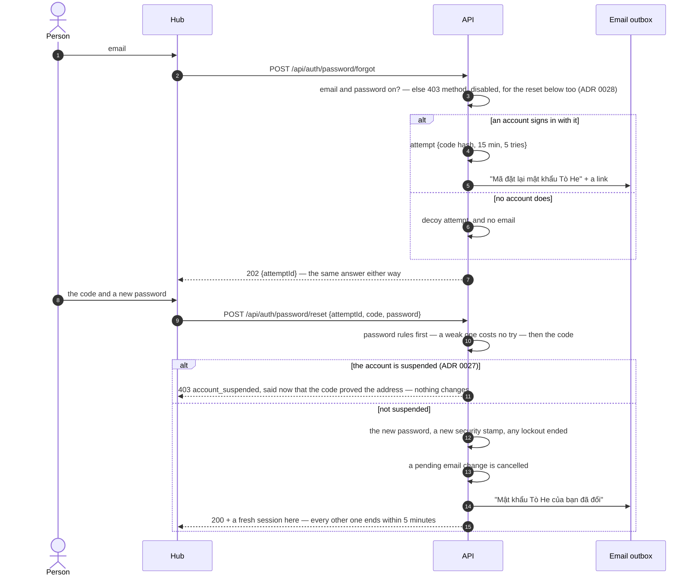

## A new sign-in email

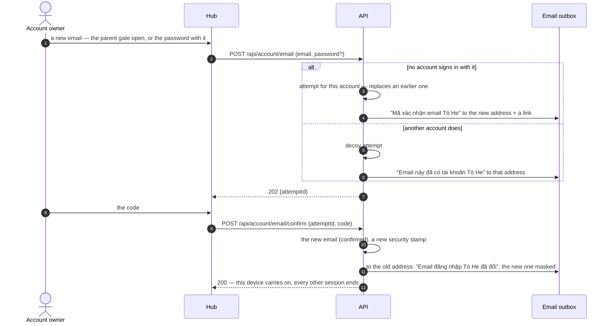

## Sign-in methods

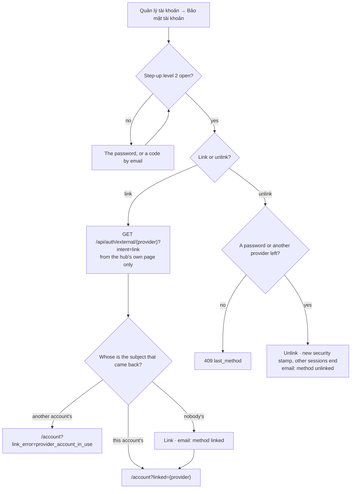

Which methods exist is the deployment's — a provider needs its secrets; which are on is the admin console's
([ADR 0028](../decisions/0028-sign-in-and-registration-at-run-time.md), [Admin console](admin.md#sign-in-and-registration)).
A method switched off signs nobody in and makes no account: not by a forgotten password, not by finishing a provider
sign-in begun before. Nothing else changes — a provider stays linked, a password stays set, and step-up still accepts
the password. `GET /api/config` tells the hub what is on; a link to a provider that is off ends at
`/account?link_error=method_disabled`.

A link starts only from the hub: another site navigating a signed-in browser to the start address carries its session
cookie too, so the API refuses a start that `Sec-Fetch-Site` marks as coming from elsewhere. An account made with a
provider has no password until it sets one, behind step-up level 2 by a code.

## Stepping up

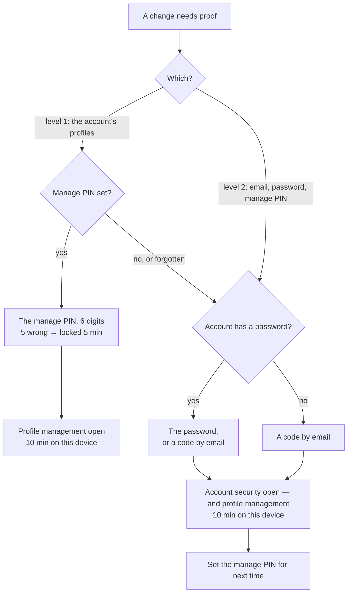

Both levels are claims of this device's session: they close when someone is chosen to play, or the owner locks the
page. Signing in, the password just typed counts as level 2 for adding a first email.

## Sessions

| What | How |
| --- | --- |
| Cookie | `tohe.session` — `__Host-tohe.session` behind an HTTPS hub (ADR 0021) — 90 days, sliding, HttpOnly, `SameSite=Lax` |
| In the cookie | the active profile, and until when step-up level 1 and level 2 are open — and the admin console, after its two-factor check ([Admin console](admin.md#two-factor-authentication)) |
| Checked against the account's security stamp | every 5 minutes (`Identity:SessionCheckInterval`) |
| The stamp changes when | the password is reset or changed · the sign-in email changes · a provider is unlinked · an admin suspends the account or signs it out everywhere ([Admin console](admin.md#users)) · the owner asks to delete the account ([below](#deleting)) |
| Never written for | a suspended account: whatever would re-issue its session — choosing who plays, a step-up — answers `403 account_suspended` and ends the session at once, so it cannot renew itself before the check. An account waiting to be deleted likewise, with `401 session_ended`: only signing in again starts a session, and keeps the account |

## A device's life

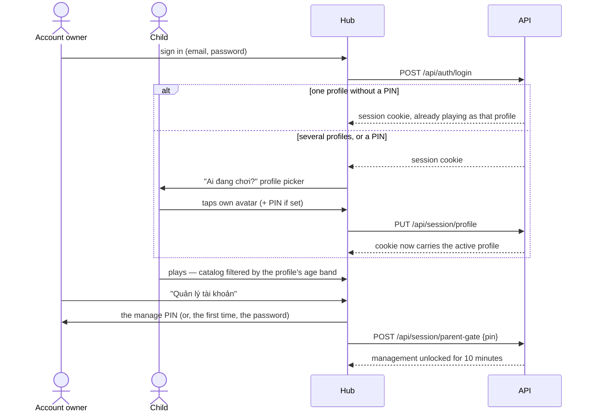

Signing up plays the new profile at once, and so does signing in to an account with one profile and no PIN — nobody
else to choose, and one sign-in request fewer. The hub then sends the device through the picker with
`/profiles?auto=true`, which goes straight on (offering the guest's progress first, if this device has some), and
which also chooses a lone PIN-less profile by itself when a page needs a player and none is chosen. Opened by hand
("Đổi người chơi"), the picker always shows, so a one-profile account can still add a profile or manage the account.

## Deleting

A profile is deleted at once, an account after seven days ([ADR 0034](../decisions/0034-delete-accounts-and-profiles-for-good.md)).
Every module that keeps something under a profile's id implements `IProfileData`: `WithdrawAsync` lets the profiles
go at once — they leave their tables (a bot finishes a hand in progress), invitations to them end — and `PurgeAsync`
deletes what the module stores, inside the caller's transaction.

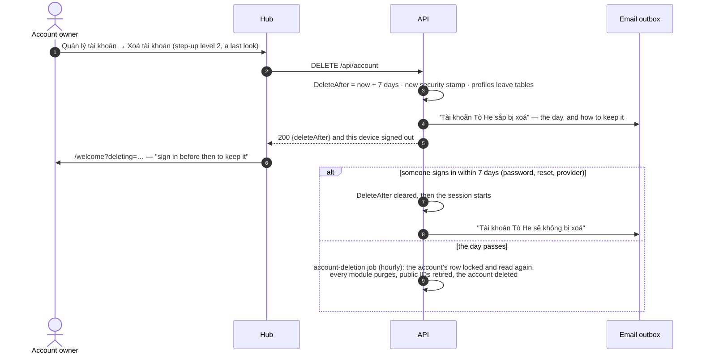

| Data | When a profile goes |
| --- | --- |
| The profile, its name history | Deleted |
| Saves, scores (Progress) | Deleted |
| Results on boards, their decisions, ranked runs (Integrity) | Deleted — the one way past the decisions' append-only trigger ([Integrity](integrity.md#decisions)) |
| Seats in finished hands and closed tables (Rooms) | Kept for the others who played, with nothing of them: a fresh random id, `Deleted: true`, no account, name or avatar; its results keep place and points, without profile or account |
| Its public ID | Retired in `identity.retired_profile_ids`: never given to another profile |
| An account's sign-in methods, roles, keys, sign-in attempts | Deleted with the account |
| Sent email records · audit entries | 30 days (ADR 0022) · a year ([Admin console](admin.md#the-audit-log)) |

While an account waits, its profiles are on no public board and found by no ID — the board audience and the profile
directory leave it out, as a suspended one — and the console's Users pages show it as "Chờ xoá". Deleting a profile
stays where it was, behind the parent gate and never the last one; for a child it is the parent taking the consent
back (R-07).

## Names

| Rule | Why |
| --- | --- |
| 1 to 24 visible characters (grapheme clusters: an emoji family is one), at most 128 UTF-16 units stored | Fits a seat or a board row; a chain of emoji joined by zero-width joiners is one character of any length |
| Whitespace of any kind becomes one plain space; leading and trailing spaces go | "Bé   Na" and "Bé Na" look alike, so they are alike |
| No control, private-use, unassigned or format characters — except the zero-width joiner, variation selectors and tag characters emoji need | No direction overrides, zero-width tricks or invisible text |
| No letters that draw nothing (Hangul and braille fillers) | A name made of them looks empty |
| At most three combining marks on one character | Vietnamese needs two; more is "zalgo" |
| Not a reserved name — Admin, Moderator, Support, System, Official, Tò He, Quản trị (viên), Kiểm duyệt, Hỗ trợ, Hệ thống, Chính thức, Người chơi đã xoá — compared without case, marks, separators or hidden joiners | Nobody passes for the platform. "Tò-HE 🦊" is taken; "Admin Nhí" is not |
| No offensive word (`NameFilter`, [ADR 0035](../decisions/0035-filter-offensive-names-and-limit-renames.md)): whole words, or two side by side, or letters typed apart. Vietnamese words are matched **with their marks**, however typed; English words and Vietnamese teen code **without marks**, `0 1 3 4 5 7 @ $ !` read as letters, a letter repeated read once | Names are shown to strangers. "Fuuuck", "sh1t", "f u c k" are refused; "Bé Lớn", "Các Bạn", "Diễm", "Essex" are not — without their marks most Vietnamese swear words are everyday words. What slips through, a moderator renames |
| Its owner renames a profile at most **5 times in 24 hours** (`Identity:ProfileRenamesPerDay`), counted from its name history (`rename_limit`) | Swearing and swapping back is pointless; nobody else meets the limit. A moderator's rename from the console is not limited |

The API runs with invariant globalization (no ICU), where `string.Normalize` does nothing beyond ASCII. So the hub
sends names composed (`normalize('NFC')`), the rules hold for composed and decomposed text alike, and reserved names
are matched through a table of Latin letters with marks (`ProfileNames`). The hub counts characters with
`Intl.Segmenter` to warn early; the API decides.

## Rules

| Rule | Where it is enforced |
| --- | --- |
| One account per sign-in email; an account exists only once the code sent to it came back | `email_index` (unique) on `identity.accounts`; `AuthEndpoints` |
| A code opens only its attempt; five tries, 15 minutes; one address gets a code a minute and five an hour | `Attempts`, `Codes` |
| No answer tells whether an address has an account: decoy attempts, the same 202, a miss as slow as a wrong password | `AuthEndpoints`, `AccountEmailEndpoints` |
| Changing the sign-in email needs step-up level 2 (or the password with the request) and a code at the new address | `AccountEmailEndpoints` |
| A provider's account is linked by its subject, to one account at most; the address it sends only finds an account, and only when the provider verified it | `ExternalEndpoints`; the key of `account_logins` |
| Joining the account that has the address needs a code sent there or the account's password — or the code that proved the address during this sign-in | `ExternalEndpoints` |
| A sign-in back from a provider waits on the browser that came back, in a sealed cookie (`tohe.external`, path `/api/auth/external`) — never in a link — for 15 minutes | `ExternalEndpoints` |
| Linking and unlinking need step-up level 2; a link starts only from the hub's page (`Sec-Fetch-Site`); unlinking never removes the last way in and ends the other sessions; the account's address hears of both | `ExternalEndpoints` |
| Providers answer with a GET (OpenID Connect in the query), and every one of them uses PKCE | `ExternalProviders` |
| A suspended account has no way in — password, provider, finishing a link, a new password by email — and hears why only after proving it is theirs; its sessions end with the new security stamp, and none is written for it | `AuthEndpoints`, `ExternalEndpoints`, `SessionWriter`, `AccountsAdmin` |
| A method switched off in the console signs nobody in and makes no account — nor does a forgotten password, nor finishing a provider sign-in begun before | `AuthEndpoints`, `ExternalEndpoints`, `RuntimeSettings` |
| Every way an account is made obeys the registration mode and checks it again when the account is made; an invite code is counted in that transaction, so its limit holds when people use it at the same moment | `Invites`, `AuthEndpoints`, `ExternalEndpoints` |
| Every name a profile had is kept, whoever renamed it | The `profiles_name_history` trigger on `identity.profiles` |
| Managing the account's profiles needs step-up level 1: the manage PIN within the last 10 minutes, or level 2 | The parent-gate endpoint filter on `/api/account` and `/api/profiles/*` (`ProfileEndpoints.Gated`) |
| The manage PIN is six digits, hashed; five wrong in a row lock it for five minutes | `SessionEndpoints`, `ManagePins` |
| The email, the password and the manage PIN change within step-up level 2: the password or a code by email, in the last 10 minutes | `AccountSecurityEndpoints`, `AccountEmailEndpoints` |
| Signing up needs 16 or older and the terms; the account keeps their version, and accepts newer ones again | `AuthEndpoints`, `AccountSecurityEndpoints`; the hub's `legal/documents.ts` |
| An account owns at least one and at most five profiles; changes to them are serialized on the account's row, so requests at the same time cannot break the limits | Identity module (`ProfileEndpoints`) |
| An account sees, manages and plays as its own profiles only; another account's profile is "not found" | Identity module, `IActiveProfile` |
| Public IDs are unique and given once, when the profile is made | `ProfileIds`, unique index on `public_id` |
| A PIN is exactly 4 digits and stored hashed; wrong PINs are rate limited | Session endpoints |
| Children see only games whose `minAge` is at most the lower bound of their age band | Registry, via `IActiveProfile` |
| A child plays online with other accounts only when the account's owner turned on "Chơi online với người ngoài" (`playWithOthers`, off by default); otherwise only at tables the account keeps to itself | Rooms, via `IActiveProfile` ([ADR 0016](../decisions/0016-online-rooms-for-turn-based-games.md)) |
| A profile is on public boards only with "Hiện trên bảng công khai" on — adults from the start, a child once its owner says they asked it — never while its account is suspended, and never while a moderator hides it, whatever the switch says | `ProfileEndpoints`, `IBoardAudience` ([Integrity and boards](integrity.md#public-boards)) |
| Saves, scores and the leaderboard belong to the active profile; boards list the account's profiles | Progress, via `IActiveProfile` and `IAccountProfiles` |
| A profile is asked to tables by its ID only as its owner allows — anyone, people it played with, its account — and a child only within its account; a child's ID is not found from outside its account, nor is a profile of a suspended account ([ADR 0033](../decisions/0033-invite-a-profile-by-its-id.md)) | `ProfileEndpoints` (`child_invites_account_only`, `GET /api/profiles/by-id`), `IProfileDirectory`, Rooms |
| Unsafe `/api` requests from another origin (`Sec-Fetch-Site` ≠ `same-origin`) are rejected | `SameOriginGuard` middleware |
| Per client IP, 10 requests a minute in each of three buckets: signing in or asking for a code (`auth`), typing a code back (`auth-code`), a PIN or the parent gate (`auth-gate`) | Rate limiter policies; `Identity:AuthRequestsPerMinute` |
| 10 wrong passwords lock an account for 5 minutes; a password reset ends the lockout | ASP.NET Core Identity lockout |

## Guest mode

"Chơi thử" lets anyone play without an account, with one local guest profile per device (saves stay on the
device). The first time a real profile is chosen on that device, the hub offers to move the guest's progress to it.

## API

| Endpoint | Auth | Purpose |
| --- | --- | --- |
| `GET /api/auth/challenge` | — | A [proof-of-work](#proof-of-work) to solve before signing up or a reset, when the console asks for one |
| `POST /api/auth/register` | — | Start signing up, with an invite code when [registration](#registration) needs one (and `proof` when the console asks): a code to the email — 202 and an attempt, whoever the address belongs to |
| `POST /api/auth/register/confirm` | — | The code creates the account and its first profile, which plays at once |
| `POST /api/auth/login` / `POST /api/auth/logout` | — / session | Sign in with the email (an old account's username until it adds one) / out |
| `POST /api/auth/password/forgot` | — | A code to set a new password, if the address has an account (`proof` when the console asks) — 202 either way |
| `POST /api/auth/password/reset` | — | The code sets the new password; every other session ends |
| `GET /api/auth/external/{provider}` | — (`?intent=link`: session + level 2) | A navigation: off to the provider, back through `…/callback` and `…/done` |
| `GET /api/auth/external/pending` | the browser that came back | The step that waits — `email`, `link` or `signup` — or 404 |
| `POST /api/auth/external/pending/email` · `/email/confirm` | the browser that came back | A code to the address typed · the code proves it; an account with it is linked at once |
| `POST /api/auth/external/pending/link-code` · `/link` | the browser that came back | A code to the account's address · the code, or the password, links and signs in |
| `POST /api/auth/external/pending/signup` | the browser that came back | A name, the terms and an invite code when needed create the account; its first profile plays at once |
| `DELETE /api/auth/external/pending` | the browser that came back | Forget the sign-in that waits |
| `GET /api/auth/me` | session | Account (with its email, linked providers, platform role — [Admin console](admin.md) — and community), its profiles (with public IDs, whether each is on public boards, whether a moderator hid it from them, and who may invite it), active profile, step-up expiries |
| `PUT /api/session/profile` / `DELETE` | session | Choose (PIN if set) / clear the active profile |
| `POST /api/session/parent-gate` / `DELETE` | session | The manage PIN opens profile management / lock both levels |
| `POST /api/session/step-up` | session | Level 2 with the password (opens level 1 too) |
| `POST /api/session/step-up/code` · `/confirm` | session | Level 2 with a code to the account's email |
| `PUT /api/account/manage-pin` · `PUT /api/account/password` | session + level 2 | Set or change the manage PIN · the password (every other session ends) |
| `DELETE /api/account` | session + level 2 | Delete the account ([above](#deleting)): `{deleteAfter}`, seven days on; every session ends, this one too; signing in before then keeps it |
| `POST /api/account/terms` | session | Accept the terms and privacy notice in the version the hub shows |
| `POST /api/account/email` | session + level 2, or the password | A code to a new sign-in email |
| `POST /api/account/email/confirm` | session | The code makes it the sign-in email; every other session ends |
| `DELETE /api/account/logins/{provider}` | session + level 2 | Unlink a provider — never the last way in; every other session ends |
| `GET /api/profiles/options` | — | Allowed avatars and age bands; how many profiles an account may own |
| `PATCH /api/account` | parent | The account's telemetry switch |
| `POST /api/profiles` | parent | Add a profile: a child's with an age band, an adult's without |
| `GET /api/profiles/by-id/{publicId}` | session | A profile's card — id, ID, name, avatar — to confirm before asking it to a table ([ADR 0033](../decisions/0033-invite-a-profile-by-its-id.md)); never a child of another account nor a profile of an account suspended or waiting to be deleted (`profile_not_found`); 20 lookups an hour per account (`lookup_limit`) |
| `PATCH` / `DELETE /api/profiles/{id}` | parent | Edit (incl. a child's `playWithOthers`, `onPublicBoards` — with `askedChild` to turn a child's on — and an adult's `invites`: `anyone`, `played-with`, `account`) / delete a profile — never the last — with everything of it ([above](#deleting)) |

`GET /api/config` says whether the server sends email (`email`) — without it, nothing that needs a code starts
(`email_unavailable`) — which providers it offers (`providers`: an `id` and the name on the button, only those on),
whether email and password are on (`passwordSignIn`), the registration mode (`registration`: `open`, `invite` or
`closed`), and whether signing up and a reset take a proof-of-work (`proofOfWork`).

Errors are problem details; a machine-readable `code` lets the hub show a Vietnamese message: `invalid_credentials`,
`locked_out`, `email_invalid`, `email_unavailable`, `email_unchanged`, `code_invalid` (with `triesLeft`),
`attempt_closed`, `code_cooldown`, `too_many_codes`, `password_too_short`, `password_invalid`, `pin_required`,
`pin_invalid`, `parent_gate_required`, `step_up_required`, `manage_pin_not_set`, `manage_pin_invalid`,
`password_not_set`, `email_required`, `terms_required`, `too_many_profiles`, `last_profile`, `name_required`, `name_invalid_character`,
`name_too_long`, `name_reserved`, `name_inappropriate`, `rename_limit`, `sign_in_expired`, `wrong_step`, `proof_required`, `provider_account_in_use`,
`last_method`, `account_suspended`, `session_ended`, `method_disabled`, `proof_of_work_required`, `registration_closed`, `invite_required`,
`invite_invalid`, `asked_child_required`.
Navigations answer with a redirect instead: `/welcome?external=failed` (the provider refused, or was cancelled),
`/welcome?external=suspended`, `/welcome?external=disabled`, `/account?linked={provider}`, or `/account?link_error=`
`step_up_required`, `provider_account_in_use`, `cross_origin` or `method_disabled`.

## From households

The migration `AccountsOwnProfiles` moved UAT's households in place (ADR 0023): each adult kept their account and
profile; a household's children went to its first adult (the earliest account); its telemetry switch went to each of
its accounts; rooms, seats and results now name accounts; every profile got a public ID. `MigrationTests` runs it over
a seeded database of the old shape. The way back is the backup `deploy/uat/deploy.sh` takes before every deploy.
