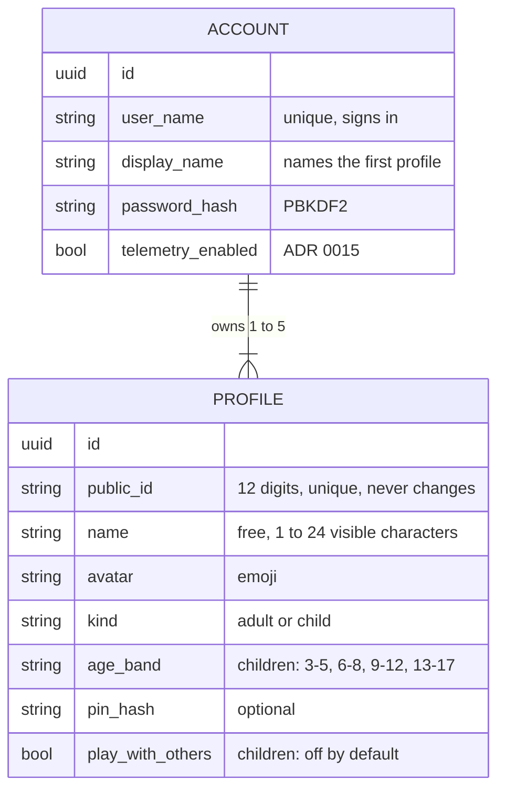
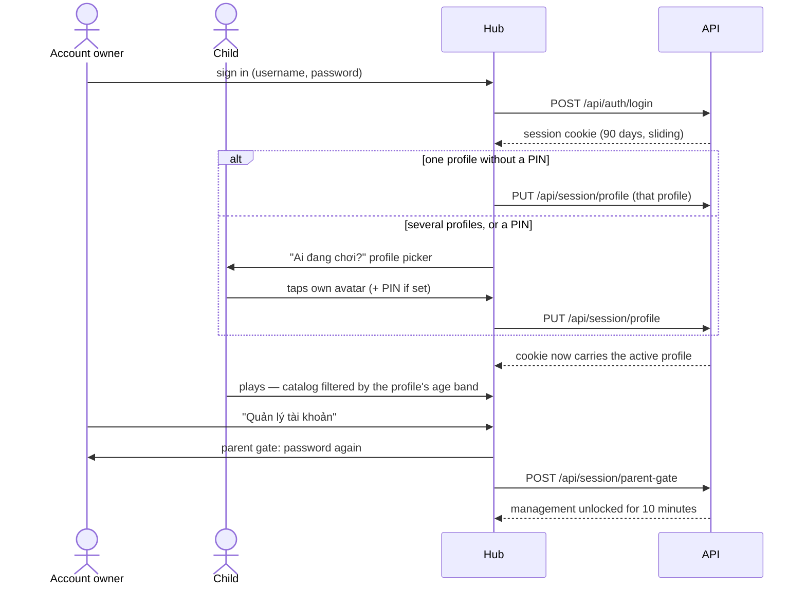

Decisions: [ADR 0023](../decisions/0023-accounts-own-their-profiles.md) (accounts own profiles, public IDs, names),
[ADR 0011](../decisions/0011-password-sign-in-first.md) (password sign-in, sessions, parent gate). ADR 0004
(households) is superseded.

## Model

- An **account** is someone who signs in. It owns one to five **profiles**: the first is created with the account
  and named with its display name, and the last can never be removed. A family is one account with a profile per
  player.
- A **profile** is a player. Children only ever have profiles — never accounts or passwords. Any profile may have a
  PIN.
- Every profile has a **public ID**: 12 digits shown as `1234 5678 9012`. The first 11 are random (the first never 0),
  the last is a [Damm](https://en.wikipedia.org/wiki/Damm_algorithm) check digit, so a single mistyped digit or two
  swapped neighbours never point at another profile. It never changes and is not a secret — an address, never a way to
  sign in (`ProfileIds`, mirrored in the hub's `session/profileIds.ts`).
- **Names** are free and not unique: the ID tells profiles apart. See [Names](#names).
- Saves and scores belong to a profile; boards show the profiles of one account.

Tables live in the `identity` schema (`accounts`, `profiles`). Data Protection keys (used to encrypt session cookies)
live in `platform.data_protection_keys`.

## A device's life

The picker chooses by itself only when the hub sent someone there to pick a player (`/profiles?auto=true`, after
signing in or when a page needs a player). Opened by hand ("Đổi người chơi"), it always shows, so a one-profile
account can still add a profile or manage the account.

## Names

| Rule | Why |
| --- | --- |
| 1 to 24 visible characters (grapheme clusters: an emoji family is one), at most 128 UTF-16 units stored | Fits a seat or a board row; a chain of emoji joined by zero-width joiners is one character of any length |
| Whitespace of any kind becomes one plain space; leading and trailing spaces go | "Bé   Na" and "Bé Na" look alike, so they are alike |
| No control, private-use, unassigned or format characters — except the zero-width joiner, variation selectors and tag characters emoji need | No direction overrides, zero-width tricks or invisible text |
| No letters that draw nothing (Hangul and braille fillers) | A name made of them looks empty |
| At most three combining marks on one character | Vietnamese needs two; more is "zalgo" |
| Not a reserved name — Admin, Moderator, Support, System, Official, Tò He, Quản trị (viên), Kiểm duyệt, Hỗ trợ, Hệ thống, Chính thức, Người chơi đã xoá — compared without case, marks, separators or hidden joiners | Nobody passes for the platform. "Tò-HE 🦊" is taken; "Admin Nhí" is not |

The API runs with invariant globalization (no ICU), where `string.Normalize` does nothing beyond ASCII. So the hub
sends names composed (`normalize('NFC')`), the rules hold for composed and decomposed text alike, and reserved names
are matched through a table of Latin letters with marks (`ProfileNames`). The hub counts characters with
`Intl.Segmenter` to warn early; the API decides.

## Rules

| Rule | Where it is enforced |
| --- | --- |
| Managing the account and its profiles needs the parent gate (password within the last 10 minutes) | The parent-gate endpoint filter on `/api/account` and `/api/profiles/*` (`ProfileEndpoints.Gated`) |
| An account owns at least one and at most five profiles; changes to them are serialized on the account's row, so requests at the same time cannot break the limits | Identity module (`ProfileEndpoints`) |
| An account sees, manages and plays as its own profiles only; another account's profile is "not found" | Identity module, `IActiveProfile` |
| Public IDs are unique and given once, when the profile is made | `ProfileIds`, unique index on `public_id` |
| A PIN is exactly 4 digits and stored hashed; wrong PINs are rate limited | Session endpoints |
| Children see only games whose `minAge` is at most the lower bound of their age band | Registry, via `IActiveProfile` |
| A child plays online with other accounts only when the account's owner turned on "Chơi online với người ngoài" (`playWithOthers`, off by default); otherwise only at tables the account keeps to itself | Rooms, via `IActiveProfile` ([ADR 0016](../decisions/0016-online-rooms-for-turn-based-games.md)) |
| Saves, scores and the leaderboard belong to the active profile; boards list the account's profiles | Progress, via `IActiveProfile` and `IAccountProfiles` |
| Unsafe `/api` requests from another origin (`Sec-Fetch-Site` ≠ `same-origin`) are rejected | `SameOriginGuard` middleware |
| Sign-in, registration, PIN and parent gate: 10 requests per minute per client IP | Rate limiter policy `auth` |
| 10 wrong passwords lock an account for 5 minutes | ASP.NET Core Identity lockout |

## Guest mode

"Chơi thử" lets anyone play without an account, with one local guest profile per device (saves stay on the
device). The first time a real profile is chosen on that device, the hub offers to move the guest's progress to it.

## API

| Endpoint | Auth | Purpose |
| --- | --- | --- |
| `POST /api/auth/register` | — | Create an account and its first profile |
| `POST /api/auth/login` / `POST /api/auth/logout` | — / session | Sign in / out |
| `GET /api/auth/me` | session | Account, its profiles (with public IDs), active profile, parent-gate expiry |
| `PUT /api/session/profile` / `DELETE` | session | Choose (PIN if set) / clear the active profile |
| `POST /api/session/parent-gate` / `DELETE` | session | Unlock / lock account management |
| `GET /api/profiles/options` | — | Allowed avatars and age bands; how many profiles an account may own |
| `PATCH /api/account` | parent | The account's telemetry switch |
| `POST /api/profiles` | parent | Add a profile: a child's with an age band, an adult's without |
| `PATCH` / `DELETE /api/profiles/{id}` | parent | Edit (incl. a child's `playWithOthers`) / remove a profile — never the last |

Errors are problem details; a machine-readable `code` (e.g. `invalid_credentials`, `pin_required`, `pin_invalid`,
`parent_gate_required`, `username_taken`, `too_many_profiles`, `last_profile`, `name_required`,
`name_invalid_character`, `name_too_long`, `name_reserved`) lets the hub show a Vietnamese message.

## From households

The migration `AccountsOwnProfiles` moved UAT's households in place (ADR 0023): each adult kept their account and
profile; a household's children went to its first adult (the earliest account); its telemetry switch went to each of
its accounts; rooms, seats and results now name accounts; every profile got a public ID. `MigrationTests` runs it over
a seeded database of the old shape. The way back is the backup `deploy/uat/deploy.sh` takes before every deploy.
