Decisions: [ADR 0026](../decisions/0026-sign-in-methods-and-account-linking.md) (Google, GitHub and an OpenID
Connect issuer, linked by subject after proof), [ADR 0025](../decisions/0025-step-up-in-two-levels-and-consent-at-sign-up.md) (step-up in two levels,
16 or older and the terms at sign-up), [ADR 0024](../decisions/0024-email-identifies-an-account.md) (email identifies
an account, codes bound to attempts), [ADR 0023](../decisions/0023-accounts-own-their-profiles.md) (accounts own profiles, public IDs, names),
[ADR 0011](../decisions/0011-password-sign-in-first.md) (passwords, sessions, parent gate). ADR 0004 (households) is
superseded.

## Model

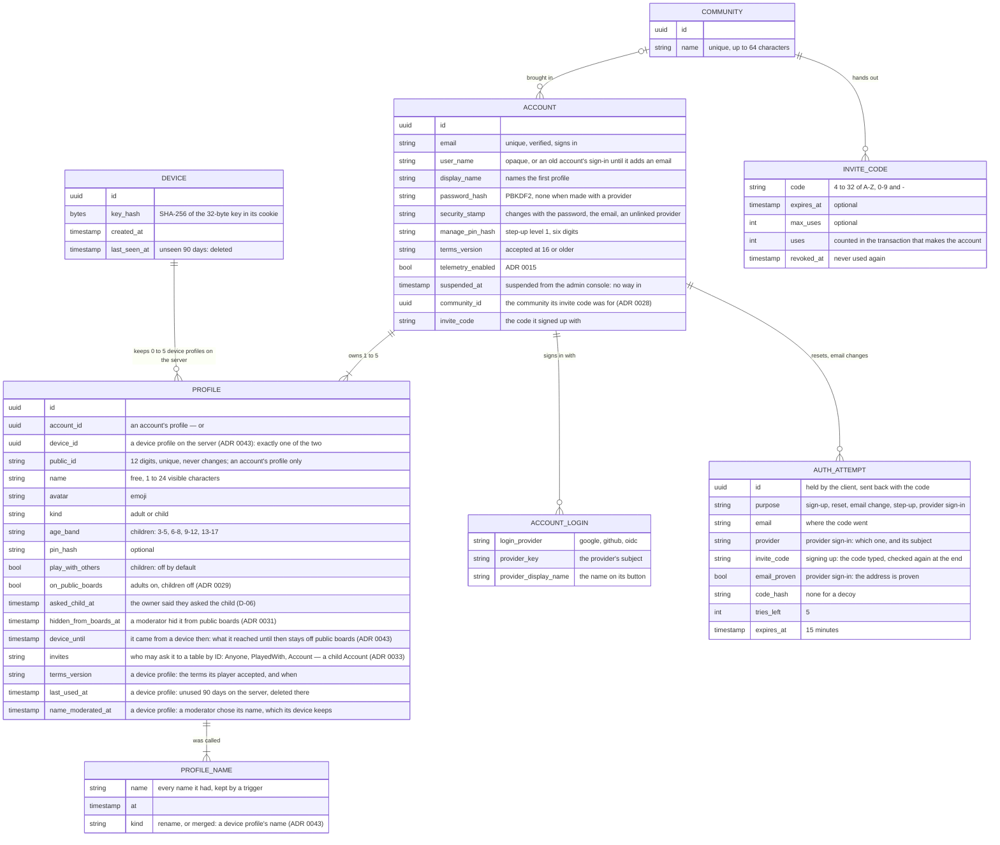

- An **account** is someone who signs in, with one **verified email** that nobody else ever sees. It owns one to five
  **profiles**: the first is created with the account and named with its display name, and the last can never be
  removed. A family is one account with a profile per player. It may also sign in with Google, GitHub or the
  deployment's OpenID Connect issuer, each linked by the provider's subject ([Signing in with a
  provider](#signing-in-with-a-provider)).
- A **profile** is a player. Children only ever have profiles — never accounts, emails or passwords. Any profile may
  have a PIN.
- Every profile has a **public ID**: 12 digits shown as `1234 5678 9012`. The first 11 are random (the first never 0),
  the last is a [Damm](https://en.wikipedia.org/wiki/Damm_algorithm) check digit, so a single mistyped digit or two
  swapped neighbours never point at another profile. It never changes and is not a secret — an address, never a way to
  sign in (`ProfileIds`, mirrored in the hub's `session/profileIds.ts`).
- **Names** are free and not unique: the ID tells profiles apart. See [Names](#names).
- A **community** is a group an invite code belongs to. An account remembers the community it came with, one for now
  ([Registration](#registration)).
- An **attempt** waits for a code sent by email — signing up, a forgotten password, a new sign-in email — or for the
  last step of a sign-in back from a provider.
- Saves and scores belong to a profile; boards show the profiles of one account. A profile may have started as a
  [device profile](#device-profiles), keeping its id.

Tables live in the `identity` schema (`accounts`, `account_logins`, `profiles`, `profile_names`, `auth_attempts`,
`communities`, `invite_codes`, `devices`, `retired_profile_ids`); the console's switches in `admin.settings` ([Admin console](admin.md#sign-in-and-registration)). Data Protection keys (used to encrypt
session cookies) live in `platform.data_protection_keys`.

## Signing up

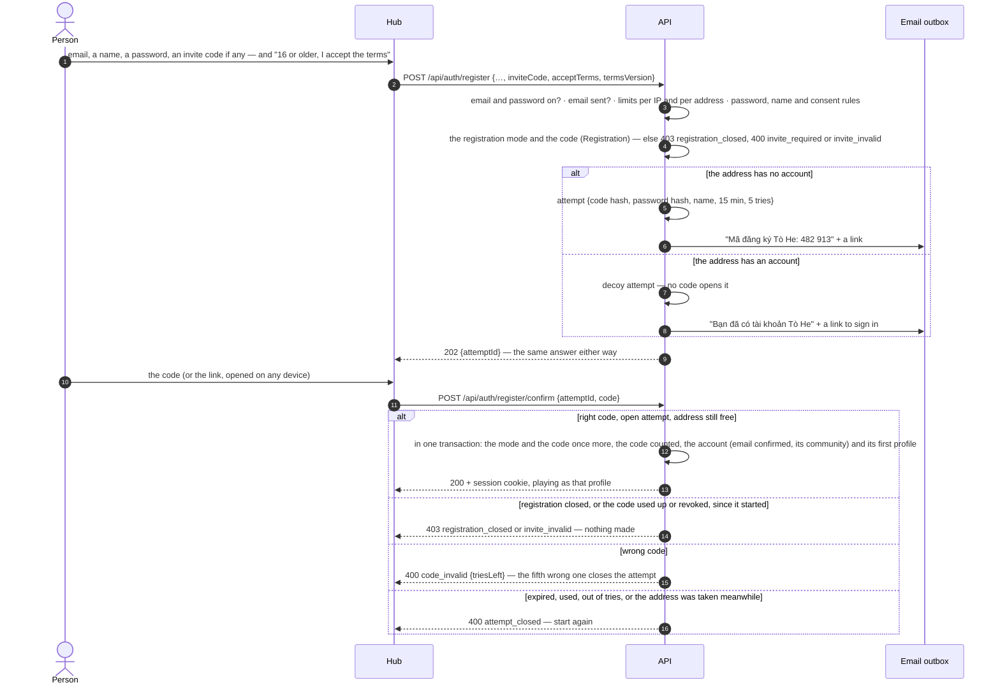

There is no "unverified" account: the password, the name and the accepted terms wait in the attempt until the code
comes back. Under 16, a child plays as a profile a parent makes (ADR 0023) instead of signing up. Since a code opens only
the attempt it was sent for, someone who signed up first with another person's address cannot use the code that
person receives, and the owner's own attempt is unaffected by theirs.

## Registration

Who may make an account is the admin console's ([ADR 0028](../decisions/0028-sign-in-and-registration-at-run-time.md),
[Admin console](admin.md#sign-in-and-registration)): `open`, `invite` or `closed`. Every way an account is made obeys
it — signing up by email when it starts and when its code comes back, and the first sign-in with a provider.

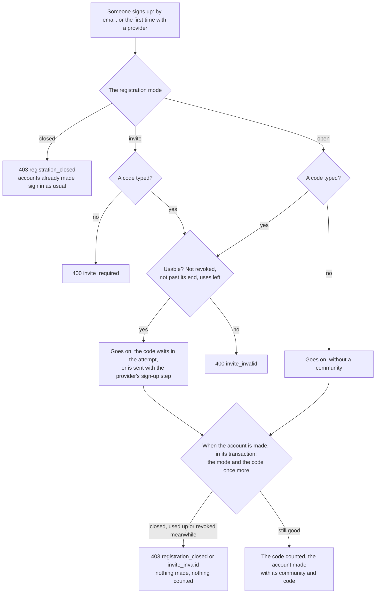

- A code is 4 to 32 letters A–Z, digits and dashes; what is typed is trimmed and upper-cased. A code typed must be
  usable in every mode, so a typo never silently leaves someone outside the community they were invited to.
- The code is counted by one `UPDATE … SET uses = uses + 1 WHERE … uses < max_uses` in the transaction that makes the
  account: two people using its last use at the same moment get one account and one `invite_invalid`.
- Codes travel as links, `/account/register?invite=CODE`. The hub fills the field from it and keeps the code on that tab
  (`sessionStorage`, `tohe.invite`) through a trip to a provider, for the provider's sign-up step; it forgets the code
  once an account is made.

### Proof-of-work

A switch of the console, off by default ([ADR 0037](../decisions/0037-proof-of-work-before-a-code-by-email.md),
E-09): on, signing up by email and asking for a password reset — the two requests that send a code to any address,
without a session — take a solved challenge, before anything else is checked.

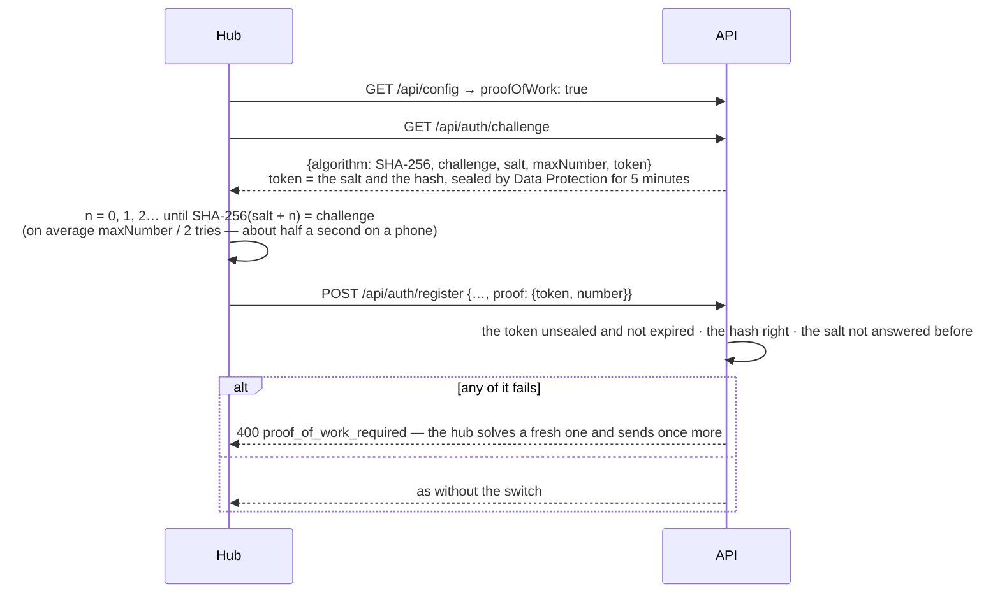

- The hash is computed in the hub's own code (`session/proofOfWork.ts`), not `crypto.subtle`: that exists only on
  HTTPS, and UAT is plain HTTP.
- `Identity:ProofOfWorkMaxNumber` (50 000) sets the difficulty, `Identity:ProofOfWorkLifetime` (5 minutes) how long a
  challenge waits. Answered salts are remembered in memory until their challenge would have expired: one API process
  (ADR 0016).
- It stops cheap bots, not someone with many machines; it costs a person nothing they notice and sends nothing outside
  Tò He. Launch is by invite (E-09 Q1); turn it on before registration opens to everyone.
- The hub reads the mode from `GET /api/config`: by invite, the code field comes first and is needed; open, it comes
  last and is welcome; closed, the sign-up pages say so and the welcome page stops offering "Tạo tài khoản".

## One-time codes

| For | Sent to | Link in the email |
| --- | --- | --- |
| Signing up | the address signing up | `/account/register/confirm?attempt=…&code=…` |
| A forgotten password | the account's address | `/account/password/reset?attempt=…&code=…` |
| A new sign-in email | the new address | `/account/email?attempt=…&code=…` |
| Step-up level 2 without the password | the account's address | — (typed where it was asked for; lives 10 minutes) |
| An address for a provider that vouched for none | the address typed | — (typed on `/account/sign-in/continue`) |
| Linking a provider to the account that has the address | the account's address | — (typed on `/account/sign-in/continue`) |

Every code: six random digits, stored hashed, used once, bound to its attempt, alive 15 minutes, five tries — counted in
the database, so tries made at the same moment all count. One address gets one code a minute and five an hour,
whatever they are for (`code_cooldown`, `too_many_codes`). Links need `App:PublicUrl`; without it the email carries the
code alone. Attempts a day past their end are deleted when the next one starts.

## Signing in

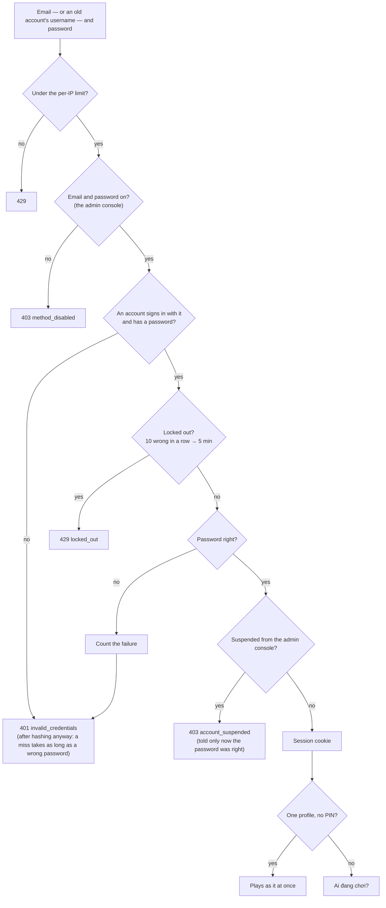

An account from before email sign-in still signs in with its username. Right after it does, the hub asks for an email
and sends the password just typed along as the proof; once the code comes back, only the email signs in.

## Signing in with a provider

Production only: a deployment offers the providers it has secrets for ([Configuration](../guides/configuration.md#api))
and the admin console has on (ADR 0028), and the hub shows "Tiếp tục với …" for each on the sign-in and sign-up
screens.

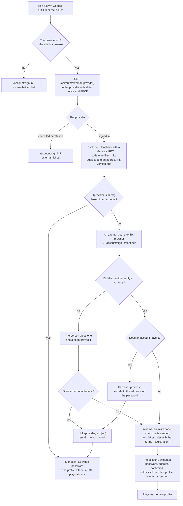

- The provider's subject is the identity. The address only finds an account, and only when the provider verified it:
  Google and an OpenID Connect issuer say `email_verified` (in the ID token or from their userinfo endpoint); GitHub's
  primary address counts when GitHub marks it `verified`. A provider that vouched for none asks for an address.
- What waits is an attempt — 15 minutes, five tries for its code — that a sealed cookie, `tohe.external` (path
  `/api/auth/external`), binds to the browser that came back. A step that sends a code replaces the attempt with a new
  one; "Huỷ" closes it.
- OpenID Connect answers in the query, as a GET: the same-origin guard, which refuses cross-site POSTs to `/api`,
  stays whole.
- The provider is asked about again when it comes back and at every step after: switched off meanwhile, nothing is
  linked and nothing is made (`method_disabled`; `/account/sign-in?external=disabled` for the navigation back).

## Proof before a link

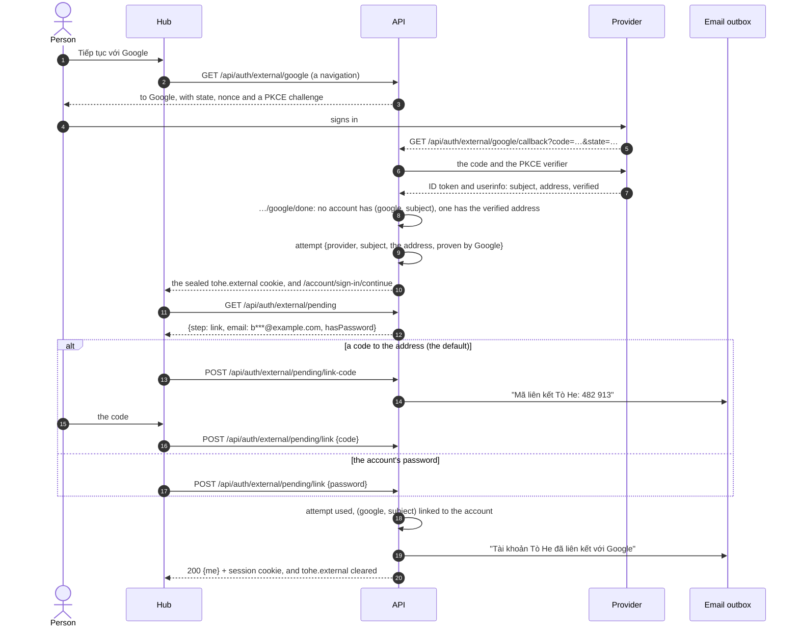

When the person proved the address with our own code during this sign-in — the provider vouched for none — that code
is the proof, and the account that has the address is linked at once. Proving with a provider the account already has
is not offered: the account was found by its address, so a code always reaches its owner (ADR 0026).

## A forgotten password

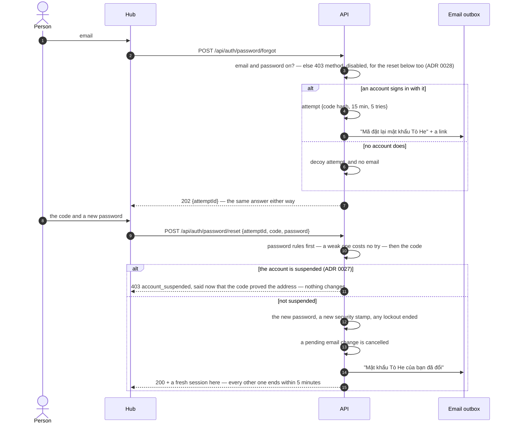

## A new sign-in email

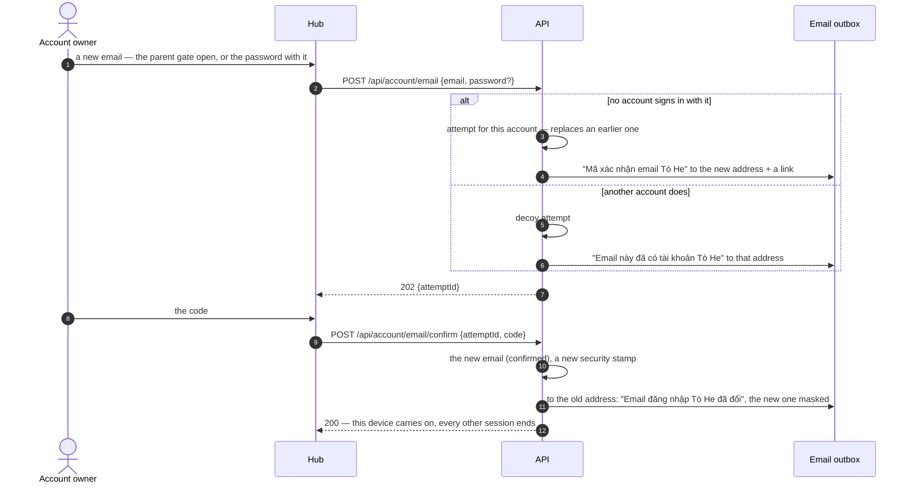

## Sign-in methods

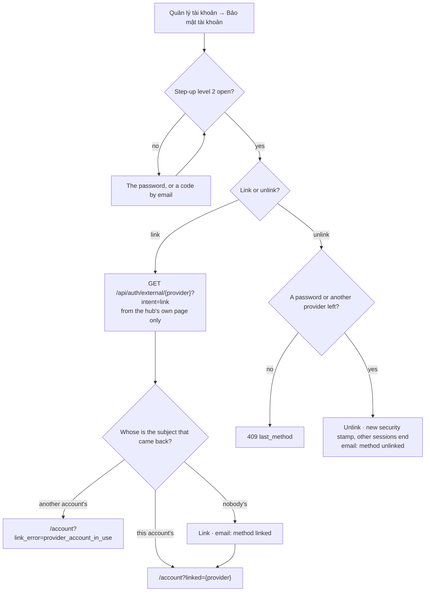

Which methods exist is the deployment's — a provider needs its secrets; which are on is the admin console's
([ADR 0028](../decisions/0028-sign-in-and-registration-at-run-time.md), [Admin console](admin.md#sign-in-and-registration)).
A method switched off signs nobody in and makes no account: not by a forgotten password, not by finishing a provider
sign-in begun before. Nothing else changes — a provider stays linked, a password stays set, and step-up still accepts
the password. `GET /api/config` tells the hub what is on; a link to a provider that is off ends at
`/account?link_error=method_disabled`.

A link starts only from the hub: another site navigating a signed-in browser to the start address carries its session
cookie too, so the API refuses a start that `Sec-Fetch-Site` marks as coming from elsewhere. An account made with a
provider has no password until it sets one, behind step-up level 2 by a code.

## Stepping up

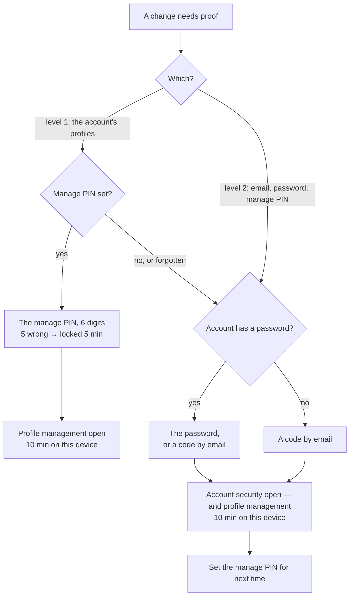

Both levels are claims of this device's session: they close when someone is chosen to play, or the owner locks the
page. Signing in, the password just typed counts as level 2 for adding a first email.

**A link out of Tò He** (feedback's mail today; any other origin or scheme) asks for level 1 too when an account's child
profile plays ([ADR 0046](../decisions/0046-player-surfaces-two-zones-one-frame.md), [Surfaces](surfaces.md)): the same
parent gate, in a sheet in Tôi, and the link opens once the gate does — the parent who typed the PIN leaves management
open for its ten minutes, as anywhere else. An adult's profile follows it at once; so does a device profile, whose device
has no manage PIN. The PIN guards the links out *inside the app*; the public pages the app opens (help, about, papers)
carry `?from=app` and show no link out of Tò He at all, so a child reading them has no way out the PIN did not guard.

**Moving up to an adult's profile** asks for level 1 too ([ADR 0046](../decisions/0046-player-surfaces-two-zones-one-frame.md)):
in the picker, while an account's child profile plays, choosing an adult's profile opens the same parent gate first,
unless management is open on this device already; the adult's own PIN, if it has one, follows. Choosing locks management
again, so the child cannot come back up alone. Moving to a child's profile, or between adults, asks nothing. The hub asks
it, and `PUT /api/session/profile` checks it too: from an account's child profile to an adult's, without management
open on this device, it answers `403 parent_gate_required` — before the adult's own PIN — so a child cannot move up
by calling the API itself. The `pin` it takes is the profile's own, never the manage PIN: the gate opens with
`POST /api/session/parent-gate` (or level 2) first. Clearing the active profile (`DELETE /api/session/profile`) from a
child's profile needs the gate open too, since with nobody playing an adult's profile asks nothing.

## Sessions

| What | How |
| --- | --- |
| Cookie | `tohe.session` — `__Host-tohe.session` behind an HTTPS hub (ADR 0021) — 90 days, sliding, HttpOnly, `SameSite=Lax` |
| In the cookie | the active profile, and until when step-up level 1 and level 2 are open |
| The console's | a session of its own, on the console's host: `tohe.console` — `__Host-tohe.console` behind an HTTPS console — 12 hours from its own sign-in, never sliding, `SameSite=Strict`; its stamp is checked on every request, not every 5 minutes; it authenticates the console's routes alone, and this one never does there ([Admin console](admin.md#the-consoles-session)) |
| The Studio's | a session of its own for the Asset Studio: `tohe.studio` — `__Host-tohe.studio` over HTTPS — 12 hours from its own sign-in, never sliding, `SameSite=Strict`, its stamp checked on every request; it needs a studio role, and authenticates the Studio's routes alone ([Asset Studio](asset-studio.md#members-and-the-studios-session)) |
| Checked against the account's security stamp | every 5 minutes (`Identity:SessionCheckInterval`) |
| The stamp changes when | the password is reset or changed · the sign-in email changes · a provider is unlinked · an admin suspends the account or signs it out everywhere ([Admin console](admin.md#users)) · two-factor authentication is turned off in the console ([Admin console](admin.md#two-factor-authentication)) · the owner asks to delete the account ([below](#deleting)) |
| Never written for | a suspended account: whatever would re-issue its session — choosing who plays, a step-up — answers `403 account_suspended` and ends the session at once, so it cannot renew itself before the check. An account waiting to be deleted likewise, with `401 session_ended`: only signing in again starts a session, and keeps the account |

## A device's life

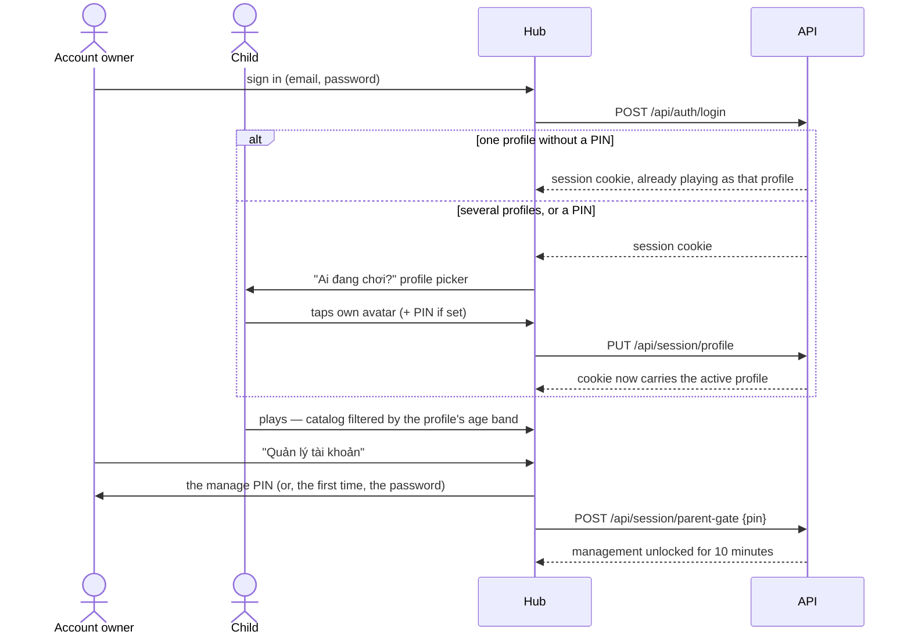

Signing up plays the new profile at once, and so does signing in to an account with one profile and no PIN — nobody
else to choose, and one sign-in request fewer. The hub then sends the device through the picker with
`/account/profiles?auto=true`, which goes straight on (offering first to bring in this device's device profiles that
have progress, [Device profiles](#bringing-one-into-an-account)), and
which also chooses a lone PIN-less profile by itself when a page needs a player and none is chosen. Opened by hand
("Đổi người chơi"), the picker always shows, so a one-profile account can still add a profile or manage the account.

**Coming back** ([ADR 0046](../decisions/0046-player-surfaces-two-zones-one-frame.md), [Surfaces](surfaces.md#coming-back)):

- **Who is playing.** On a device with more than one profile — the account's, or the device's own — a cold start that
  follows 30 minutes unused opens the picker once (`/account/profiles?ask=true`); one tap, and the screen or the link
  that was opening goes on as that player. With one profile, or within 30 minutes, the last player stays.
- **An ended session says so.** The 90-day session can end — it ran out, the password changed elsewhere, an admin signed
  the account out. The hub keeps a copy of the session for playing offline; when the API says nobody is signed in while
  that copy is there, the screens that need a player say "Phiên đăng nhập đã hết — đăng nhập lại để chơi tiếp bằng tài
  khoản", with *Đăng nhập lại* and *Chơi trên máy này*. The device never plays on as a device profile in
  silence. Signing out is a choice, and leads to the sign-in screen as before.

## Deleting

A profile is deleted at once. An account stops at once and, after seven days, waits for an admin to delete it for good
([ADR 0034](../decisions/0034-delete-accounts-and-profiles-for-good.md),
[ADR 0038](../decisions/0038-an-account-waits-for-an-admin-after-its-seven-days.md)).
Every module that keeps something under a profile's id implements `IProfileData`: `WithdrawAsync` lets the profiles
go at once — they leave their tables (a bot finishes a hand in progress), invitations to them end — and `PurgeAsync`
deletes what the module stores, inside the caller's transaction.

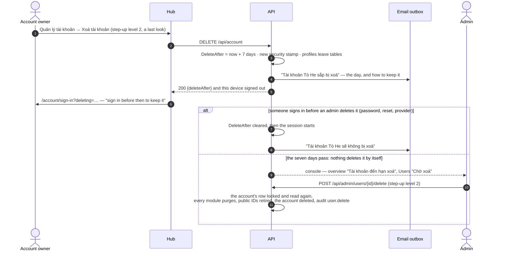

| Data | When a profile goes |
| --- | --- |
| The profile, its name history | Deleted |
| Saves, scores (Progress) | Deleted |
| Results on boards, their decisions, ranked runs (Integrity) | Deleted — the one way past the decisions' append-only trigger ([Integrity](integrity.md#decisions)) |
| Seats in finished hands and closed tables (Rooms) | Kept for the others who played, with nothing of them: a fresh random id, `Deleted: true`, no account, name or avatar; its results keep place and points, without profile or account |
| Its public ID, its id | Retired in `identity.retired_profile_ids`: never given to another profile, never adopted from a device — a device profile's id alone, as it has no public ID |
| The ids merged into it (its aliases) | Retired with it; the aliases go ([Merge aliases](#merge-aliases)) |
| A transfer code of it (a device profile) | Deleted with it |
| The share links it made, and their counts (Links) | Deleted with it: their codes resolve as `unknown` ([Entry links](entry-links.md#its-life)). Merged into another profile, they move there; moved to another device, they stay |
| The notes that it moved away from a device | Deleted with it |
| An account's sign-in methods, roles, keys, sign-in attempts | Deleted with the account |
| Sent email records · audit entries | 30 days (ADR 0022) · a year ([Admin console](admin.md#the-audit-log)) |

While an account waits, its profiles are on no public board and found by no ID — the board audience and the profile
directory leave it out, as a suspended one — and the console's Users pages show it as "Chờ xoá". Past its seven days
it goes on waiting the same way — signing in still keeps it — until an admin deletes it from the console
([Admin console](admin.md#users)): nothing deletes an account by itself while the law's deadlines are not known.
Deleting a profile stays where it was, behind the parent gate and never the last one; for a child it is the parent
taking the consent back (R-07).

## Names

| Rule | Why |
| --- | --- |
| 1 to 24 visible characters (grapheme clusters: an emoji family is one), at most 128 UTF-16 units stored | Fits a seat or a board row; a chain of emoji joined by zero-width joiners is one character of any length |
| Whitespace of any kind becomes one plain space; leading and trailing spaces go | "Bé   Na" and "Bé Na" look alike, so they are alike |
| No control, private-use, unassigned or format characters — except the zero-width joiner, variation selectors and tag characters emoji need | No direction overrides, zero-width tricks or invisible text |
| No letters that draw nothing (Hangul and braille fillers) | A name made of them looks empty |
| At most three combining marks on one character | Vietnamese needs two; more is "zalgo" |
| Not a reserved name — Admin, Moderator, Support, System, Official, Tò He, Quản trị (viên), Kiểm duyệt, Hỗ trợ, Hệ thống, Chính thức, Người chơi đã xoá — compared without case, marks, separators or hidden joiners | Nobody passes for the platform. "Tò-HE 🦊" is taken; "Admin Nhí" is not |
| No offensive word (`NameFilter`, [ADR 0035](../decisions/0035-filter-offensive-names-and-limit-renames.md)): whole words, or two side by side, or letters typed apart. Vietnamese words are matched **with their marks**, however typed; English words and Vietnamese teen code **without marks**, `0 1 3 4 5 7 @ $ !` read as letters, a letter repeated read once | Names are shown to strangers. "Fuuuck", "sh1t", "f u c k" are refused; "Bé Lớn", "Các Bạn", "Diễm", "Essex" are not — without their marks most Vietnamese swear words are everyday words. What slips through, a moderator renames |
| Its owner renames a profile at most **5 times in 24 hours** (`Identity:ProfileRenamesPerDay`), counted from its name history (`rename_limit`) — a device profile's name merged into it is not a rename | Swearing and swapping back is pointless; nobody else meets the limit. A moderator's rename from the console is not limited |

The API runs with invariant globalization (no ICU), where `string.Normalize` does nothing beyond ASCII. So the hub
sends names composed (`normalize('NFC')`), the rules hold for composed and decomposed text alike, and reserved names
are matched through a table of Latin letters with marks (`ProfileNames`). The hub counts characters with
`Intl.Segmenter` to warn early; the API decides.

## Rules

| Rule | Where it is enforced |
| --- | --- |
| One account per sign-in email; an account exists only once the code sent to it came back | `email_index` (unique) on `identity.accounts`; `AuthEndpoints` |
| A code opens only its attempt; five tries, 15 minutes; one address gets a code a minute and five an hour | `Attempts`, `Codes` |
| No answer tells whether an address has an account: decoy attempts, the same 202, a miss as slow as a wrong password | `AuthEndpoints`, `AccountEmailEndpoints` |
| Changing the sign-in email needs step-up level 2 (or the password with the request) and a code at the new address | `AccountEmailEndpoints` |
| A provider's account is linked by its subject, to one account at most; the address it sends only finds an account, and only when the provider verified it | `ExternalEndpoints`; the key of `account_logins` |
| Joining the account that has the address needs a code sent there or the account's password — or the code that proved the address during this sign-in | `ExternalEndpoints` |
| A sign-in back from a provider waits on the browser that came back, in a sealed cookie (`tohe.external`, path `/api/auth/external`) — never in a link — for 15 minutes | `ExternalEndpoints` |
| Linking and unlinking need step-up level 2; a link starts only from the hub's page (`Sec-Fetch-Site`); unlinking never removes the last way in and ends the other sessions; the account's address hears of both | `ExternalEndpoints` |
| Providers answer with a GET (OpenID Connect in the query), and every one of them uses PKCE | `ExternalProviders` |
| A suspended account has no way in — password, provider, finishing a link, a new password by email — and hears why only after proving it is theirs; its sessions end with the new security stamp, and none is written for it | `AuthEndpoints`, `ExternalEndpoints`, `SessionWriter`, `AccountsAdmin` |
| A method switched off in the console signs nobody in and makes no account — nor does a forgotten password, nor finishing a provider sign-in begun before | `AuthEndpoints`, `ExternalEndpoints`, `RuntimeSettings` |
| Every way an account is made obeys the registration mode and checks it again when the account is made; an invite code is counted in that transaction, so its limit holds when people use it at the same moment | `Invites`, `AuthEndpoints`, `ExternalEndpoints` |
| Every name a profile had is kept, whoever renamed it | The `profiles_name_history` trigger on `identity.profiles` |
| Managing the account's profiles needs step-up level 1: the manage PIN within the last 10 minutes, or level 2 | The parent-gate endpoint filter on `/api/account` and `/api/profiles/*` (`ProfileEndpoints.Gated`) |
| Moving from an account's child profile to an adult's — or clearing a child's active profile — needs step-up level 1 open on the device | `SessionEndpoints` (`parent_gate_required`) |
| The manage PIN is six digits, hashed; five wrong in a row lock it for five minutes | `SessionEndpoints`, `ManagePins` |
| The email, the password and the manage PIN change within step-up level 2: the password or a code by email, in the last 10 minutes | `AccountSecurityEndpoints`, `AccountEmailEndpoints` |
| Signing up needs 16 or older and the terms; the account keeps their version, and accepts newer ones again | `AuthEndpoints`, `AccountSecurityEndpoints`; the hub's `legal/documents.ts` |
| An account owns at least one and at most five profiles; changes to them are serialized on the account's row, so requests at the same time cannot break the limits | Identity module (`ProfileEndpoints`) |
| An account sees, manages and plays as its own profiles only; another account's profile is "not found" | Identity module, `IActiveProfile` |
| Public IDs are unique and given once, when the profile is made | `ProfileIds`, unique index on `public_id` |
| A PIN is exactly 4 digits and stored hashed; wrong PINs are rate limited | Session endpoints |
| Children see only games whose `minAge` is at most the lower bound of their age band | Registry, via `IActiveProfile` |
| A child plays online with other accounts only when the account's owner turned on "Chơi online với người ngoài" (`playWithOthers`, off by default); otherwise only at tables the account keeps to itself | Rooms, via `IActiveProfile` ([ADR 0016](../decisions/0016-online-rooms-for-turn-based-games.md)) |
| A profile is on public boards only with "Hiện trên bảng công khai" on — adults from the start, a child once its owner says they asked it — never while its account is suspended, and never while a moderator hides it, whatever the switch says | `ProfileEndpoints`, `IBoardAudience` ([Integrity and boards](integrity.md#public-boards)) |
| Saves, scores and the leaderboard belong to the active profile; boards list the account's profiles | Progress, via `IActiveProfile` and `IAccountProfiles` |
| A profile is asked to tables by its ID only as its owner allows — anyone, people it played with, its account — and a child only within its account; a child's ID is not found from outside its account, nor is a profile of a suspended account ([ADR 0033](../decisions/0033-invite-a-profile-by-its-id.md)) | `ProfileEndpoints` (`child_invites_account_only`, `GET /api/profiles/by-id`), `IProfileDirectory`, Rooms |
| Unsafe `/api` requests from another origin (`Sec-Fetch-Site` ≠ `same-origin`) are rejected | `SameOriginGuard` middleware |
| A profile is an account's or a device's on the server — exactly one — and has a public ID exactly when it is an account's | Check constraints `ck_profiles_owner`, `ck_profiles_public_id` on `identity.profiles` |
| The device key acts only for its device's device profiles, and only on `/api/devices/*`, at tables and on its share links (`/api/links`, [Entry links](entry-links.md)); an account's session never acts for a device profile | `DeviceKey`, the `Tohe.Device` and `Tohe.Player` schemes, `DevicePlayers` |
| A device keeps at most five device profiles on the server; a new one takes the proof-of-work when the console asks, and the name filter | `DeviceEndpoints` |
| A device profile acts at a table only with the terms the hub shows accepted (`412 terms_required`) | `DevicePlayers` |
| Device profiles unused for 90 days, and devices unseen for 90 days, are deleted on the server with everything of them | `DeviceCleanup` |
| A transfer code moves only its own profile, only while that profile is its device's, once, within ten minutes; six typed digits move it only with the old device's yes | `TransferEndpoints` (the transfer's row locked; its code's hash cleared when used) |
| Redeeming a transfer code takes the proof-of-work when the console asks, the `auth-code` bucket per address, at most `Identity:TransferCodeMissesPerAddressPerHour` wrong six-digit codes an hour per address, and a proof-of-work for six digits past `Identity:TransferCodeMissesPerHour` wrong ones for the whole server | `TransferEndpoints`, `TransferMisses` |
| An id merged into a profile, kept as its alias, is never taken again; deleting the profile retires it | `DeviceProfiles.IdTakenAsync`, `AccountDeletion` |
| Per client IP, 10 requests a minute in each of three buckets: signing in or asking for a code (`auth`), typing a code back (`auth-code`), a PIN or the parent gate (`auth-gate`) | Rate limiter policies; `Identity:AuthRequestsPerMinute` |
| 10 wrong passwords lock an account for 5 minutes; a password reset ends the lockout | ASP.NET Core Identity lockout |

## Device profiles

[ADR 0043](../decisions/0043-device-profiles-and-identity-levels.md): a player is a profile of this device or of an
account. A **device profile** — "Hồ sơ trên máy này" — belongs to one browser (or installed app): a name, an avatar,
saves and scores, all in IndexedDB. It has no email, no 12-digit ID, no public board and no age (it sees every game).
Step I1 lives in the hub; step I2a puts a device profile on the server when its player sits at a table — the device
key, the `named` screen and its terms line, tables open to `named` device profiles, the 90-day cleanup
([below](#device-profiles-on-the-server)); step I2b moves one to another device with the
[transfer code](#the-transfer-code) and keeps a merged one's id reachable with a [merge alias](#merge-aliases).

- **Opening the hub is playing.** A device with no session plays as its device profile at once, with no sign-in screen
  first: the first visit makes one silently, with a suggested Vietnamese name and an avatar from the profiles' set
  (`ensureDeviceProfile`, the `any` level). The slim "Đăng nhập" strip on the catalog opens the sign-in when the player
  chooses; "Chơi luôn" on the sign-in screen goes back to the device profiles. The catalog shows the device profile's
  name. A room link, the rooms lobby, a room and a replay play as the device profile too, after the `named` screen the
  first time ([below](#device-profiles-on-the-server)); signing out of an account leads to the sign-in screen, and the
  device profiles stay; an account's session that ended says so, and the device profiles play only when chosen
  ([above](#a-devices-life)). A link — a table's or a share link — is kept on the tab for an hour through signing in and the
  picker, and forgotten when another profile is chosen by hand ([Entry links](entry-links.md#the-hubs-entry-pipeline)).
- **Up to five per device** (`MAX_DEVICE_PROFILES`), in `/account/profiles` while no account is signed in: switch, make
  one (a suggested name, an avatar), rename, delete; the last one stays. Deleting removes its saves and scores from the
  device, and its copy on the server when it has one. Its ✏️ sheet also has **Chuyển sang máy khác**, and the page's
  foot **Tôi có mã chuyển máy** ([the transfer code](#the-transfer-code)). While one of them was never on the server, the
  page says that such a profile lives only on this device and goes with the browser's data — ADR 0043's warning. On an
  iPhone, the install steps say that the installed app does not share Safari's data, and how to take a profile along.
- **From the guest.** The guest of earlier versions — one local profile per device — is the device's first device
  profile: same id, same saves and scores, moved by the IndexedDB upgrade to version 4 without copying anything. The
  device keeps the key `tohe:guest` in `localStorage` for "this device plays without an account" (the public pages
  read it, [Hosts and paths](hosts-and-paths.md)); the device profile playing is `tohe:device-profile`.
- **Nothing reaches the server** while a device profile stays on the device: it never syncs, and device telemetry
  names no profile (ADR 0015). It reaches the server only when its player sits at a table, moves it to another device,
  or brings it into an account.

### Bringing one into an account

A device profile's saves and scores reach the server **only** with the request that brings it in — one request,
carrying at most 50 saves (each within the Game Contract's 64 KB) and 1 000 scores (the hub sends each board's best
first). The server stores every score of that request, and every result the integrity engine makes of it, with the
mark `device_earned`: such a result is never in a public board's audience, even once the profile is an account's — the
channel decides, no field of the request does ([Integrity and boards](integrity.md#public-boards)). What the device
plays after that syncs like any account profile's.

- **Past the limits.** Scores beyond the 1 000 never reach the server: the device keeps them, marked as sent. Saves
  beyond the 50 carry no mark, so on adding they stay pending and ordinary sync takes them; on merging the device
  profile keeps them and stays on the device, and the hub says so.
- **A backstop.** A profile that came from a device keeps when (`identity.profiles.device_until`): a run it reports as
  reached up to then is marked `device_earned` whichever way it arrives, ordinary sync included. A run marked once stays
  marked: sending its client id again never clears it, and a trigger refuses to.
- **Sent means sent.** The hub counts what a request carries as sent before the request goes, so ordinary sync never
  sends it first; it is pending again if the request fails.

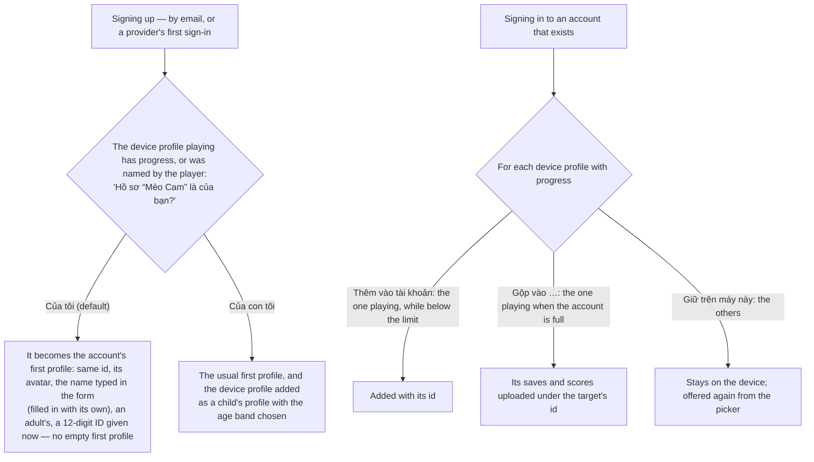

- **The id travels with the sign-up.** By email, `POST /api/auth/register` carries `deviceProfileId`, kept on the
  attempt; the confirmation from the same device carries the device profile and its data. Opened on another device,
  the link makes the account the usual way, and the original device offers to add its device profile the next time it
  signs in. With a provider, the hub starts at `/api/auth/external/{provider}?profile=<id>`; the id travels in the
  provider's state, then in the attempt, and `POST /api/auth/external/pending/signup` carries the device profile. A
  device profile whose id is not the attempt's, or whose id was taken meanwhile — even at the very moment the account
  is made — is not brought in: the account is made the usual way and the device keeps it. A device profile with a copy
  on the server, of the device signing up (its key comes with the requests), is not "taken": the copy becomes the
  account's first profile — or the child's beside it — the same row, keeping its id, seats and results, as when it is
  [adopted](#bringing-one-into-an-account). Signing up needs no step-up:
  the person has just proved the address. The question is asked when the device profile playing has progress, or when
  the player named it or chose its avatar — never about the one the hub made silently and nobody touched.
- **Signing in** (`/account/profiles` right after it): for each device profile **with progress** — or a copy on the
  server — **Thêm vào tài
  khoản** (keeps its id; only while the account is below its limit), **Gộp vào** one of the account's profiles (the
  hub suggests one with the same name or avatar) or **Giữ trên máy này**. By default the one playing is added — merged
  when the account is full — and the others stay. Adding or merging is profile management: step-up level 1 (ADR 0025),
  `POST /api/profiles/adopt` and `POST /api/profiles/{id}/merge`. Later, the picker lists the device profiles left on the
  device with "Đưa vào tài khoản".
- **Adopting an id**: the API takes the device's id only if no profile has it and none ever had it — since I1 a deleted
  profile's id is retired with its public ID (`identity.retired_profile_ids.profile_id`); ids of profiles deleted before
  were not kept and cannot be — otherwise `409 id_taken`, also when two requests bring the same id in at once: the hub
  first looks whether the account has it already (an answer lost), else gives the device profile a new id on the device,
  moves its saves and scores under it, and asks again. A [merge alias](#merge-aliases)'s old id is taken too.
- **A copy on the server** (I2a): when the id is a device profile on the server **of this request's device** — its key
  came with the request — the same row becomes the account's: its account set, its device cleared, a 12-digit ID given
  now, the adult or child template, `device_until` set. It leaves the tables it sits at as a device profile (a bot
  finishes a hand); its seats in finished hands and its results follow its id, now naming the account, and stay marked
  as a device profile's. Another device's copy is `409 id_taken`: the device key, never the id, speaks for it.
- **Asking again is harmless**: an id that is already a profile of the same account answers 200 and takes the data
  again — scores by their client ids, their marks kept — so a lost answer never makes a second profile.
- **Its name** goes through the [name rules](#names) and the filter when it is brought in: a refused name answers
  `422 name_refused` (with the rule in `reason`), and the hub asks the player to rename it first.
- **The account must be able to take it**: a suspended account, or one waiting to be deleted, takes nothing
  (`account_suspended`, `session_ended`); a child's profile starts with the child template — off public boards, no play
  with outsiders, asked to tables only within the account.
- **Merging** (I1): a save present on one side is taken; present on both, the newer wins — the device's time against
  the server's — and the other is kept as the previous version (ADR 0005); scores join the target's, marked. The target
  keeps its name and avatar; the device profile's name goes into its name history as `merged` — not a rename, so it
  costs none of the day's renames, and the console labels it. The request names the device profile
  (`deviceProfileId`): its copy on the server, of this request's device, moves into the target — seats in finished
  hands, results, closed tables it hosted, still marked — and is then deleted through [Deleting](#deleting), its id
  retired, and a [merge alias](#merge-aliases) keeps its old id reachable: a replay or a link that names it finds the
  target, and results recorded under it as the merge was being made still count. The same merge sent again — its answer lost — finds the alias to the same target and takes the data again;
  an alias to another profile is `409 id_taken`. Another device's copy is `409 id_taken`.
- **After it**, the device drops the device profile from its list; its saves and scores stay under the account
  profile's id, its scores marked as sent — so ordinary sync never sends them again, unmarked. Signing in, the device
  then plays on as the profile it was playing: the one it became, or the one it was merged into.

### Device profiles on the server

[ADR 0043](../decisions/0043-device-profiles-and-identity-levels.md), step I2a. A device profile reaches the server
**lazily**: the first time its player does something that needs it — sitting at a table, from a room link, the rooms
lobby or a room, opening a share link that asks for a name, making one with "Chia sẻ" ([Entry links](entry-links.md)),
or moving it to another device ([the transfer code](#the-transfer-code)). A game asks for what its `identity.play` says — `any` unless it
declares more ([ADR 0045](../decisions/0045-games-declare-identity-and-entries.md)) — and may ask for `named` or
`account` in the middle of play (`identity.require`, answered by the hub's own sheets); a table
asks for at least `named`. Every way in goes through the hub's [entry pipeline](entry-links.md#the-hubs-entry-pipeline),
whose identity gate is this one: the highest of the game's, the feature's and the link's level.

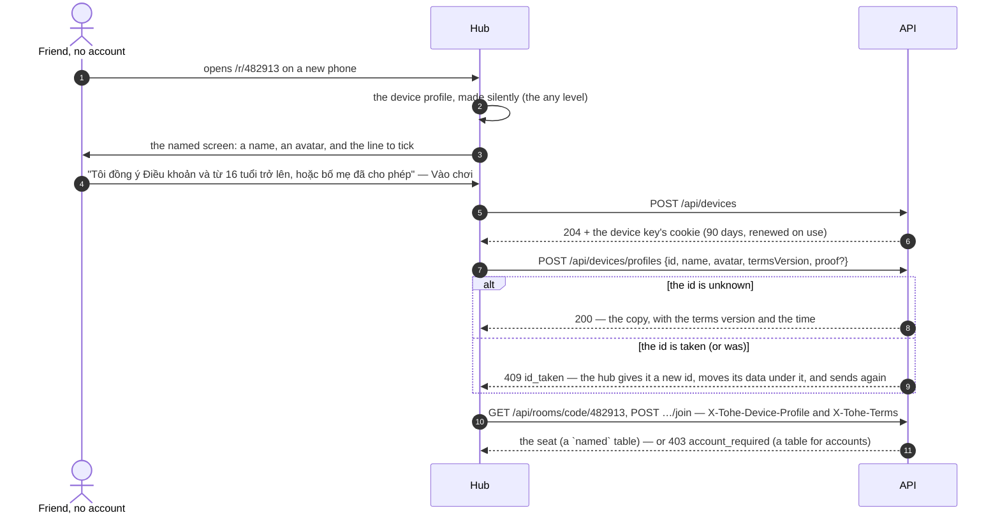

- **The `named` screen** (`session/AtTables.tsx`) comes before anything of the profile reaches the server: the name others
  will see, an avatar, and one line to tick — "Tôi đồng ý Điều khoản và từ 16 tuổi trở lên, hoặc bố mẹ đã cho phép", with
  the terms and the privacy notice a tap away. **Nhờ bố mẹ** leads to signing in (or up), where a parent makes a child's
  profile instead; **Đã có tài khoản? Đăng nhập** too. The hub keeps on the device that the profile has a copy and which
  terms its player accepted; a new name or avatar sends the copy again, without asking. The same screen, with its own
  words around the same line, comes before a transfer code ("Trước khi chuyển máy"), a share link that asks for a name
  ("Trước khi vào chơi") and making a share link — in the "Chia sẻ" sheet ("Trước khi chia sẻ").
- **The device key**: `POST /api/devices` gives the device one — 32 random bytes in a cookie, `tohe.device` over HTTP
  and `__Host-tohe.device` (`Secure`) behind an HTTPS hub, as for the players' session; `HttpOnly`, `SameSite=Lax`,
  `Path=/`, 90 days, renewed (with the device's `last_seen_at`) at most once an hour while in use. The server keeps
  only its SHA-256. A device that has a key keeps it.
- **Its own scheme, apart from the session's** (`DeviceKey`, `Tohe.Device`): the key authenticates
  `/api/devices/profiles`, `/api/devices/transfers` and `/api/devices/moves` and nothing else of the API's own; an account's endpoints read the session alone, so the key
  never acts for an account's profile. At tables, the players' scheme (`Tohe.Player`) reads the device key **only** when
  the request names a device profile — `X-Tohe-Device-Profile`, or `?deviceProfile=` in the rooms hub's address, where a
  WebSocket cannot carry headers — and the session otherwise, never both; a named profile is found only among the key's
  device's own (`device_id`), so an account's session never acts for a device profile, nor one device for another's.
- **Its id**, as when one is brought in: unknown to profiles and to retired ids, else `409 id_taken` and the hub gives it
  a new one. Its own device sending its copy again answers 200 and brings it up to date — its avatar, the terms, and
  its name through the name rules — and answers with the name the server keeps, which the device takes: the server's
  stays when a moderator chose it (`name_moderated_at`, so a hidden name never comes back) or when the day's renames
  are used up.
- **Against abuse**: the proof-of-work of ADR 0037 when the console turns it on (a new copy only), a bucket per address
  (`device`, `Identity:DeviceRequestsPerMinute`), the name filter (`422 name_refused`), five copies per device
  (`409 too_many_profiles`).
- **The terms again**: every action of a device profile at a table carries the version of the terms the hub shows
  (`X-Tohe-Terms`). Another version than the one it accepted answers `412 terms_required`; the hub shows the `named`
  screen again and sends the new version, kept with its time.
- **Gone**: a device profile its device deleted, or the cleanup took, answers `404 device_profile_not_found`; the hub
  gives it a new id on the device, its data moved under it, and sends its copy again without asking — its player
  accepted these terms already, and the copy goes with the same version; new terms ask again as always. Any other new
  id (`id_taken`) starts with no copy and no terms on the device.
- **Moved**: a device profile [moved to another device](#the-transfer-code) answers its old device
  `410 device_profile_moved` — at a table, sending its copy, deleting it — and the hub keeps what was played there
  since as a new device profile.
- **At tables** ([Online rooms](rooms.md#who-may-sit)): a table "Ai có link cũng vào" (`named`, the default) seats it; a
  table "Chỉ tài khoản" or "Chỉ hồ sơ trong tài khoản tôi" does not. It asks nobody by ID. A child whose "play with
  outsiders" is off never sits with it. Its results are marked as a device profile's and reach no public board
  ([Integrity](integrity.md#public-boards)).
- **Deleting** it on the device deletes its copy (`DELETE /api/devices/profiles/{id}`, with the key) through
  [Deleting](#deleting): it leaves its tables, the modules purge, its seats read "Người chơi đã xoá", its id is retired.
- **Cleanup** (`DeviceCleanup`, the `device-cleanup` worker, once a day): a device profile unused on the server for 90
  days, and a device unseen for 90 days with its profiles, are deleted the same way. A device key never used for a
  device profile goes a day after it was made. The copy on the device stays.
- **Moderation** ([Admin console](admin.md#users)): the console finds device profiles by name, renames one — how a
  moderator hides a name; the name sticks, and its seats at live tables show it at once — and takes any profile off
  its tables.

**What the server keeps of a device profile, and for how long** — the facts the privacy notice needs (the owner covers
device profiles in it with E-05):

| What | Where | Until |
| --- | --- | --- |
| The device: the key's hash, when it was made and last seen | `identity.devices` | 90 days unseen; a day, if it never kept a device profile |
| The profile: id, name, avatar, the terms version and when accepted, when made and last used, when a moderator renamed it | `identity.profiles` (no account, no public ID, no email, no age) | deleted on the device, 90 days unused, or brought into an account |
| Every name it had | `identity.profile_names` | with the profile |
| Its seats, hands and results at tables | `rooms.*`, `integrity.results` (marked) | with the profile; seats in others' finished hands stay as "Người chơi đã xoá" |
| A transfer code: the hashes of its six digits and of its secret, which device made it and which redeemed it, and the saves and scores it carries | `identity.profile_transfers` | ten minutes to redeem and confirm, ten more for the new device to fetch the answer; deleted with the profile |
| That a profile moved away from a device, and when | `identity.profile_moves` | 90 days, or until that device is deleted |
| An old id that names a profile it was merged into | `identity.profile_aliases` | with the profile it names; then retired |
| The share links it made — code, game and version, level, expiry, maximum and uses, revoked — and their counts per day: opened, played, accounts made, totals only ([Entry links](entry-links.md)) | `links.share_links`, `links.share_link_days` | with the profile; merged, they move to the target |

Nothing else: no address, no device fingerprint, no telemetry naming it (ADR 0015). Saves and scores stay on the device
until the profile moves to another device — and then only while the transfer code lives — or is brought into an
account.

### The transfer code

[ADR 0043](../decisions/0043-device-profiles-and-identity-levels.md), step I2b: a device profile on the server moves to
another device — a new phone, the installed app on an iPhone (whose storage Safari does not share), or before a
browser's data is cleared — with no account. The old device makes a code; the new one redeems it; the profile, its
id, saves and scores go with it, and the old device's key stops speaking for it.

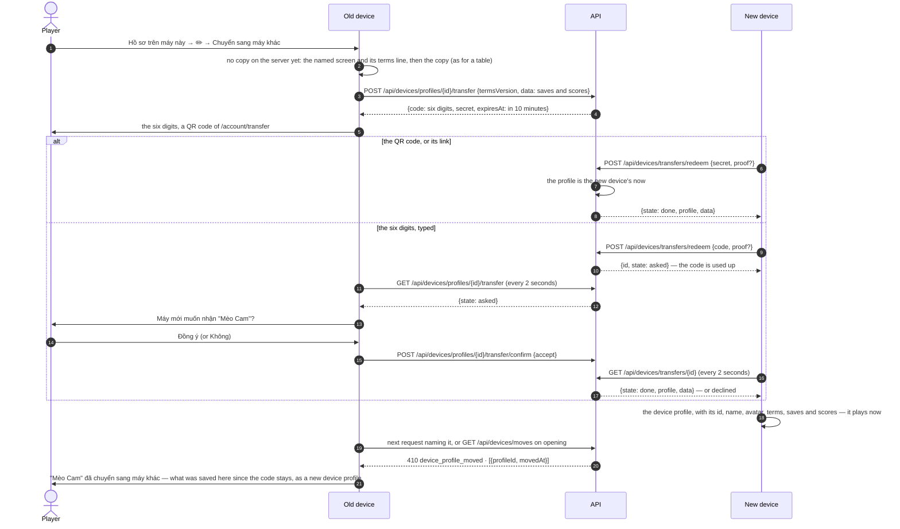

- **Only a copy on the server moves.** "Chuyển sang máy khác" on a device profile with no copy, or with terms not yet
  accepted, shows the `named` screen and its line first and sends the copy, as for a table. The code carries the
  profile's saves and scores — at most 50 saves and 1 000 scores, as when one is brought into an account, and at most
  1 MB of them; a device's live codes carry 2 MB together (`400 upload_too_large`) — sent with the request that makes
  it. The hub sends what fits, the newest saves first, and marks as sent exactly what the last code carried: what stays
  behind is kept on the old device should the profile move.
- **The code**: six random digits, and a secret of 32 random bytes for the QR code. Both are stored hashed — the
  digits as SHA-256 of the transfer's id and the digits, as the one-time codes by email; the secret as its SHA-256 —
  and the answer that made them is the only time they are seen. Alive **ten minutes**; **one per profile**: a new code
  replaces the one before. Leaving the screen cancels it (`DELETE …/transfer`).
- **Used once.** Redeeming locks the transfer's row and finds it open, or not at all: a code typed again, a secret
  scanned twice, a code expired, declined or cancelled all answer `404 transfer_invalid` — the same answer whatever the
  reason. The six digits no longer exist once typed (their hash is cleared), whatever the old device answers.
- **The six digits need the old device's yes.** Six digits can be guessed; the secret cannot. A typed code is only a
  question to the old device — "Máy mới muốn nhận "Mèo Cam"?" — which it asks while its screen is open (it asks the
  API every two seconds); "Không" ends it. Only the secret, read from the QR code or opened as its link, moves the
  profile at once. The link carries the secret after `#`, so it never reaches a server's log.
- **Against guessing**: redeeming takes the proof-of-work of ADR 0037 when the console turns it on; each address has
  the `auth-code` bucket (`Identity:AuthRequestsPerMinute`, every redemption counts). Wrong six-digit codes are counted
  twice — a slot is taken before the code is looked at and given back when it was right: per address,
  `Identity:TransferCodeMissesPerAddressPerHour` (10) an hour, past which that address hears `429 transfer_limit`; and
  for the whole server, `Identity:TransferCodeMissesPerHour` (100) an hour, past which six digits take a proof-of-work
  (`400 proof_of_work_required`, whatever the console's switch says) rather than being refused — so no single source can
  shut the digits for everyone. The secret works throughout. A hit by chance still needs the old device's yes.
- **Bound to its profile.** A code moves the profile it was made for and nothing else, and only while that profile is
  still its device's: brought into an account or deleted meanwhile, the code is gone with it. The new device needs its
  own key (`POST /api/devices`), room for one more profile (`409 too_many_profiles`; filled up before the old device's
  yes, the transfer ends as `full`), and is not the old device (`409 transfer_same_device`). Bringing a copy into an
  account, merging it and moving it all hold its device's row first, so one of them happens and the others find it
  gone.
- **The move**, in one transaction holding both devices' rows: the profile leaves the tables it sits at (a bot finishes
  a hand), its `device_id` becomes the new device's, and the old device is noted as one it moved away from
  (`identity.profile_moves`). Its id, name, avatar, terms, seats and results stay as they were. The new device gets the
  profile and the saves and scores in the answer — again, if it asks again with the same secret, polls the same
  transfer, or lists its transfers (`GET /api/devices/transfers`), for ten minutes after the code ends. The phones that
  showed it at a table leave the table's groups, so its old device hears nothing of its seat.
- **Nothing lost on the new device**: the hub keeps the redemption in IndexedDB (`cache`, `transfer:pending`: the
  secret, then the transfer's id) before the request goes and after each answer, until it settles — done, declined,
  full, expired, or gone (`404`). On the receive page, and whenever the hub opens, it carries on: the transfer it named,
  or — the answer lost — this device's transfers, or the secret again. A network error only waits for next time. The
  field takes the six digits or the transfer link pasted whole ("Chép link" on the old device), the way in for an
  installed iPhone app that cannot open the QR code's link.
- **The old device** learns it on its next request naming the profile — `410 device_profile_moved` from the rooms, the
  copy or the transfer — or from `GET /api/devices/moves` when the hub opens (asked only when a device profile of it
  has a copy). The hub says "'Mèo Cam' đã chuyển sang máy khác"; what was played there since the code was made — a save
  written since, a score not sent — stays as a **new** device profile with a new id and no copy; when nothing was, the
  profile leaves the device. Nothing is dropped.
- **Moving back** to a device it once left clears that device's note.

### Merge aliases

A device profile's copy merged into an account's profile ([above](#bringing-one-into-an-account)) leaves an alias:
`identity.profile_aliases (old_id → profile_id)`. Its seats, results and closed tables moved to the target with the
merge; the alias keeps the old id reachable for what still names it:

- **Replays, statistics and the hands list** of the target count results under its aliases' ids too
  ([Online rooms](rooms.md#who-sees-what)) — a hand recorded under the old id as the merge was being made still opens.
- **Asking to a table by id** (`POST /api/rooms/{id}/invite`) finds the target, under its own invitation rules.
- **Ids**: an alias's old id is taken — adopting, merging, a new copy — like a profile's or a retired one's.
- **Deleting the target** retires its aliases' ids with its own; the aliases go with it.

## API

| Endpoint | Auth | Purpose |
| --- | --- | --- |
| `GET /api/auth/challenge` | — | A [proof-of-work](#proof-of-work) to solve before signing up or a reset, when the console asks for one |
| `POST /api/auth/register` | — | Start signing up, with an invite code when [registration](#registration) needs one (and `proof` when the console asks), and the id of the device profile signing up (`deviceProfileId`, `409 id_taken`): a code to the email — 202 and an attempt, whoever the address belongs to |
| `POST /api/auth/register/confirm` | — | The code creates the account and its first profile — the device profile sent with it, when it is the attempt's ([Device profiles](#bringing-one-into-an-account)) — which plays at once; `entryCode`, the share link it came from, is counted once as an account made from it and stored nowhere on the account ([Entry links](entry-links.md#counts)) |
| `POST /api/auth/login` / `POST /api/auth/logout` | — / session | Sign in with the email (an old account's username until it adds one) / out |
| `POST /api/auth/password/forgot` | — | A code to set a new password, if the address has an account (`proof` when the console asks) — 202 either way |
| `POST /api/auth/password/reset` | — | The code sets the new password; every other session ends |
| `GET /api/auth/external/{provider}` | — (`?intent=link`: session + level 2) | A navigation: off to the provider, back through `…/callback` and `…/done`; `?profile=` names the device profile signing up |
| `GET /api/auth/external/pending` | the browser that came back | The step that waits — `email`, `link` or `signup` — or 404 |
| `POST /api/auth/external/pending/email` · `/email/confirm` | the browser that came back | A code to the address typed · the code proves it; an account with it is linked at once |
| `POST /api/auth/external/pending/link-code` · `/link` | the browser that came back | A code to the account's address · the code, or the password, links and signs in |
| `POST /api/auth/external/pending/signup` | the browser that came back | A name, the terms and an invite code when needed create the account — with the device profile sent, as by email; its first profile plays at once; `entryCode` as by email |
| `DELETE /api/auth/external/pending` | the browser that came back | Forget the sign-in that waits |
| `GET /api/auth/me` | session | Account (with its email, linked providers, platform role — [Admin console](admin.md) — and community), its profiles (with public IDs, whether each is on public boards, whether a moderator hid it from them, and who may invite it), active profile, step-up expiries |
| `PUT /api/session/profile` / `DELETE` | session | Choose (PIN if set; from a child's profile to an adult's, level 1 open: `403 parent_gate_required`) / clear the active profile (from a child's, level 1 open) |
| `POST /api/session/parent-gate` / `DELETE` | session | The manage PIN opens profile management / lock both levels |
| `POST /api/session/step-up` | session | Level 2 with the password (opens level 1 too) |
| `POST /api/session/step-up/code` · `/confirm` | session | Level 2 with a code to the account's email |
| `PUT /api/account/manage-pin` · `PUT /api/account/password` | session + level 2 | Set or change the manage PIN · the password (every other session ends) |
| `DELETE /api/account` | session + level 2 | Delete the account ([above](#deleting)): `{deleteAfter}`, seven days on; every session ends, this one too; signing in before then keeps it |
| `POST /api/account/terms` | session | Accept the terms and privacy notice in the version the hub shows |
| `POST /api/account/email` | session + level 2, or the password | A code to a new sign-in email |
| `POST /api/account/email/confirm` | session | The code makes it the sign-in email; every other session ends |
| `DELETE /api/account/logins/{provider}` | session + level 2 | Unlink a provider — never the last way in; every other session ends |
| `GET /api/profiles/options` | — | Allowed avatars and age bands; how many profiles an account may own |
| `PATCH /api/account` | parent | The account's telemetry switch |
| `POST /api/profiles` | parent | Add a profile: a child's with an age band, an adult's without |
| `POST /api/profiles/adopt` | parent | Bring a device profile in with its id, saves and scores: a child's with an age band, an adult's without ([Device profiles](#bringing-one-into-an-account)) — its copy on the server, when this device's key came with the request, becomes the account's; `409 id_taken`, `422 name_refused` |
| `POST /api/profiles/{id}/merge` | parent | Upload a device profile's saves and scores under one of the account's profiles — the newer save wins — and keep its name in the history; its copy on the server (`deviceProfileId`, this device's) moves there and is deleted; `409 id_taken`, `422 name_refused` |
| `POST /api/devices` | — | The device key's cookie ([Device profiles on the server](#device-profiles-on-the-server)); a device that has one keeps it — 204 |
| `POST /api/devices/profiles` | device key | Make, or bring up to date, a device profile's copy: `{id, name, avatar, termsVersion, proof?}` → `{id, name, avatar, termsVersion}` — the name the server keeps; `409 id_taken`, `409 too_many_profiles`, `412 terms_required`, `422 name_refused`, `400 proof_of_work_required` |
| `DELETE /api/devices/profiles/{id}` | device key | Delete the copy for good ([Deleting](#deleting)) — 204, or `404 device_profile_not_found` |
| `POST /api/devices/profiles/{id}/transfer` | device key | A [transfer code](#the-transfer-code) for this device's profile: `{termsVersion, data?}` → `{code, secret, expiresAt}`, replacing any before; `404 device_profile_not_found`, `410 device_profile_moved`, `412 terms_required`, `400 upload_too_large` |
| `GET /api/devices/profiles/{id}/transfer` | device key | Its live code: `{state: open \| asked, expiresAt}` — `asked` when a new device typed the six digits; `404 transfer_not_found`, `410 device_profile_moved` once it moved |
| `POST /api/devices/profiles/{id}/transfer/confirm` | device key | The old device's answer to six typed digits, `{accept}` — 204; `404 transfer_not_found`, `409 too_many_profiles` (the new device filled up meanwhile: the transfer ends as `full`) |
| `DELETE /api/devices/profiles/{id}/transfer` | device key | Cancel its code — 204 |
| `POST /api/devices/transfers/redeem` | device key | `{secret}` or `{code}`, with `proof` when the console asks → `{id, state: done \| asked, profile?, data?}`; `400 proof_of_work_required`, `404 transfer_invalid`, `409 too_many_profiles`, `409 transfer_same_device`, `429 transfer_limit` |
| `GET /api/devices/transfers/{id}` | device key (the device that redeemed) | The transfer as that device sees it: `asked`, `done` (with `profile` and `data`), `declined`, `full`, `expired`; `404 transfer_not_found` |
| `GET /api/devices/transfers` | device key | The transfers this device redeemed, newest first, while their answer is kept: how a lost answer is found |
| `GET /api/devices/moves` | device key | This device's profiles that moved away: `[{profileId, movedAt}]` |
| `GET /api/profiles/by-id/{publicId}` | session | A profile's card — id, ID, name, avatar — to confirm before asking it to a table ([ADR 0033](../decisions/0033-invite-a-profile-by-its-id.md)); never a child of another account nor a profile of an account suspended or waiting to be deleted (`profile_not_found`); 20 lookups an hour per account (`lookup_limit`) |
| `PATCH` / `DELETE /api/profiles/{id}` | parent | Edit (incl. a child's `playWithOthers`, `onPublicBoards` — with `askedChild` to turn a child's on — and an adult's `invites`: `anyone`, `played-with`, `account`) / delete a profile — never the last — with everything of it ([above](#deleting)) |

`GET /api/config` says whether the server sends email (`email`) — without it, nothing that needs a code starts
(`email_unavailable`) — which providers it offers (`providers`: an `id` and the name on the button, only those on),
whether email and password are on (`passwordSignIn`), the registration mode (`registration`: `open`, `invite` or
`closed`), and whether signing up and a reset take a proof-of-work (`proofOfWork`).

Errors are problem details; a machine-readable `code` lets the hub show a Vietnamese message: `invalid_credentials`,
`locked_out`, `email_invalid`, `email_unavailable`, `email_unchanged`, `code_invalid` (with `triesLeft`),
`attempt_closed`, `code_cooldown`, `too_many_codes`, `password_too_short`, `password_invalid`, `pin_required`,
`pin_invalid`, `parent_gate_required`, `step_up_required`, `manage_pin_not_set`, `manage_pin_invalid`,
`password_not_set`, `email_required`, `terms_required`, `too_many_profiles`, `last_profile`, `name_required`, `name_invalid_character`,
`name_too_long`, `name_reserved`, `name_inappropriate`, `rename_limit`, `sign_in_expired`, `wrong_step`, `proof_required`, `provider_account_in_use`,
`last_method`, `account_suspended`, `session_ended`, `method_disabled`, `proof_of_work_required`, `registration_closed`, `invite_required`,
`invite_invalid`, `asked_child_required`, `id_taken`, `name_refused` (with `reason`, the name rule that refused it),
`upload_too_large`, `device_profile_not_found`, `device_profile_moved`, `transfer_invalid`, `transfer_not_found`,
`transfer_limit`, `transfer_same_device`; `terms_required` is also a device profile's `412` at a table.
Navigations answer with a redirect instead: `/account/sign-in?external=failed` (the provider refused, or was cancelled),
`/account/sign-in?external=suspended`, `/account/sign-in?external=disabled`, `/account?linked={provider}`, or `/account?link_error=`
`step_up_required`, `provider_account_in_use`, `cross_origin` or `method_disabled`.

## From households

The migration `AccountsOwnProfiles` moved UAT's households in place (ADR 0023): each adult kept their account and
profile; a household's children went to its first adult (the earliest account); its telemetry switch went to each of
its accounts; rooms, seats and results now name accounts; every profile got a public ID. `MigrationTests` runs it over
a seeded database of the old shape. The way back is the backup `deploy/uat/deploy.sh` takes before every deploy.
