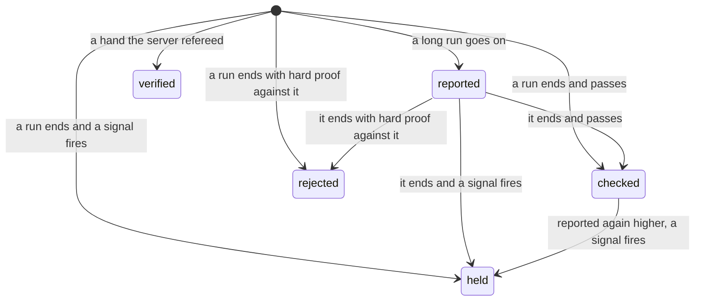
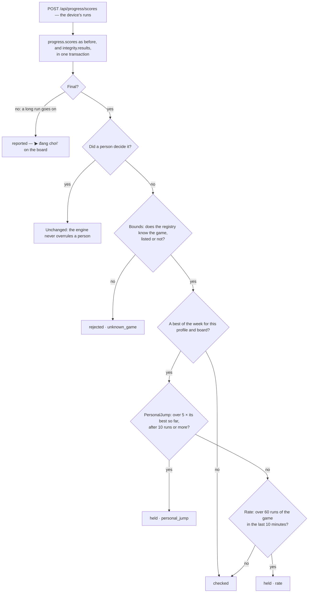
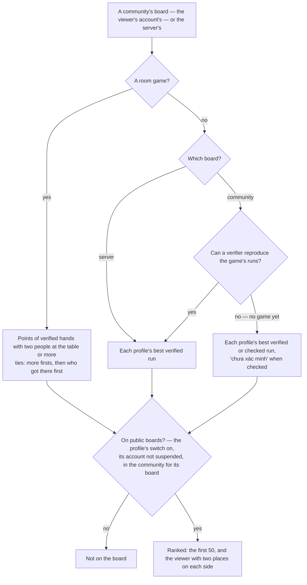
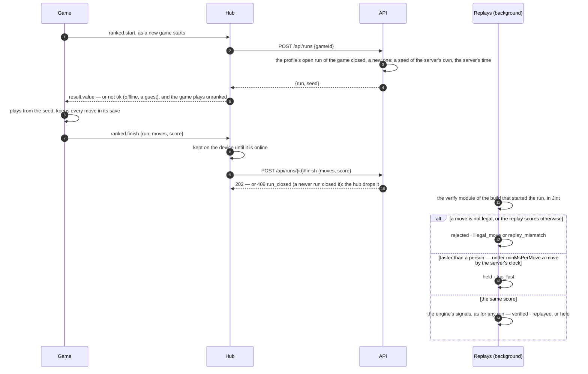
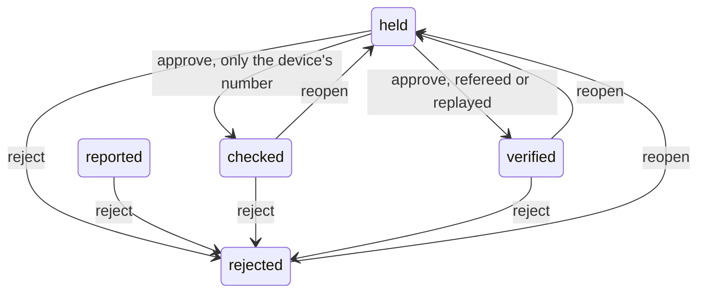
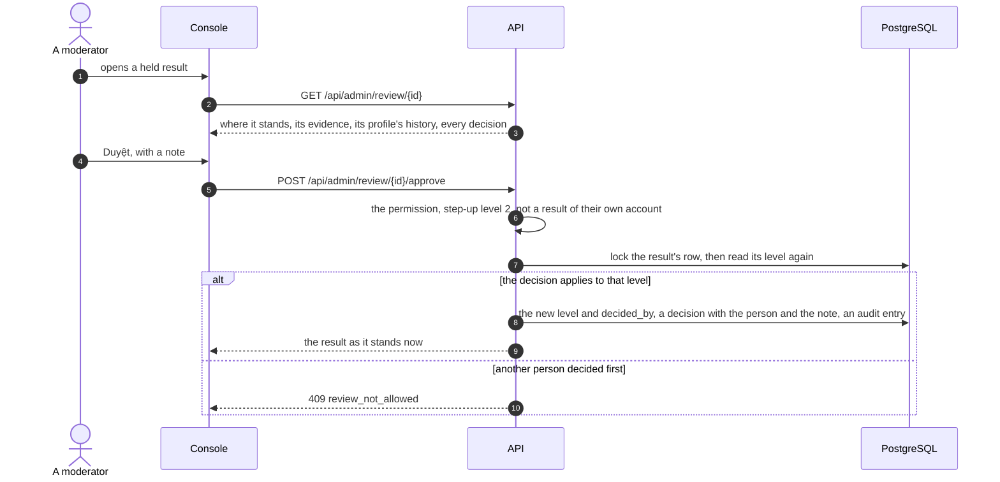

Decision: [ADR 0029](../decisions/0029-integrity-engine-and-boards-by-trust.md). This page describes what exists: the
engine, its rules of version 1, the decision log, the account's boards and the public ones — a community's and the
server's — ranked runs, which the server replays ([ADR 0030](../decisions/0030-ranked-runs-replayed-by-the-server.md)),
and the console's review, where people decide what the engine held
([ADR 0031](../decisions/0031-people-decide-what-the-engine-held.md)).

## Levels

| Level | Means | On the account's board |
| --- | --- | --- |
| `reported` | Only the device's number: a run still going on, or one from before the engine | Yes |
| `checked` | Passed the rules of its version | Yes |
| `verified` | The server refereed it — a room hand — or replayed it — a ranked run | Yes |
| `held` | A signal fired; it waits for a person | Only for its own player, labelled "Đang được xem xét" |
| `rejected` | Hard proof that it is false, or a person decided | No |

The level follows the evidence, never the player. Three rules hold everywhere: automation only hides — `rejected`
needs hard proof, anything else that looks wrong is `held`, and suspending an account is a person's decision; no
player is trusted past their evidence; the player sees where their results stand.

## A run's way

A device profile's runs brought into an account arrive together, long after they were played: `Rate` does not look
at them; `Bounds` and `PersonalJump` do. A run played in the account is judged against the account's own runs only: a
device profile's best neither hides it as "moving no board" nor raises the bar of `PersonalJump`, and its runs count for
no `Rate`.

Only a run that would move a board — a best of the week for its profile — is looked at past `Bounds`: a run that
changes no board cannot mislead one, and a child who restarts often never sees "Đang được xem xét" for it. A final run
reported again with a higher value is judged again — unless it is left to people: held, rejected, or decided by a
person. Then nothing changes, its value neither: a person decides on the number they see ([review](#review)).

## A hand's way

A finished hand (ADR 0016) is `verified · refereed` for every person at the table, saved in the transaction that stores
the hand. With fewer than two people — the rest bots — it is not `public`: the account's board counts it, public boards
will not (D-11). Playing with bots is not suspicious, only not comparable, so nothing is held for it.

## Rules of version 1

| Rule | Looks at | Answer |
| --- | --- | --- |
| `Bounds` | The registry knows the game, listed now or not | Impossible → `rejected · unknown_game` |
| `PersonalJump` | A best of the week over 5 × the profile's best so far on the board, after at least 10 of its runs | Unusual → `held · personal_jump` |
| `Rate` | Over 60 runs of the game from the profile within 10 minutes, by the server's clock | Unusual → `held · rate` |
| `RoomVerifier` | A hand the server refereed | `verified · refereed` |

The numbers live in `IntegrityEngine` (`JumpFactor`, `JumpHistory`, `RateLimit`, `RateWindow`). Changing one is a new
rule version: results already decided keep the version that decided them.

## Decisions

Every change of level is a row in `integrity.decisions`: the level before (none for a first one) and after, the reason,
what the signals saw (`details`, JSON), the rule version, the actor (none for the engine) and when. A trigger refuses
`UPDATE`, `DELETE` and `TRUNCATE` on the table, as on the audit log (ADR 0027). A later decision reverses one; the
result keeps its current level, its rule version and who decided it last (`decided_by`, a person only).

One way out ([ADR 0034](../decisions/0034-delete-accounts-and-profiles-for-good.md)): when a profile is deleted, its
results go, and each result's decisions with it — the foreign key cascades — in a transaction that set
`tohe.purge` to `profiles`. The trigger lets a decision go only then, and only once its result is gone: nothing deletes
a decision while its result stays, and nothing updates one.

## The account's board

`GET /api/boards/{gameId}?board=default&period=week|all` — each of the account's profiles with its best: `reported`,
`checked` or `verified`, and the viewer's own `held` labelled (`underReview`). A run still going on is `inProgress`.
Ties go to whoever got there first by the server's clock.

- **This week** starts on Monday 00:00 in Việt Nam (`Weeks.StartOf`: UTC+7, which has had no daylight saving since 1975,
  so a fixed offset needs no time zone database). A result belongs to the week the server received its current value,
  not the device's clock — a run played offline on Sunday and synced on Monday counts on Monday.
- **All time** keeps every week.
- Room games: `GET /api/rooms/stats` takes the account's board of the week from the engine — points of `verified`
  hands, tables with bots included — next to the profile's own statistics ([Online rooms](rooms.md)).

## Public boards

`GET /api/boards/{gameId}/public?scope=community|server&board=default&period=week|all` — read from the results, by
trust, for the profiles that may be on them:

- **Never a device profile's results.** A run that reached the server with a device profile brought into an account
  ([Identity](identity.md#bringing-one-into-an-account)) carries `device_earned` in `progress.scores` and
  `integrity.results`, set by the channel it came through, never by the request's content. So does a hand a device
  profile played at a table (ADR 0043, I2a): `RoomVerifier` marks the result of a seat with a profile and no account —
  verified like anyone's, with no account until the profile is brought into one, when it takes the account and keeps
  the mark. Both public queries leave such results out (`&& !result.DeviceEarned`), whoever's they are now, and a
  trigger refuses to clear the mark on a result. The account's own board counts them as any other.
- **Who is on them** is Identity's to say (`IBoardAudience`): a profile with its switch "Hiện trên bảng công khai" on, of
  an account that is not suspended; for a community's board, of an account that came with that community (ADR 0028). An
  adult's profile starts on; a child's starts off, and its owner turns it on only by saying they asked the child
  (D-06, `asked_child_required` otherwise) — when is kept (`asked_child_at`). The answer is read on every request, so a
  switch, a suspension or a lifted one counts at once.
- **What counts** follows D-16 Q4: the server's board takes verified results only, a community's also checked runs of a
  game nothing can reproduce yet — every one-player game until ranked runs (D-10). Then the hub says once that the
  board's scores are not verified, or labels each one on a board that mixes them. A room game's boards count only hands
  with two people at the table (D-11).
- **What it shows**: rank, name, avatar and the value; a tap shows the profile's ID (D-17) — never an account or an
  email. Places are not shared: ties go to who got there first by the server's clock. The view also says whether the
  viewer is on public boards (`listed`), and whether the server can verify the game at all (`reproducible`), so the hub
  can explain an empty server board.
- **The hub**: the 🏆 sheet has *Nhà mình*, *Cộng đồng* (when the account has one) and *Toàn Tò He*, each this week or all
  time; a room game's lobby shows the three boards of the week.

## Ranked runs

A one-player game that declares `ranked` ([Game Contract](../contracts/game-contract-v1.md#ranked-runs)) plays each
ranked run from a seed the API deals, and hands its moves in at the end; the API replays them with the game's own
verify module, the `ReplayVerifier`.

- **One open run per profile and game**: a new run closes the last, so nobody picks the best of many seeds; a run open
  for 30 days closes. A profile may start 20 runs a minute (`too_many_runs`).
- **The replay** runs in the background every `Integrity:ReplayInterval` (5 s), ten runs at a time, oldest first, with
  the verify module of the build that started each — builds are immutable, so the code is the code that played. Jint
  runs it within 10 s and the limits rooms use, `Math.random` and `Date.now` throwing.
- **What it decides** joins the engine as a result of its own (source `ranked:{run}`), on the run's board, at the time
  the moves arrived: `verified · replayed`, or what a signal says; `rejected · illegal_move` or `replay_mismatch` —
  hard proof; `held · too_fast`; `held · replay_failed` when the module broke on the run, and `held · replay_unavailable`
  after five tries without reaching it. A decided run keeps its result's id.
- **What counts where**: a game the server replays has verified runs only on its public boards — its community's too
  (D-16 Q4); the run the game also reported as a score still counts on the account's board.

## Review

Whoever holds `admin.results.review` — owners, admins and moderators ([Admin console](admin.md#who-gets-in)) — reviews
in the console's **Xem xét kết quả**: the held results, oldest first, and under **Đã quyết** the results people decided
about or the engine rejected, the latest decision first, where an old decision is found again. One result shows where
it stands and why, its evidence — `device` (only the device's number), `refereed` (a room hand), `replayed` (a ranked
run whose replay agreed) — a ranked run's moves, time, the least a person needs and the scores claimed and replayed,
the profile's best and number of results on the board with its last ten, and every change of level.

A decision is logged with the person and the note, and the result keeps the rule version that judged it last; the audit
log has it too (`result.approve`, `result.reject`, `result.reopen`, target `result {id}`). A result left to people keeps
its value as well as its level: the same run reported again higher changes nothing, so an approved run cannot climb
afterwards — a run grows only until it ends ([ADR 0014](../decisions/0014-live-scores-for-long-runs.md)).

Rejecting does not suspend: the result links to its account, where whoever may suspends ([Users](admin.md#users)). A
moderator also hides a profile from public boards, with a reason, and lets it back. The owner's switch stays as it is
and does not bring it back; the hub tells the owner, under the switch, that Tò He's operator hid the profile, and the
account's own board is unchanged.

A ranked run is also watched in the game itself: **▶ Xem lại run trong game** asks
`GET /api/admin/review/{id}/run` for its seed and moves and the build that played it, and the console opens that
build with `init.rankedReplay` — the game plays the moves back from the seed with its own logic, as the server replayed
them, up to a move that is not legal ([ADR 0032](../decisions/0032-watch-a-ranked-run-in-the-game-itself.md)). Once the catalog moved on to a newer build the
games origin no longer serves the old one, and the run is only numbers.

## Data

| Table | Holds |
| --- | --- |
| `integrity.results` | One row per result: kind (`Run`, `Hand`), profile and account (none for a device profile's hand, ADR 0043), game, board (`hands` for a hand), value, place, source (unique: `run:{profile}:{clientId}`, `hand:{room}:{hand}:{seat}`), final, level, public, the server's time, the device's, rule version, `decided_by` |
| `integrity.decisions` | The append-only log above; a result's decisions go only with it, when its profile is deleted |
| `integrity.ranked_runs` | One row per ranked run: profile and account, game, the build and verify module that started it, board, limits, seed, state (`Open`, `Submitted`, `Decided`, `Closed`), started and finished by the server's clock, the moves (JSON), the score claimed and replayed, tries, its result |

Two partial indexes keep the review's lists small: the held results (`ix_integrity_results_held`), and people's
decisions with the rejections (`ix_integrity_decisions_decided`).

The migration `IntegrityEngine` brought every earlier result in as it was trusted: runs as `reported`, hands as
`verified` — public when two people sat at the table — each with an `imported` decision of rule version 0.

## Rules

| Rule | Where it is enforced |
| --- | --- |
| Only hard proof rejects; anything else that looks wrong is held, and once held only a person releases it | `IntegrityEngine` |
| A result left to people — held, rejected, or decided by a person — keeps its level and its value | `IntegrityEngine` (`Settled`) |
| A person approves only a held result — verified with a referee's or a replay's evidence, checked otherwise — rejects one not rejected, reopens a decided one; with `admin.results.review` and step-up level 2, never about their own account's results, one at a time per result | `ReviewEndpoints`, `IntegrityReview` |
| Every change of level is logged, and the log cannot be rewritten | `IntegrityEngine`; the triggers `decisions_no_change` and `decisions_no_truncate` |
| A result is saved with what it came with, or not at all | `IResults` adds to the caller's unit of work (Progress, Rooms) |
| A held result shows only to its own player | `Boards` |
| A public board shows only profiles switched on and not hidden by a moderator, of accounts not suspended — and only what its audience can trust | `PublicBoards`, Identity's `IBoardAudience` |
| A child is on public boards only once its owner says they asked it | `ProfileEndpoints` (`asked_child_required`) |
| A ranked run starts from the server's seed, one open per profile and game; its replay decides — the same score verified, a wrong one or a move that is not legal rejected, faster than a person held | `RankedRuns`, `RankedReplays`, `VerifyHost` |
| Modules keep their tables: Progress and Rooms hand results over through `IResults`; names and avatars come from Identity's `IAccountProfiles` and `IBoardAudience`; the registry answers `IRegistryGames` | `IntegrityModule` |

## API

| Endpoint | Auth | Purpose |
| --- | --- | --- |
| `GET /api/boards/{gameId}?board=default&period=week` | session, a chosen profile | The account's board of a game: each profile's best this week (`week`) or ever (`all`) |
| `GET /api/boards/{gameId}/public?scope=server&board=default&period=week` | session, a chosen profile | A community's (`community`, the account's) or the server's (`server`) board: the first 50, the viewer's place and its neighbours |
| `POST /api/runs` | session, a chosen profile | Open a ranked run of a game: `{ run, seed }`; it closes the last open one of that game |
| `POST /api/runs/{id}/finish` | session, a chosen profile | Hand its moves and score in for the replay: 202; the same moves again are taken once |

Refusals: 403 `profile_required`; 400 `period_invalid`, `scope_invalid`, and for a run `moves_invalid`,
`too_many_moves`, `score_invalid`; 404 for a game the catalog does not list, `no_community` for a community's board of
an account without one, `not_ranked` for a run of a game that is not ranked, `not_found` for another profile's run;
409 `run_closed`, `run_finished`; 429 `too_many_runs`.

The review's endpoints belong to the console: [Admin console](admin.md#api).
