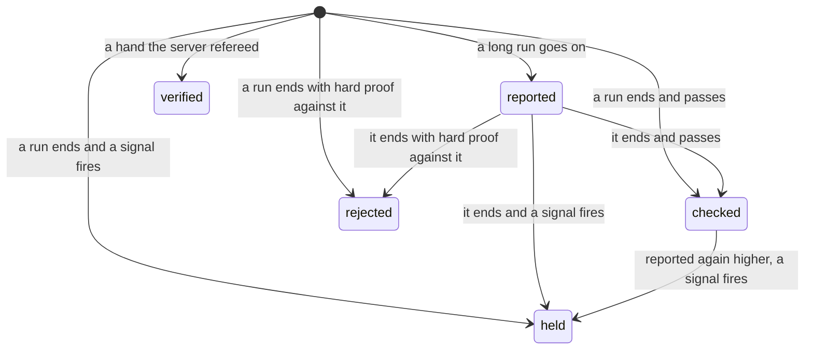
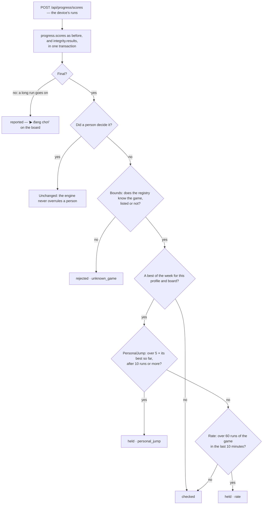
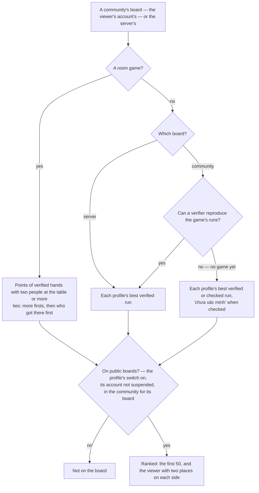

Decision: [ADR 0029](../decisions/0029-integrity-engine-and-boards-by-trust.md). This page describes what exists: the
engine, its rules of version 1, the decision log, the account's boards and the public ones — a community's and the
server's. The console's queue of results waiting for a person comes next.

## Levels

| Level | Means | On the account's board |
| --- | --- | --- |
| `reported` | Only the device's number: a run still going on, or one from before the engine | Yes |
| `checked` | Passed the rules of its version | Yes |
| `verified` | The server refereed it: a room hand | Yes |
| `held` | A signal fired; it waits for a person | Only for its own player, labelled "Đang được xem xét" |
| `rejected` | Hard proof that it is false | No |

The level follows the evidence, never the player. Three rules hold everywhere: automation only hides — `rejected`
needs hard proof, anything else that looks wrong is `held`, and suspending an account is a person's decision; no
player is trusted past their evidence; the player sees where their results stand.

## A run's way

Only a run that would move a board — a best of the week for its profile — is looked at past `Bounds`: a run that
changes no board cannot mislead one, and a child who restarts often never sees "Đang được xem xét" for it. A final run
reported again with a higher value is judged again — unless it is held or rejected: once held, only a person releases a
result, and a level a person set stays.

## A hand's way

A finished hand (ADR 0016) is `verified · refereed` for every person at the table, saved in the transaction that stores
the hand. With fewer than two people — the rest bots — it is not `public`: the account's board counts it, public boards
will not (D-11). Playing with bots is not suspicious, only not comparable, so nothing is held for it.

## Rules of version 1

| Rule | Looks at | Answer |
| --- | --- | --- |
| `Bounds` | The registry knows the game, listed now or not | Impossible → `rejected · unknown_game` |
| `PersonalJump` | A best of the week over 5 × the profile's best so far on the board, after at least 10 of its runs | Unusual → `held · personal_jump` |
| `Rate` | Over 60 runs of the game from the profile within 10 minutes, by the server's clock | Unusual → `held · rate` |
| `RoomVerifier` | A hand the server refereed | `verified · refereed` |

The numbers live in `IntegrityEngine` (`JumpFactor`, `JumpHistory`, `RateLimit`, `RateWindow`). Changing one is a new
rule version: results already decided keep the version that decided them.

## Decisions

Every change of level is a row in `integrity.decisions`: the level before (none for a first one) and after, the reason,
what the signals saw (`details`, JSON), the rule version, the actor (none for the engine) and when. A trigger refuses
`UPDATE`, `DELETE` and `TRUNCATE` on the table, as on the audit log (ADR 0027). A later decision reverses one; the
result keeps its current level, its rule version and who decided it last (`decided_by`, a person only).

## The account's board

`GET /api/boards/{gameId}?board=default&period=week|all` — each of the account's profiles with its best: `reported`,
`checked` or `verified`, and the viewer's own `held` labelled (`underReview`). A run still going on is `inProgress`.
Ties go to whoever got there first by the server's clock.

- **This week** starts on Monday 00:00 in Việt Nam (`Weeks.StartOf`: UTC+7, which has had no daylight saving since 1975,
  so a fixed offset needs no time zone database). A result belongs to the week the server received its current value,
  not the device's clock — a run played offline on Sunday and synced on Monday counts on Monday.
- **All time** keeps every week.
- Room games: `GET /api/rooms/stats` takes the account's board of the week from the engine — points of `verified`
  hands, tables with bots included — next to the profile's own statistics ([Online rooms](rooms.md)).

## Public boards

`GET /api/boards/{gameId}/public?scope=community|server&board=default&period=week|all` — read from the results, by
trust, for the profiles that may be on them:

- **Who is on them** is Identity's to say (`IBoardAudience`): a profile with its switch "Hiện trên bảng công khai" on, of
  an account that is not suspended; for a community's board, of an account that came with that community (ADR 0028). An
  adult's profile starts on; a child's starts off, and its owner turns it on only by saying they asked the child
  (D-06, `asked_child_required` otherwise) — when is kept (`asked_child_at`). The answer is read on every request, so a
  switch, a suspension or a lifted one counts at once.
- **What counts** follows D-16 Q4: the server's board takes verified results only, a community's also checked runs of a
  game nothing can reproduce yet — every one-player game until ranked runs (D-10). Then the hub says once that the
  board's scores are not verified, or labels each one on a board that mixes them. A room game's boards count only hands
  with two people at the table (D-11).
- **What it shows**: rank, name, avatar and the value; a tap shows the profile's ID (D-17) — never an account or an
  email. Places are not shared: ties go to who got there first by the server's clock. The view also says whether the
  viewer is on public boards (`listed`), and whether the server can verify the game at all (`reproducible`), so the hub
  can explain an empty server board.
- **The hub**: the 🏆 sheet has *Nhà mình*, *Cộng đồng* (when the account has one) and *Toàn Tò He*, each this week or all
  time; a room game's lobby shows the three boards of the week.

## Data

| Table | Holds |
| --- | --- |
| `integrity.results` | One row per result: kind (`Run`, `Hand`), profile and account, game, board (`hands` for a hand), value, place, source (unique: `run:{profile}:{clientId}`, `hand:{room}:{hand}:{seat}`), final, level, public, the server's time, the device's, rule version, `decided_by` |
| `integrity.decisions` | The append-only log above |

The migration `IntegrityEngine` brought every earlier result in as it was trusted: runs as `reported`, hands as
`verified` — public when two people sat at the table — each with an `imported` decision of rule version 0.

## Rules

| Rule | Where it is enforced |
| --- | --- |
| Only hard proof rejects; anything else that looks wrong is held, and once held only a person releases it | `IntegrityEngine` |
| A level a person set is never changed by the engine | `IntegrityEngine` (`decided_by`) |
| Every change of level is logged, and the log cannot be rewritten | `IntegrityEngine`; the triggers `decisions_no_change` and `decisions_no_truncate` |
| A result is saved with what it came with, or not at all | `IResults` adds to the caller's unit of work (Progress, Rooms) |
| A held result shows only to its own player | `Boards` |
| A public board shows only profiles switched on, of accounts not suspended — and only what its audience can trust | `PublicBoards`, Identity's `IBoardAudience` |
| A child is on public boards only once its owner says they asked it | `ProfileEndpoints` (`asked_child_required`) |
| Modules keep their tables: Progress and Rooms hand results over through `IResults`; names and avatars come from Identity's `IAccountProfiles` and `IBoardAudience`; the registry answers `IRegistryGames` | `IntegrityModule` |

## API

| Endpoint | Auth | Purpose |
| --- | --- | --- |
| `GET /api/boards/{gameId}?board=default&period=week` | session, a chosen profile | The account's board of a game: each profile's best this week (`week`) or ever (`all`) |
| `GET /api/boards/{gameId}/public?scope=server&board=default&period=week` | session, a chosen profile | A community's (`community`, the account's) or the server's (`server`) board: the first 50, the viewer's place and its neighbours |

Refusals: 403 `profile_required`; 400 `period_invalid`, `scope_invalid`; 404 for a game the catalog does not list, and
`no_community` for a community's board of an account without one.
