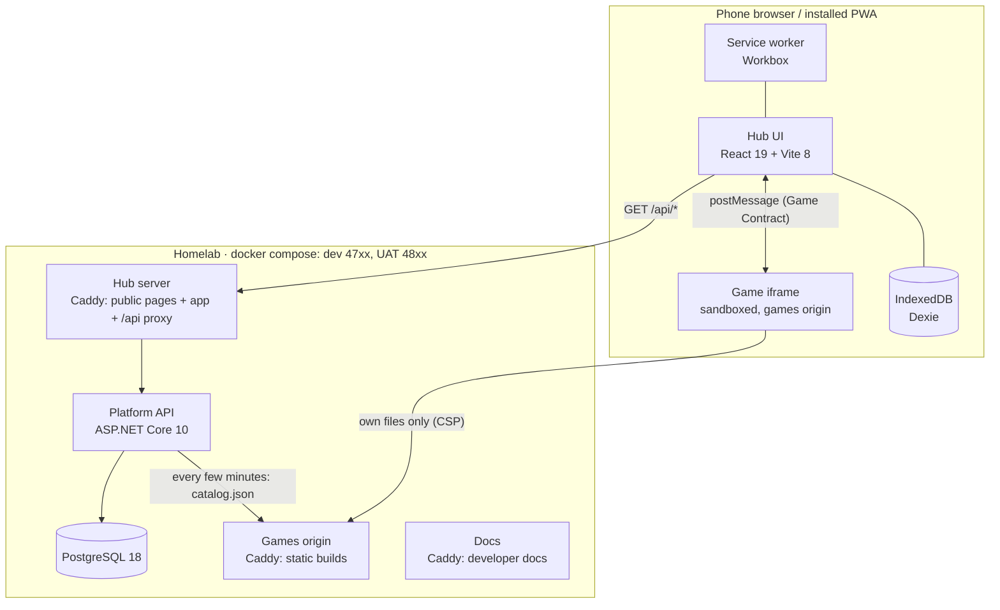

## Containers

| Container | Code | Responsibility |
| --- | --- | --- |
| Hub | `apps/hub` | Profiles, catalog, launcher, host side of the contract, local-first storage and (M2) sync. |
| Platform API | `services/api` | Identity (M1), registry, saves and scores (M2), parental settings. The only writer to the database. |
| Games origin | `games/*` → `tools/games-host` | Immutable static builds under `/<id>/<version>/` plus `catalog.json`. |
| Public pages | `apps/web` | The home page, the games' pages, the install guide, the FAQ, about, the terms and the privacy notice (Vietnamese), built into the hub image and served by its Caddy at the root of the hub's host ([Hosts and paths](hosts-and-paths.md#the-public-pages)). |
| Docs | `apps/docs` + `docs/` | The developer docs (English), at the root of their own host. |
| Admin console | `apps/console` | The operator's pages on a host of its own with its own sign-in, served by the hub image's server on a second site ([Admin console](admin.md)). |

## Origins

Three browser origins, on purpose:

| Origin | Local (dev) | UAT (homelab) | Why separate |
| --- | --- | --- | --- |
| Hub + API | `http://localhost:4720` (API also on `:4740` for debugging) | `http://10.100.0.2:4820` | The public pages and the app share the origin, so the session cookie (M1) stays first-party; the API is same-origin, so no CORS. |
| Games | `http://localhost:4730` | `http://10.100.0.2:4830` | Game code — possibly AI-written — can never read the hub's cookies or storage. |
| Docs | `http://localhost:4710` | `http://10.100.0.2:4810` | Static, independent of the app; stays up if the app is down. |

Environments are described in [ADR 0010](../decisions/0010-environments-dev-and-uat.md). Production runs the same
images on the `platform-infra` cluster through Tò He's Helm chart, configured when the containers start
([ADR 0021](../decisions/0021-release-production-through-the-tohe-chart.md), [Configuration](../guides/configuration.md)).
There all of Tò He is on `toheplay.io.vn`, a domain it has to itself: the hub at its root, the games origin at
`games.toheplay.io.vn`, the docs at `docs.toheplay.io.vn` — one level down, which Cloudflare's free certificate
covers ([ADR 0040](../decisions/0040-all-of-tohe-on-one-domain-of-its-own.md)). The games are the same *site* as the hub there, as
locally and on UAT, where only the port tells the origins apart: the hub's `__Host-` session cookie (on HTTPS), the
API's same-origin checks and the games' CSP keep game code away from it, and no app that is not Tò He's shares the
domain. Which host and which path each part lives on, and how that grows, is [Hosts and paths](hosts-and-paths.md)
([ADR 0042](../decisions/0042-hosts-by-trust-paths-by-component.md)).

## Dependency rules

- A game depends only on `@tohe/game-sdk` (and its own libraries). Never on the hub, the API, or other games.
- The hub depends on `@tohe/contract`, `@tohe/game-sdk/host` and the generated API types. It never imports game code.
- The API knows games only through `catalog.json`; it never loads game code.
- `@tohe/contract` is the single source of truth for the contract. The C# catalog types and the Caddy CSP are
  derived from it and must be kept in step (tests and the build check this).
- `@tohe/routes` is the single source of truth for the paths on the hub's host. The hub's Caddy routes, the service
  worker's list of app pages, `robots.txt` and the API's `HubPaths` are generated from it
  ([Hosts and paths](hosts-and-paths.md)).

## Modules inside the API

The API is a modular monolith ([ADR 0003](../decisions/0003-backend-dotnet-modular-monolith-postgres.md)).
Each module lives in `services/api/src/Tohe.Api/Modules/<Name>/`, registers its own services and endpoints, and
owns its tables in its own PostgreSQL schema. Modules do not read each other's tables.

| Module | Status | Endpoints |
| --- | --- | --- |
| Platform | done | `GET /api/config` |
| Registry | done | `GET /api/games`, `GET /api/games/{id}` |
| Identity & Profiles | done | `/api/auth/*`, `/api/session/*`, `/api/account/*`, `/api/profiles/*` — accounts own their profiles and sign in by email or a provider, switched and opened at run time ([ADR 0023](../decisions/0023-accounts-own-their-profiles.md), [0024](../decisions/0024-email-identifies-an-account.md), [0026](../decisions/0026-sign-in-methods-and-account-linking.md), [0028](../decisions/0028-sign-in-and-registration-at-run-time.md)); see [Identity](identity.md) |
| Saves & Scores | M2 | per-profile saves and runs; their boards come from Integrity |
| Integrity | the engine and the account's boards ([ADR 0029](../decisions/0029-integrity-engine-and-boards-by-trust.md)) | `/api/boards/*`; Progress and Rooms hand it their results — see [Integrity and boards](integrity.md) |
| Parental | later | play-time limits, per-profile game visibility |
| Email | done ([ADR 0022](../decisions/0022-send-transactional-email-through-an-outbox.md)) | none — other modules add messages to its outbox |
| Telemetry | done ([ADR 0015](../decisions/0015-device-telemetry.md)) | `/api/telemetry`, `/api/telemetry/report` — see [Device telemetry](telemetry.md) |
| Admin | the platform at a glance, users, sign-in and registration, communities ([ADR 0027](../decisions/0027-platform-admin-and-the-first-owner.md), [0028](../decisions/0028-sign-in-and-registration-at-run-time.md)) | `/api/admin/*`, an OpenAPI document of its own; reads what the other modules expose — see [Admin console](admin.md) |
| Rooms | done ([ADR 0016](../decisions/0016-online-rooms-for-turn-based-games.md)) | `/api/rooms/*`, SignalR `/api/rooms/hub` — see [Online rooms](rooms.md) |

Generated reference: [Platform API](/reference/api/).

## Key flows

- [Launching a game](game-launch-flow.md) — handshake, save, score, pause, exit.
- Catalog: `pnpm build` assembles games → games origin serves `catalog.json` → the API polls it
  (`Registry:SyncInterval`) and upserts the registry → the hub lists `GET /api/games`.
- [A newcomer's first touches](#a-newcomers-first-touches) — open and play, install, link previews, feedback.

## A newcomer's first touches

Opening the hub is playing ([vision](../vision.md)); nothing stands between a link and the first game.

- **No sign-in before playing.** A device with no session plays as its device profile at once — the first visit makes
  one silently, with a suggested name (`RequireSession`, `playerGate` in `apps/hub/src/session/session.ts`);
  `/account/sign-in` opens only when chosen — from the catalog's slim "Đăng nhập" strip, or for what needs an account.
  A room link (`/r/<code>`), a room, the rooms lobby and a replay keep asking a signed-out device to sign in
  (`device={false}`). Signing out is a choice and leads to the sign-in screen. Signing up asks whether the device
  profile is the person's own, and signing in offers to bring each device profile with progress into the account
  ([Identity](identity.md#device-profiles)).
- **Installing: one component, three ways** (`apps/hub/src/install/`). `chooseInstall` is a pure decision from the
  environment, what the browser handed over, whether a game finished, whether the visit had its offer and when the
  player last said no:

  | Where | What | When |
  | --- | --- | --- |
  | Android, Chrome, Edge (`beforeinstallprompt`, kept from the start of the page) | The card "Cài Tò He" on the catalog; its button calls `prompt()` | After the first finished game, once per visit |
  | Safari on iPhone and iPad (User-Agent) | A sheet with the steps of iOS 26: ⋯ → Chia sẻ → Thêm vào Màn hình chính → "Mở dưới dạng ứng dụng web" | After the first finished game, once per visit |
  | The in-app browser of Zalo, Messenger, Facebook (User-Agent) | A strip "Mở bằng trình duyệt" with "Chép link" and a hint | On arrival, on every screen until dismissed |

  A finished game is a final `score` (or a ranked finish) from the Game Contract's host side — no contract change.
  Never when running as the installed app (`display-mode: standalone`, `navigator.standalone`). "Để sau" and closing
  are silent for 14 days (`localStorage` `tohe:install-dismissed`). The catalog's "⋯" menu has "Cài app", which opens the
  same prompt or sheet at any time (and says how by hand where none fits), and "Góp ý / báo lỗi", a `mailto:` to
  `hello@toheplay.io.vn` with the app's version and the browser in the body.
- **The manifest** (`apps/hub/vite.config.ts`): user-first description, `start_url` `/play`, a shortcut to Ghép Khối,
  screenshots made by `pnpm --filter @tohe/hub generate:screenshots`. `index.html` carries static `og:` and `twitter:`
  tags (title, description) for link previews; the preview image and `og:url` must be absolute and wait for the hub's
  public URL at run time.
- **Tested** by the hub's unit tests (`install.test.ts`, `session.test.ts`) and the stack's journey,
  `pnpm --filter @tohe/e2e journey`.
