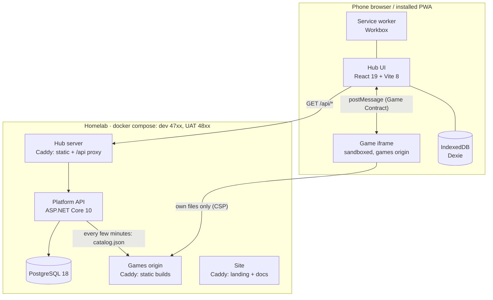

## Containers

| Container | Code | Responsibility |
| --- | --- | --- |
| Hub | `apps/hub` | Profiles, catalog, launcher, host side of the contract, local-first storage and (M2) sync. |
| Platform API | `services/api` | Identity (M1), registry, saves and scores (M2), parental settings. The only writer to the database. |
| Games origin | `games/*` → `tools/games-host` | Immutable static builds under `/<id>/<version>/` plus `catalog.json`. |
| Site | `apps/site` + `docs/` | Landing page (Vietnamese) and developer docs (English). |

## Origins

Three browser origins, on purpose:

| Origin | Local (dev) | UAT (homelab) | Why separate |
| --- | --- | --- | --- |
| Hub + API | `http://localhost:4720` (API also on `:4740` for debugging) | `http://10.100.0.2:4820` | The session cookie (M1) stays first-party; the API is same-origin, so no CORS. |
| Games | `http://localhost:4730` | `http://10.100.0.2:4830` | Game code — possibly AI-written — can never read the hub's cookies or storage. |
| Site | `http://localhost:4710` | `http://10.100.0.2:4810` | Static, independent of the app; stays up if the app is down. |

Environments are described in [ADR 0010](../decisions/0010-environments-dev-and-uat.md). For a future public
production, hostnames must be flat (one level under `vinetic.io.vn`) because Cloudflare's free certificates only
cover one subdomain level — see [ADR 0002](../decisions/0002-games-in-sandboxed-iframe-on-own-origin.md).

## Dependency rules

- A game depends only on `@tohe/game-sdk` (and its own libraries). Never on the hub, the API, or other games.
- The hub depends on `@tohe/contract`, `@tohe/game-sdk/host` and the generated API types. It never imports game code.
- The API knows games only through `catalog.json`; it never loads game code.
- `@tohe/contract` is the single source of truth for the contract. The C# catalog types and the Caddy CSP are
  derived from it and must be kept in step (tests and the build check this).

## Modules inside the API

The API is a modular monolith ([ADR 0003](../decisions/0003-backend-dotnet-modular-monolith-postgres.md)).
Each module lives in `services/api/src/Tohe.Api/Modules/<Name>/`, registers its own services and endpoints, and
owns its tables in its own PostgreSQL schema. Modules do not read each other's tables.

| Module | Status | Endpoints |
| --- | --- | --- |
| Platform | done | `GET /api/config` |
| Registry | done | `GET /api/games`, `GET /api/games/{id}` |
| Identity & Households | done | `/api/auth/*`, `/api/session/*`, `/api/household/*` — see [Identity](identity.md) |
| Saves & Scores | M2 | per-profile saves, score boards |
| Parental | later | play-time limits, per-profile game visibility |
| Telemetry | done ([ADR 0015](../decisions/0015-device-telemetry.md)) | `/api/telemetry`, `/api/telemetry/report` — see [Device telemetry](telemetry.md) |

Generated reference: [Platform API](/docs/reference/api/).

## Key flows

- [Launching a game](game-launch-flow.md) — handshake, save, score, pause, exit.
- Catalog: `pnpm build` assembles games → games origin serves `catalog.json` → the API polls it
  (`Registry:SyncInterval`) and upserts the registry → the hub lists `GET /api/games`.
