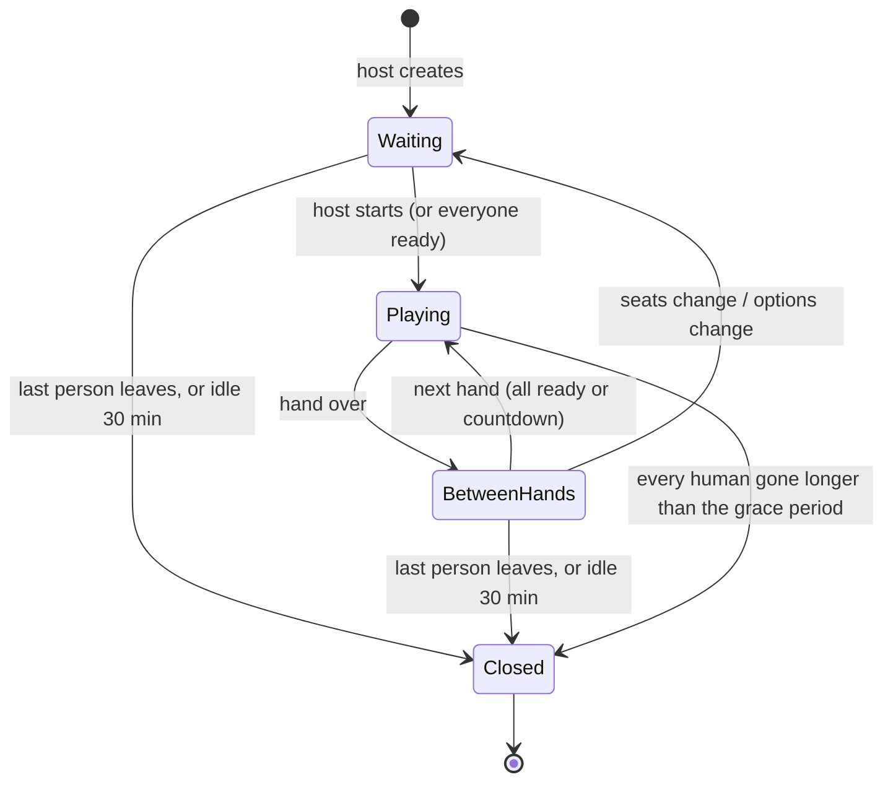
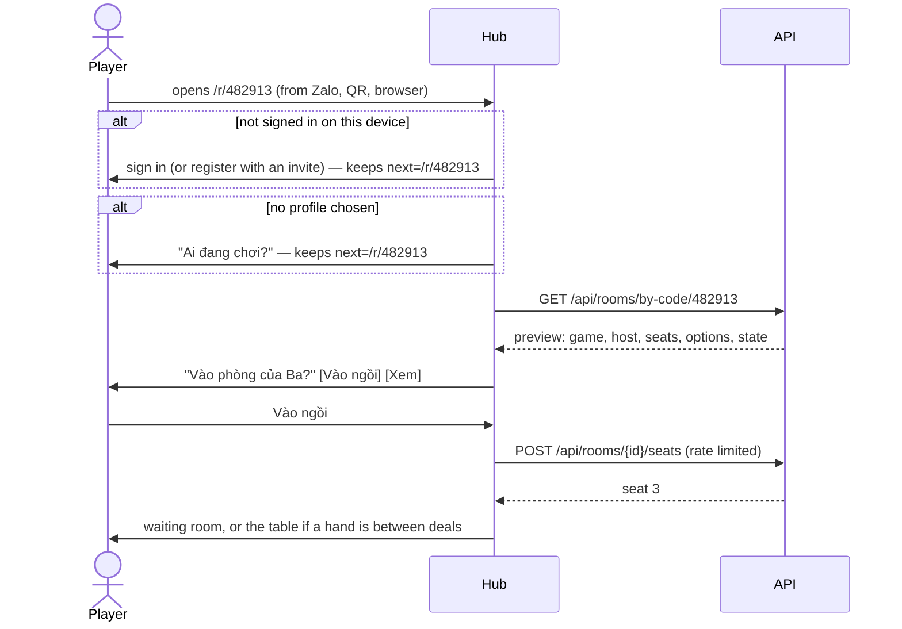

> **Status: accepted, being built in [phases](#phases)** ([ADR 0016](../decisions/0016-online-rooms-for-turn-based-games.md)).
> The owner accepted the proposed answers to the [open questions](#decisions-on-the-proposals-open-questions).
> Technology and evidence: [Online rooms research](../research/online-rooms.md). First game:
> [Tiến lên](../research/tien-len.md).

## Why

The owner wants to play Tiến lên miền Nam with other people on the platform, each on their own phone: a list of
public rooms, private rooms, a code to type or a link to share, and room options such as bots for empty seats. The
flow should be built once, properly, so that later turn-based games (Cờ caro, Phỏm, Cờ tướng…) get it for free.

## Principles

1. **The platform owns the room; the game owns the table.** Lobby, codes, links, seats, bots, timers and reconnection
   live in the hub and the API. A game brings its rules and draws its table.
2. **The server decides.** The API deals and validates every action. A phone receives only what its seat may see:
   never the state, never the seed.
3. **One rules module per game.** The same `rules.js` from the game's immutable build runs on the phone (hints,
   offline bots) and in the API (the referee).
4. **Phones come and go.** Locking the screen, switching network or taking a call is the normal case. Every
   (re)connection receives a full snapshot of the seat's view, so a lost message never matters.
5. **Made for a family.** No free chat (preset reactions only), no money or chips, names and avatars only, and
   playing with other households behind a parent's switch.
6. **Offline still plays.** Without a connection a game offers "Chơi với máy": the same rules against bots on the
   phone.

## Words

| Word | Vietnamese in the UI | Meaning |
| --- | --- | --- |
| Room | Phòng / bàn | A table for one game: seats, options, a code, a host. Lives from creation until the last person leaves. |
| Seat | Ghế | A place at the table: empty, a profile, or a bot. |
| Host | Chủ phòng | The profile that created the room, or the one it passed to. Changes options, adds bots, starts, removes players. |
| Hand | Ván | One deal played to the end. |
| Series | Bảng điểm | The running score of a room across its hands. |
| Spectator | Người xem | Watches public information only (if the room allows). |
| Code | Mã phòng | 6 digits, unique among open rooms. |
| Link | Link mời | `https://<hub>/r/<code>`: the same code, one tap. |

## A room's life



- A room closes when no human is left; bots never keep a room open. Its code is free again at once.
- The host role passes to the longest-seated human when the host leaves.
- Seats can change only while `Waiting` or `BetweenHands`; a player who leaves mid-hand is replaced by a bot
  for the rest of that hand (if the room allows bots) or the hand ends for everybody (if not).

## Flows

### 1. The lobby

Tapping an online game in the catalog opens its lobby (a hub page, `/play/<game>/rooms`), not the game:

```text
┌──────────────────────────────┐
│  Tiến Lên                    │
│  [ ⚡ Chơi nhanh ]            │  join the fullest public room waiting for players, or create one
│  [ ＋ Tạo phòng ] [ # Nhập mã ]│
│  [ 🤖 Chơi với máy ]          │  offline: the game alone, against bots on this phone
│                              │
│  Phòng đang mở               │  public rooms, live (SignalR), newest first
│  🐯 Ba · 2/4 · đang chờ   ›  │
│  🐼 Mẹ · 4/4 · đang chơi  👁 │  👁 = spectators allowed
└──────────────────────────────┘
```

### 2. Creating a room

The host picks the options (below) and lands in the waiting room as seat 1. Defaults come from the host's last room
for that game, so creating the next room is one tap.

### 3. The waiting room

```text
┌──────────────────────────────┐
│  Phòng 482 913      [Chia sẻ]│  code large enough to read across a table
│  ▓▓ QR ▓▓                     │  scanned by another phone in the same room
│  ┌────┐ ┌────┐ ┌────┐ ┌────┐ │
│  │🐯 Ba│ │🐼Mẹ│ │ ＋ │ │🤖  │ │  ＋ = empty: invite, or host adds a bot
│  │chủ │ │ ✓  │ │    │ │ Vừa│ │  ✓ = ready
│  └────┘ └────┘ └────┘ └────┘ │
│  Luật: chặt heo, thối 2, 20 s │  options summary; host taps to change
│  [ Bắt đầu ]                  │  host only, from 2 seats taken
└──────────────────────────────┘
```

- **Chia sẻ** uses the Web Share API (Zalo, Messenger, SMS on the phone) with the link and a line of text; where it
  is missing, it copies the link and says so.
- **QR** encodes the link, for family sitting together.
- The host can add or remove a bot per seat, remove a player, change options, pass the host role, or lock the room
  (nobody new may join).

### 4. Joining with a code

A 6-digit field with the numeric keypad (`inputmode="numeric"`), pasting allowed, spaces ignored, submitted when the
sixth digit is typed. The answer is the room's preview, or one of the messages in [When joining fails](#when-joining-fails).

### 5. Joining with a link



- The hub today has no way back to a page after sign-in or the profile picker; a `next` parameter (same-origin paths
  only) is new work for this flow.
- On iOS a link opens in Safari, not in the installed PWA; the session cookie of the PWA is separate
  ([ADR 0004](../decisions/0004-identity-households-and-profiles.md)), so the player may sign in once in Safari.
  Android Chrome can open links in the installed app.
- The link works for anyone who can reach the hub: family on the home network or VPN today; the wider internet only
  after a production ADR.

### When joining fails

| Case | What the player sees | Offered |
| --- | --- | --- |
| No room with that code | "Không tìm thấy phòng 482 913" | Try again, lobby |
| Room full | "Phòng đã đủ người" | Watch (if allowed), lobby |
| Hand in progress, no free seat | "Ván đang chơi" | Watch, or sit at the next free seat between hands |
| Room locked by the host | "Chủ phòng đã khóa phòng" | Lobby |
| Child profile, other household, switch off | "Cần bố mẹ cho phép chơi với người ngoài gia đình" | Lobby |
| Game hidden for this profile's age | "Trò này chưa dành cho bạn" | Catalog |
| Offline or API down | "Cần mạng để chơi online" | Chơi với máy |
| Already seated in this room on another device | Takes the seat over on this device; the other device shows "Đang chơi ở máy khác" | — |
| Too many wrong codes | "Thử lại sau một phút" | — |

### 6. At the table

- The game is launched in the iframe with the room in `init`; from then on the hub relays views and actions.
- **Turn timer** (option): the active seat's avatar shows a ring; at zero the platform asks the rules for the
  timeout action (Tiến lên: pass, or play the lowest legal card when leading).
- **Disconnects:** the seat shows "mất kết nối"; after the grace period a bot plays it (if bots are allowed) and the
  player takes it back the moment they return. Without bots, the timer keeps passing for them.
- **Reactions:** a small fixed set of emoji and short phrases ("Hay quá!", "Nhanh lên nào", "😂"), rate limited. No
  typed text.

### 7. Between hands

Results (places, penalties, points), the series score, then the next hand when everyone taps **Ván tiếp** or after a
countdown. Players can leave; the host can change seats and options; empty seats can take a bot or a newcomer.

## Options

**Platform options** (every online game):

| Option | Choices | Proposed default |
| --- | --- | --- |
| Visibility | Public (in the lobby list) / private (code or link only) | Public |
| Who may join | Anyone signed in on this server / my household only | Anyone |
| Seats | The game's range (Tiến lên 2–4) | 4 |
| Bots fill empty seats at start | On / off | On |
| Bot level | The game's levels (Dễ, Vừa, Khó) | Vừa |
| Bot takes over a disconnected player | On / off | On |
| Turn timer | Off / 15 / 20 / 30 / 60 s | 20 s |
| Spectators | On / off | Off |
| Start | Host taps start / starts when every seat is ready | Host |

**Game options** are declared by the game in `game.json` (choices and defaults) and validated by its rules module;
the hub draws the form, so no game builds its own room screen. Tiến lên's house rules:
[Tiến lên research](../research/tien-len.md#house-rules).

## Who sees what

| Data | Seen by |
| --- | --- |
| A seat's hand | That seat only (and everyone in the replay, once the hand is over) |
| Card counts, the table, passes, places | Everyone at the table and spectators |
| Profile name and avatar | Everyone in the room, and the lobby list (host only) |
| Household, account, age band | Nobody else — the server uses the age band to filter, never shows it |
| The deck and seed | The server only |

Playing with another household shows a child's profile name and avatar to people outside the family; that is new
(today only the household leaderboard shows them) and is why the parent switch exists.

## The contract (additive sketch)

Changing `packages/contract` needs this ADR, the docs and conformance in the same pull request. The sketch keeps
protocol 1, like `themes` and `telemetry`: a game without `rooms` is untouched.

**Manifest:**

```jsonc
{
  "capabilities": ["save", "scores", "rooms"],
  "rooms": {
    "rules": "rules.js",              // pure ES module inside the build
    "seats": { "min": 2, "max": 4 },
    "bots": ["easy", "normal", "hard"],
    "options": [                       // the hub draws these
      { "id": "chopChain", "type": "boolean", "default": true, "label": { "vi": "Chặt chồng", "en": "Stacked chops" } },
      { "id": "instantWins", "type": "multi", "choices": ["dragon", "fourTwos", "fivePairs", "sixPairs"], "default": ["dragon", "fourTwos"] }
    ]
  }
}
```

**Protocol:**

| Direction | `type` | Fields | Notes |
| --- | --- | --- | --- |
| host → game | `init` | `room?: { id, seat, seats, options }` | Present when launched at a table; absent means offline or solo. |
| host → game | `room.view` | `view`, `seq` | The seat's whole view after every change; opaque JSON from the rules' `view()`. |
| host → game | `room.event` | `event` | Seat joined, left, disconnected, bot took over, reaction, timer. |
| game → host | `room.action` | `id`, `action` | Request; answered by `result` with the rules' error code (`not_your_turn`, `must_beat`…) if refused. |
| game → host | `room.react` | `reaction` | One of the preset reactions. |

**The rules module** (TypeScript in the game's folder, built to `rules.js`; pure, deterministic, no DOM, timers,
network or `Math.random`):

```ts
export interface Rules<State, Action, View, Options> {
  setup(ctx: { seats: number; options: Options; seed: number; carry?: unknown }): State;
  view(state: State, seat: number | null): View;           // null = spectator
  act(state: State, seat: number, action: Action): { state: State } | { error: string };
  status(state: State): { turn: number[] } | { over: true; result: HandResult; carry?: unknown };
  timeout(state: State, seat: number): Action;              // what the timer plays
  bot(state: State, seat: number, level: string, seed: number): Action;
}
```

`carry` passes what the next hand needs from the last one (Tiến lên: the winner leads). The platform keeps the series
score from each `HandResult`.

## The server

A `Rooms` module in the API, own `rooms` schema ([ADR 0003](../decisions/0003-backend-dotnet-modular-monolith-postgres.md)).

| Endpoint | Purpose |
| --- | --- |
| `GET /api/rooms?game=` | Public rooms the active profile may join |
| `POST /api/rooms` | Create (options validated against the game's manifest and rules) |
| `GET /api/rooms/by-code/{code}` | Preview by code (rate limited) |
| `POST /api/rooms/{id}/seats` / `DELETE` | Sit / leave |
| `/api/rooms/hub` (SignalR) | Lobby updates, room state, views, actions, reactions, presence |

- **One actor per room** serialises everything that happens to it: actions, timers, bots, joins. No locks across
  rooms.
- **Rules engine:** one Jint engine per game version, warmed at start-up, with limits per call (an action, a bot
  decision). `Math.random` and `Date` are replaced, so the module cannot be non-deterministic by accident.
- **Durable enough:** every accepted action is appended to `rooms.actions` and the state snapshotted at each hand's
  start. After a restart (a UAT deploy) rooms are rebuilt by replaying from the snapshot, and phones reconnect to
  the same table. Finished hands keep their seed and actions, which makes replays possible.
- **One API instance.** Several instances would need room affinity; not planned at this scale.

## Reconnection

- The hub uses SignalR's automatic reconnect with stateful reconnect, and also checks the connection when the page
  becomes visible again: iOS closes sockets of suspended pages and does not always fire `onclose`.
- On every (re)connection the server sends the seat's full current view. Views are snapshots with a sequence number,
  so the game redraws from the snapshot and nothing has to be replayed.
- The seat is held for the grace period (proposed 30 s), then a bot plays it if the room allows; coming back takes
  it over at once.

## Security

- **Same-origin only:** the WebSocket upgrade carries the session cookie, so the hub endpoint checks `Origin` as
  `SameOriginGuard` does for unsafe requests (cross-site WebSocket hijacking).
- A signed-in profile is required; children's access follows the age filter and the parent switch.
- Every action goes through the rules; the server never trusts a phone's idea of the state.
- Codes come from a CSPRNG, are unique among open rooms, and die with the room; lookups by code are rate limited per
  account. A private room is protected by not being listed, which suits a server of invited households.
- Limits on message size and rate, on rooms per profile, and on reactions.

## Offline

| Situation | Behaviour |
| --- | --- |
| No network when opening the lobby | "Cần mạng để chơi online" and **Chơi với máy** |
| Network lost mid-hand | Banner; the seat is held, then a bot plays it; back online, the player takes over |
| API down | No rooms; offline play works, as for every game |

## Telemetry

Following [ADR 0015](../decisions/0015-device-telemetry.md): counts of reconnects, refused actions and failed
joins, and a metric for round-trip time, per game version; nothing about who played with whom.

## Phases

1. **Tiến lên offline** — the game against three bots on one phone, built with the rules module and bots that the
   server will reuse. No platform change; the family plays and confirms the house rules.
2. **Rooms** — this ADR accepted; contract, SDK and conformance; the `Rooms` module; lobby, create, code, link, QR,
   share; seats, bots, timer, reconnection, series score; the parent switch.
3. **Polish** — reactions, spectators, hand history and replays, statistics and leaderboards, inviting a household
   member directly.

## Open questions

1. **Who may join a public room:** every signed-in profile on the server (proposed, as asked), with a parent switch
   per child profile for playing with other households — off by default for children (proposed)?
2. **Guests (Chơi thử):** offline against bots only (proposed), or online too?
3. **Money or chips:** none; points only (proposed), as the vision rules out anything like betting.
4. **Reactions:** preset emoji and phrases only, no typed text (proposed)?
5. **Code format:** 6 digits (proposed, easy for children on a numeric keypad) or 6 letters?
6. **Turn timer default** 20 s, and **grace period** 30 s before a bot takes a disconnected seat (proposed)?
7. **Leaderboards:** per household as today plus personal statistics (proposed); across households later, or never?
8. **Vision:** replace the non-goal "Real-time multiplayer" with "real-time action multiplayer", making turn-based
   online rooms a goal, on acceptance (proposed)?

## Decisions on the proposal's open questions

The owner accepted every proposed answer on 2026-10-16 ("theo đề xuất của ta hãy triển khai đi"):

1. Public rooms are open to every signed-in profile on the server; child profiles need a parent's switch to play
   with other households, off by default.
2. Guests play offline against bots only.
3. No money or chips: points only.
4. Preset reactions only, no typed text.
5. Room codes are 6 digits.
6. Turn timer 20 s by default; a disconnected seat is held 30 s before a bot plays it.
7. Leaderboards stay per household, with personal statistics; nothing across households for now.
8. The vision now lists real-time action multiplayer as the non-goal; turn-based online rooms are a goal.
