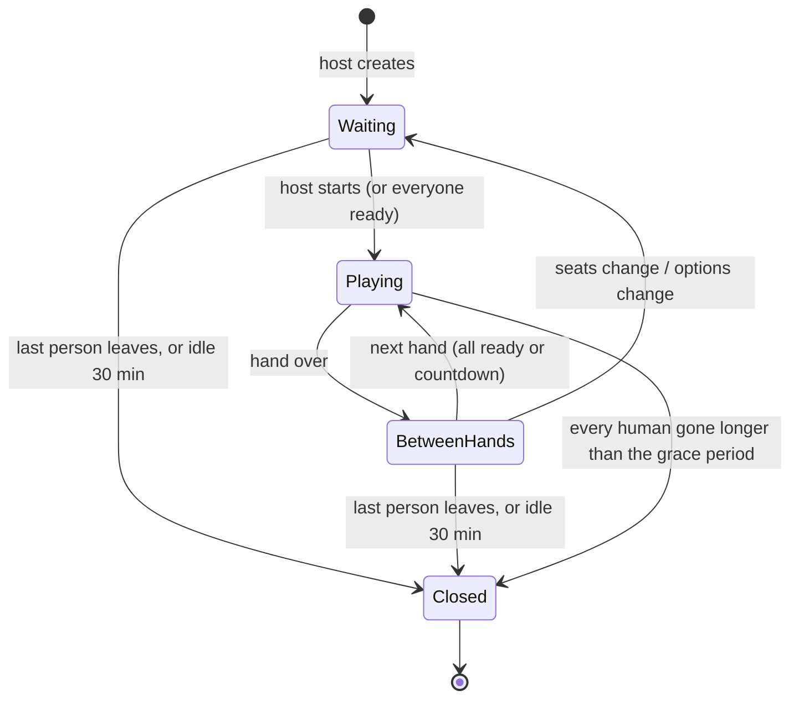
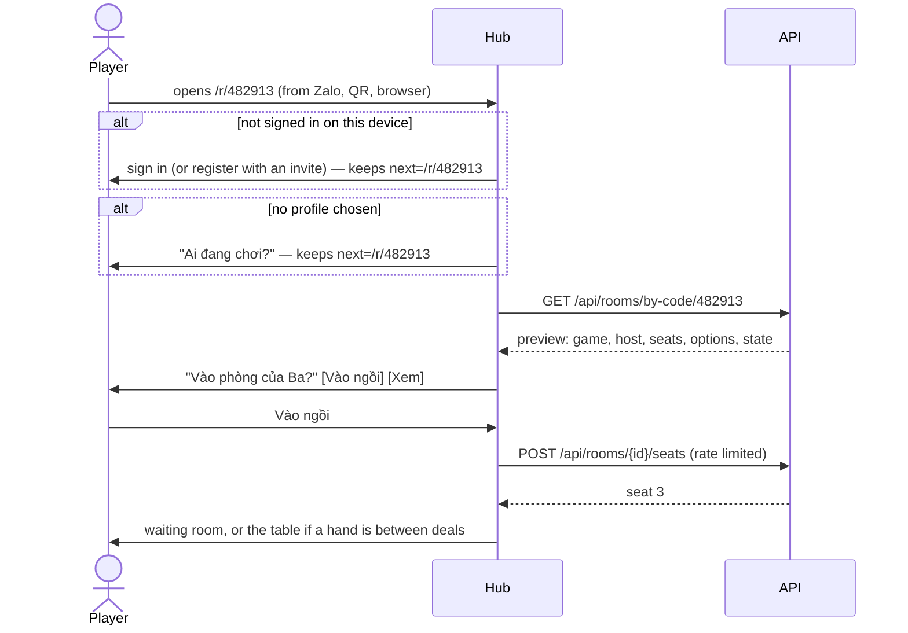

> **Status: built, [phases](#phases) 1–3** ([ADR 0016](../decisions/0016-online-rooms-for-turn-based-games.md),
> replays: [ADR 0017](../decisions/0017-replays-of-finished-online-hands.md)).
> The owner accepted the proposed answers to the [open questions](#decisions-on-the-proposals-open-questions).
> Technology and evidence: [Online rooms research](../research/online-rooms.md). First game: Tiến Lên
> ([research](../research/tien-len.md), [SPEC](../../games/tien-len/SPEC.md)).

## Why

The owner wants to play Tiến lên miền Nam with other people on the platform, each on their own phone: a list of
public rooms, private rooms, a code to type or a link to share, and room options such as bots for empty seats. The
flow should be built once, properly, so that later turn-based games (Cờ caro, Phỏm, Cờ tướng…) get it for free.

## Principles

1. **The platform owns the room; the game owns the table.** Lobby, codes, links, seats, bots, timers and reconnection
   live in the hub and the API. A game brings its rules and draws its table.
2. **The server decides.** The API deals and validates every action. A phone receives only what its seat may see:
   never the state, never the seed.
3. **One rules module per game.** The same `rules.js` from the game's immutable build runs on the phone (hints,
   offline bots) and in the API (the referee).
4. **Phones come and go.** Locking the screen, switching network or taking a call is the normal case. Every
   (re)connection receives a full snapshot of the seat's view, so a lost message never matters.
5. **Made for a family.** No free chat (preset reactions only), no money or chips, names and avatars only, and
   playing with other households behind a parent's switch.
6. **Offline still plays.** Without a connection a game offers "Chơi với máy": the same rules against bots on the
   phone.

## Words

| Word | Vietnamese in the UI | Meaning |
| --- | --- | --- |
| Room | Phòng / bàn | A table for one game: seats, options, a code, a host. Lives from creation until the last person leaves. |
| Seat | Ghế | A place at the table: empty, a profile, or a bot. |
| Host | Chủ phòng | The profile that created the room, or the one it passed to. Changes options, adds bots, starts, removes players. |
| Hand | Ván | One deal played to the end. |
| Series | Bảng điểm | The running score of a room across its hands. |
| Spectator | Người xem | Watches public information only (if the room allows). |
| Invitation | Lời mời | A player asks a member of their household to the table; it shows on that profile's catalog for 10 minutes. |
| Replay | Xem lại | A finished hand played back in the game, for the people who played it. |
| Code | Mã phòng | 6 digits, unique among open rooms. |
| Link | Link mời | `https://<hub>/r/<code>`: the same code, one tap. |

## A room's life



- A room closes when no human is left; bots never keep a room open. Its code is free again at once.
- The host role passes to the longest-seated human when the host leaves.
- Seats can change only while `Waiting` or `BetweenHands`; a player who leaves mid-hand is replaced by a bot
  for the rest of that hand (if the room allows bots) or the hand ends for everybody (if not).

## Flows

### 1. The lobby

Tapping an online game in the catalog opens its lobby (a hub page, `/play/<game>/rooms`), not the game:

```text
┌──────────────────────────────┐
│  Tiến Lên                    │
│  [ ⚡ Chơi nhanh ]            │  join the fullest public room waiting for players, or create one
│  [ ＋ Tạo phòng ] [ # Nhập mã ]│
│  [ 🤖 Chơi với máy ]          │  offline: the game alone, against bots on this phone
│                              │
│  Phòng đang mở               │  public rooms, live (SignalR), newest first
│  🐯 Ba · 2/4 · đang chờ   ›  │
│  🐼 Mẹ · 4/4 · đang chơi  👁 │  👁 = spectators allowed
└──────────────────────────────┘
```

### 2. Creating a room

The host picks the options (below) and lands in the waiting room as seat 1. Defaults come from the host's last room
for that game, so creating the next room is one tap.

### 3. The waiting room

```text
┌──────────────────────────────┐
│  Phòng 482 913      [Chia sẻ]│  code large enough to read across a table
│  ▓▓ QR ▓▓                     │  scanned by another phone in the same room
│  ┌────┐ ┌────┐ ┌────┐ ┌────┐ │
│  │🐯 Ba│ │🐼Mẹ│ │ ＋ │ │🤖  │ │  ＋ = empty: invite, or host adds a bot
│  │chủ │ │ ✓  │ │    │ │ Vừa│ │  ✓ = ready
│  └────┘ └────┘ └────┘ └────┘ │
│  Luật: chặt heo, thối 2, 20 s │  options summary; host taps to change
│  [ Bắt đầu ]                  │  host only, from 2 seats taken
└──────────────────────────────┘
```

- **Chia sẻ** uses the Web Share API (Zalo, Messenger, SMS on the phone) with the link and a line of text. Browsers
  only offer it, and the Clipboard API, on HTTPS: on the home server's plain HTTP the button copies the text and the
  link the old way and says so.
- **QR** encodes the link, for family sitting together.
- The host can add or remove a bot per seat, remove a player, change options, pass the host role, or lock the room
  (nobody new may join).

### 4. Joining with a code

A 6-digit field with the numeric keypad (`inputmode="numeric"`), pasting allowed, spaces ignored, submitted when the
sixth digit is typed. The answer is the room's preview, or one of the messages in [When joining fails](#when-joining-fails).

### 5. Joining with a link



- The way back survives signing in, registering and the profile picker: the page that needs a player remembers its
  path in `sessionStorage` (`session/next.ts`, paths of the hub only), and the profile picker goes there instead of
  the catalog.
- On iOS a link opens in Safari, not in the installed PWA; the session cookie of the PWA is separate
  ([ADR 0004](../decisions/0004-identity-households-and-profiles.md)), so the player may sign in once in Safari.
  Android Chrome can open links in the installed app.
- The link works for anyone who can reach the hub: family on the home network or VPN today; the wider internet only
  after a production ADR.

### When joining fails

| Case | What the player sees | Offered |
| --- | --- | --- |
| No room with that code | "Không tìm thấy phòng 482 913" | Try again, lobby |
| Room full | "Phòng đã đủ người" | Watch (if allowed), lobby |
| Hand in progress, no free seat | "Ván đang chơi" | Watch, or sit at the next free seat between hands |
| Room locked by the host | "Chủ phòng đã khóa phòng" | Lobby |
| Child profile, other household, switch off | "Cần bố mẹ cho phép chơi với người ngoài gia đình" | Lobby |
| Game hidden for this profile's age | "Trò này chưa dành cho bạn" | Catalog |
| Offline or API down | "Cần mạng để chơi online" | Chơi với máy |
| Already seated in this room on another device | Takes the seat over on this device; the other device shows "Đang chơi ở máy khác" | — |
| Too many wrong codes | "Thử lại sau một phút" | — |

### 6. At the table

- The game is launched in the iframe with the room in `init`; from then on the hub relays views and actions.
- **Turn timer** (option): the active seat's avatar shows a ring; at zero the platform asks the rules for the
  timeout action (Tiến lên: pass, or play the lowest legal card when leading).
- **Disconnects:** the seat shows "mất kết nối"; after the grace period a bot plays it (if bots are allowed) and the
  player takes it back the moment they return. Without bots, the timer keeps passing for them.
- **Reactions:** 😀 in the game's HUD opens a fixed set of eight (👋 Chào cả nhà!, 😂 Haha!, 👏 Hay quá!, ⏰ Nhanh lên
  nào!…), at most one every 1.5 s per seat; they appear as a bubble at the seat. No typed text.

### 7. Between hands

Results (places, penalties, points), the series score, then the next hand when everyone taps **Ván tiếp** or after a
countdown. Players can leave; the host can change seats and options; empty seats can take a bot or a newcomer.

### 8. Watching

When the host allows it (**Cho người khác vào xem**, off by default), a room is marked 👁 in the lobby. Tapping a
full or locked table watches it instead of joining; a code or link preview offers **👁 Xem** next to joining. The same doors apply as for sitting (household-only, the parent switch). A spectator gets the view
of seat `null`: the table, card counts and places, never a hand; the waiting room says **Bạn đang xem phòng này**,
and the game hides its buttons and reactions. Leaving gives up nothing.

### 9. Inviting the family

**Mời người trong nhà** in the waiting room lists the household's profiles that are not at the table. An invitation
shows as a banner on that profile's catalog (checked every 20 s) with **Vào phòng**, which opens the room's preview.
It lasts 10 minutes, opens a locked room for that profile, and never gets round the parent switch or a full table.
Invitations live in the room's memory: an API restart forgets them.

### 10. Results and looking back

The lobby shows the active profile's own results in the game (hands, wins, points: all time and the last 7 days),
the household's board for the last 7 days, and its last 20 hands. **Xem lại** opens a hand in the game, which deals
it again from its seed with its own rules module and plays it back from the player's seat: back, forward, play and
pause ([ADR 0017](../decisions/0017-replays-of-finished-online-hands.md)). A hand played with an older version than
the catalog's says it cannot be replayed: the games image only holds current builds.

## Options

**Platform options** (every online game):

| Option | Choices | Proposed default |
| --- | --- | --- |
| Visibility | Public (in the lobby list) / private (code or link only) | Public |
| Who may join | Anyone signed in on this server / my household only | Anyone |
| Seats | The game's range (Tiến lên 2–4) | 4 |
| Bots fill empty seats at start | On / off | On |
| Bot level | The game's levels (Dễ, Vừa, Khó) | Vừa |
| Bot takes over a disconnected player | On / off | On |
| Turn timer | Off / 15 / 20 / 30 / 60 s | 20 s |
| Spectators | On / off | Off |
| Start | Host taps start / starts when every seat is ready | Host |

**Game options** are declared by the game in `game.json` (choices and defaults) and validated by its rules module;
the hub draws the form, so no game builds its own room screen. Tiến lên's house rules:
[Tiến lên research](../research/tien-len.md#house-rules).

## Who sees what

| Data | Seen by |
| --- | --- |
| A seat's hand | That seat only; once the hand is over, the people who played it (its replay carries the seed) |
| Card counts, the table, passes, places | Everyone at the table and spectators |
| A finished hand: seats, seed, actions, result | The profiles that played it — not spectators |
| Personal results and the household's board | The profile itself; its household's profiles on the board |
| Profile name and avatar | Everyone in the room, and the lobby list (host only) |
| Household, account, age band | Nobody else — the server uses the age band to filter, never shows it |
| The deck and seed | The server only |

Playing with another household shows a child's profile name and avatar to people outside the family; that is new
(today only the household leaderboard shows them) and is why the parent switch exists.

## The contract

Game Contract v1, additively (protocol 1, like `themes` and `telemetry`): a game without `rooms` is untouched. Full
reference: [Game Contract v1](../contracts/game-contract-v1.md).

**Manifest:** the `rooms` capability and block go together (Tiến Lên's, abridged):

```jsonc
{
  "capabilities": ["save", "rooms"],
  "rooms": {
    "rules": "rules.js",                 // ES module in the build, exporting `rules`
    "seats": { "min": 2, "max": 4 },
    "bots": ["easy", "normal", "hard"],  // easiest first; the middle one is the default
    "options": [                          // the hub draws these when a room is created
      { "id": "chopChain", "type": "boolean", "label": { "vi": "Chặt chồng", "en": "Stacked chops" }, "default": true },
      { "id": "points", "type": "choice", "label": { "vi": "Tính điểm", "en": "Points" },
        "choices": [{ "id": "full", "label": {…} }, { "id": "places", "label": {…} }], "default": "full" },
      { "id": "instantWins", "type": "multi", "label": {…}, "choices": [{ "id": "dragon", "label": {…} }, …],
        "default": ["dragon", "fourTwos", "fivePairs", "sixPairs"] }
    ]
  }
}
```

**Protocol:**

| Direction | `type` | Fields | Notes |
| --- | --- | --- | --- |
| host → game | `init` | `room?: { id, seat, seats, options }` | Present at a table. `seat` is this phone's (-1: spectator); `seats` are `{ profile, bot, connected, score }` in the rules module's order. |
| host → game | `room.view` | `view`, `events`, `seq`, `turnMs` | The seat's whole view after a change, the public events since the last one (empty after a reconnection: redraw), and the turn timer. |
| host → game | `room.seats` | `seats`, `seat` | Someone joined, left, lost the connection, or a bot took a seat; this phone's seat may move between hands. |
| host → game | `room.reaction` | `seat`, `reaction` | A preset reaction. |
| game → host | `room.act` | `id`, `action` | Answered by `result`, with the rules module's error code (`must_beat`, `not_your_turn`…) when refused. |
| game → host | `room.next` | `id` | Ready for the next hand. |
| game → host | `room.react` | `reaction` | One of `wave laugh wow clap hurry gg sad heart`. |

The SDK's `session.room` (SDK 0.5.0) keeps the newest view, which may arrive before the game listens: `latest`,
`onView`, `onSeats`, `onReaction`, `act`, `next`, `react`.

**Replays** ([ADR 0017](../decisions/0017-replays-of-finished-online-hands.md), SDK 0.6.0): `init.replay` instead of
`init.room` carries `{ seats, seat, seed, options, carry, actions }`; `session.replay` hands it to the game, which
calls `setup` with the seed, options and carry, then `act` for each action, drawing `view(state, seat)`. Nothing goes
back to the hub but telemetry.

**The rules module** (TypeScript in the game's folder, `src/module.ts` built to `rules.js` by a second Vite build;
pure and deterministic: no DOM, timers, network, `Math.random` or `Date.now`):

```ts
export const rules = {
  setup(ctx: { seats: number; seed: number; options?: unknown; carry?: Carry | null }): State,
  view(state: State, seat: number | null): View,              // null: a spectator
  act(state: State, seat: number, action: Action):
    { ok: true; state: State; events: GameEvent[] } | { ok: false; error: string },
  status(state: State):
    { over: false; turn: number[]; chop: number[] }            // chop: seats that may act out of turn (bots)
    | { over: true; result: { points: number[]; … }; carry: Carry },
  timeout(state: State, seat: number): Action,                  // what the turn timer plays
  bot(state: State, seat: number, level: string, seed: number): Action | null,  // null: nothing out of turn
};
```

States, views and actions are JSON (the server stores and relays them). `carry` passes what the next hand needs from
the last one (Tiến Lên: its winner leads); the room adds each hand's `result.points` to its score sheet.

## The server

A `Rooms` module in the API with its own `rooms` schema
([ADR 0003](../decisions/0003-backend-dotnet-modular-monolith-postgres.md)), reading games through the registry's
`IRegistryGames` and profiles through `IActiveProfile`.

| Endpoint | Purpose |
| --- | --- |
| `GET /api/rooms?game=` | Rooms the active profile may see: public ones it may join, and the ones it sits at |
| `GET /api/rooms/mine` | Open rooms it sits at |
| `POST /api/rooms` | Open a room; the host takes seat 1. Options are checked against the game's `rooms.options` |
| `GET /api/rooms/code/{code}` | Preview by code, spaces ignored; 20 lookups a minute per profile |
| `GET /api/rooms/{id}` | A room it sits at, or may see |
| `POST /api/rooms/{id}/join` · `/leave` | Sit (an empty seat, or between hands a bot that only filled one) · leave (a bot finishes the hand) |
| `PATCH /api/rooms/{id}` · `PUT …/seats/{seat}` · `POST …/start` | The host's controls, before a hand |
| `POST /api/rooms/{id}/watch` | Watch without a seat, when the room allows spectators |
| `POST /api/rooms/{id}/invite` · `GET /api/rooms/invites` | Ask a household profile to the table · the active profile's invitations |
| `GET /api/rooms/stats?game=` | Its results (all time, last 7 days) and the household's 7-day board |
| `GET /api/rooms/history?game=` · `GET /api/rooms/{id}/hands/{hand}` | Its last 20 hands · one hand to replay, only for the profiles that played it |
| `/api/rooms/hub` (SignalR) | `Enter`, `Exit`, `Act`, `Next`, `React`, `WatchLobby`; pushes `Room`, `View`, `Reaction`, `Closed`, `LobbyChanged` |

- **One actor per room** runs everything that happens to it one at a time: joins, actions, bots, timers. A clock
  ticks every room five times a second, each on its own task, and skips a room whose last tick (a bot thinking) has
  not finished.
- **Rules engine:** one Jint engine per room, with the room's build of the rules module fetched from the games origin
  and kept (builds are immutable, so a room keeps its version after a deploy). `Math.random` and `Date.now` throw;
  calls are limited in time (10 s), recursion and allocations. Measured with Tiến Lên's module: an action 0.16 ms,
  an easy or normal bot 2 ms, a hard bot 0.5 s (1.7 s at most) — [research](../research/online-rooms.md).
- **Durable without snapshots:** a room stores its seats, options, score sheet, the hand's seed and starting carry;
  every accepted action is appended to `rooms.actions`. When the API starts, open rooms are rebuilt by replaying the
  hand's actions from its setup (the rules module is deterministic), and phones that reconnect get the same table. A
  room whose build is gone closes.
- **Every finished hand is kept:** `rooms.hands` (build version, seed, options, carry, who sat where, result) and
  `rooms.results` (one row per seat: profile and household, place, points) next to its actions. Statistics, the board
  and replays read them; rooms are closed, never deleted.
- **One API instance.** Several instances would need room affinity; not planned at this scale.

## Reconnection

- The hub uses SignalR's automatic reconnect with stateful reconnect, and also checks the connection when the page
  becomes visible again: iOS closes sockets of suspended pages and does not always fire `onclose`.
- On every (re)connection the server sends the seat's full current view. Views are snapshots with a sequence number,
  so the game redraws from the snapshot and nothing has to be replayed.
- The seat is held for the grace period (30 s), then a bot plays it if the room allows; coming back takes it over
  at once. After an API restart everyone gets the grace period again.

## Security

- **Same-origin only:** the WebSocket upgrade carries the session cookie, so `/api/rooms/hub` refuses an `Origin`
  other than the hub's own host (cross-site WebSocket hijacking); unsafe requests are covered by `SameOriginGuard`.
  The hub's CSP names its own `ws://` and `wss://` host next to `'self'` for browsers older than CSP3.
- A signed-in profile is required; children's access follows the age filter and the parent switch.
- Every action goes through the rules; the server never trusts a phone's idea of the state.
- Codes come from a CSPRNG, are unique among open rooms, and die with the room; lookups by code are rate limited per
  account. A private room is protected by not being listed, which suits a server of invited households.
- Limits on message size and rate, on rooms per profile, and on reactions.

## Offline

| Situation | Behaviour |
| --- | --- |
| No network when opening the lobby | "Cần mạng để chơi online" and **Chơi với máy** |
| Network lost mid-hand | Banner; the seat is held, then a bot plays it; back online, the player takes over |
| API down | No rooms; offline play works, as for every game |

## Telemetry

Following [ADR 0015](../decisions/0015-device-telemetry.md): the hub counts sessions at a table
(`hub.room.session`), replays (`hub.room.replay`), reconnections of the rooms hub (`hub.room.reconnect`) and moves the
server refused (`hub.room.refused`), with the game's own telemetry as for any game; nothing about who played with
whom.

## Tests

| Where | What |
| --- | --- |
| `games/tien-len` | The rules: unit tests and a fast-check random-play bot over every house-rule combination and table size |
| Conformance | A rooms game's module loaded on its own: platform functions, bot tables to the end at every size, determinism, JSON round trips, view sizes, no browser APIs; then the game at a two-seat table refereed by its own module, and replaying a hand its bots played |
| API (`RoomsTests`) | Lobby visibility, codes, joining and refusals, the parent switch, host controls, options, a whole hand over SignalR with bots, refused actions, a restart rebuilding the hand, Jint limits and a hard bot's time, the hub's origin check; results, statistics and a replay that the rules module plays back to the same result; spectators; invitations |
| Hub | Codes, seats as the game sees them, quick play, defaults, the way back after sign-in, the replay handed to the game |
| e2e (`pnpm --filter @tohe/e2e rooms`, CI) | Two phones: create, join by link, start, a whole hand with hints, results on both, leave |


## Phases

1. **Tiến lên offline** — *done:* the game against three bots on one phone, built with the rules module and bots
   the server reuses (Tiến Lên 0.1).
2. **Rooms** — *done:* contract, SDK 0.5.0 and conformance; the `Rooms` module; lobby, quick play, create, code, link,
   QR, share; seats, bots, turn timer, reconnection, score sheet, preset reactions; the parent switch (Tiến Lên 0.2).
3. **History and family** — *done:* results, personal statistics and the household's board; the last 20 hands and
   their replays (SDK 0.6.0, [ADR 0017](../decisions/0017-replays-of-finished-online-hands.md)); spectators;
   invitations to household members; telemetry counts (Tiến Lên 0.3).
4. **Next:** spike S5 on iPhones (locked screen, network changes) before telling the family.

## Open questions

1. **Who may join a public room:** every signed-in profile on the server (proposed, as asked), with a parent switch
   per child profile for playing with other households — off by default for children (proposed)?
2. **Guests (Chơi thử):** offline against bots only (proposed), or online too?
3. **Money or chips:** none; points only (proposed), as the vision rules out anything like betting.
4. **Reactions:** preset emoji and phrases only, no typed text (proposed)?
5. **Code format:** 6 digits (proposed, easy for children on a numeric keypad) or 6 letters?
6. **Turn timer default** 20 s, and **grace period** 30 s before a bot takes a disconnected seat (proposed)?
7. **Leaderboards:** per household as today plus personal statistics (proposed); across households later, or never?
8. **Vision:** replace the non-goal "Real-time multiplayer" with "real-time action multiplayer", making turn-based
   online rooms a goal, on acceptance (proposed)?

## Decisions on the proposal's open questions

The owner accepted every proposed answer on 2026-10-16 ("theo đề xuất của ta hãy triển khai đi"):

1. Public rooms are open to every signed-in profile on the server; child profiles need a parent's switch to play
   with other households, off by default.
2. Guests play offline against bots only.
3. No money or chips: points only.
4. Preset reactions only, no typed text.
5. Room codes are 6 digits.
6. Turn timer 20 s by default; a disconnected seat is held 30 s before a bot plays it.
7. Leaderboards stay per household, with personal statistics; nothing across households for now.
8. The vision now lists real-time action multiplayer as the non-goal; turn-based online rooms are a goal.
