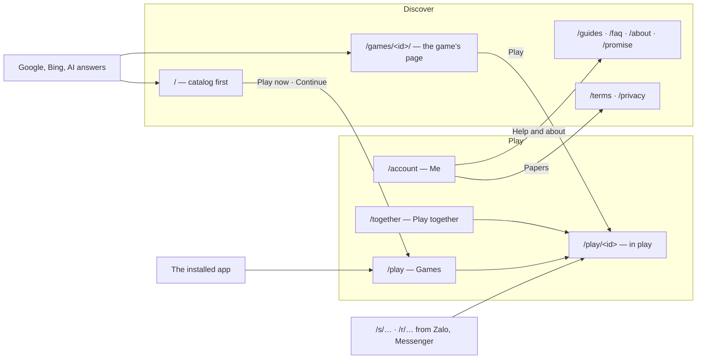
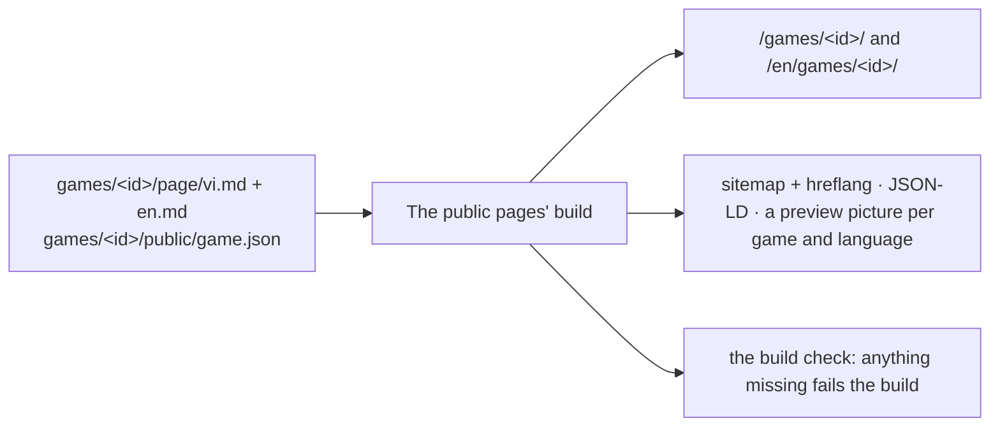

Decisions: [ADR 0046](../decisions/0046-player-surfaces-two-zones-one-frame.md) (the planes, the zones, the frame,
coming back) and [ADR 0047](../decisions/0047-two-languages-and-an-introduction-surface-that-grows.md) (the languages,
the introduction surface). Hosts and namespaces: [Hosts and paths](hosts-and-paths.md). The target is described here;
*Where things stand* says what runs today.

## Planes

| Plane | Trust | Rule |
| --- | --- | --- |
| Players | high: sessions, profiles, children's data | no third-party script; a CSP per namespace |
| Games | low | sandboxed iframe, an origin of its own, the games' CSP; speaks only the Game Contract |
| Operators | highest | its own session and second factor; Cloudflare Access in front before the launch |
| Developers | public | no session |
| Edge | — | no code of Tò He's |

**The game plane's isolation.** Today **L1**: an origin of its own. Every game is added to this repository by the owner,
whose review covers the game's dependencies too. **Before the first game the owner did not add**, the owner chooses
**L2** (a registrable domain of its own) or **L3** (a site per game). The games origin is configuration, so either is a
configuration change plus DNS. The games origin sends `Origin-Agent-Cluster: ?1`.

## The players' host: two zones

| Zone | Paths | Indexed |
| --- | --- | --- |
| **Discover** | `/`, `/games/`, `/games/<id>/`, `/games/c/<slug>/`, `/guides/…`, `/faq/`, `/about/`, `/promise/`, `/terms/`, `/privacy/`, and each under `/en/` | yes |
| **Play** | `/play`, `/together`, `/account/…`, `/play/<id>/…`, `/s/<code>`, `/r/<code>` | no |

- **A game's two URLs**: `/games/<id>/` is its page (indexed, *Play* and *Play with a friend* at the top);
  `/play/<id>` is where it is played (full screen, not indexed).
- **`/` never redirects.** A device that has played gets *Continue* at the top of the page; the installed app opens
  `/play`.

## The app's frame

| | Narrow screens | From tablet width |
| --- | --- | --- |
| Navigation | a bottom bar: **Trò chơi · Chơi cùng · Tôi** | a rail on the left, the same three tabs |
| Content | one column | up to about 1200 px; the catalog in four to six columns |
| A game in play | no frame, full screen | the same |

| Tab | Path | From the top |
| --- | --- | --- |
| **Trò chơi** — Games | `/play` | who is playing (*Change*) → the table the player sits at → invitations → *Continue* (the game this profile opened last) → recent → every game |
| **Chơi cùng** — Play together | `/together` | the box for a code → the player's tables → invitations → the links they sent |
| **Tôi** — Me | `/account` | profiles and who is playing → settings (language, theme, sound) → install → help and about → feedback → papers → the account |

- Each level — the app, a table, a game — is an entry in the history, so Android's back steps one level.
- The app's manifest locks no orientation; each game declares its own.
- On a child's profile, a link out of Tò He asks for the manager PIN.
- Nothing presses a child to keep playing: no punishing streaks, no countdowns, no guilt.

## Coming back

| Moment | What happens |
| --- | --- |
| Opening the app | the frame's first screen starts from what was left unfinished (above) |
| A shared device | with several profiles, "who is playing?" — one tap — after a cold start that follows 30 minutes unused; child → adult asks for the manager PIN |
| The account's session ended | the app says so and offers to sign in; it does not fall back to the device's profile in silence |
| A new version | waits for the next cold start; in a long session, *A new version — Reload* on the frame's screens, never during a game, at a table or in a replay |
| A link while installed | `launch_handler` `focus-existing` where supported; on iPhone, entry pages say how to open the app and enter the code |
| Storage | the installed app asks for persistent storage |
| Counting | returning visits counted as totals only ([Telemetry](telemetry.md)) |

## Languages

| Part | Vietnamese | English |
| --- | --- | --- |
| Public pages | `/…` | `/en/…`; `x-default` → `/en/` |
| The app | a setting (Me → Language); without one: the way in (the page just left, the maker of the link, the host of the table), then the browser (`vi` → Vietnamese, else English), then Vietnamese | the same |
| Link previews | the language of the link's maker | the same |
| Terms and privacy | the original | a translation; where they differ, the version more favourable to the user applies |
| Console, developer docs | — | English only |

- `hreflang` lives in `sitemap.xml` only. Each page has its `lang`, `og:locale` and alternate, and a canonical link to
  itself.
- The VI | EN switch leads to the same page; a non-Vietnamese browser gets a suggestion, never a redirect.
- Proper names and established terms stay in English inside the Vietnamese interface. A game's `name` is its standard
  name; names per language are optional.

## The introduction surface

| Page | Holds | Structured data |
| --- | --- | --- |
| Home | the catalog first; "Game nhỏ cho cả nhà · Không quảng cáo · Không cần tài khoản · Chơi ngay"; *Continue*; a date | `WebSite`, `Organization`, `ItemList` |
| A game's page | *Play*, *Play with a friend*; the answer; **the facts table** (ages, players, round length, offline, ads: none, data collected: none); how to play; pictures; related games; a date | `VideoGame`, `BreadcrumbList` |
| The promise | no ads, no tracking, no purchases, no coins | `WebPage` |
| A collection (from ~8 games) | a written introduction and a comparison table | `CollectionPage`, `ItemList`, `BreadcrumbList` |
| A page for a search (≥ 3 fitting games) | written text that answers the search | `Article`, `ItemList` |

**Adding a game** brings its public page: `/new-game` writes `games/<id>/page/vi.md` and `en.md`; the facts come from
`game.json`; the build makes the rest and fails if anything is missing.

**Crawlers.** `robots.txt` keeps the content signals (`search=yes, ai-input=yes, ai-train=no`), allows by name the
crawlers that fetch for search and answers (Googlebot, Bingbot, `OAI-SearchBot`, `Claude-SearchBot`, `PerplexityBot`,
Applebot, `coccocbot-web`) and disallows by name those that fetch only for training (`GPTBot`, `ClaudeBot`,
`Google-Extended`, `Applebot-Extended`, `CCBot`).

**Growth**: about 8 games, collections; about 30, a static search and a paginated list; about 100, a sitemap per
language and IndexNow.

## Where things stand

| Part | Today | In place when |
| --- | --- | --- |
| Planes, L1, the escalation rule | L1 in place; Access on `console.` optional | `Origin-Agent-Cluster` with the routes' pull request; Access before the launch |
| Namespaces `/together`, `/en/…`, `/promise/`; crawlers by name | not yet | the routes' pull request |
| Public pages in two languages | Vietnamese only | the public pages' languages pull request |
| Game names per language | one `name`, Vietnamese | the Game Contract's names pull request, with its own ADR |
| One source per game, a picture per game, the facts table, the catalog-first home, the promise, *Continue* instead of the redirect | how-to in `apps/web/src/content/games.ts`; one picture; `/` redirects a returning device | the introduction surface's pull request |
| The app's frame and tabs, the language setting | no frame; a bottom-sheet menu; the browser's language | the app frame's pull request |
| Coming back | the catalog first; no "who is playing"; silent fallback; updates take over at once | the coming-back pull request |
| Link previews in the maker's language | Vietnamese only | the link languages' pull request |
