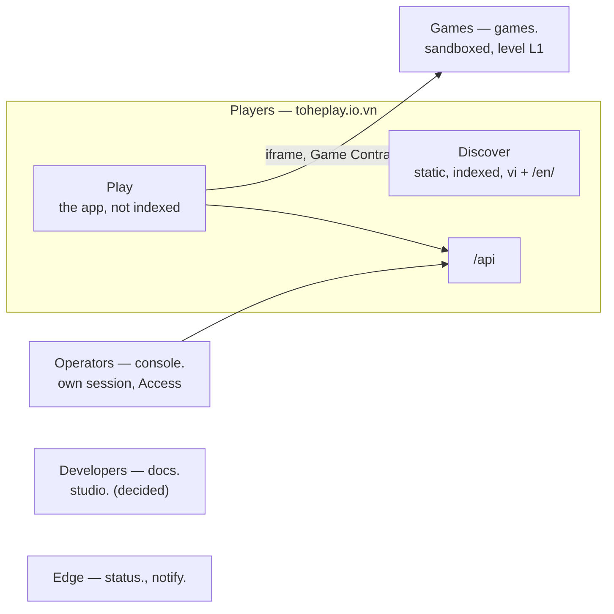
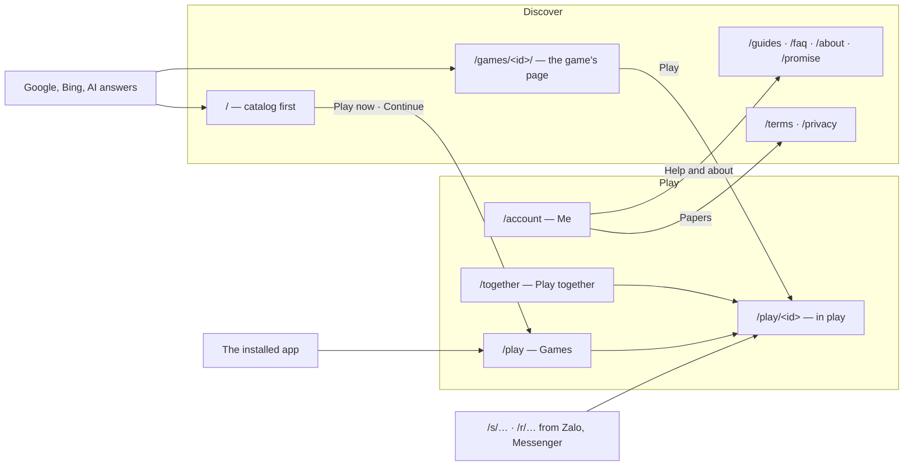
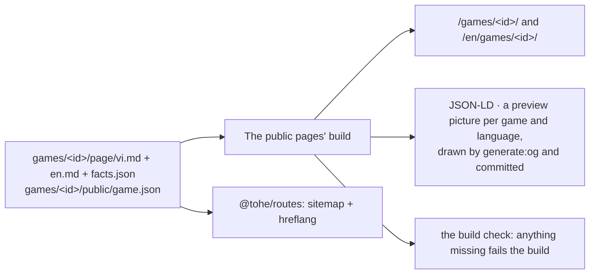

Decisions: [ADR 0046](../decisions/0046-player-surfaces-two-zones-one-frame.md) (the planes, the zones, the frame,
coming back) and [ADR 0047](../decisions/0047-two-languages-and-an-introduction-surface-that-grows.md) (the languages,
the introduction surface). Hosts and namespaces: [Hosts and paths](hosts-and-paths.md). The target is described here;
*Where things stand* says what runs today.

## Planes

| Plane | Trust | Rule |
| --- | --- | --- |
| Players | high: sessions, profiles, children's data | no third-party script; a CSP per namespace |
| Games | low | sandboxed iframe, an origin of its own, the games' CSP; speaks only the Game Contract |
| Operators | highest | Cloudflare Access in front (on since 2026-10-22), then its own session and second factor |
| Developers | `docs.`: public · `studio.`: people and agents who make game assets | `docs.`: no session · `studio.`: its own session and studio roles, a second factor to approve, agent tokens with scopes ([ADR 0051](../decisions/0051-an-asset-studio-for-game-assets.md), [ADR 0052](../decisions/0052-agent-tokens-and-the-scopes-no-agent-gets.md)) |
| Edge | — | no code of Tò He's |

**The game plane's isolation.** Today **L1**: an origin of its own. Every game is added to this repository by the owner,
whose review covers the game's dependencies too. **Before the first game the owner did not add**, the owner chooses
**L2** (a registrable domain of its own) or **L3** (a site per game). The games origin is configuration, so L2 is a
change of configuration and DNS; L3 also needs a URL per game from the API, the hub's CSP to allow each game's host, and a
games host that serves many names. Keeping the games origin apart by origin (`Origin-Agent-Cluster: ?1`) waits: it broke
an end-to-end test when tried (2026-10-22).

## The players' host: two zones

| Zone | Paths | Indexed |
| --- | --- | --- |
| **Discover** | `/`, `/games/`, `/games/<id>/`, `/games/c/<slug>/`, `/guides/…`, `/faq/`, `/about/`, `/promise/`, `/terms/`, `/privacy/`, and each under `/en/` | yes |
| **Play** | `/play`, `/together`, `/account/…`, `/play/<id>/…`, `/s/<code>`, `/r/<code>` | no |

- **A game's two URLs**: `/games/<id>/` is its page (indexed, *Play* and *Play with a friend* at the top);
  `/play/<id>` is where it is played (full screen, not indexed).
- **`/` never redirects.** A device that has opened a game gets *Continue* at the top of the page; the installed app
  opens `/play`. In `pnpm dev`, `/` on the app's port (4720) is the app's first screen: it goes to `/play`; the public
  pages are the other dev server's (4711).
- **Every public page's header has *Chơi ngay*** to `/play` (with the page's `?lang=`), on phones too, and *Chơi tiếp*
  in its place on a device that has opened a game. A device "has opened a game" when the hub wrote `tohe:returning`
  — where it notes "opened" (below), not on every start, so a device that only looked at the app is still a newcomer.
- **A public page opened from the app shows no link out of Tò He.** Tôi's help, about and papers (and the consent's
  links to the terms) add `?from=app`; a small script file on the public pages hides every link that leaves Tò He — the
  developer docs, GitHub, the mail address, each marked `data-out` — and keeps them hidden for the rest of that visit
  (`sessionStorage`). The PIN guards the links out *inside* the app ([Identity](identity.md)); the public pages, opened
  from the app, show none. The home page does not carry the docs link in its body: the footer does.

## The app's frame

| | Narrow screens | From tablet width |
| --- | --- | --- |
| Navigation | a bottom bar: **Trò chơi · Chơi cùng · Tôi** | a rail on the left, the same three tabs |
| Content | one column | up to about 1200 px; the catalog in four to six columns |
| A game in play | no frame, full screen | the same |

| Tab | Path | From the top |
| --- | --- | --- |
| **Trò chơi** — Games | `/play` | who is playing (a chip with the name; tapped, the picker) and *Nhập mã* → the table the player sits at → invitations → *Chơi tiếp* (the game this profile opened last, one big tile) → recent → every game, each a picture and a name. No title, no strip about where progress is kept, no link to technical data: those are Tôi's |
| **Chơi cùng** — Play together | `/together` | the player's tables → *Mở bàn* (one button for each game that has tables, to its lobby) → invitations → a one-line box for a code ("Có mã? Gõ mã hoặc dán link.") → the links they sent (the full list stays at `/account/links`). On a computer the first three and the last two stand in two columns |
| **Tôi** — Me | `/account` | who is playing (one tap to change) → settings (language, theme, sound, install) → help (guides, FAQ, about, the promise, feedback — one row) → papers (terms, privacy, technical data) → the account. Groups are a heading and rows, not a card each; on a computer, two columns |

None of the tabs' screens repeats its tab's name as a title: the bar or the rail says where it is, and the name stays as a
heading for screen readers. The look and the words are those of [Voice and look](../conventions/voice-and-look.md): icons
are SVG from one set and carry a label; a game's tile is a picture and a name, never a cut description; "Rủ bạn"
(share) and "Bảng điểm" (leaderboard) are labelled buttons under the name. A table is a **bàn** on every screen — the
lobby (*Mở bàn*, *Bàn đang mở*), a table (*Rời bàn*, *chủ bàn*), invitations (*Vào bàn*), its errors and the entry pages
— and a *table* in English, never *phòng* or *room*; `rooms` stays the name in routes (`/play/<id>/rooms`), in code and in
the API.

- Each level — the app, a table, a game — is an entry in the history, so Android's back steps one level.
- **A way back on every screen.** An installed app on an iPhone has no Back, so no screen is a dead end that needs the
  browser's: a screen of the frame that is not a tab's root has a "←" at its top (to its tab's root or the screen it
  belongs under), and a full-screen one — a game's lobby, a table, a replay, an entry gate, the naming form a guest sees —
  has its own. A test over the router's routes fails for one with neither.
- The app's manifest locks no orientation; each game declares its own.
- On an account's child profile, a link out of Tò He asks for the account's manage PIN ([Identity](identity.md)); a device
  with only device profiles has no PIN.
- The hub neither rotates nor locks the screen: a game fits the orientation it prefers inside the screen it gets. It
  does ask, on one occasion: a portrait game on a phone held sideways (below).
- **A short landscape screen** *(agent)* — a phone held sideways, under 500 px high (a height query on a touch screen
  or not): the rail instead of the bottom bar, a compact header (the tab's name smaller, tighter spacing), and tiles
  that shrink, so the catalog's first screen shows games first. A tablet or a computer (500 px and up) keeps the frame as
  above.
- **A portrait game on a phone held sideways** *(agent)*: when the game's `game.json` orientation is `portrait`, the
  screen is a touch screen in landscape and under 500 px high, a calm layer covers the game: "Xoay dọc máy để chơi" /
  "Turn your phone upright to play", a drawing of a phone turning upright. The game keeps running underneath and the
  layer goes when the phone turns back; `any` and `landscape` games never get it; a tablet or a computer never does. The
  hub still does not lock the screen — it asks the player to turn the phone.
- Nothing presses a child to keep playing: no punishing streaks, no countdowns, no guilt.

**How the hub does it** (`apps/hub/src/frame/`):

- A layout route (`_frame` in `router.tsx`) holds `/play`, `/together` and every `/account/…` screen; a game
  (`/play/<id>`), its lobby, a table, a replay and the links into them (`/r/…`, `/s/…`) are outside it, full screen.
  `/account/links` is Chơi cùng's. Forms (signing in, signing up, a new profile) stay one narrow column inside it.
- **The short screen** is two CSS queries in one place (`frame/short.ts`, the Tailwind variants `short:` and `turn:` in
  `styles.css`; a test keeps them in step): `(max-height: 499px) and (orientation: landscape)`, and the same with
  `(pointer: coarse)` for the layer that asks to turn the phone — a computer's short window gets the rail but is never
  asked to turn a phone it cannot turn. The layer (`launcher/RotateHint.tsx`) is in the tree of every portrait game and
  shown by CSS alone, so there is no state to stick and nothing is paused. A game outside the frame
  (`launcher/GameFrame.tsx`) with the hub's own top bar (a game without the `shell` capability) keeps 56 px of bar under
  a notch: the bar's height is 3.5rem plus the safe-area inset.
- Each tab's screen starts with a chip of the player's avatar and name, which opens the profile picker (and, in Trò chơi, with
  *Nhập mã* at the other end). The chip never cuts the name: it wraps at the spaces up to a width (9 rem on a phone, 16 rem
  from a tablet and on a short screen), and the tab's name is a heading for screen readers only. The bar
  sits above the phone's home indicator (`env(safe-area-inset-bottom)`) and steps aside while a field that brings up the
  keyboard has the focus. The rail comes before the screen in the document and the bar after it, so the focus follows
  what is seen; the tab of the screen shown carries `aria-current="page"`.
- **History**: a tab takes the place of the screen in the history (the app is one level) — or, when the tab's screen is
  already behind in the history, steps back to it, as "←" does, so `/play → avatar → Trò chơi → Back` leaves the app
  instead of staying; a game, a table or a screen under a tab is a new entry.
- **"←" on a sub-screen** is drawn by `Screen`, from the frame (`backTarget` in `frame/tabs.ts`: signing in and the email
  → Tôi; the code step, registering and the password screens → signing in; the profile picker → Trò chơi; moving a
  profile → the picker); `/account/data` and `/account/links` draw their own. Outside the frame `Screen` takes `back`.
- **A path that is no screen** (`/account/foo`, `/play/x/y`) shows the app's own not-found in its language, with *Về
  Tò He* to `/play`. The app opened straight at a game, a table or a link into one, with nothing of the app
  behind it, first puts `/play` behind it, so Back from the game reaches the app before it leaves Tò He.
- **Tôi** is `/account`; Quản lý tài khoản, behind the parent gate, is `/account?manage=true` — and what returns there:
  `?add=true` (a new profile), `?linked=` and `?link_error=` (a provider linked, the API's `HubPaths.Account`).
  Help and about and the papers are full navigations to the public pages, in the app's language where the page exists
  in it. Feedback (`mailto:`) is the only link out of Tò He today.

## Coming back

| Moment | What happens |
| --- | --- |
| Opening the app | the frame's first screen starts from what was left unfinished (above) |
| A shared device | with several profiles, "who is playing?" — one tap — after a cold start that follows 30 minutes unused; an account's child profile → an adult's asks for the manage PIN |
| The account's session ended | the app says so and offers to sign in; it does not fall back to the device's profile in silence |
| A new version | takes over at the next cold start, or while the app is out of sight on a screen of the frame that holds nothing in progress, so the player comes back to the same screen on the new version without seeing it happen; in a long session in sight, *A new version — Reload* with *Later* on the frame's screens. Never during a game, at a table or in a replay |
| Starting the installed app | the splash screen is the brand colour, in light and dark alike |
| A link while installed | `launch_handler` `focus-existing` where supported; on iPhone, entry pages say how to open the app and enter the code |
| Storage | the installed app asks for persistent storage |
| Counting | returning visits counted as totals only ([Telemetry](telemetry.md)) |

**How the hub does it:**

| Moment | Where | How |
| --- | --- | --- |
| Trò chơi's first screen | `pages/CatalogPage.tsx`, `launcher/recent.ts`, `rooms/myTables.ts` | from the top: who is playing and *Nhập mã* (no title, no strip about progress, no technical-data link); **Bàn đang ngồi** — the tables of `GET /api/rooms/mine`, "Tiến Lên · bàn của Bố — Vào lại" (an account's profile, or a device profile with a copy on the server); the invitations, as before; **Chơi tiếp** — the game this profile opened last, one big tile (picture, name, the button); **Gần đây** — up to six it opened before; every game, as tiles of a picture and a name with *Rủ bạn* (and, for an account, *Bảng điểm*) under the name, in columns that grow with the screen (about 150 px on a phone, 240 px on a computer, 290 px on a tablet held upright) and stretch to fill the row. A section with nothing to show is not shown. The hub notes "opened" itself when a game's menu or its tables' lobby opens: per profile, on the device, in IndexedDB's `cache` table (`opened:<profileId>`, a game's id and a time, the last twelve), gone with a device profile that is deleted; the same moment writes `tohe:returning` in `localStorage`, which the public pages read for *Chơi tiếp* (and nothing else does); the Game Contract does not change. Whether a round is left unfinished, the game says on its own title screen |
| Who is playing | `session/whoIsPlaying.ts`, `RequireSession`, the picker (`pages/ProfilesPage.tsx`) | The picker leads with the profile this device played last — "Vẫn là Mèo? Chơi tiếp", big, one tap — and the other profiles below it under "Người khác"; with no last player (a first start) it is the title and a grid. localStorage `tohe:last-used` holds when the app was last in sight (written each minute while seen and when it leaves sight). A page load is a cold start: if it follows 30 minutes or more since then, and the device has more than one profile — an account's profiles, or this device's own — the first screen that needs a player sends to the picker (`/account/profiles?ask=true`) once; the screen that asked, or the link kept, opens after the tap. A first start, a clock set back, or storage refused asks nothing. On an account, choosing an adult's profile while a child's plays opens the parent gate first (the manage PIN, or the password or an email code without one), unless management is open already; choosing locks it again. Quản lý tài khoản was behind the gate already |
| The session ended | `session/ended.ts`, `api/queries.ts` | the hub keeps a copy of the account's session for playing offline; when the API answers that nobody is signed in while that copy is there, the session ended (signing out and deleting the account forget the copy first). The device keeps `tohe:session-ended` and every screen that needs a player shows "Phiên đăng nhập đã hết — đăng nhập lại để chơi tiếp bằng tài khoản" with *Đăng nhập lại* (back to the same screen after) and *Chơi trên máy này* — the device's profiles only when chosen. Signing in, or that choice, clears it |
| A new version | `update/`, `vite.config.ts` | `registerType: 'prompt'`: the new service worker installs and waits, with no `skipWaiting`, `clientsClaim` or reload of its own, and takes over once every page of the app is closed. A long session asks for a new version every hour while in sight; *Có bản mới — Tải lại* shows above the bar on the frame's screens only (a game, a lobby, a table, a replay and the links into them are outside the frame), with a visible *Để sau* that hides it until the next start. **Out of sight** (`visibilitychange` to `hidden`) with a new version waiting, the page takes it — skip waiting, then one reload, at the same address — when it shows a tab's own screen (`/play`, `/together`, `/account` but not Quản lý tài khoản) or `/account/links` and holds no work: no dialog open, no field with text in it (`appliesOutOfSight`, `holdsWork`). Every other screen of the frame keeps what is in progress only in the page — a code sent by email, a step of signing up or of moving a profile, the parent gate — so it waits for the notice or the next cold start, as do a game, a table and a replay. Otherwise only a tap reloads. `pnpm --filter @tohe/hub updates` builds the hub twice and checks it, in CI too: going out of sight on `/play` reloads into the new build, in a game it does not |
| The splash screen | the manifest (`vite.config.ts`) | `background_color` is the light theme's `--tohe-brand`, read from `tokens.css` when the hub is built: Android draws the start screen of the installed app from the manifest before any page exists, in light and dark alike, with the opaque icon (its own square of a lighter orange, `#f97316`) in the middle |
| A link while installed | the manifest, `install/launch.ts`, `install/InstalledAppHint.tsx` | `launch_handler: { client_mode: ["focus-existing", "auto"] }`; where the browser has `launchQueue` (Chromium), a link handed to the open app goes there — a screen of the app inside it, a public page as a page. On an iPhone or iPad outside the app, an entry page's screens (`/r/…`, `/s/…`: the table's preview, the named screen) carry "Đã cài app Tò He? Mở app, bấm Nhập mã rồi gõ 482 913."; not a dead end |
| Storage | `install/launch.ts` | the installed app asks `navigator.storage.persist()` once (`tohe:persist-asked`), unless its storage persists already |
| Counting | `telemetry/funnel.ts` | `hub.funnel.browser-return`, once a day, beside `hub.funnel.standalone-open` |

## A quick cold start

The first start with no cache took 1.9 s to the first tile on production (0.5 s warm) and, on a weak signal, could stop
on "Đang tải…" for good: nothing limited the wait for `GET /api/auth/me`, and `#root` was empty until the script ran.

| Part | Where | How |
| --- | --- | --- |
| The first paint | `apps/hub/index.html` | `#root` holds a static skeleton — the frame's rail and bar and a grid of tile placeholders — drawn with the design tokens through the CSS variables `theme-init.js` sets, the same Tailwind classes as the frame (it follows the short screen too); React replaces it on mount. A picture only: hidden from screen readers, nothing to focus. A page that is not a frame screen (a game, a link into a table) shows it for the moment the script takes to load |
| The session's wait | `session/loadMe.ts`, `api/queries.ts` | `GET /api/auth/me` has a timeout of 3 s (`AbortSignal.timeout`). On a timeout, a network error or a 5xx the hub goes on with the copy of the session it keeps for playing offline (ADR 0005) — an account's profiles, or the device's own — and asks again in the background: after 5 s, then every wait twice as long up to a minute, and at once when the app comes back into sight or the network returns. **A timeout never ends the session**: "the session ended" (above) needs the API's own answer that nobody is signed in |

## The installed app's icons and shortcuts

- **Icons** are opaque, the brand colour in the corners (iOS paints transparency black): `icon-192.png`, `icon-512.png`
  and `apple-touch-icon.png`, declared with `purpose: "any"`; `icon-maskable-512.png` is its own file for
  `purpose: "maskable"`, its art inside the 80% safe zone. `pnpm --filter @tohe/hub generate:icons` draws them from
  `favicon.svg`.
- **Shortcuts** (a long press on the home-screen icon): Ghép Khối (`/play/merge-block`), **Chơi cùng** (`/together`) and
  **Nhập mã** (`/together?code=1`: Chơi cùng with the box for a code focused, the way in for a code read aloud). The
  shortcuts share the app's icon.
- **Installing on iOS**: the sheet's steps name the buttons, not their place — Safari's Share button (⋯ first, if it is not
  in sight: the bar differs on iPad and with Safari's layouts), then *Thêm vào Màn hình chính*, then *Mở dưới dạng ứng
  dụng web*.

## Languages

| Part | Vietnamese | English |
| --- | --- | --- |
| Public pages | `/…` | `/en/…`; `x-default` → `/en/` |
| The app | a setting (Me → Language), shared with the public pages' switch; without one: the public page the player came from, then the browser (`vi` → Vietnamese, else English), then Vietnamese | the same |
| Link previews | the language of the link's maker, or of the table's host; Vietnamese for a card that names no game | the same |
| Terms and privacy | the original | a translation; where they differ, the version more favourable to the user applies |
| Console, developer docs | — | English only |

- `hreflang` lives in `sitemap.xml` only, which `@tohe/routes` generates. Each page has its `lang`, `og:locale` and
  alternate, and a canonical link to itself.
- The VI | EN switch leads to the same page; a non-Vietnamese browser gets a suggestion, never a redirect.
- Proper names and established terms stay in English inside the Vietnamese interface. A game's `name` is its standard
  name; a name and a description per language (`names`, `descriptions`) are optional and shown in the reader's language
  when present ([ADR 0048](../decisions/0048-a-standard-name-and-words-per-language-for-each-game.md)).

**What the public pages hand to the app** — two things, both read by the app when it starts
(`apps/hub/src/language/language.ts`):

| | What | Written by |
| --- | --- | --- |
| The remembered choice | `localStorage` key **`tohe:language`** on the players' origin, `vi` or `en`. Written when a reader uses the VI \| EN switch, follows the suggestion (`en`) or turns it down with *Stay in Vietnamese* (`vi`); a Vietnamese page shows the suggestion when the key says `en`, or when there is no key and the browser's first language is not `vi*`, and not when it says `vi` | `apps/web/src/scripts/language.ts` |
| The page's language | **`?lang=vi`** or **`?lang=en`** on every link from a public page into the app (`/play`, `/play/<id>`, `/play/<id>/rooms`), the header's *Chơi ngay* and *Continue* on the home pages among them — a Vietnamese page's too: a Vietnamese page read on an English phone opens a Vietnamese app | `appPath` in `apps/web/src/i18n.ts` |

The app's order stays as above: its own setting, which a choice on the public pages' switch fills in (the key), then
the page the player came from (`?lang=`), then the browser, then Vietnamese. When the app has no setting yet, the
page's language becomes it (`rememberEntryLanguage`): the installed app opens at `/play` without `?lang=`, and a family
that came from a Vietnamese page keeps a Vietnamese app on an English phone. A choice already made is never overwritten. Tôi → Ngôn ngữ writes the same key, and
the app changes language at once, without a reload; its links to the public pages follow it (and carry `?from=app`,
above).

## The introduction surface

| Page | Holds | Structured data |
| --- | --- | --- |
| Home | one line under the name ("Mấy trò chơi nhỏ cho cả nhà. Mở là chơi, không quảng cáo."); the games as the main action, a picture, a name and the short `kind` line each; *Continue* on a device that has played; one strip, **Chơi cùng** (a sentence and a link to the games with tables); **Bố mẹ hay hỏi**, three questions each a link into the FAQ (`/faq/#<id>`); a small date near the footer. Installing, the story and the promise are links in the footer and About, not sections; no link to the developer docs in its body (the footer has it). [Voice and look](../conventions/voice-and-look.md) | `WebSite`, `Organization`, `ItemList` |
| A game's page | *Play* big and first under the name and its `kind` (and *Play together* beside it, smaller, for a game with tables); the short answer; **the facts table** (age, players, one round, how the phone is held, ads: none, personal data: no sign-up needed to play, no tracking); how to play; its own questions; pictures; related games; a date. "Who it suits" only where a game's file says something the facts do not | `VideoGame`, `BreadcrumbList` |
| The promise | no ads, no tracking, no purchases, no coins | `WebPage` |
| A collection (from ~8 games) | a written introduction and a comparison table | `CollectionPage`, `ItemList`, `BreadcrumbList` |
| A page for a search (≥ 3 fitting games) | written text that answers the search | `Article`, `ItemList` |

**Adding a game** brings its public page: `/new-game` writes `games/<id>/page/vi.md`, `en.md` (with an `updated` date)
and `facts.json` (facts the manifest does not hold, such as how long a round lasts); the rest comes from `game.json`;
`pnpm --filter @tohe/web generate:og` draws its preview pictures, committed beside the page; the build makes the pages,
serves the pictures at `/games/<id>/og.png` and `/en/games/<id>/og.png`, and fails if anything is missing or out of
date.

**One source per game**, in the game's folder, outside `public/` so the games origin never serves it:

| File | Holds | Read by |
| --- | --- | --- |
| `page/vi.md`, `page/en.md` | front matter `updated` (the day the words were last revised) and `kind` (what it is in a few words, after the name in the title); then the answer — what it is and for whom, one or two short sentences, no numbers the facts table holds; then, under the page's own headings, how to play (3 to 5 numbered lines), optionally who it suits (left out where it only repeats the facts and the answer) and the game's own questions (`### …?`) and pictures (``, the file beside it). Plain text, no HTML or links | `apps/web/src/content/game-page.ts`, which fails on anything else, naming the file |
| `page/facts.json` | `round` — `fixed` (seconds, a clock ends it), `about` (a typical range of minutes) or `open` (no set length: a game goes on until it is over, and the game keeps the player's place); `offline` — true only when playing with no connection after a first visit is guaranteed, not left to the browser's cache (a games-origin service worker, [ADR 0005](../decisions/0005-offline-first.md)'s spike S1) | the same, with Zod |
| `page/og.vi.png`, `page/og.en.png`, `page/og.json` | the game's link-preview picture in each language (1200×630: its icon, its name in that language, its `kind`, Tò He's tagline), made by `pnpm --filter @tohe/web generate:og` and committed beside the page; `og.json` holds a sha256 per language of what each was drawn from (those words, the icon's bytes, a version of the drawing) | `apps/web/scripts/og-stamp.ts`; the build copies them under the game's pages |
| `public/game.json` | the name and description in each language ([ADR 0048](../decisions/0048-a-standard-name-and-words-per-language-for-each-game.md)), `minAge`, `orientation`, the seats and bots (`rooms`), whether it plays together (`rooms`) | the Game Contract |

**The facts table** of a game's page: ages (`minAge`), players (one alone, or the seats of a table and the bots), a
round (`facts.json`), the screen (`orientation`), ads (none) and personal data (none needed to play; no tracking).
**Offline** is claimed — a row of the table, a sentence on the home page — only when every game's `facts.json` says
`offline: true`, worked out at build time; none does today.

**The build check** (`apps/web/scripts/check-build.ts`) fails the build when a game lacks either page or its facts,
when one is broken, when a language pair of the sitemap does not name its alternates both ways, when a game lacks its
picture in either language, when one is not 1200×630 or out of date (its stamp no longer matches what the sources
give: "run pnpm --filter @tohe/web generate:og"), when a game's page does not name its own as `og:image`, when the
home pages, a game's page
or the promise show no `updated` day, or when a page lacks its structured data (the table above).

**Crawlers.** `robots.txt` keeps the content signals (`search=yes, ai-input=yes, ai-train=no`), allows by name the
crawlers that fetch for search and answers (Googlebot, Bingbot, `OAI-SearchBot`, `Claude-SearchBot`, `PerplexityBot`,
Applebot, Cốc Cốc's) in a group that repeats every crawler's rules, and disallows everything to those only for training
(`GPTBot`, `ClaudeBot`, `CCBot`, and the tokens `Google-Extended`, `Applebot-Extended`).

**Growth**: about 8 games, collections; about 30, a static search and a paginated list; about 100, a sitemap per
language and IndexNow.

## Where things stand

| Part | Today | In place when |
| --- | --- | --- |
| Planes, L1, the escalation rule | L1 in place; Cloudflare Access on `console.` | — |
| Crawlers by name in `robots.txt` | in place | — |
| Namespaces `/together`, `/promise/` | in place: `/together` (Chơi cùng) and `/promise/` with their pages | — |
| Public pages in two languages | in place: Vietnamese at `/…`, English at `/en/…`, `hreflang` in the sitemap, the VI \| EN switch and the suggestion, the choice kept under `tohe:language`, `?lang=vi|en` into the app (which reads both); the terms and the privacy notice Vietnamese-only (`vietnameseOnlyPages` in `@tohe/routes`) | the public pages' languages pull request |
| Game names per language | in place: a standard `name` with `names` and `descriptions` per language (ADR 0048); the hub shows its language's, the console the standard name, link previews their card's language's, each public page its own language's | — |
| One source per game, a picture per game, the facts table, the catalog-first home, the promise, *Continue* instead of the redirect | in place: `games/<id>/page/` for the four games; a picture per game and language, made by `generate:og` and committed beside the page; the home page shows the catalog first and *Continue* on a device that has played, and never redirects; `/promise/` in both languages. No game claims offline play yet (no games-origin service worker), so no page does | — |
| Collections and pages for a search | none: they wait for about eight games, and three fitting ones | the growth above |
| The short landscape screen, the turn-your-phone layer, the cold start, the icons and shortcuts | in place (above) *(agent)*: the rail and a compact header below 500 px of height; "Xoay dọc máy để chơi" over a portrait game on a touch screen sideways; a skeleton in `#root` and a 3 s wait for `/api/auth/me`; opaque icons and a maskable one; shortcuts to Chơi cùng and the code box | — |
| The app's frame and tabs, the language setting | in place: the bar and the rail, the three tabs, Chơi cùng, Tôi with the language, theme and sound, the history per level (a tab behind steps back), a "←" on every sub-screen and every full-screen gate, the app's own not-found, no orientation lock, the manage PIN before a link out on a child's profile; the bottom-sheet menu gone | — |
| Public pages and the app joined | in place: *Chơi ngay* / *Chơi tiếp* in every public page's header; `?lang=` on every link into the app; `?from=app` and no link out on a public page the app opened; `tohe:returning` written when a game is opened | — |
| Coming back | in place (above): a table's six digits on Trò chơi and Chơi cùng ("Tiến Lên · bàn 482 113", from `GET /api/rooms/mine`); the API holds a child moving up to the parent gate (`parent_gate_required`, which the picker answers by asking the parent again). Not yet: a share link that opens its game at once passes no screen to carry the iPhone's line | — |
| Link previews in the maker's language | in place: the hub sends its language when it makes a share link or opens a table; the API keeps it with the link or the table, and a card that names a game speaks it — its words, `lang`, `og:locale` and the game's name ([Entry links](entry-links.md#link-previews)) | — |
| The terms and the privacy notice in English, the clause parity test | Vietnamese only | before the launch |
| The console in English | Vietnamese words in its code | an item of the product backlog |
