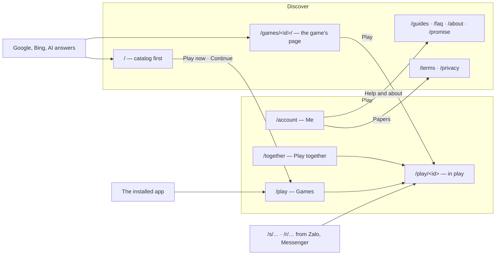
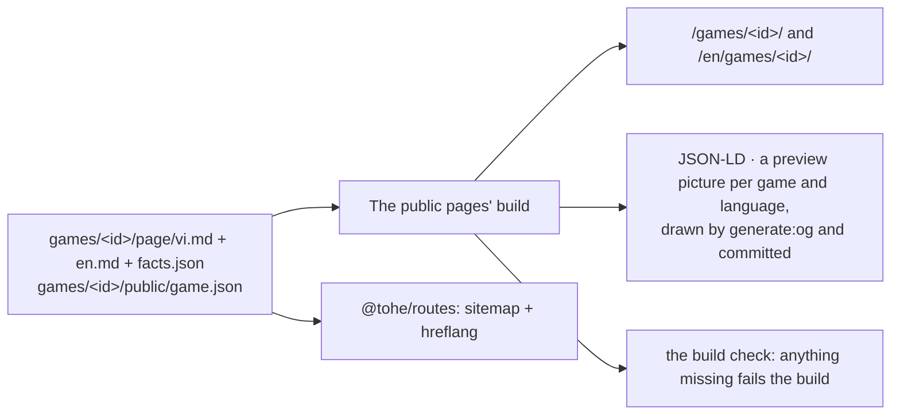

Decisions: [ADR 0046](../decisions/0046-player-surfaces-two-zones-one-frame.md) (the planes, the zones, the frame,
coming back) and [ADR 0047](../decisions/0047-two-languages-and-an-introduction-surface-that-grows.md) (the languages,
the introduction surface). Hosts and namespaces: [Hosts and paths](hosts-and-paths.md). The target is described here;
*Where things stand* says what runs today.

## Planes

| Plane | Trust | Rule |
| --- | --- | --- |
| Players | high: sessions, profiles, children's data | no third-party script; a CSP per namespace |
| Games | low | sandboxed iframe, an origin of its own, the games' CSP; speaks only the Game Contract |
| Operators | highest | Cloudflare Access in front (on since 2026-10-22), then its own session and second factor |
| Developers | public | no session |
| Edge | — | no code of Tò He's |

**The game plane's isolation.** Today **L1**: an origin of its own. Every game is added to this repository by the owner,
whose review covers the game's dependencies too. **Before the first game the owner did not add**, the owner chooses
**L2** (a registrable domain of its own) or **L3** (a site per game). The games origin is configuration, so L2 is a
change of configuration and DNS; L3 also needs a URL per game from the API, the hub's CSP to allow each game's host, and a
games host that serves many names. Keeping the games origin apart by origin (`Origin-Agent-Cluster: ?1`) waits: it broke
an end-to-end test when tried (2026-10-22).

## The players' host: two zones

| Zone | Paths | Indexed |
| --- | --- | --- |
| **Discover** | `/`, `/games/`, `/games/<id>/`, `/games/c/<slug>/`, `/guides/…`, `/faq/`, `/about/`, `/promise/`, `/terms/`, `/privacy/`, and each under `/en/` | yes |
| **Play** | `/play`, `/together`, `/account/…`, `/play/<id>/…`, `/s/<code>`, `/r/<code>` | no |

- **A game's two URLs**: `/games/<id>/` is its page (indexed, *Play* and *Play with a friend* at the top);
  `/play/<id>` is where it is played (full screen, not indexed).
- **`/` never redirects.** A device that has played gets *Continue* at the top of the page; the installed app opens
  `/play`.

## The app's frame

| | Narrow screens | From tablet width |
| --- | --- | --- |
| Navigation | a bottom bar: **Trò chơi · Chơi cùng · Tôi** | a rail on the left, the same three tabs |
| Content | one column | up to about 1200 px; the catalog in four to six columns |
| A game in play | no frame, full screen | the same |

| Tab | Path | From the top |
| --- | --- | --- |
| **Trò chơi** — Games | `/play` | who is playing (*Change*) and a button for a code → the table the player sits at → invitations → *Continue* (the game this profile opened last) → recent → every game |
| **Chơi cùng** — Play together | `/together` | the box for a code → the player's tables → invitations → the links they sent (the full list stays at `/account/links`) |
| **Tôi** — Me | `/account` | profiles and who is playing → settings (language, theme, sound) → install → help and about → feedback → papers → the account |

- Each level — the app, a table, a game — is an entry in the history, so Android's back steps one level.
- The app's manifest locks no orientation; each game declares its own.
- On an account's child profile, a link out of Tò He asks for the account's manage PIN ([Identity](identity.md)); a device
  with only device profiles has no PIN.
- The hub neither rotates nor locks the screen: a game fits the orientation it prefers inside the screen it gets.
- Nothing presses a child to keep playing: no punishing streaks, no countdowns, no guilt.

## Coming back

| Moment | What happens |
| --- | --- |
| Opening the app | the frame's first screen starts from what was left unfinished (above) |
| A shared device | with several profiles, "who is playing?" — one tap — after a cold start that follows 30 minutes unused; an account's child profile → an adult's asks for the manage PIN |
| The account's session ended | the app says so and offers to sign in; it does not fall back to the device's profile in silence |
| A new version | waits for the next cold start; in a long session, *A new version — Reload* on the frame's screens, never during a game, at a table or in a replay |
| A link while installed | `launch_handler` `focus-existing` where supported; on iPhone, entry pages say how to open the app and enter the code |
| Storage | the installed app asks for persistent storage |
| Counting | returning visits counted as totals only ([Telemetry](telemetry.md)) |

## Languages

| Part | Vietnamese | English |
| --- | --- | --- |
| Public pages | `/…` | `/en/…`; `x-default` → `/en/` |
| The app | a setting (Me → Language), shared with the public pages' switch; without one: the public page the player came from, then the browser (`vi` → Vietnamese, else English), then Vietnamese | the same |
| Link previews | the language of the link's maker, or of the table's host | the same |
| Terms and privacy | the original | a translation; where they differ, the version more favourable to the user applies |
| Console, developer docs | — | English only |

- `hreflang` lives in `sitemap.xml` only, which `@tohe/routes` generates. Each page has its `lang`, `og:locale` and
  alternate, and a canonical link to itself.
- The VI | EN switch leads to the same page; a non-Vietnamese browser gets a suggestion, never a redirect.
- Proper names and established terms stay in English inside the Vietnamese interface. A game's `name` is its standard
  name; a name and a description per language (`names`, `descriptions`) are optional and shown in the reader's language
  when present ([ADR 0048](../decisions/0048-a-standard-name-and-words-per-language-for-each-game.md)).

**What the public pages hand to the app** — two things, both read by the app once it has its language setting (the app
frame's pull request); until then the hub ignores them:

| | What | Written by |
| --- | --- | --- |
| The remembered choice | `localStorage` key **`tohe:language`** on the players' origin, `vi` or `en`. Written when a reader uses the VI \| EN switch, follows the suggestion (`en`) or turns it down with *Stay in Vietnamese* (`vi`); a Vietnamese page shows the suggestion when the key says `en`, or when there is no key and the browser's first language is not `vi*`, and not when it says `vi` | `apps/web/src/scripts/language.ts` |
| The page's language | **`?lang=en`** on every link from an English page into the app (`/play`, `/play/<id>`, `/play/<id>/rooms`), *Continue* on `/en/` among them; a Vietnamese page's links carry nothing, Vietnamese being the default | `appPath` in `apps/web/src/i18n.ts` |

The app's order stays as above: its own setting, which a choice on the public pages' switch fills in (the key), then
the page the player came from (`?lang=`), then the browser, then Vietnamese.

## The introduction surface

| Page | Holds | Structured data |
| --- | --- | --- |
| Home | the catalog first; "Game nhỏ cho cả nhà · Không quảng cáo · Không cần tài khoản · Chơi ngay"; *Continue*; a date | `WebSite`, `Organization`, `ItemList` |
| A game's page | *Play*, *Play with a friend*; the answer; **the facts table** (ages, players, round length, screen, ads: none, personal data: none needed to play, no tracking); how to play; who it suits; its own questions; pictures; related games; a date | `VideoGame`, `BreadcrumbList` |
| The promise | no ads, no tracking, no purchases, no coins | `WebPage` |
| A collection (from ~8 games) | a written introduction and a comparison table | `CollectionPage`, `ItemList`, `BreadcrumbList` |
| A page for a search (≥ 3 fitting games) | written text that answers the search | `Article`, `ItemList` |

**Adding a game** brings its public page: `/new-game` writes `games/<id>/page/vi.md`, `en.md` (with an `updated` date)
and `facts.json` (facts the manifest does not hold, such as how long a round lasts); the rest comes from `game.json`;
`pnpm --filter @tohe/web generate:og` draws its preview pictures, committed beside the page; the build makes the pages,
serves the pictures at `/games/<id>/og.png` and `/en/games/<id>/og.png`, and fails if anything is missing or out of
date.

**One source per game**, in the game's folder, outside `public/` so the games origin never serves it:

| File | Holds | Read by |
| --- | --- | --- |
| `page/vi.md`, `page/en.md` | front matter `updated` (the day the words were last revised) and `kind` (what it is in a few words, after the name in the title); then the answer — what it is and for whom, one or two sentences, no numbers the facts table holds; then, under the page's own headings, how to play (3 to 5 numbered lines), who it suits, and optionally the game's own questions (`### …?`) and pictures (``, the file beside it). Plain text, no HTML or links | `apps/web/src/content/game-page.ts`, which fails on anything else, naming the file |
| `page/facts.json` | `round` — `fixed` (seconds, a clock ends it), `about` (a typical range of minutes) or `open` (no set length: a game goes on until it is over, and the game keeps the player's place); `offline` — true only when playing with no connection after a first visit is guaranteed, not left to the browser's cache (a games-origin service worker, [ADR 0005](../decisions/0005-offline-first.md)'s spike S1) | the same, with Zod |
| `page/og.vi.png`, `page/og.en.png`, `page/og.json` | the game's link-preview picture in each language (1200×630: its icon, its name in that language, its `kind`, Tò He's tagline), made by `pnpm --filter @tohe/web generate:og` and committed beside the page; `og.json` holds a sha256 per language of what each was drawn from (those words, the icon's bytes, a version of the drawing) | `apps/web/scripts/og-stamp.ts`; the build copies them under the game's pages |
| `public/game.json` | the name and description in each language ([ADR 0048](../decisions/0048-a-standard-name-and-words-per-language-for-each-game.md)), `minAge`, `orientation`, the seats and bots (`rooms`), whether it plays together (`rooms`) | the Game Contract |

**The facts table** of a game's page: ages (`minAge`), players (one alone, or the seats of a table and the bots), a
round (`facts.json`), the screen (`orientation`), ads (none) and personal data (none needed to play; no tracking).
**Offline** is claimed — a row of the table, a sentence on the home page — only when every game's `facts.json` says
`offline: true`, worked out at build time; none does today.

**The build check** (`apps/web/scripts/check-build.ts`) fails the build when a game lacks either page or its facts,
when one is broken, when a language pair of the sitemap does not name its alternates both ways, when a game lacks its
picture in either language, when one is not 1200×630 or out of date (its stamp no longer matches what the sources
give: "run pnpm --filter @tohe/web generate:og"), when a game's page does not name its own as `og:image`, when the
home pages, a game's page
or the promise show no `updated` day, or when a page lacks its structured data (the table above).

**Crawlers.** `robots.txt` keeps the content signals (`search=yes, ai-input=yes, ai-train=no`), allows by name the
crawlers that fetch for search and answers (Googlebot, Bingbot, `OAI-SearchBot`, `Claude-SearchBot`, `PerplexityBot`,
Applebot, Cốc Cốc's) in a group that repeats every crawler's rules, and disallows everything to those only for training
(`GPTBot`, `ClaudeBot`, `CCBot`, and the tokens `Google-Extended`, `Applebot-Extended`).

**Growth**: about 8 games, collections; about 30, a static search and a paginated list; about 100, a sitemap per
language and IndexNow.

## Where things stand

| Part | Today | In place when |
| --- | --- | --- |
| Planes, L1, the escalation rule | L1 in place; Cloudflare Access on `console.` | — |
| Crawlers by name in `robots.txt` | in place | — |
| Namespaces `/together`, `/promise/` | `/promise/` in place with its page; `/together` in the map ahead of its page (the app shows its own not-found there until then) | the app frame's pull request |
| Public pages in two languages | in place: Vietnamese at `/…`, English at `/en/…`, `hreflang` in the sitemap, the VI \| EN switch and the suggestion, the choice kept under `tohe:language`, `?lang=en` into the app (which ignores both for now); the terms and the privacy notice Vietnamese-only (`vietnameseOnlyPages` in `@tohe/routes`) | the public pages' languages pull request |
| Game names per language | in place: a standard `name` with `names` and `descriptions` per language (ADR 0048); the hub shows its language's, the console the standard name, link previews the Vietnamese, each public page its own language's | — |
| One source per game, a picture per game, the facts table, the catalog-first home, the promise, *Continue* instead of the redirect | in place: `games/<id>/page/` for the four games; a picture per game and language, made by `generate:og` and committed beside the page; the home page shows the catalog first and *Continue* on a device that has played, and never redirects; `/promise/` in both languages. No game claims offline play yet (no games-origin service worker), so no page does | — |
| Collections and pages for a search | none: they wait for about eight games, and three fitting ones | the growth above |
| The app's frame and tabs, the language setting | no frame; a bottom-sheet menu; the browser's language | the app frame's pull request |
| Coming back | the catalog first; no "who is playing"; silent fallback; updates take over at once | the coming-back pull request |
| Link previews in the maker's language | Vietnamese only | the link languages' pull request |
| The terms and the privacy notice in English, the clause parity test | Vietnamese only | before the launch |
| The console in English | Vietnamese words in its code | an item of the product backlog |
