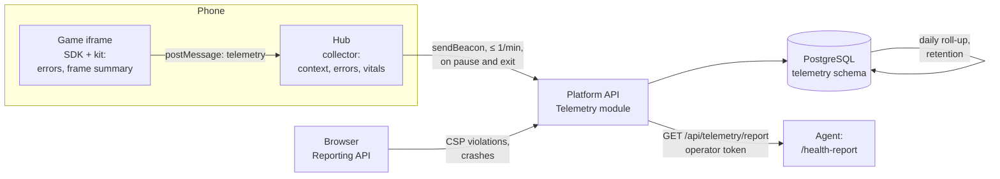

> **Status: proposal** ([ADR 0015](../decisions/0015-device-telemetry.md), Proposed). Nothing here is built yet; the
> owner decides the [open questions](#open-questions) first.

## Why

Games run on the family's and friends' phones, where nobody has developer tools. Today what goes wrong there is
lost:

- a game's `log()` lines reach the hub, which only prints them to the phone's console (`PlayPage.tsx`);
- the kit's `#perf` readout measures frame times, but only shows them on screen when someone asks for it;
- the kit falls back from WebGL to Canvas when a phone loses its WebGL context, and nobody learns that it did;
- the hub has no handler for its own uncaught errors.

We only hear about a problem when someone tells the owner ("Ghép Khối lags on the A55"), and then we need the phone
in hand to measure it. Telemetry turns that into data: which game version, on which kind of device, how often.

## Principles

1. **Technical data only.** It describes the device and the software, never the person. No names, accounts,
   profiles, households, saves, scores, IP addresses or free text typed by a player.
2. **Visible.** A page in the hub lists exactly what is sent and shows the last batch as it was sent. The same list
   is in these docs.
3. **One switch.** A parent can turn it off for the household; the server can turn it off for everyone. Off means
   games do not even measure.
4. **Light.** Summaries are computed on the device and sent in small batches; a game frame pays microseconds, never
   a network call ([budgets](#budgets)).
5. **First-party.** Data goes to our own API and PostgreSQL, on the same machine as everything else. No third-party
   script or service.
6. **Never in the way.** Telemetry failures are silent and never retried in a loop; a full queue drops the oldest
   batch.

## What is collected

### Context: once per play session

| Field | Example | Source | Why |
| --- | --- | --- | --- |
| Hub version | `64d9ff6` | hub build | Tie problems to a deploy |
| Game id and version | `tap-merge 0.4.0` | catalog | Tie problems to a game build |
| OS and browser family, major version | `Android 15`, `Chrome 141` | user agent, reduced on the server; the raw string is not stored | Compatibility |
| Device class | `phone`, viewport rounded to 50 px, DPR | `innerWidth`, `devicePixelRatio` | Layout, rendering cost |
| CPU cores, memory class | `8`, `4 GB` | `hardwareConcurrency` (capped at 16), `deviceMemory` (Chromium only) | Explain slow devices |
| Renderer | `webgl2`, `canvas (fallback)` | kit | WebGL problems |
| Mode | installed app or browser tab, theme, language | hub | Rare combinations that break |
| Device id | random, rotates every 30 days *(open question)* | hub, local storage | Count affected devices; not linked to any account |

### Errors

| Signal | Source | Notes |
| --- | --- | --- |
| Uncaught errors and unhandled rejections in a game | SDK, inside the iframe | Message and the top stack frames (file:line, trimmed), grouped by a fingerprint |
| The same in the hub | hub | Same shape |
| Protocol errors | hub's `host.ts` | Messages that fail validation: a game breaking the contract |
| Save, sync and score failures | hub | Status code and endpoint, no payload |
| WebGL context lost, Canvas fallback | kit | Counted per session |
| Audio blocked | kit `sfx` | Phones that never unlock sound |
| CSP violations on the games origin | browser Reporting API | A game reaching outside its folder (ADR 0002) |
| Page crashed (out of memory, unresponsive) | browser Reporting API, **Chromium only** | Arrives on the next visit; the page itself cannot see it |

### Performance

| Signal | Source | Browsers | Notes |
| --- | --- | --- | --- |
| Frame time histogram while playing | kit, in Phaser's loop | all | Buckets ≤ 17, 25, 33, 50, 100, > 100 ms, plus the slowest frame; paused and hidden time excluded. This is the `#perf` readout, summarised |
| Game step time (p50, p95) | kit | all | Our code's cost, apart from drawing |
| Game load | hub | all | iframe created → `ready` → first frame drawn |
| Hub web vitals: LCP, INP, CLS | hub, `web-vitals` | Chromium, Firefox; Safari from 26.2 | Safari's INP is still reported as unreliable: keep it, mark it |
| Long animation frames in the hub | hub | **Chromium only** | Which script made the hub stutter |

### Usage, kept minimal *(open question)*

Per game and day: number of sessions and a duration bucket (under 1, 1–5, 5–15, 15–60, over 60 minutes). Enough to
weigh a problem ("2 % of sessions", "only long sessions"); no per-profile play time.

### Never collected

Names, usernames, profile or household ids, IP addresses (the API does not store them), saves and scores, typed
text, screenshots or recordings, location, contacts, precise device fingerprints (no GPU renderer string: Safari
masks it anyway, and Chrome's exact value is a fingerprint), battery, network type.

## How it flows

- **Games** never call the API (ADR 0002). They hand telemetry to the hub with a new, additive protocol message,
  `telemetry`, sent only when `init` says telemetry is on. The SDK catches the game's uncaught errors; the kit adds
  frame summaries and renderer events, so every kit game gets them without code of its own.
- **The hub** adds the context, batches, and sends with `navigator.sendBeacon` to `/api/telemetry` on its own
  origin: on `visibilitychange` to hidden, on exit, and at most once a minute. Offline, it keeps at most 20 batches
  in IndexedDB and drops the oldest.
- **The browser** sends CSP violation reports and Chromium crash reports to `/api/telemetry/reports`, declared with
  `Reporting-Endpoints` headers on the hub and games origins.
- **The API** owns a `Telemetry` module and a `telemetry` schema (ADR 0003). It validates every batch (size, fields,
  rate per device), stores events, rolls them up daily, and deletes raw events after 30 days and roll-ups after a
  year *(open question)*. `GET /api/config` carries `telemetry.enabled`, so the server can switch everything off.

## Budgets

| Budget | Limit |
| --- | --- |
| Per game frame | One histogram increment: well under 0.05 ms |
| Game → hub | One message per minute of play, plus errors (at most 10 per minute, the same error counted, not repeated) |
| Hub → API | At most one request per minute, 16 KB per batch, `sendBeacon` (never blocks a page) |
| Bundle size | Hub: `web-vitals` (about 2 KB) and the collector; games: under 2 KB in SDK and kit |
| Server | Rejected above 32 KB or 6 batches per minute per device |

The conformance kit gets a check that a game's telemetry stays within these limits and that a game sends none when
telemetry is off.

## Transparency and control

- **Hub → Quản lý gia đình → Dữ liệu kỹ thuật:** what is collected (the tables above, in Vietnamese), a switch for
  the whole household (behind the parent gate), and **Xem gói gần nhất** with the last batch exactly as sent.
- **Guests (Chơi thử)** follow a per-device switch on the same page *(open question)*.
- **These docs** are the reference; any new field needs this page updated in the same pull request.
- **Legal footing (assumption, not legal advice):** Vietnam's Law on Personal Data Protection (91/2025/QH15, in
  force since 2026-01-01) protects children's data. The design avoids personal data altogether; the classification
  of a rotating device id should be checked if the platform ever goes public.

## Reports for agents and the owner

Raw events are not for reading. The API answers `GET /api/telemetry/report?days=7` with a summary built in SQL:

- per game version: sessions, sessions without an error, top error fingerprints with counts, first and last seen,
  and how many devices they hit;
- frame time p50/p95 and the share of frames over 33 ms, by device class and renderer;
- load time p50/p95; WebGL fallback and audio-blocked rates;
- hub web vitals by browser family;
- new since the previous version: errors that did not exist before, metrics that got worse.

It is protected by an operator token kept with the other UAT secrets (`~/.config/tohe-uat/uat.env`), so an agent
reads reports through the hub's public `/api` and never touches the UAT database. A small tool,
`pnpm --filter @tohe/telemetry-report start -- --env uat`, prints the report as Markdown, and a skill, `/health-report`,
tells an agent what to look for: error spikes after a deploy, new fingerprints, slow device classes, fallbacks. It
also tells the agent to propose fixes as issues or pull requests, never to change anything by itself. Later, the same
report can be a parent-gated page in the hub.

## Phases

1. **Errors and context** (most value): SDK and hub error capture, the `telemetry` message, the API module with
   retention, the transparency page, the report endpoint, the tool and `/health-report`.
2. **Performance:** frame summaries and renderer events in the kit, load timing, hub web vitals.
3. **Browser reports and regressions:** CSP and crash reports, a "since the last deploy" comparison printed by
   `deploy/uat/deploy.sh` a day after a deploy, and an optional export to the homelab's Grafana.

## Open questions

1. **Default:** on, with the notice and the switch (proposed), or off until a parent turns it on?
2. **Device id:** a random id rotated every 30 days (proposed), or none at all? Without it, "how many phones" cannot
   be answered.
3. **Usage counts** (sessions and duration buckets per game and day): keep them (proposed) or leave them out?
4. **Guests:** included under a per-device switch (proposed)?
5. **Retention:** raw events 30 days, daily roll-ups one year (proposed)?
6. **Who reads reports:** the agent through the operator token now, and a parent page later (proposed)?
