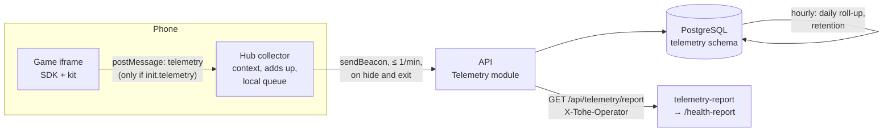

Decision: [ADR 0015](../decisions/0015-device-telemetry.md). Phases 1 (errors, context, reports) and 2
(performance) are built; phase 3 is [next](#phases).

## Why

Games run on the family's and friends' phones, where nobody has developer tools. Before telemetry, what went wrong
there was lost: a game's `log()` lines ended in the phone's console, the kit's `#perf` readout was only shown on
screen, WebGL → Canvas fallbacks happened silently, and the hub had no error handler. Now every report carries the
game version and the kind of device, so a problem shows up before anyone mentions it.

## Principles

1. **Technical data only.** It describes the device and the software, never the person: no names, accounts,
   profiles, households, saves, scores, IP addresses or text a player typed. Names of events are fixed identifiers
   checked by the contract and the API, so no free text can ride along.
2. **Visible.** The hub's **Dữ liệu kỹ thuật** page lists what is sent and shows the last batch exactly as sent.
3. **Three switches**, all on by default: the server's, the household's (a parent's, behind the parent gate) and
   the device's. Off means games do not even measure.
4. **Light.** Summaries are made on the device; a frame pays microseconds, never a network call ([budgets](#budgets)).
5. **First-party.** Data goes to our API and PostgreSQL only. No third-party script or service.
6. **Never in the way.** Failures are silent; queues and buffers are bounded and drop the oldest.

## What is collected

Four kinds of event, in the Game Contract (`packages/contract/src/telemetry.ts`):

| Kind | Holds | Example |
| --- | --- | --- |
| `error` | message (≤ 300 characters), top five stack frames without origin or query, count | `TypeError: x is undefined` |
| `count` | a name and how many times | `kit.renderer.fallback` |
| `metric` | a name ending in its unit, and a value | `kit.first-frame-ms` = 812 |
| `frames` | frames per duration bucket (≤ 17, 25, 33, 50, 100 ms, slower), slowest frame, the game's own step time p50/p95, renderer | one per minute of play |

### What the platform reports by itself

| Name | Kind | From | When |
| --- | --- | --- | --- |
| uncaught errors and unhandled rejections | error | SDK (in the game), hub | as they happen, added up per minute |
| `[warn]` / `[error]` lines from `session.log()` | error | hub | the game logs a warning or an error |
| `protocol: …` | error | hub | a game message fails validation (a game breaking the contract) |
| `kit.renderer.webgl` / `kit.renderer.canvas` | count | kit | the game starts |
| `kit.renderer.fallback` | count | kit | WebGL failed while booting; the game restarted on Canvas |
| `kit.webgl.context-lost` | count | kit | the browser took the WebGL context away |
| `kit.first-frame-ms` | metric | kit | first frame drawn, from the game page's start |
| frame summary | frames | kit | every minute of play and when paused |
| `kit.audio.blocked` / `kit.audio.unsupported` | count | kit | sound still off a second after the first touch / no Web Audio |
| `sdk.errors-dropped`, `sdk.metrics-dropped` | count | SDK | a game went over its budget |
| `hub.play.session` | count | hub | a game opens |
| `hub.play.duration.under-1m` … `over-60m` | count | hub | a game closes |
| `hub.game.ready-ms` | metric | hub | the game answered the handshake |
| `hub.game.failed` | count | hub | the game never answered |
| `hub.sync.failed.http-4xx` / `http-5xx` / `network` | count | hub | a save or score did not reach the server while online |
| `hub.vitals.lcp-ms`, `hub.vitals.inp-ms`, `hub.vitals.cls` | metric | hub (`web-vitals`) | the hub's own pages; Safari from 26.2, and its INP is still unreliable |
| `hub.telemetry.dropped` | count | hub | the hub's buffer was full |

With every batch, once per page load, the hub sends its **context**: hub version, device class (phone, tablet,
desktop), viewport rounded to 50 px, pixel ratio, CPU cores (capped at 16), memory (Chromium only), installed app or
browser tab, theme and language, and a **device id**: random, kept in local storage, renewed every 30 days, tied to
no account. The API reduces the `User-Agent` header to OS and browser families with major versions, and does not
store the header.

### Never collected

Names, usernames, profile or household ids, IP addresses, saves and scores, typed text, screenshots or recordings,
location, contacts, battery, network type, or a GPU renderer string (Safari masks it anyway, and Chrome's exact value
is a fingerprint).

### A game's own telemetry

Every game gets errors for free from the SDK, and frames and renderer events by passing `session.telemetry` to the
kit. A game can add what only it knows:

```ts
session.telemetry.count('game.tap-merge.shuffle-used');
session.telemetry.metric('game.tap-merge.board-fill-ms', ms);
```

Names are lower-case words joined by dots (`game.<id>.…`), a metric's ends in its unit, and nothing about the player
goes into one. A new name needs a row in the table above.

## How it flows



- **Games** never call the API (ADR 0002). The SDK (0.4.0) creates `session.telemetry` when `init.telemetry` is
  true and sends `telemetry` messages: every minute, when paused or hidden, and before `exit()`. It adds counts up,
  counts a repeated error instead of repeating it, and keeps at most ten different errors a minute.
- **The hub** (`apps/hub/src/telemetry/`) checks every message with the contract's schemas, adds its own events and
  the context, and sends to `POST /api/telemetry` with `navigator.sendBeacon` at most once a minute, when the page
  is hidden, and on `pagehide`. Offline, it keeps up to 20 batches in local storage and sends them when back online.
- **The API** (`services/api/src/Tohe.Api/Modules/Telemetry/`) checks every batch again (shapes, names, sizes; at
  most 200 events and 32 KB; 30 batches a minute per address), stores sessions and events in the `telemetry` schema,
  and, every hour, adds finished days up into daily rows and deletes raw events after 30 days and daily rows after a
  year. `GET /api/config` carries `telemetry`, the server's switch (`Telemetry:Enabled`).

## Budgets

| Budget | Limit | Checked by |
| --- | --- | --- |
| Per game frame | one histogram increment and a sample, well under 0.05 ms | `frames.ts` |
| Game → hub | one message a minute of play plus one per pause; ≤ 50 events, ≤ 8 KB | contract schema, conformance |
| Hub → API | ≤ 1 request a minute, ≤ 150 events and 16 KB per batch, `sendBeacon` | `collector.ts` tests |
| API | ≤ 200 events and 32 KB per batch (413 above), 30 batches a minute per address | API tests |
| Bundle | SDK and kit: about 2 KB; hub: `web-vitals` (about 2 KB) | — |

## Switches and transparency

| Switch | Who | Where |
| --- | --- | --- |
| Server | the owner | `Telemetry__Enabled=false` in the API's environment; the hub reads it from `GET /api/config` |
| Household | a parent | **Quản lý gia đình → Dữ liệu kỹ thuật** (`PATCH /api/household { telemetry }`) |
| Device | anyone, guests included | **Dữ liệu kỹ thuật** (`/data`, linked from the welcome, profile and game screens) |

The `/data` page lists what is sent and never sent (as above), says which switch keeps telemetry off, and shows the
last batch exactly as it was sent. Turning a switch off drops what was waiting, including batches queued offline.

**Legal footing (assumption, not legal advice):** Vietnam's Law on Personal Data Protection (91/2025/QH15, in force
since 2026-01-01) protects children's data. The design keeps personal data out altogether; the classification of
the rotating device id should be checked if the platform ever goes public.

## Reports for agents and the owner

`GET /api/telemetry/report?days=7` (at most 30; `includeHeadless=true` to keep conformance and e2e runs) answers with
a summary built from the raw events: totals; devices by OS, browser and class; one entry per game version, and one
for the hub itself, with its errors (grouped, with "new" for fingerprints not seen before the window), frame
summaries per platform and renderer (share of frames over 33 ms, the p95 bucket), metrics (p50, p95, max) and
counts; and daily errors and plays from the roll-ups.

It needs the operator token in the `X-Tohe-Operator` header: `Telemetry__OperatorToken`, kept in
`~/.config/tohe-uat/uat.env` on UAT (`TOHE_UAT_TELEMETRY_TOKEN`, created by `deploy/uat/deploy.sh`) and
`tohe-dev-only` on the dev stack. Without a token configured, the endpoint answers 404.

```sh
pnpm --filter @tohe/telemetry-report report -- --env uat --days 7   # Markdown; --json for the raw report
```

The tool lists **Worth a look** first: new errors, errors in over 5 % of sessions, platforms with over 10 % of frames
slower than 33 ms, renderer fallbacks, lost contexts, blocked audio, failed starts, sync failures and protocol
errors. The `/health-report` skill tells an agent how to read it and to propose fixes, never to act on UAT itself.

## Phases

1. **Errors, context and reports** — done: SDK and hub error capture, the `telemetry` message, the API module with
   roll-ups and retention, the switches and the transparency page, the report, the tool and `/health-report`.
2. **Performance** — done: frame summaries, renderer and audio events in the kit, load times, hub web vitals.
3. **Next:** CSP violation and Chromium crash reports through the browser's Reporting API, a "since the last
   deploy" comparison printed by `deploy/uat/deploy.sh` a day later, and an optional export to the homelab's
   Grafana.

## Decisions on the proposal's open questions

The owner accepted the proposed answers on 2026-10-15 ("ok rất tốt, hãy impl"): on by default with the notice and
the switches; a device id renewed every 30 days; plays and duration ranges per game and day; guests included under
the device switch; raw events 30 days and daily roll-ups a year; reports read by agents through the operator token,
a page for parents later.
