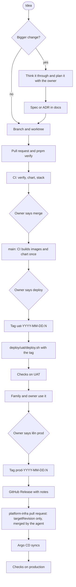

A change travels one road: a branch, a pull request, `main`, UAT, production. The images are built once, for the commit
on `main`; UAT and production run those same images, and a tag says which commit each one runs
([ADR 0041](../decisions/0041-promote-one-build-through-the-environments-by-tag.md)). The owner decides when; the agent
does the steps.

## The four environments

| | Development | CI | UAT | Production |
| --- | --- | --- | --- | --- |
| For | Building and trying | The automatic gate | The family's daily use, and where the images bound for production run first | The public |
| Where | The developer's machine: `pnpm dev` or compose project `tohe`, ports 47xx | GitHub Actions: the pull request, then `main` | The homelab, `10.100.0.2`: hub `http://10.100.0.2:4820`, console `:4821`, docs `:4810`, games `:4830`, compose project `tohe-uat` | Hub `https://toheplay.io.vn` (API at `/api`), console `https://console.toheplay.io.vn` behind Cloudflare Access, games `https://games.toheplay.io.vn`, docs `https://docs.toheplay.io.vn` ([ADR 0040](../decisions/0040-all-of-tohe-on-one-domain-of-its-own.md), [ADR 0042](../decisions/0042-hosts-by-trust-paths-by-component.md)) |
| Runs | The working tree | The checks, then the images and the chart | The images of the newest `uat-` tag | The images of the newest `prod-` tag |
| Data | Throwaway | Throwaway | Real, the family's | Real once people other than the owner use it |
| Config lives in | `compose.yaml` | `.github/workflows/ci.yml` | `compose.uat.yaml` and `~/.config/tohe-uat/uat.env` on the homelab | The `apps/tohe` component of the `platform-infra` repository (Argo CD), secrets in Infisical `/tohe` |
| An agent may | Anything | — | Tag and deploy when the owner says "deploy"; read logs | Read from outside; tag and promote when the owner says "lên prod" |

What each image reads is in [Configuration](configuration.md); how UAT is run in [UAT environment](uat.md); the chart
production uses in [Self-hosting](self-hosting.md) ([ADR 0021](../decisions/0021-release-production-through-the-tohe-chart.md),
[ADR 0010](../decisions/0010-environments-dev-and-uat.md)).

## From idea to production



Nothing is built after `main`. A fix in a hurry takes the same road with less time on UAT; nothing is patched on
production directly.

## The owner's three words

| The owner says | The agent does |
| --- | --- |
| "merge" | Merges the pull request the owner reviewed, with a merge commit, once its checks are green. CI then builds and publishes the images for the new commit on `main`. Nothing is merged without the owner's word. |
| "deploy" | Tags the commit `uat-…` (the newest commit of `main` unless told otherwise), pushes the tag, runs `deploy/uat/deploy.sh <tag>` and runs the [checks](#checks-after-a-deploy). Reports the result. |
| "lên prod" (or the owner tags `prod-…` themselves) | Takes the commit of the newest `uat-` tag unless the owner names another, checks that it carries a `uat-` tag, tags it `prod-…`, publishes a GitHub Release, opens the `platform-infra` pull request that changes only `targetRevision` of `apps/tohe`, merges it, waits for Argo CD, and runs the [checks](#checks-after-a-deploy). Reports the result. If a `prod-` tag the owner made points at a commit without a `uat-` tag, stops and asks. |

Any other change to `platform-infra` stays a pull request the owner merges.

## Tags

Annotated tags on commits of `main`: `uat-YYYY-MM-DD.N` and `prod-YYYY-MM-DD.N`, where the date is in Việt Nam time and
`N` counts the tags of that day from 1. A tag is never moved or deleted — except a `prod-` tag that was never promoted,
on the owner's word. The newest tag of a prefix (latest date, then highest `N`: `git tag -l 'uat-*' --sort=-v:refname`)
is what that environment runs. Rolling back is a new tag on an older commit ([below](#rolling-back)).

Rules before tagging. `pnpm release:check <ref> --for uat|prod` checks all of them for a commit, read-only, and prints
the next free tag name for today. Run `git fetch origin --tags` first: it reads `origin/main` and the tags as they are
and does not fetch.

| Rule | What `release:check` looks at |
| --- | --- |
| The commit is on `main` | `git merge-base --is-ancestor <commit> origin/main` |
| CI is green for it | The `CI` workflow's run for the push of that commit to `main`, from the GitHub API, concluded `success` |
| Its images and chart exist | The four images `ghcr.io/vinh466/tohe-play/<api, hub, games or docs>:sha-<commit>` and the chart version `<Chart.yaml version at that commit>-g<7-char sha>` are on GHCR |
| A `prod-` tag goes only on a commit that has a `uat-` tag (`--for prod`) | `git tag --points-at <commit> --list 'uat-*'` |

```sh
git tag -a uat-2026-10-21.1 <commit> -m "UAT 2026-10-21.1"
git push origin uat-2026-10-21.1
deploy/uat/deploy.sh uat-2026-10-21.1

git tag -a prod-2026-10-23.1 <commit> -m "Production 2026-10-23.1"
git push origin prod-2026-10-23.1
gh release create prod-2026-10-23.1 --generate-notes --notes-start-tag <previous prod- tag>   # the first time: no start tag
```

The release notes come from the pull requests since the previous `prod-` tag, so pull request titles matter.
`git tag -l 'prod-*'` and the GitHub Releases list what production ran and when. A GitHub tag ruleset on `uat-*` and
`prod-*` (no update, no deletion) stops a tag from being moved by mistake; the owner can add it in the repository's
settings.

What CI publishes for each commit on `main`: the images `ghcr.io/vinh466/tohe-play/<api|hub|games|docs>:sha-<full commit>`
and the chart `oci://ghcr.io/vinh466/charts/tohe` at version `<Chart.yaml version>-g<7-char sha>`. The `targetRevision`
in `platform-infra` is that chart version.

## Checks after a deploy

Two read-only scripts, in the package `tools/env-check`. Each prints one line per check (`✔` or `✘` with a short
detail) and a summary, and exits 1 if any check failed. They write nothing: they only read (GET and HEAD, DNS over
HTTPS, `docker compose logs`, one `SELECT`).

| | `pnpm check:uat` (on the homelab) | `pnpm check:prod` (from anywhere) |
| --- | --- | --- |
| Expects | `--expect <ref>`, else the newest `uat-` tag; `apiVersion` is the first 12 characters of its commit | `--expect <ref>`, else the newest `prod-` tag; `apiVersion` is `sha-<full commit>`. With neither, it prints the version and warns |
| Hub | `/api/health` is `Healthy`; `/api/config`; `/` is the public home page (indexed, its own CSP without inline script, `Chơi ngay` leads to `/play`); `/sitemap.xml` is XML with absolute URLs and `robots.txt` names it; `/play` answers; `/admin/` is a `404` | `/api/health` is `Healthy`; `/api/config` (version, registration, proof of work, providers, email); the same checks of `/`, `/sitemap.xml` and `robots.txt`; `/play` answers with CSP, HSTS and `nosniff`; `http://` redirects to `https://`; `www` redirects to the apex; `/admin/` is a `404` |
| Console | `:4821`: `/` is the console's page with `noindex`; `/api/admin/overview` is a `401` without its session; `/play` is a `404` | `https://console.toheplay.io.vn/` redirects to Cloudflare Access (`*.cloudflareaccess.com`) — or, without it, is the console's page with `noindex, nofollow` |
| Docs | The docs host: `/` answers the docs, `/docs/<page>` answers `301` to `/<page>`, the query kept, and `/play` redirects to the hub's `/play` | The same |
| Games | `/catalog.json` lists games; `/` redirects to the hub's `/play` with `noindex` | The same, and the first game's entry page answers with `form-action 'none'` in its CSP |
| Underneath | The API log since `--since` (default 15 minutes) has no `fail:`, `crit:`, `Unhandled` or `Exception` line; the newest migration in the database is the newest migration file of the commit. Skipped with `--no-docker`, or when Docker is missing | The mail DNS records: DKIM, the `send` subdomain's SPF and MX, DMARC, and the domain's MX |

The addresses can be overridden (`--hub`, `--console`, `--games`, `--docs`, `--domain`; `--no-dns` skips the
mail records). After a deploy the agent runs `pnpm check:uat --expect <tag>` or `pnpm check:prod --expect <tag>` with the
tag it just made. `--since` for UAT is how far back to read the log, for example the time of the deploy.

If a check fails, say so and stop. Rolling back is the owner's call ([below](#rolling-back)).

## Testing, layer by layer

| Layer | What | Runs |
| --- | --- | --- |
| Unit | Vitest: the game logic, the SDK, the hub | `pnpm test`, in `pnpm verify` and CI ([what runs when](#continuous-integration)) |
| API | xUnit against PostgreSQL through Testcontainers, never a shared database | `pnpm test`, in `pnpm verify` and CI (needs Docker) |
| Games | The conformance kit: the Game Contract, the CSP, both themes | `pnpm conformance`, in `pnpm verify` and CI |
| The stack | `routes` (the hub serves the map of its paths, [ADR 0042](../decisions/0042-hosts-by-trust-paths-by-component.md)), then the e2e suites: `smoke`; `rooms`, three phones play a Tiến Lên table ([ADR 0016](../decisions/0016-online-rooms-for-turn-based-games.md)); `journey`, a newcomer's first touches; `entries`, every way in ([ADR 0044](../decisions/0044-entry-links.md)) | CI, one job per suite, each on a compose stack of its own; locally `pnpm --filter @tohe/e2e <suite>` against a running stack |
| The chart | Lint, every profile rendered, every guard, an install and an upgrade on kind, `helm test` | CI, job `chart`; locally `deploy/helm/tohe/ci/check.sh` for the first part |
| After a deploy | The [checks](#checks-after-a-deploy) above | `pnpm check:uat` and `pnpm check:prod`, run by the agent after a deploy |
| Real devices | Phones: touch, sound, install, the installed PWA | The owner; [below](#local-development) for how to get a build on a phone |

[Definition of Done](../conventions/definition-of-done.md) says what a pull request needs before it is finished.

## Continuous integration

`.github/workflows/ci.yml` runs on every pull request and every push to `main`. A first job, *What the change touches*
(`scripts/ci-scope.sh`), sorts a pull request by the files it changed since it left its base:

| Scope | The pull request changes only | What runs |
| --- | --- | --- |
| `notes` | plan notes (`plans/`), agent and skill definitions (`.claude/`), `AGENTS.md`, `CLAUDE.md`, `README.md` | nothing: none of it is built or shipped |
| `docs` | the above and the spec under `docs/` | Biome, and the docs app's build, which checks every internal link |
| `all` | anything else | every job below |

The jobs run side by side, each on a runner of its own; the runners of a public repository cost nothing, so a check
that can run apart runs apart:

| Job | What | Waits for |
| --- | --- | --- |
| Verify | Biome, then typecheck, test and build every package but the API's | — |
| API | The API's build and its tests on PostgreSQL (Testcontainers), then the generated files are up to date | — |
| Conformance (*game*) | The conformance kit for one game. The games are the folders in `games/` with a `conformance` script, found by `scripts/ci-scope.sh`: a new game gets its job without a change to the workflow | — |
| Images | The release's images (`deploy/docker/docker-bake.hcl`), built once for the run, tagged `sha-<commit>` | — |
| Helm chart | Lint, every profile, every guard; then an install and an upgrade on kind, with the run's images | Images |
| E2E (*suite*) | `routes`, then one e2e suite, on a compose stack of its own with the run's images (`compose.image.yaml`, as Mode C) | Images |
| CI passed | Every job passed, or was not needed for the change: the one check to require on `main` | all of them |
| Publish | On `main` only: pushes the run's images to ghcr.io as they are, then the chart | CI passed |

- Verify, API and the conformance jobs together are `pnpm verify`, the Definition of Done; a check added to
  `scripts/verify.sh` goes into the workflow too.
- The chart, the e2e suites and publish all use the images the Images job built: what is published is the very images
  the checks ran. A new image is a target in `docker-bake.hcl`; a new suite is an entry in the e2e job's matrix; a
  new job goes into the needs of *CI passed*.
- A push to `main` is always `all`, and it runs every task without reading a cache (`TURBO_CACHE=local:w`): what gets
  published has passed every check from scratch.
- Every merge commit on `main` gets a run of its own, side by side with the others: its images and chart carry its
  commit, so no run waits for another or replaces it, and every commit on `main` can be released. A new push to a pull
  request cancels the run of the push before.
- On a pull request, each job reads the Turborepo cache the same job saved on `main`: a task whose inputs did not change
  replays its result. A task's inputs are declared in `turbo.json`; a file a task reads from outside its package (as the
  docs app reads `docs/`) must be listed there, or a change to it will not rebuild the task. Turborepo's `--affected` is not
  used for the same reason: it looks only at which package folders changed.
- Only `main` saves caches — each job its Turborepo cache, and one job the pnpm store when the lockfile changed
  (`.github/actions/save-caches`). A pull request's cache could be read by no other pull request, and would only crowd
  `main`'s out of the repository's 10 GB.
- A job that needs Node starts from `.github/actions/setup`: Node and pnpm as pinned, the dependencies, .NET when asked,
  the job's Turborepo cache.

## Local development

Detail is in [Local development](local-development.md). In short:

- **Mode A**, `pnpm dev`: hot reload for the API, the games origin, the hub, the public pages and the docs; PostgreSQL and Mailpit from
  compose.
- **Mode B**, `docker compose up --build -d`: the production-like containers. Do not run both at once; they share ports.
- **Mode C**, `pnpm stack:image <tag|commit>`: the exact images CI published for a commit, in the `tohe-image` project on
  the same ports, to reproduce a problem seen on UAT or production; `--down` removes it and its throwaway database. It
  never builds, and refuses while the development stack runs.
- **Demo data**, `pnpm seed`: a family account (an adult and a child profile), a friend's account and a few scores in the
  local database, in any of the modes. It refuses outside the Development environment, so UAT and production can never be
  seeded.
- **Phones on the LAN**: `TOHE_PUBLIC_HOST=<lan address>` with Mode B. Plain HTTP, so no service worker and no install.
- **An Android phone over USB**: forward the hub and the games origin, `adb reverse tcp:4720 tcp:4720` and
  `adb reverse tcp:4730 tcp:4730`, then open `http://localhost:4720`. `localhost` is a secure context, so the service
  worker runs and Chrome can offer to install the app.
- **An iPhone**: try it on production while only the owner uses it.
- **One dev stack runs per machine at a time.** Parallel work (several branches or worktrees) relies on `pnpm verify`,
  whose API tests use their own Testcontainers, and on CI.

## Data and migrations

- Development and CI data is throwaway. UAT holds the family's data; production runs the same migrations on its own
  database.
- A migration is final once it is merged to `main`: it is never edited again, and a correction is a new migration. Until
  then, the pull request that adds it may still change it.
- A column is dropped or renamed one release after the code stops using it, so the previous tag still runs.
- Never run migrations against UAT or production by hand: the API applies them when it starts, and a UAT deploy backs
  the database up first.
- No data leaves UAT or production for a development machine, except a UAT dump used to dry-run a migration and deleted
  afterwards.
- Changing the product's behaviour freely, removing a feature without a compatibility window, stays allowed while
  production is the owner's test bed.

## Rolling back

- **UAT**: a new `uat-` tag on the older commit, deployed with `deploy/uat/deploy.sh <new tag>`; the old tags stay. The
  database is not rolled back with the code: that is why a migration waits one release before it removes anything. A
  backup from before the deploy is in `~/backups/tohe-uat/` ([UAT](uat.md#backups)).
- **Production**: a new `prod-` tag on an older commit that has a `uat-` tag, promoted the same way (release,
  `platform-infra` pull request, Argo CD). The old tag stays.
