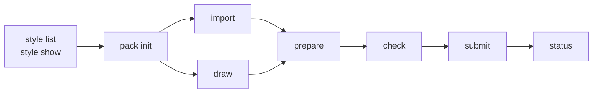

This guide is for agents first. `tohe-studio` (`packages/studio`) makes a pack for the
[Asset Studio](../architecture/asset-studio.md) with one command per step: take pictures from a known free pack or draw
them with a script, fit them to the pack's style, send them to the Studio, which checks each file, and submit the pack
for review ([ADR 0051](../decisions/0051-an-asset-studio-for-game-assets.md)). **A person reviews every pack** before a
game may use it; no command approves anything. Once approved, a game pins the pack
([Use assets in a game](use-assets-in-a-game.md)).

## Set up

The CLI reads two variables:

| Variable | Holds |
| --- | --- |
| `TOHE_STUDIO_URL` | The Studio's host: `https://studio.toheplay.io.vn` in production, `http://localhost:4722` in development (the Studio app's dev server, which passes `/api/studio` to the API) |
| `TOHE_STUDIO_TOKEN` | An agent token, `tohe_at_…`, holding the scope `studio.draft` |

Until the Studio has a host of its own, `/api/studio` still answers on the hub's host: `http://localhost:4720` in
development.

The owner makes the token on the console's **Agents** page (`/agents`) and gives it to you; it shows once, expires (30
days by default) and can be revoked at any moment ([Agent tokens](../architecture/agent-tokens.md)). Keep it in the
environment, never in a file of the repository. The CLI sends it as a bearer and never prints it; a line that would
hold it shows `tohe_at_…` instead. The token reaches the Studio's draft and read endpoints only: it can make and change
your own drafts, upload their files and submit them, never approve, reject or delete.

Run the CLI from the repository's root:

```sh
node packages/studio/src/cli.ts help
```

The examples below write `tohe-studio` for `node packages/studio/src/cli.ts`.

Exit codes: `0` ok; `1` a check failed or the server refused (the lines say which asset and which code); `2` usage or
configuration (an argument, a variable, no `pack.json`, a server it cannot reach).

## The steps



### 1. Choose a style

```sh
tohe-studio style list
tohe-studio style show tohe-pixel        # palette, tile size, view, samples; --json for all of it
```

A pack names one style; the server fixes it with the pack's first draft. A game's `SPEC.md` says which style it uses and
why.

### 2. Start a pack

```sh
tohe-studio pack init .studio-work/farm-crops --id farm-crops --style tohe-pixel --version 1.0.0 \
  --description "Crops for the farm game, 16×16"
```

A pack's working folder can be anywhere; `.studio-work/` in the repository is ignored by git. It holds `pack.json` and
the files:

```json
{
  "id": "farm-crops",
  "version": "1.0.0",
  "style": "tohe-pixel",
  "description": "Crops for the farm game, 16×16",
  "assets": [
    {
      "id": "tiles/tile-0001",
      "kind": "image",
      "file": "files/tiles/tile-0001.png",
      "tags": ["farm", "pixel"],
      "licence": "CC0-1.0",
      "attribution": null,
      "source": {
        "type": "pack",
        "name": "Tiny Farm",
        "url": "https://kenney.nl/assets/tiny-farm",
        "author": "Kenney (www.kenney.nl)",
        "file": "Tiles/tile_0001.png"
      }
    }
  ]
}
```

| Field | Holds |
| --- | --- |
| `id` | Unique in the pack: `a-z`, digits, `-`, and `/` for folders |
| `kind` | `image`, `spritesheet`, `tileset`, `audio`, `font` or `palette` |
| `file` | The file, relative to the folder |
| `tags` | Words to find it by: at most 20, each at most 40 characters |
| `licence`, `attribution` | An SPDX identifier, and the credit when the licence asks for one ([Licences](#licences-and-sources)) |
| `source` | Where it came from ([Licences and sources](#licences-and-sources)) |
| `frames` | A sprite sheet's frame, or a tileset's tile: `width`, `height`, `count`. A sprite sheet needs it |

The sha256, size and dimensions of each file are read from the file when it is sent; you never write them. `import`
and `draw` fill `pack.json` in; edit it by hand for tags, kinds and frames. The semver rule of the pack's versions —
patch, minor, major — is in [Packs](../architecture/asset-studio.md#packs).

### 3. Take files from a known pack

```sh
tohe-studio import --list
tohe-studio import kenney-tiny-farm .studio-work/farm-crops --include 'Tiles/tile_00[0-2]*.png'
```

`import` downloads the source's zip, takes the pictures that match `--include` (repeatable; globs of the paths in the
archive; without it, the source's own choice — for Tiny Farm, the single tiles in `Tiles/`), and adds each as an asset
named after its path (`Tiles/tile_0001.png` becomes `tiles/tile-0001`) with its licence, its credit and its source
filled in. When a source's address moves, download the zip by hand from its page and pass `--from <zip>`.

| Known source | Pack | Licence |
| --- | --- | --- |
| `kenney-tiny-farm` | [Tiny Farm](https://kenney.nl/assets/tiny-farm) by Kenney, 16×16 tiles | `CC0-1.0` |

A new source is a change to `packages/studio/src/sources.ts`, reviewed like code: someone has read its licence.

### 4. Or draw it with code

```js
// .studio-work/scripts/carrot.mjs
export default async ({ createCanvas, save }) => {
  const canvas = createCanvas(16, 16);
  const context = canvas.getContext('2d');
  context.fillStyle = '#f08030';
  context.fillRect(6, 4, 4, 10);
  await save('crops/carrot', canvas, { tags: ['crop'] });
};
```

```sh
tohe-studio draw .studio-work/scripts/carrot.mjs .studio-work/farm-crops
```

The script gets `createCanvas` and `loadImage` of [`@napi-rs/canvas`](https://github.com/Brooooooklyn/canvas) and
`save(id, canvas, { kind, tags, frames })`, which writes a PNG without metadata. Every saved picture becomes an asset under
`LicenseRef-Tohe-Internal`, with `source: { "type": "code", "file", "script" }` — the script's whole text, so the asset
can be drawn again. The Studio keeps at most 8000 characters of a source: keep a drawing script short.

### 5. Fit it to the style

```sh
tohe-studio prepare .studio-work/farm-crops --palette --binary-alpha
```

`prepare` decodes every picture and writes it again as a PNG without metadata (text, time, colour profiles); a picture
whose pixels it does not change keeps its own encoding. Options:

| Option | Does |
| --- | --- |
| `--palette` | Moves every opaque pixel to the nearest colour of the style's palette (read from the Studio). A painted style has none |
| `--binary-alpha` | Alpha below 128 becomes 0, the rest 255 |
| `--trim` | Cuts transparent borders away. It changes the picture's size, so it is opt-in; a sprite sheet or a tileset is never trimmed |

It prints what changed in each asset. Run it again before every `check` after you change a file.

### 6. Check it with the Studio

```sh
tohe-studio check .studio-work/farm-crops    # --dry-run says the same: check never submits
```

`check` first looks at the pack itself: every file there, every licence one the Studio accepts, a credit where one is
needed. Then it makes the pack's draft on the server — or replaces the one this folder made before, remembered in
`.studio-draft.json` per server — and uploads every file the server does not have yet, by sha256. **The server checks
each file as it arrives** and refuses one that fails, naming the asset and the code:

```text
  asset crops/carrot: colour_not_in_palette — 12 opaque pixels are not colours of the palette
farm-crops@1.0.0 failed its checks: 1 problem(s)
```

Then `check` asks the server for a **dry run**: every check a submission runs — the metadata, every file uploaded so
far, the version against the last one approved — on the draft as it stands, with nothing more saved. It prints the
report and exits `1` when it has a problem:

```text
farm-crops@1.0.0: the server's checks pass; tohe-studio submit sends it for review
```

The draft itself stays on the server: it is yours and only you can change it; a draft not submitted within 30 days is
removed.

**Stripped files.** The server keeps a picture without its metadata (text, time, EXIF; never its pixels,
[Checks](../architecture/asset-studio.md#checks)). A file that had some is kept under a new sha256, which the upload
answers. `check` remembers it in `.studio-draft.json` and sends the server's sha256 for that asset from then on, so the
file is not uploaded again, and prints one line:

```text
  asset crops/carrot: the server stripped its metadata (now 2f6c…); tohe-studio prepare writes it without, so the hashes match
```

Run `prepare` and the file you have is the one the server keeps.

### 7. Submit it for review

```sh
tohe-studio submit .studio-work/farm-crops
```

The same as `check`, then the draft is submitted. From then on nobody changes it: a fix is a new version in `pack.json`,
which makes a new draft.

### 8. Follow the review

```sh
tohe-studio status farm-crops@1.0.0        # --json for all of it
```

`submitted`, `approved`, `rejected` with the reviewer's reason, `deprecated` or `withdrawn`. A rejected version stays
rejected: fix what the reason says and submit a new version.

## What the checks mean

The server runs them ([Checks](../architecture/asset-studio.md#checks)); the codes below are the ones the CLI finds
before sending.

| Group | What it asks |
| --- | --- |
| Files | PNG or WebP, not animated, the bytes the format says they are, within the limits of size and pixels per file and of size per pack; metadata is stripped, not refused |
| Pictures | Sizes in multiples of the style's tile; a sprite sheet's grid matching its `frames`; for a pixel-art style, every opaque pixel in the palette and alpha only 0 or 255 |
| Metadata | Ids unique, the style known, tags valid, the source complete |
| Licence | One the Studio accepts, a credit where it is needed |
| Semver | The version greater than every one approved, and the right step for what changed |

| Code (local) | Means |
| --- | --- |
| `assets_required` | The pack has no asset |
| `file_missing`, `file_outside` | `file` names nothing, or a path outside the folder |
| `licence_not_accepted` | Not a licence the Studio accepts |
| `attribution_missing` | The licence asks for a credit and `attribution` is empty |
| `source_too_long` | The source is longer than the Studio keeps (8000 characters) |
| `frames_required` | A sprite sheet without `frames` |

Every other code comes from the server. A problem of the checks — of an upload, the dry run or a submission — names its
asset, when it is about one, and one of the stable codes in the [table of checks](../architecture/asset-studio.md#checks):
`format_not_allowed`, `magic_mismatch`, `too_large`, `too_many_pixels`, `size_not_tile_multiple`, `frames_mismatch`,
`colour_not_in_palette`, `alpha_not_binary`, `tile_edges_differ`, `id_duplicate`, `style_unknown`, `style_not_approved`,
`source_incomplete`, `licence_not_accepted`, `attribution_missing`, `vendor_not_checked`, `semver_too_small`. The
server's other refusals — a field it does not accept, a draft no longer yours — are listed in
[Endpoints](../architecture/asset-studio.md#endpoints).

## Licences and sources

| Licence | |
| --- | --- |
| `CC0-1.0`, `LicenseRef-Tohe-Internal` | No credit needed |
| `CC-BY-4.0`, `OFL-1.1`, `MIT`, `BSD-2-Clause`, `BSD-3-Clause`, `Apache-2.0` | `attribution` holds the credit |
| `CC-BY-SA-4.0` | The owner decides each case at review |
| NC, ND, "free for personal use", unknown | Never |

Every asset says where it came from:

| `source.type` | Holds | Made by |
| --- | --- | --- |
| `pack` | `name`, `url` (the http(s) page that names the licence), `author` | `import` |
| `code` | `script`, the drawing script's text | `draw` |
| `upload` | `by`: who made it | by hand |
| `ai` | `vendor`, `model`, `prompt`, `seed` (a number or text), `date` (an ISO date) | not yet: no generator is allowed until the owner sets a budget |

The server refuses a source without its `type` or one of its fields (`source_incomplete`); `check` finds the same before
sending: it reads `pack.json` and names the field that is wrong. Further fields, such as `file`, are kept as they are.

A reviewer checks that the source is plausible, that the pictures suit children — no gore, nothing frightening, no text,
logos or real people — that they are not a near copy of a known character or game, that they fit the style, and that
they read at their real size.
