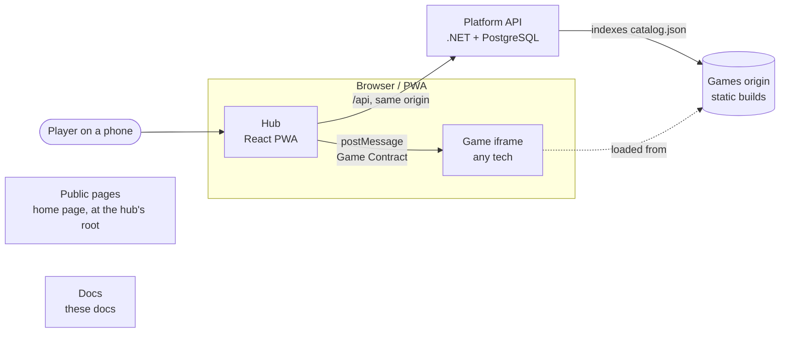

Tò He is a small, self-hosted platform for quick casual games (merge-block, block-blast, tetris-likes, later
mini farms and light RPGs) that run in a phone browser or as an installed PWA. It is built for players aged 16 and
over first, with a family mode for parents who manage children, and it is designed so that **new games can be made
quickly — including by AI agents — on top of a stable technical foundation**.

Tò He runs in production at toheplay.io.vn ([ADR 0040](decisions/0040-all-of-tohe-on-one-domain-of-its-own.md)),
with a UAT environment on the homelab where the family plays first.

These pages are the specification. If the code and the docs disagree, one of them is a bug; fix it in the same
change. Agents working in this repository must read [Working with agents](guides/working-with-agents.md) first.

## The system in one picture

- **Hub** — login and profiles (milestone M1), game catalog, launcher, local-first saves.
- **Games** — independent static builds, each in its own folder and technology, embedded in a sandboxed iframe
  on a separate origin. They talk to the platform only through the [Game Contract](contracts/game-contract-v1.md).
- **Platform API** — the backend services games may need (saves, scores, profiles…), called only by the hub.
- **Public pages** — the Vietnamese home page, at the root of the hub's host.
- **Docs** — these English docs, at the root of their own host.

## Principles

1. **The contract is the platform.** Games are replaceable; the [Game Contract](contracts/game-contract-v1.md)
   is not. It stays small, versioned, and every change to it needs an [ADR](decisions/index.md).
2. **Games never see secrets.** They run on their own origin and never call the API; the hub does it for them.
3. **Offline first.** A game that has been opened once keeps working when the API or the homelab is down.
4. **Verifiable by machines.** Every rule that matters is checked automatically: types, tests, the
   [conformance kit](contracts/game-contract-v1.md#conformance), the end-to-end smoke test.
5. **Simple over scalable.** One family, a handful of players: a modular monolith, one database, static files.

## Where to go next

| You want to… | Read |
| --- | --- |
| Understand why this exists and what it will not do | [Vision & scope](vision.md) |
| Run everything on your machine | [Local development](guides/local-development.md) |
| See how the pieces fit | [Architecture overview](architecture/overview.md) |
| Build a game | [Create a game](guides/create-a-game.md) and the [Game Contract](contracts/game-contract-v1.md) |
| Ship a change to UAT and production | [Environments and releases](guides/environments.md) |
| Know why something is the way it is | [Decisions (ADR)](decisions/index.md) |
| Know what is next | [Walking skeleton](roadmap/walking-skeleton.md) |
| Know when a change is finished | [Definition of Done](conventions/definition-of-done.md) |
