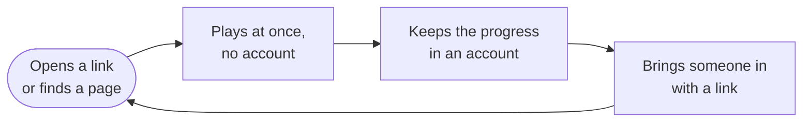

## Why

Casual mini-game portals are full of ads and interruptions. Tò He is a calm alternative: a handful of small games, no
ads, no tracking, playable in a phone browser in seconds — and a learning project for building a durable technical
foundation. It began as one family's corner and is now open to anyone the owner shares it with.

The name comes from *tò he*, the Vietnamese children's toy figurines made of coloured rice dough: small, bright
and shaped quickly. Each game here is one such figurine, shaped quickly from the same dough.

## Who it is for

Everyone is first of all **a player** — one person, followed through one life with Tò He. Most players are **16 or
older** and have used web apps before; a child plays through a parent's account, and that family mode is a layer, not
the front of the product:

| Who | Needs |
| --- | --- |
| A player (16+) | Open and play in seconds, without signing up; see what a game is before starting it; a name only when others will see it; an account only when it is worth it — to keep progress, play on another phone, appear on a board; a link that brings a friend to the same table or the same game. |
| A family (a layer) | Profiles for each person on one account; children pick a picture, have no password, and play behind the settings their parent chose; the parent finds this in Tôi → Gia đình and `/family`, not on the front. |
| The owner, who runs it | A foundation that stays stable for years; a console to run the platform; games that can be added fast, often with AI help; a codebase that is pleasant to review. |
| A developer or an AI agent | Docs that explain intent, contracts that are checked by machines, one obvious way to do things. |

## What it must be good at

1. **Instant play on a phone** — the first game visible within a few seconds, without an account; installable as a
   PWA; playable offline after the first visit.
2. **Reaching someone with a link** — a link from a chat app leads straight to the right table or game, on Android,
   iPhone and inside the chat app's browser.
3. **Many small games, one place** — a shared catalog, profiles, saves and scores across all games, and public boards
   that only hold results the platform trusts ([ADR 0029](decisions/0029-integrity-engine-and-boards-by-trust.md)).
4. **Fast, reliable game creation** — a new game from a one-paragraph idea to "playable on a phone" in an
   afternoon, with most of the work done by an AI agent following these docs and passing the automated checks.
5. **Technology freedom per game** — Canvas, DOM, Phaser, PixiJS, Godot web exports… as long as the game honours
   the [Game Contract](contracts/game-contract-v1.md).

## Non-goals

- Ads, in-app purchases, monetisation of any kind.
- Tracking people: no third-party analytics or scripts; the platform counts totals, never a person.
- Free-text chat, social feeds, content people upload. Online rooms offer preset reactions only.
- Real-time action multiplayer. Turn-based games at one table across phones are a goal: [online
  rooms](architecture/rooms.md), [ADR 0016](decisions/0016-online-rooms-for-turn-based-games.md).
- Native apps. The installed PWA is the app; a store listing that wraps it may be considered later, with an ADR.
- Scale beyond what one API instance serves ([ADR 0016](decisions/0016-online-rooms-for-turn-based-games.md)).

## Go / no-go

The project continues past the [walking skeleton](roadmap/walking-skeleton.md) only if all of these hold:

- A child in the family plays a real game on a real phone, with a profile, synced saves, and it still works with
  the API turned off.
- An AI agent builds a second game from these docs alone and it passes conformance with little help.
- The owner reads these docs and finds that they describe the intended design.
- Maintaining it still feels like fun, not a chore.
