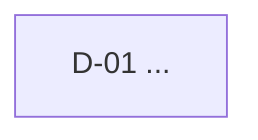

# Map — <title>

Every item the goal depends on, and what blocks what. An edge `A --> B` reads "decide A before B".
Status lives on the [PLAN.md](PLAN.md) board, not here — this page is the shape.

## Items

| ID | Question / change | Why the goal needs it | Blocks |
|---|---|---|---|
| D-01 | <question> | <why> | — |

## Considered and left off

<things that looked related but the goal does not depend on — and why>
