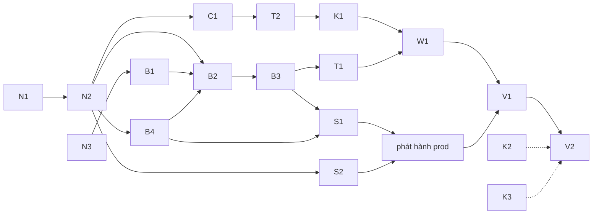

# Delivery — Asset Studio: thứ tự xây, theo pull request

Danh sách graduate, owner duyệt 2026-10-24 ("ok chốt theo đề xuất, hướng review đã ổn, bạn hãy theo đề xuất làm việc
đi"). Owner giao agent merge và deploy prod cho các PR này. Số ADR dự kiến: 0049 (N1), 0050 (N2), 0051 (N3), 0052 (C1);
nếu phiên khác lấy số trước thì dùng số trống kế tiếp.

Luật chung:

- Mỗi PR **một mục đích**, mang ADR và docs của nó (spec trước, trong cùng PR), chạy `pnpm verify` trước khi mở.
- Owner review và merge từng PR. Số ADR được cấp khi PR mở (tiếp sau 0045).
- Lên UAT và prod theo luồng hiện có: owner nói "deploy" thì tag `uat-…`; nói "lên prod" thì tag `prod-…` (ADR 0041).

## Tiến độ (2026-10-25 02:30)

| PR | Trạng thái |
|---|---|
| N1–N3 | **merged** — [#134](https://github.com/vinh466/tohe-play/pull/134) |
| B1 · K3a | **trên prod** — [#140](https://github.com/vinh466/tohe-play/pull/140), [#141](https://github.com/vinh466/tohe-play/pull/141) (`prod-2026-10-24.1`) |
| C1 · K2 · T2 · B4 · K1 · K3b · W1a · B2 · T1 · B3 · T1b · W1b · S1a | **trên prod** — #143, #144, #147, #148, #150, #152, #151, #153, #154, #155, #157, #158, #159 (`uat-2026-10-24.3` → `prod-2026-10-24.2`, `check:uat` 20/20, `check:prod` 23/23; platform-infra #251) |
| S1b | **trên prod** — [#160](https://github.com/vinh466/tohe-play/pull/160), `prod-2026-10-24.3` |
| S2 | **xong** — owner: R2 `tohe-studio`, `assets.toheplay.io.vn` + WAF, DNS `studio.`, khoá Infisical; agent: biến `TOHE_ASSETS_REGISTRY`, ADR 0054 ([#162](https://github.com/vinh466/tohe-play/pull/162)); Studio bật ([platform-infra #252](https://github.com/vinetic-spaces/platform-infra/pull/252)), host `serving` ([#163](https://github.com/vinh466/tohe-play/pull/163)) |
| Sửa sau phát hành | **trên prod** — [#167](https://github.com/vinh466/tohe-play/pull/167) app Studio treo khi chưa đăng nhập (`prod-2026-10-25.1`); [#169](https://github.com/vinh466/tohe-play/pull/169) upload lên R2 trả 500 vì streaming SigV4 (`prod-2026-10-25.2`, platform-infra #254, #255) |
| V1 | spec **duyệt** ([#164](https://github.com/vinh466/tohe-play/pull/164)); style `tiny-farm-16` (bản nháp) và pack `farm-tiny@1.0.0` **đã submit** trên Studio prod (2026-10-25); chờ owner duyệt |
| V2 | sau khi owner duyệt V1 |

## Điều chỉnh khi graduate (2026-10-24)

- **N1–N3 gộp một PR** (#134): ADR 0050, 0051, 0052 trỏ lẫn nhau, tách ra thì kiểm link không qua.
- **B4 trước B2**: endpoint duyệt của B2 cần session và studio role của B4. Thứ tự backend: B1 → B4 → B2 → B3. Các PR
  backend chạy lần lượt vì cùng sửa `ToheDbContext.cs`, `Program.cs` và migrations.
- **SeaweedFS thay MinIO** cho dev và test: MinIO bản community ngừng phát hành image năm 2025 và bị archive năm 2026.
  ADR 0051 đã ghi.
- **P0 chưa đóng atlas**: build chép file theo hash vào `dist/studio/`, để conformance đối chiếu từng file với lock.
  Đóng atlas là tối ưu về sau (owner: "tối ưu chi tiết sau"). Ghi trong ADR 0053.
- **Studio role nằm trong schema `studio`** (`studio.members`), không nằm trong `identity`, để module giữ bảng của mình.
- **K3 tách K3a (helper bố cục) và K3b (conformance theo hướng)**; **T1b** theo sau B3 (dry run, file bị strip, `problems`,
  `source.type`); **S1 tách S1a (app, host) và S1b (màn duyệt)**; **W1 tách W1a (`/new-game`) và W1b (`/new-asset`)**.

## Việc tiếp theo phát hiện khi xây (chưa làm)

- Cờ owner trong `StudioMeView` để app ẩn nút Rút với reviewer không phải owner (API đã chặn `owner_required`).
- Cho studio member bật 2FA trong hub (hiện chỉ tài khoản có platform role bật được) — đụng `apps/hub`.
- Bản nháp riêng tư trên R2: R2 public cả bucket → quy tắc Cloudflare chỉ mở `blobs/`, `packs/`, hoặc bucket riêng cho
  bản nháp. Chốt cùng S2.
- Retention và append-only cho `agents.audit`; trang console nhập vendor AI đã tra điều khoản (`studio.vendors`).
- Kiểm thử thật: ảnh chụp sáng/tối của app Studio sau khi đăng nhập, build arm64 của image API. (SDK S3 với R2 thật: đã
  chạy trên prod từ #169. Smoke e2e đã mở trang đăng nhập của app Studio từ #167.)
- `prepare --palette` đọc pixel có áp gamma khi PNG còn chunk `gAMA` (các tile Kenney có), còn server đọc pixel thô:
  palette lệch 1 đơn vị. Tạm thời chạy `prepare` không `--palette` trước để bỏ metadata. Sửa: bỏ metadata trước khi so
  palette, hoặc giải mã không chuyển màu.
- `tohe-studio` chưa có lệnh tạo style (`style create`, upload ảnh mẫu): V1 tạo `tiny-farm-16` bằng API trực tiếp.
- Test `RoomsTests…time_limit` (Jint) trượt khi máy tải nặng, luôn qua trên CI.

## Các lane và PR

| PR | Lane | Nội dung | ADR | Cần trước | Items |
|---|---|---|---|---|---|
| **N1** | Nền | Nguyên tắc "game khai báo mức phụ thuộc, nền tảng cung cấp và giữ rào"; một đoạn mở đầu trong `game-contract-v1.md` | **Games declare what they depend on** | — | D-01 |
| N2 | Nền | `docs/architecture/asset-studio.md`: pack, kho (bucket + DB), license, style, duyệt, đường rút khẩn cấp, app `studio.`, quyền. Host `studio` trong `@tohe/routes` chuyển từ `reserved` sang `decided`. `AGENTS.md`: ngoại lệ "agent tạo bản nháp", hàng `apps/studio` và `packages/studio` | **Asset Studio** | N1 | D-02, D-05–D-09, D-11, D-14 |
| N3 | Nền | `docs/architecture/agent-tokens.md`: principal, scope, danh sách cấm, hạn dùng, thu hồi, audit | **Agent tokens and the scopes no agent gets** | — | D-15 |
| **B1** | Backend | Token cho agent: bảng principal và token (lưu hash), middleware kiểm scope, danh sách cấm trong code có test, audit, trang cấp và thu hồi trong console | (N3) | N3 | D-15 |
| B2 | Backend | Module `Studio`: schema `studio` (style, pack, version, file, trạng thái); tải bản nháp bằng `studio.draft`; duyệt và rút (reviewer, 2FA); ghi file và manifest bất biến lên bucket (API S3: SeaweedFS trong compose, R2 trong chart); OpenAPI `studio` | (N2) | N2, B1, B4 | D-05, D-06, D-11 |
| B3 | Backend | Máy kiểm asset phía server (SkiaSharp), bộ file mẫu tốt và xấu, endpoint `--dry-run` | (N2) | B2 | D-09 |
| B4 | Backend | Studio role (claim riêng); trang cấp role trong console | (N2) | N2 | D-14 |
| **C1** | Contract | `assets` trong `GameManifest` (chỉ `bundle`), schema của lock; conformance: lock, hash, SPDX, `credits.json`, request chỉ tới folder của game, module luật không dùng asset; docs Game Contract | **Assets in the Game Contract** | N2 | D-12, E-01 |
| **S1** | Studio | `apps/studio` tối thiểu: đăng nhập (account + studio role + 2FA), gallery, preview 1×/2× sáng/tối, checklist, duyệt, từ chối, rút; site thứ ba trong Caddy; ingress trong chart; e2e | (N2) | B2, B3, B4 | D-14, D-09 |
| S2 | Hạ tầng | **Owner, `platform-infra`:** DNS + ingress `studio.toheplay.io.vn`; bucket R2 (đọc công khai phần đã duyệt) + credential trong Infisical | — | N2 | D-06, D-14 |
| **T1** | Công cụ | `packages/studio` + CLI `tohe-studio`: `style`, `pack init`, `import`, `draw`, `prepare`, `check --dry-run`, `submit`, `status` | (N2) | B1, B3 | D-10 |
| T2 | Công cụ | Build: `assets:resolve`, `assets.lock.json`, `assets.gen.ts`, cache theo hash (thư mục chung, CI cache), kiểm hash, `--offline`, atlas và nén, `credits.json`; máy kiểm drift trong `verify` và CI | (C1) | C1 | D-06, D-12, E-02 |
| **K1** | Kit | `loadPack` theo key có type; màn "Ghi công" trong shell | — | T2 | E-03 |
| K2 | Kit | `@tohe/game-kit/content`: helper Zod, loader, kiểm tham chiếu | — | — | D-03, E-03 |
| K3 | Kit | Helper bố cục (safe-area, hai bố cục); conformance chụp đúng hướng game khai báo và desktop; spike S3 | — | — | D-04, E-04 |
| **W1** | Quy trình | `/new-game`: bước chốt style, chọn pack, trích nguồn luật chơi (R-02); skill mới `/new-asset`; `working-with-agents.md` | — | T1, T2, K1 | E-05 |
| — | Phát hành | Owner: "deploy" rồi "lên prod" cho B1–B4 và S1, để registry thật chạy trên prod | — | S1, S2 | — |
| **V1** | Pilot | Agent `import` Kenney Tiny Farm và tạo một style pixel 16×16 → owner duyệt trong Studio prod. `games/vuon-rau/SPEC.md` (slice: 1 map, 3 cây, 1 NPC, ngày/đêm, dọc + ngang) → owner review | — | W1, phát hành | E-07 |
| V2 | Pilot | Xây slice, đo kích thước, FPS và save trên máy thật (A55, iPhone); báo cáo kèm dòng "owner kiểm lại trên prod" | — | V1 | E-07 |

## Đường găng

K2 và K3 không phụ thuộc gì, nên làm song song bất cứ lúc nào.

## Không nằm trong danh sách này

- **E-06** (spike S1) và **D-13** (`precache`, `on-demand`): để sau (D-13).
- **`generate --vendor`** và **MCP `tohe-studio`**: bậc P2 của Studio, sau khi owner duyệt ngân sách (D-10).
- **Upload và quản lý cho người** trong Studio: bậc P1 của Studio (design §4), làm sau pilot.
