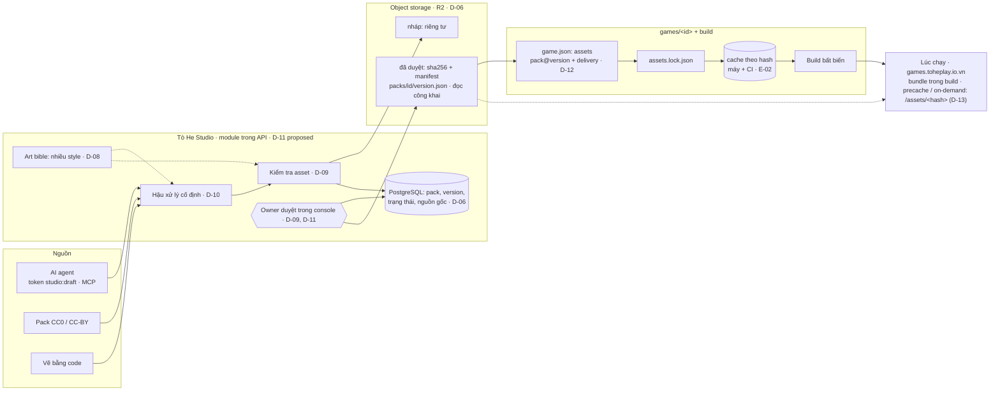

# Design — Asset Studio: thiết kế đích (v2, đang thành hình)

Trang này **ghép** các item thành một bức tranh và không tự quyết điều gì. Mỗi khẳng định trỏ về item quyết nó;
*(proposed)* là item chưa `decided`. Item nào được quyết khác đi thì sửa trang này trong cùng phiên. Ngày: 2026-10-22.

## Trả lời ngắn: đã đủ tới đâu?

- **Đã chốt** (owner, 2026-10-22):
  - Nguyên tắc khai báo (D-01).
  - Studio là nguồn; khoá version lúc build; ba chế độ tải; bốn rào (D-02).
  - Content trong build (D-03). Game quyết bố cục (D-04).
  - Pack (D-05).
  - Object storage + state trong DB ngay từ đầu, build có cache (D-06).
  - Danh sách license B (D-07).
  - Style do game chọn (D-08).
- **Đã đề xuất, chờ owner:** Studio chạy trong API của Tò He; owner duyệt trong console; agent chỉ tạo bản nháp bằng
  token hẹp. Cần một ngoại lệ cho luật "prod chỉ đọc" (D-11).
- **Còn mở:** cổng duyệt và kiểm tra asset (D-09), công cụ cho AI và ngân sách (D-10), hình dạng contract (D-12), phục
  vụ lúc chạy (D-13). License cho asset Tò He tự làm vẫn chưa chọn (D-07).
- **Chưa có số đo nào**: kích thước, FPS, save, hạn mức storage trên iOS đều chờ E-06 và E-07.

## 1. Bức tranh

## 2. Các khối, chuẩn đứng sau, và nơi ở

| Khối | Làm gì | Chuẩn / tiền lệ | Ở đâu | Item |
|---|---|---|---|---|
| Nguyên tắc khai báo | Game chọn trong những gì nền tảng mở; nền tảng giữ rào; conformance kiểm điều đã khai báo | `capabilities`, `identity` (ADR 0045) | ADR mới | D-01 |
| Pack | Bộ asset cùng style, semver, mỗi file một sha256; `style` trỏ tới art bible | Pack Kenney; semver | Schema trong `packages/studio` *(proposed)* | D-05 |
| State | Pack, version, trạng thái, nguồn gốc, người duyệt, nhật ký | — | PostgreSQL, module `Studio` | D-06 |
| File | Nháp riêng tư; đã duyệt thì bất biến, đọc công khai, kèm manifest mỗi version | Content-addressed storage; registry kiểu npm | R2 (prod) · MinIO (dev) *(proposed)* | D-06 |
| License và nguồn gốc | Danh sách SPDX cho phép; `source` bắt buộc; asset AI có đủ nguồn gốc; credits sinh từ lock | SPDX; USCO Part 2 | Metadata của pack; màn credits trong kit | D-07 |
| Art bible | Nhiều style. Style Tò He là mặc định, không bắt buộc; game tự chọn hoặc tạo style | Style model của Scenario (R-01) | Bản ghi trong Studio | D-08 |
| Hậu xử lý | Ép palette của style, căn lưới pixel, cắt viền, kiểm mép tile, đóng atlas, nén | — | `packages/studio` CLI | D-10 |
| Kiểm tra asset | Kích thước, palette theo style của pack, nền trong suốt, mép tile, license, semver | Conformance của game | Server Studio khi nhận bản nháp | D-09 |
| Cổng duyệt | Agent chỉ tạo `draft`; owner chuyển sang `approved` trong console (Access + TOTP) *(proposed)* | Roblox moderation (R-01) | Console | D-09, D-11 |
| Công cụ cho AI | Token `studio:draft`; CLI rồi MCP `tohe-studio`; adapter generator đổi được vendor | PixelLab MCP (R-01) | P0 CLI → P2 MCP | D-10, D-11 |
| Contract `assets` | `pack@version` + `delivery` theo pack; lock; key có type | `pnpm-lock` | `@tohe/contract` + ADR | D-12, E-01 |
| Build | Resolve qua manifest, cache theo hash (máy, CI), kiểm hash, `--offline`, chỉ đóng gói file dùng, `sizeBudgetKb` | — | `tools/games-host` hoặc plugin Vite | E-02 |
| Kit | Nạp asset theo key; `content` (Zod, loader, kiểm tham chiếu); credits; helper bố cục | Phaser loader | `@tohe/game-kit` | E-03, E-04 |
| Phục vụ lúc chạy | `/assets/<hash>` immutable trên games origin, lấy từ bucket qua Cloudflare; service worker; nhãn "cần mạng" của hub | ADR 0005, 0007 | Caddy games + hub | D-13 |

## 3. Các luồng chính

**A. Agent làm một pack mới**

1. Agent chọn style (D-08), dùng style có sẵn hoặc đề xuất style mới.
2. Lấy từ pack CC0, gọi generator, hoặc vẽ bằng code (D-10).
3. Chạy hậu xử lý cục bộ, rồi tải lên bằng token `studio:draft` (D-11).
4. Server kiểm tra asset (D-09) và lưu bản nháp: file riêng tư trong bucket, state trong DB.
5. Owner mở console, xem gallery, duyệt.
6. Studio ghi file đã duyệt và manifest `packs/farm-crops/1.0.0.json` (bất biến) lên bucket. Pack chuyển sang
   `approved` (D-05, D-06).

**B. Game chọn nguyên liệu**

1. `/new-game` chốt style, rồi tìm pack theo tag và style (E-05).
2. Game khai báo `"assets": { "farm-crops": { "version": "1.0.0", "delivery": "bundle" } }` (D-12).
3. Build đọc manifest, lấy file từ cache hoặc bucket, kiểm hash, ghi `assets.lock.json`, chỉ đóng gói file được dùng
   (E-02).
4. Conformance kiểm lock, license, budget và chế độ tải (E-01).
5. Ra build bất biến.

**C. Studio sửa một asset**

1. `farm-crops@1.0.1` được publish.
2. Game đang chạy **không đổi** (D-02, rào 2).
3. Game muốn dùng bản mới thì một PR nâng version. Bản `1.0.0` không bao giờ bị xoá (rào 3).

**D. Store sập khi đang build**

- Cache ấm (trên máy hoặc CI) thì build vẫn chạy, vì hash nằm trong lock.
- Cache lạnh thì build fail và báo rõ thiếu file nào. Owner đã chấp nhận (D-06).

**E. (Sau S1) Game có chương 2 để `precache`**

1. Pack `farm-ch2` khai báo `delivery: precache`.
2. File ở `/assets/<hash>` trên games origin; service worker tải về khi người chơi mở khoá chương.
3. Conformance tải xong rồi cắt mạng, game vẫn phải chạy (D-13, E-06).

## 4. Lộ trình (dự kiến, chưa phải graduation list)

| Bậc | Có gì | Mở khoá cho |
|---|---|---|
| **P0 — Studio tối thiểu** | Module `Studio` + bucket; schema pack; token `studio:draft` + CLI; kiểm tra asset phía server; màn duyệt trong console; manifest bất biến; contract `assets` chỉ với `bundle`; build có cache và lock; kit nạp asset + `content` + credits | Pilot E-07 |
| **P1 — Studio cho người** | Upload và quản lý trong console; ngừng dùng pack; `precache` (sau E-06) | Người góp asset; game offline lớn |
| **P2 — Studio cho agent** | MCP `tohe-studio`; adapter generator (ngân sách theo D-10); `on-demand` khi có game cần | Agent tự làm asset là chính |

## 5. Còn mở

D-11 *(proposed)*; D-09, D-10, D-12, D-13 *(open)*. Thứ tự giải quyết theo [map.md](map.md).

## 6. Rủi ro chưa có lời đáp

| Rủi ro | Trả lời ở đâu |
|---|---|
| Style AI không đồng bộ trong một pack | D-08 art bible của pack, D-10 hậu xử lý cố định, D-09 người duyệt |
| Ngân sách generator trả phí | D-10 (owner). P0 chạy được không cần trả phí: CC0 + vẽ bằng code |
| Ảnh AI không phù hợp trẻ em | D-09: bắt buộc người duyệt |
| Sai license khi phát hành công khai | D-07 danh sách cho phép + máy kiểm phía server |
| Agent ghi vào prod | D-11: token chỉ tạo nháp, thu hồi được, có nhật ký; ngoại lệ do owner mở |
| Store sập khi build | D-06 / E-02: cache theo hash, CI cache, `--offline` báo rõ |
| Store sập khi chơi (`precache`, `on-demand`) | D-13: file hash qua Cloudflare `immutable`; mặc định là `bundle` |
| iOS dọn storage, service worker trong iframe | E-06 (spike S1) |
| P0 nặng hơn vì có DB và bucket ngay | E-07: pilot kéo P0, chỉ xây những gì pilot dùng |
