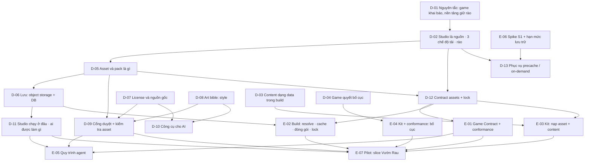

# Map — Asset Studio

Mọi item mà goal phụ thuộc, và cái gì chặn cái gì. Cạnh `A --> B` đọc là "quyết A trước B". Trạng thái nằm trên bảng
ở [PLAN.md](PLAN.md); trang này chỉ vẽ hình dạng.

## Items

| ID | Câu hỏi / thay đổi | Vì sao goal cần | Chặn |
|---|---|---|---|
| D-01 | Nguyên tắc chung: game khai báo mức phụ thuộc, nền tảng cung cấp và giữ rào | Mọi lựa chọn về asset đều dựa trên nó, và owner muốn dùng lại cho vấn đề khác | D-02 |
| D-02 | Studio là nguồn; game khoá version lúc build; ba chế độ tải theo pack; bốn rào | Đây là kiến trúc. Sai chỗ này thì phá ADR 0002, 0005, 0007 | D-05, D-12, D-13 |
| D-03 | Content (item, cây, quest, hội thoại) nằm ở đâu, nền tảng giúp gì | Game nhiều content cần data mở rộng được, agent viết được | E-03 |
| D-04 | Hướng màn hình và bố cục: ai quyết | Farming RPG cần chạy tốt ở cả dọc lẫn ngang | E-04 |
| D-05 | Đơn vị phát hành là gì (asset hay pack), có những loại nào, metadata, version, hash | Mọi công cụ, contract và kho lưu đều dựa trên mô hình này | D-06, D-09, D-12 |
| D-06 | Studio lưu asset và state ở đâu (repo, LFS, repo riêng, object storage + DB) | Repo public, có hạn mức LFS, và build cần tái lập được | D-11, E-02 |
| D-07 | Nhận license nào; ghi nguồn gốc ra sao; asset do AI tạo thì thế nào; asset của Tò He phát hành dưới license gì | Asset đã duyệt được phát hành công khai (bucket đọc công khai, build của game), nên phải có chính sách trước | D-09, D-10 |
| D-08 | Một style Tò He chung hay mỗi game, mỗi pack một style; art bible chứa gì | Đồng bộ style là điểm yếu nhất của AI tạo ảnh (R-01) | D-09, D-10 |
| D-09 | Duyệt theo tiêu chí gì; kiểm tra tự động nào ("conformance cho asset"). Ai duyệt và ở đâu thuộc D-11 | Trẻ em chơi; AI chỉ được tạo bản nháp | E-05, E-07 |
| D-10 | Công cụ cho AI: generator nào (ngân sách), hậu xử lý cố định, MCP `tohe-studio` | Owner muốn "các công cụ cho AI làm ra asset là chính" | — |
| D-11 | Studio chạy ở đâu; người, agent, CI mỗi bên được làm gì; duyệt ở đâu | State nằm trong DB nên duyệt không còn qua PR; agent không được ghi vào prod (`AGENTS.md:42`) | E-05, E-07 |
| D-12 | Field `assets` trong `game.json`, lock, và cách code game gọi asset (key có type) | Game "lựa và chọn" phải là một contract rõ ràng | E-01, E-02, E-03 |
| D-13 | Phục vụ `precache` / `on-demand` lúc chạy: đường dẫn, cache, hạn mức trên máy, nhãn của hub, xử lý lỗi | Đã thiết kế trong D-02, xây khi có điều kiện | — |
| E-01 | Game Contract: ADR, docs, schema `assets`, conformance; sửa luật "outside their folder" | Contract đổi thì phải có ADR, docs và conformance trong cùng PR (`AGENTS.md`) | E-05, E-07 |
| E-02 | `tools/games-host` hoặc plugin Vite: resolve pack qua manifest trên bucket, cache theo hash (dùng chung mọi worktree, CI cache, `--offline`), kiểm hash, đóng atlas, nén, ghi lock, tính `sizeBudgetKb` | Build hôm nay chỉ copy `dist/` (`tools/games-host/src/assemble.ts`) | E-07 |
| E-03 | `@tohe/game-kit`: nạp asset theo key có type; `content` (schema Zod, loader, kiểm tham chiếu) | Agent viết data thay vì sửa engine | E-07 |
| E-04 | Kit có helper bố cục (safe-area, hai bố cục); conformance chụp đúng hướng game khai báo (hôm nay chỉ 390×844) | D-04: nền tảng làm cho rẻ | E-07 |
| E-05 | `/new-game` có bước chốt style (D-08) và chọn nguyên liệu; có thể thêm skill `/new-asset`; `working-with-agents.md` | Agent là người dùng chính | — |
| E-06 | Chạy spike S1; đo hạn mức lưu trữ và việc iOS dọn dữ liệu | `precache` hứa offline, nên phải đo trước | D-13 |
| E-07 | Pilot: vertical slice Vườn Rau Mini trên Studio P0 | *Done when* 5 | — |

## Considered and left off

- **Gọi Studio lúc chạy theo kiểu "luôn lấy bản mới nhất"**: bỏ ở D-02. Bản đã duyệt sẽ tự đổi, replay lệch. Roblox
  cũng cấm tải asset từ xa lúc chạy (R-01).
- **Marketplace, asset trả phí**: nằm ở *Not this plan*.
- **Asset người chơi tải lên**: thuộc host `media.` (ADR 0042), không phải plan này.
- **Kho luật chơi và cơ chế game**: R-02 ghi lại các nguồn để `/new-game` tham khảo (E-05). Không xây kho riêng.
- **Nới giới hạn save 64 KB** (`docs/contracts/game-contract-v1.md:254`): chỉ xem lại khi pilot chạm tới (E-07).
- **Spike S3** (xoay màn hình trong iframe): đã nằm trong E-04, không tách thành item riêng.
