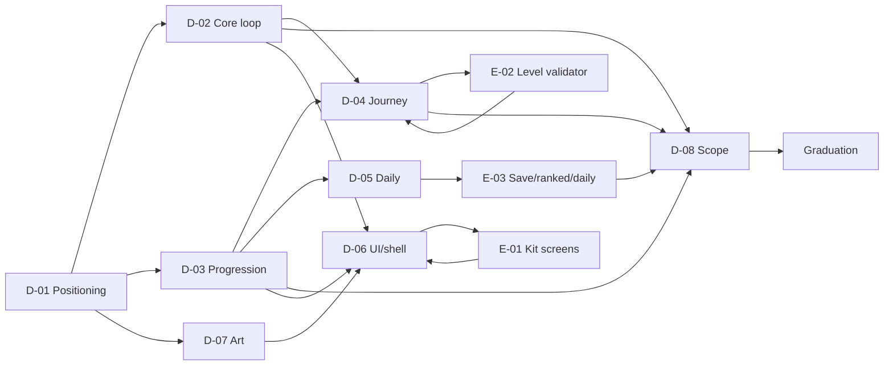

# Map — Lấp Ô

## The shape

## Edges (why)

- **D-01 first**: who it is for and what promise the UI/voice must carry. It changes D-02, D-03 and D-07.
- **D-02 before D-04/D-06/D-08**: journey goals and screens depend on the exact rules and assists.
- **D-03 before D-04/D-05/D-08**: the progression model decides whether levels, daily and ranks exist.
- **D-04 before E-02**: the validator needs level data and goals.
- **D-05 before E-03**: daily storage, seed and leaderboard depend on the daily rules.
- **D-06 before E-01**: the shell extension is driven by the journey/stats screens.
- **E-01/E-02/E-03 → D-08**: technical costs feed the scope decision.
- **D-08 last**: it cuts the plan into shippable PRs.

## Order of work

1. D-01, D-02, D-03 — owner decisions.
2. D-04, D-05, D-06, D-07 — parallel research/design.
3. E-01, E-02, E-03 — technical spikes.
4. D-08 — scope and phasing.
5. V0 — rewrite the spec; then V1/V2/V3.

## What the plan does not need

- A new engine, online rooms, a level editor, monetisation, a platform-wide achievement system. Noted in
  [log.md](log.md) if found.
