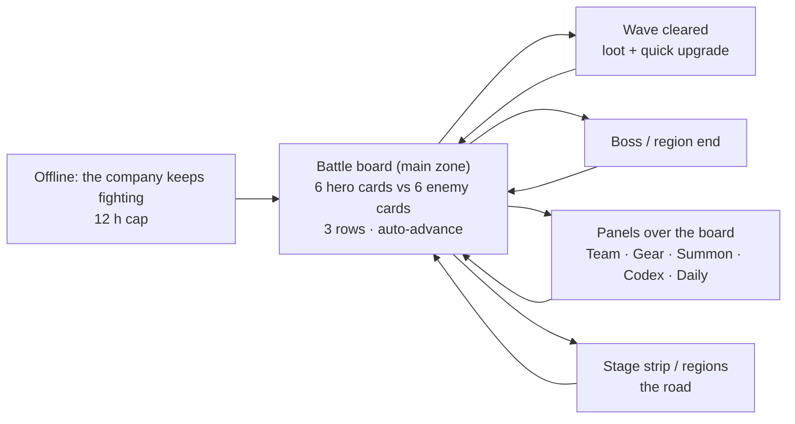

# Design — Vân Du Ký: first picture (v2, proposed)

This page **composes** the items into one picture. It decides nothing: every claim points at the item that decides it, and *(proposed)* marks an item not yet `decided`. Date: 2026-11-09.

## Short answer: how complete is it?

**Decided:** the game is **Vân Du Ký**, a **roaming company** with **no home**; the **main zone is the battle board**; **6 hero cards in 3 rows** (front/mid/back) vs 6 enemy cards; **round-based auto** with auto normal attacks + auto-cast skills and a manual toggle; **card-on-board** visuals, **dark-first**; **company level + star + gear** progression; **4 regions × 12 stages (48)**, 16 heroes, 16 enemies, 4 bosses; **offline combat**; **light daily**; **SFX only**; the platform extension package is **P0** (persistent shell, on-demand assets, 256 KB save, E-03 FX player). **Open:** the summon/economy model (D-07). The brief is deferred by the owner; the plan is at Resolve → Converge.

## 1. The picture

There is no home screen. The board is the app; the stage strip is the road; the panels are the systems.

**Wireframe v1:** [board-v1.html](wireframes/board-v1.html) — history (one row of four).
**Wireframe v2:** [board-v2.html](wireframes/board-v2.html) — history (2×2 per side).
**Wireframe v3:** [board-v3.html](wireframes/board-v3.html) — current: **3 rows / 6 heroes**, card-on-board, dark-first; board, formation sheet, stage preview, boss board.

## 2. The pieces, the standard behind each, and where each lives

| Piece | Does | Standard / prior art | Lives in | Item |
|---|---|---|---|---|
| **Battle board** | 6 hero cards vs 6 enemy cards, 3 rows (front/mid/back); auto-advance; turn rail; card clash effects | Legend of Mushroom's always-on action + a card board | Play stage, full screen | D-01, D-04, D-05 |
| **Regions** | 4 regions × 12 stages; 4 bosses; 16 heroes, 16 enemies | AFK campaign + Legend of Mushroom waves | Board + stage strip | D-09 |
| **FX layer** | pixelfx sprite sheets + act timing; hit-stop/shake/push | Card clash + E-03 player | Phaser board | D-03, E-03 |
| **Audio** | SFX only; no music | Kit `createSfx` + haptics | Board/sheets | D-15 |
| **Wave / stage** | Waves, loot, auto-advance, stop/farm, region end | AFK campaign + Legend of Mushroom waves | Top strip + board | D-09 |
| **Boss** | Every N stages / region end; phases, telegraphs, bigger reward | AFK bosses, Summoners War | Board | D-09 |
| **Panels** | Team, hero detail, gear, summon, codex, daily, records | Mobile RPG sheets over the action | Sheets over the board | D-12 |
| **Offline return** | The company keeps fighting while away; 12 h cap; a summary card | AFK idle chest | Card on first open | D-07 |
| **Codex** | Hero/enemy/region entries, bonds, company rank, records | Collection meta | Panel | D-08 |
| **Summon** | Earned pulls, visible pity, duplicates → shards | AFK's generous gacha, without money | Panel | D-07 |
| **Daily** | 3 tasks, 1 expedition, 1 boss; no energy, no streak punishment | AFK's flexible dailies | Panel + badge | D-10 |
| **Settings / credits** | Sound, theme, language, asset credits | Game Contract + kit | Menu stage | D-17 |

## 3. The main flows

### First 10 minutes

1. Title screen ("Đoàn Thám Hiểm", *Chơi*) → a short how-to (one card, one screen).
2. The board opens mid-fight: 4 starting guardians vs a wave; auto-cast on; the player watches the first clash.
3. Turn auto-cast off for one skill, tap the skill, see the cut-in; turn it back on.
4. Win; loot flies in; a "Nâng cấp" badge appears; tap it, upgrade a hero/gear; the board resumes.
5. Stage 1-4: the first "recommended power" wall; the loss card suggests team/gear/tower, not a paywall.
6. First summon: enough shards for one pull; a guaranteed Rare; the new hero can join the team.

### A daily return (5–10 min)

1. Open the app: the offline card says what the company farmed; collect.
2. The board resumes at the highest stage; auto-advance is on; watch or fast-forward.
3. Daily badge: claim 3 tasks, send the expedition, hit the boss.
4. Spend gold/essence; upgrade gear/star; close.

### The first wall (day 2–3)

1. The board loses a wave; the stage strip shows "Vùng 2 · 3/12" and the recommended power.
2. The loss card suggests: "Đổi đội hình", "Nâng gear", "Thử tháp" — three free paths.
3. The player farms the highest cleared stage with auto ×3, upgrades gear, changes the front row, and wins.
4. No energy, no timer, no "watch an ad to continue".

## 4. Still open

- **D-07** — economy details: summon/gacha model, currency rates, pity, duplicate value, offline rate.
- **Brief** — the owner deferred confirmation; graduation waits for it.
- **D-16** — the exact 16/16/4 roster and the 7-day event are proposed; owner can adjust.

## 5. Known risks without an answer yet

| Risk | Where it will be answered |
|---|---|
| Board clutter: 12 cards + turn rail + boss bar + dock on 360×640 | D-12, with wireframes tested at that size |
| Scope grew to 4 regions / 16 heroes / 4 bosses | D-16; the sim and content tests gate art lock |
| Battery/heat: continuous animation | D-12/D-13, with an idle mode that animates less |
| Auto-advance frustration: the board walks into a loss | D-09, with a "Dừng" control and a clear wall state |
| No home: no quiet place, no long-term sink outside gear/stars | D-08, via codex/bonds/company rank |
| Balance: one week collapses into one day, or walls are too hard | D-06/D-07/D-11, with a simulation |
| Art cost: 16 hero cards + 16 enemies + 4 bosses + 4 regions | D-13/D-11, with a frame budget and reuse |
| Platform drift: P0 delays the game | D-17, with a timeboxed P0 |
| Shell mismatch: a persistent world is not a "run" | E-01, part of P0 |
| "Calm" vs "deep": the owner wants both | D-01/D-04, via playtest |
