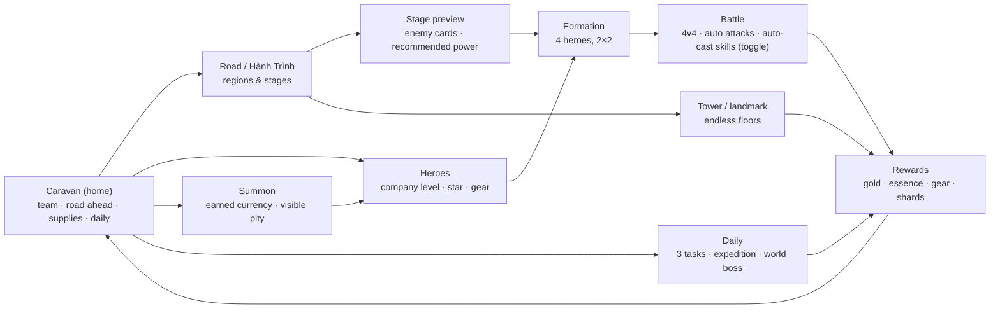

# Design — RPG thẻ bài treo máy: first picture (v1, proposed)

This page **composes** the items into one picture. It decides nothing: every claim points at the item that decides it, and *(proposed)* marks an item not yet `decided`. Date: 2026-11-09.

## Short answer: how complete is it?

**Decided:** the game is a **roaming company (Đoàn Thám Hiểm)**, not a village; 4 heroes; auto normal attacks + auto-cast skills with a manual toggle; the platform will be extended before the game is squeezed into today's limits. **Open:** the platform extension package (D-17), the battle timing (D-04), and every system that follows. Everything below is a **working proposal** to make the discussion concrete.

## 1. The picture

## 2. The pieces, the standard behind each, and where each lives

| Piece | Does | Standard / prior art | Lives in | Item |
|---|---|---|---|---|
| **Caravan** | Home: the company, the road ahead, the idle supplies chest, the daily summary | AFK's idle chest + a travelling home | Play stage, first tab | D-01, D-08 |
| **Road** | 3 regions × 12 stages; each stage a wave/round puzzle | Summoners War scenario, AFK campaign | Play stage, tab 2 | D-09 |
| **Battle** | 4v4, auto attacks, auto-cast skills with a manual toggle; 20–40 s | AFK + Summoners War | Phaser scene in play stage | D-04 |
| **Heroes** | Roster, hero detail, star, gear, skills, bonds | Summoners War monsters, AFK heroes | Play stage, tab 3 | D-05, D-06 |
| **Summon** | Earned pulls, visible pity, duplicates → shards | AFK's generous gacha, without money | Play stage, tab 4 | D-07 |
| **Daily** | 3 tasks, 1 expedition, 1 boss; no energy, no streak punishment | AFK's flexible dailies | Caravan + a daily screen | D-10 |
| **Tower** | Endless floors at a landmark on the road | AFK King's Tower | Road sub-screen | D-09 |
| **Codex** | Hero/enemy/region entries, bonds, company rank, local records | Collection meta | More menu | D-08 |
| **Settings / credits** | Sound, theme, language, asset credits | Game Contract + kit | Menu stage | D-02, D-13 |

## 3. The main flows

### First 10 minutes

1. Title screen ("Đoàn Thám Hiểm", *Chơi*) → a short how-to (one card, one screen).
2. Caravan: the company's 4 starting guardians, a small supply chest, the first road region one tap away.
3. Stage 1-1: auto-battle; the player watches the first skill auto-cast, then turns auto-cast off for one manual cast; win; gold/gear.
4. Hero screen: company level up, equip the first gear, see the power go up.
5. Stage 1-2 → 1-4: the first "recommended power" wall; the game points to gear/star, not a paywall.
6. First summon: enough shards for one pull; a guaranteed Rare; the new hero can join the team.

### A daily return (5–10 min)

1. Caravan: collect the 12 h supplies; read a one-line "while you were away" summary.
2. Daily: claim 3 tasks (clear 3 stages, upgrade gear once, summon once); collect the expedition.
3. Push 1–3 stages or retry the wall; auto ×3 if farming.
4. Spend gold/essence; upgrade a hero/gear; close.

### The first wall (day 2–3)

1. Stage preview says "recommended power 1,450 · your team 1,280".
2. The loss card suggests: "Đổi đội hình", "Nâng gear", "Thử tháp" — three free paths.
3. The player farms the highest cleared stage with auto ×3, upgrades gear, changes the front row, and wins.
4. No energy, no timer, no "watch an ad to continue".

## 4. Still open

- **D-17** — the platform extension package (A: shell/assets/save/music; B: + content packs).
- **D-04** — battle timing: round-based auto (recommended) vs real-time auto.
- **D-05** — roles, elements, rarity, gear slots, skills, bonds (team size 4 is decided).
- **D-06** — company level vs individual levels; 3 axes; no prestige in v1.
- **D-07** — no gacha vs earned gacha vs hybrid; pity; duplicate value; one idle source.
- **D-08** — no base; codex/bonds/company rank; how much caravan is visible.
- **D-09** — 3 regions vs endless; modes; stage schema.
- **D-10** — daily weight; no streak punishment.
- **D-11** — content pipeline and balance simulation.
- **D-12** — 4 tabs vs 5; screen map; wireframes.
- **D-13** — card-on-board vs sprite vs hybrid; dark-first vs both themes.
- **D-14** — name, world, factions, tone, lore hooks.
- **D-15** — audio/haptics; music or SFX only.
- **D-16** — v1 scope, milestones, what is deliberately out.

## 5. Known risks without an answer yet

| Risk | Where it will be answered |
|---|---|
| Platform drift: the extension program delays the game indefinitely | D-17, with a timeboxed P0 |
| Scope creep: the genre pulls toward 8–11 systems | D-16, with a hard v1 list |
| Balance: one week collapses into one day, or walls are too hard | D-06/D-07/D-11, with a simulation |
| Art cost: 12 heroes × 12 frames + 12 enemies + 3 bosses | D-13/D-11, with a frame budget and reuse plan |
| Shell mismatch: a persistent world is not a "run" | E-01, part of D-17 |
| Phone readability: 4 cards + turn rail + boss bar on 360 px | D-12, with wireframes tested at 360×640 |
| Retention without FOMO: no energy, no streaks, no ads | D-10, with a light daily and a 7-day journey |
| No base: where the "farm"/home feeling comes from | D-08, via gear/stage farming + caravan cosmetics + company rank |
| "Calm" vs "deep": the owner wants both | D-01/D-04, via playtest |
