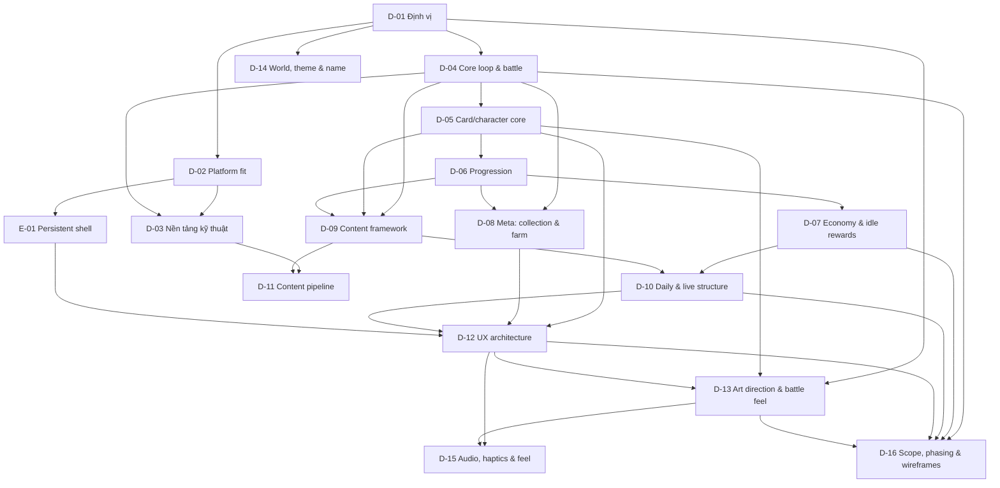

# Map — RPG thẻ bài treo máy

Mỗi item là một quyết định mà mục tiêu phụ thuộc vào, cùng thứ tự phụ thuộc. Cạnh `A --> B` đọc là "quyết A trước B". Trạng thái nằm ở [PLAN.md](PLAN.md); trang này giữ hình dạng của plan.

## Items

| ID | Câu hỏi / thay đổi | Vì sao mục tiêu cần | Blocks |
|---|---|---|---|
| D-01 | Game dành cho ai, lời hứa một câu, một phiên chơi dài bao lâu, "treo máy" nghĩa là gì, vì sao mở lại ngày mai? | Mọi lựa chọn battle, progression, UX và art đều bám vào đây | D-02, D-04, D-13, D-14 |
| D-02 | Game này sống được trong giới hạn Tò He (64 KB save, build budget, offline, không server logic) hay cần thay đổi nền tảng? | Quyết định trước khi thiết kế hệ thống để không vẽ ra thứ không chạy được | D-03, E-01 |
| D-03 | Engine/render (Phaser, DOM/React, hybrid), cách tách logic/view, save schema & migration, dữ liệu nội dung | Là nền để làm game lớn, nhiều nội dung, sửa lâu dài | D-11 |
| D-04 | Vòng lặp chính: idle auto-battle hay có lớp active? Trận kéo dài bao lâu? Thắng/thua/thử lại thế nào? | Là trục gameplay; quyết trước mọi hệ thống khác | D-03, D-05, D-08, D-09, D-16 |
| D-05 | Nhân vật là thẻ: vai trò, hệ, rarity, kỹ năng, đội hình, cách thẻ tương tác | Là đơn vị nội dung và sức mạnh; quyết định độ sâu của battle | D-06, D-09, D-12, D-13 |
| D-06 | Các trục phát triển (level, sao, gear, skill, account level…), đường cong và cảm giác mạnh lên | Là điểm mạnh chính theo yêu cầu của owner | D-07, D-08, D-09 |
| D-07 | Nguồn/thu nhập tiền tệ, chỗ tiêu, phần thưởng offline, cap và nhịp tiến trình | Quyết định game có "đã" khi quay lại hay không, và có bị grind vô nghĩa | D-10, D-16 |
| D-08 | Lớp meta ngoài trận: bộ sưu tập, farm/base, sưu tầm, nhiệm vụ dài hạn | Tạo lý do quay lại ngoài màn đánh; là chỗ mở rộng nội dung | D-12 |
| D-09 | Khung nội dung: chương/stage, dungeon, boss, sự kiện, chế độ phụ; schema dữ liệu | Để thêm nội dung hàng tháng mà không sửa core | D-10, D-11, D-16 |
| D-10 | Nhịp hằng ngày: nhiệm vụ, daily, offline return, streak không gây áp lực; có live/event không | Quyết định retention và cách game tôn trọng thời gian người chơi | D-12, D-16 |
| D-11 | Cách viết/thêm hero, stage, event: data-driven, validate, balance sim, asset packs | Là điều kiện để "nội dung mở rộng được" — mục tiêu cốt lõi | — |
| D-12 | Screen map, navigation, information architecture, bố cục từng màn, luồng một tay | Biến hệ thống thành sản phẩm dùng được; đầu ra wireframe | D-13, D-15, D-16 |
| D-13 | Art direction: thẻ, chibi/anime, khung thẻ, animation, hiệu ứng va chạm, damage number, readability | Là yêu cầu trực tiếp của owner và quyết định pipeline asset | D-15, D-16 |
| D-14 | Thế giới, thème, tên game, tông kể chuyện; mức dân gian Việt hay fantasy gốc | Tạo bản sắc và chất liệu cho hero/quái/nội dung | — |
| D-15 | Âm thanh, haptics, rung/feedback khi đánh, không khí | Hoàn thiện cảm giác "sát thương có sức nặng" trên phone | D-16 |
| D-16 | v1 gồm gì, bao nhiêu nội dung, thứ tự build, bộ wireframe giao cho implementation | Chốt phạm vi để plan graduate được, không mở vô hạn | — |
| E-01 | Thêm `persistent` vào shell của game-kit: bỏ "Ván mới", giữ Chơi tiếp/Menu chính | Một RPG là thế giới persistent, không phải một ván; shell hiện tại sẽ hiện nút reset sai | D-12 |

## Considered and left off

- **Real-time PvP / arena đồng bộ**: nền tảng chỉ có rooms turn-based; idle RPG không cần. Nếu sau này muốn async arena, đó là item mới.
- **Chat, guild, social feed**: ngoài non-goals của Tò He.
- **Monetization, energy gate, gacha bằng tiền thật**: bị cấm bởi vision; mọi cơ chế summon phải dùng tiền tệ kiếm trong game.
- **Native app / 3D**: PWA + 2D là đủ và phù hợp giới hạn build.
- **Server-authoritative battle**: không cần cho single-player; save/score đi qua hub.
- **Kịch bản chi tiết từng chương**: plan chốt khung; nội dung cụ thể viết ở giai đoạn sau.
