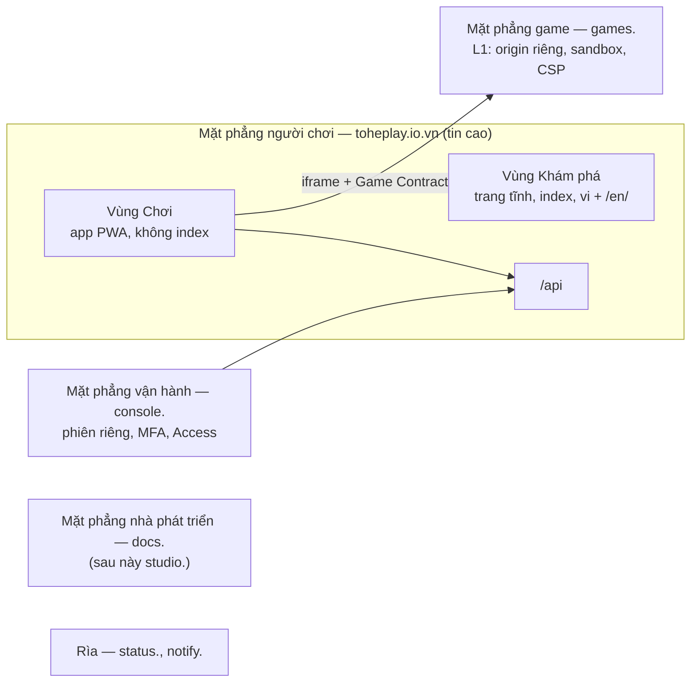
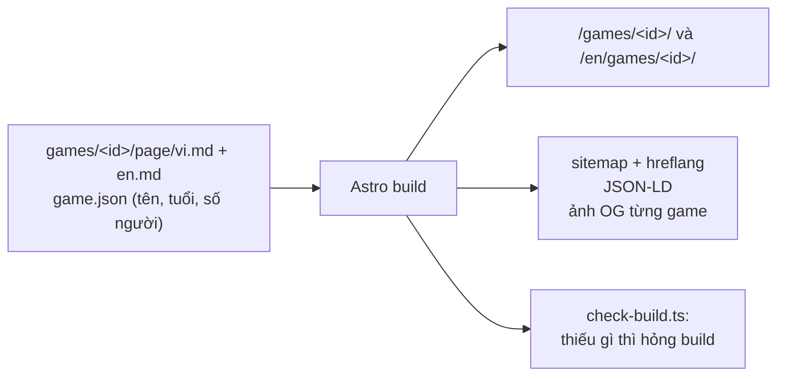

# Design — Review trước launch: bề mặt sản phẩm (v1, đợt 1 đã quyết)

Trang này **ghép** các item thành một bức tranh. Nó không quyết gì: mỗi ý chỉ về item đã quyết nó. Item nào đổi, sửa
trang này trong cùng phiên. Ngày: 2026-10-22.

## Ngắn gọn: đã chốt tới đâu?

Mọi quyết định của **đợt 1** đã chốt: D-01, D-02, D-04, D-05, D-06. Hai điểm owner duyệt lần cuối trong ADR:

- các câu phụ của D-02 (tên ba mục, bỏ redirect ở `/`, PIN cho link ra ngoài, bỏ khoá màn dọc);
- "cập nhật êm" của D-04.

Còn mở: cách rà màn (Q3 của brief, đợt 2).

## 1. Mặt phẳng — ai ở đâu, tin tới đâu ([D-05](items/D-05-hosts-and-paths.md))

- Host theo ranh giới tin cậy; một domain; giữ bố cục của ADR 0042.
- **Game ở L1**: game do owner thêm vào repo. **Luật leo thang**: trước game đầu tiên không do owner thêm, owner chọn L2
  (domain riêng) hay L3 (mỗi game một site) — backlog PB-14.

## 2. Hai vùng của mặt phẳng người chơi ([D-02](items/D-02-layout.md))

| Vùng | Đường dẫn | Cho ai | Index |
|---|---|---|---|
| **Khám phá** | `/` · `/games/` · `/games/<id>/` · `/games/c/<slug>/` (từ ~8 game) · `/guides/…` · `/faq/` · `/about/` · `/promise/` · `/terms/` · `/privacy/` — và bản `/en/…` | người lạ, bố mẹ | có |
| **Chơi** | `/play` (Trò chơi) · `/together` (Chơi cùng) · `/account` (Tôi) · `/play/<id>` (đang chơi) · `/play/<id>/rooms/…` · `/s/…` · `/r/…` | người đang chơi | không |

- **Một game hai URL, vai rõ**: `/games/<id>/` là trang của game (nút Chơi ở đầu); `/play/<id>` là chỗ chơi.
- **Đường nối hai chiều**: trang công khai có "Chơi ngay", "Chơi tiếp" và VI | EN; trong app, Tôi → Trợ giúp và giới
  thiệu, Giấy tờ.
- `/` **không còn chuyển** người quay lại; app đã cài mở `/play`.

## 3. Khung app ([D-02](items/D-02-layout.md), [D-04](items/D-04-coming-back.md))

| | Điện thoại | Máy tính, tablet |
|---|---|---|
| Điều hướng | thanh dưới: **Trò chơi · Chơi cùng · Tôi** | rail trái, cùng ba mục |
| Nội dung | một cột | danh mục 4–6 cột, rộng tối đa ~1200px |
| Đang chơi | không khung, game toàn màn hình | như điện thoại |

- **Trò chơi**: người đang chơi (+ Đổi) → bàn đang ngồi → lời mời → chơi tiếp → gần đây → mọi trò chơi.
- **Chơi cùng**: ô nhập mã → bàn của bạn → lời mời tới bạn → link bạn đã gửi.
- **Tôi**: hồ sơ và đổi người chơi; cài đặt (ngôn ngữ, giao diện, âm thanh); cài app; trợ giúp; góp ý; giấy tờ; tài khoản.
- **Máy dùng chung**: "Ai đang chơi?" một chạm sau 30 phút không dùng nếu máy có nhiều hồ sơ; trẻ → người lớn cần mã quản lý;
  link ra khỏi Tò He với hồ sơ trẻ cũng cần mã quản lý.
- **Phiên hết hạn** thì nói ra. **Cập nhật êm**: bản mới chờ lần mở lạnh, không bao giờ cắt ngang lúc chơi.
- **Link khi đã cài**: `launch_handler`; trên iPhone, trang lối vào chỉ cách "Mở app → Nhập mã".
- Bỏ khoá màn dọc của app; mỗi game tự khai báo hướng màn.
- Không chuỗi ngày có phạt, không đếm ngược, không câu gây áy náy.

## 4. Ngôn ngữ ([D-01](items/D-01-languages.md))

- **Tiếng Việt là mặt chính**, tiếng Anh hỗ trợ; tên riêng và thuật ngữ giữ tiếng Anh khi chính xác hơn.
- **Trang công khai**: vi ở `/`, en ở `/en/`, `x-default` → `/en/`; `hreflang` trong sitemap; nút VI | EN; gợi ý, không tự
  chuyển.
- **App**: cài đặt → ngôn ngữ của lối vào → trình duyệt (`vi` → vi, khác → en) → vi. Link mời không mang ngôn ngữ; thẻ xem
  trước theo người tạo link.
- **Tên game**: `name` là tên chuẩn, bắt buộc; `names.vi` tuỳ chọn (đổi Game Contract).
- **Điều khoản**: bản vi gốc, bản en dịch; "áp dụng bản có lợi hơn cho người dùng" khi lệch.
- Console tiếng Anh (PB-12); docs tiếng Anh.

## 5. Bề mặt giới thiệu ([D-06](items/D-06-introduction-surface.md))

- **Một nguồn cho mỗi game**; thêm game = một PR tự đủ; `/new-game` viết hai file trang.
- **Trang game**: nút Chơi và Chơi cùng bạn ở đầu; câu trả lời ngay; **bảng sự thật** (tuổi, số người, một ván bao lâu,
  offline, quảng cáo: không, dữ liệu thu: không); cách chơi; ảnh.
- **Trang chủ**: danh mục trước; "Không quảng cáo · Không cần tài khoản · Chơi ngay". **Lời hứa** `/promise/`.
- **GEO**: chữ rõ, có ngày, có bảng; cho phép rõ bot tìm kiếm của AI, chặn rõ bot chỉ để huấn luyện; `llms.txt` giữ.
- **Mở rộng**: ~8 game có bộ sưu tập; ~30 game có tìm kiếm tĩnh; ~100 game có sitemap theo ngôn ngữ. Trang theo nhu cầu
  tìm kiếm chỉ khi ≥ 3 game hợp và chữ thật.

## 6. Còn mở

- Q3 của brief: cách rà màn (đợt 2, E-02).

## 7. Rủi ro chưa có câu trả lời

- iPhone và Safari chưa thử cho cập nhật êm và `launch_handler` — thử ở vòng thiết bị của owner sau khi build.
- `Origin-Agent-Cluster` chưa kiểm mức hỗ trợ của trình duyệt (PB-13).
- Luật BVQLNTD 2023 mới đọc qua trang tổng hợp — đọc văn bản gốc trước khi chốt Điều khoản (E-05).
