# D-02 — Bố cục các trang và app: Tò He nên được sắp thế nào?

- Status: **proposed** (agent, 2026-10-22)
- Kind: decision
- Blocks: E-02 (rà màn), D-01 (namespace `/en/`) · Blocked by: — · Đi cùng: [D-01](D-01-languages.md)
- Decided: —

## Why it matters

Owner (2026-10-22, gõ không dấu): "toi chua hinh dung dc trang gioi thieu vao tu dau" và "tap trung dive research ve bo
cuc cac screen/app cho toi 1 giai phap hien dai, toi uu cho nhu cau cua san pham ta, ta chua launch gi ca nen gia rat re
ta co the thoai mai upgrade/change nha". Đổi bố cục trước khi có người ngoài và trước khi Google index nhiều là rẻ nhất.

## What is true today

Từ [R-01](../research/R-01-pages-and-ways-in.md) và kiểm kê code ngày 2026-10-22:

1. **Hai cửa chính, không nối với nhau.** `/` là trang giới thiệu; máy đã từng chơi bị chuyển sang `/play` trước khi
   trang kịp hiện (`apps/web/src/scripts/returning.js:12-15`). Từ app không có đường ra Giới thiệu, Hỏi đáp, Hướng dẫn,
   trang game; chỉ có `/terms` và `/privacy` trong ô đồng ý.
2. **App không có khung.** Route gốc là một `<Outlet/>` trống (`apps/hub/src/router.tsx:25-27`); mỗi trang tự vẽ header;
   không có thanh điều hướng. Menu là một bottom sheet bốn mục: Nhập mã, Link chia sẻ, Cài app, Góp ý
   (`apps/hub/src/ui/MenuButton.tsx`). Nút giao diện chỉ có ở danh mục.
3. **Hai danh mục, hai trang cho một game, vai không rõ.** Danh mục tĩnh `/games/` và danh mục của app `/play` (một lưới
   phẳng 2–3 cột, `CatalogPage.tsx:92`); trang game `/games/<id>` (SEO, nút "Chơi ngay") và `/play/<id>` (chơi).
4. **Máy tính chỉ là một cột giữa.** `Screen` rộng tối đa `max-w-3xl`, hầu hết màn dùng `max-w-md`
   (`apps/hub/src/ui/Screen.tsx:8-12`); không có bố cục riêng cho máy tính. App đã cài bị khoá màn dọc
   (`orientation: portrait`, `apps/hub/vite.config.ts`), trong khi mỗi game đã tự khai báo hướng màn trong `game.json`.
5. **Chơi cùng nhau bị chia vụn.** Bàn chơi chỉ vào được qua từng game (`/play/<id>/rooms`); "Nhập mã" và "Link của tôi"
   nằm trong menu; API đã có `GET /api/rooms/mine` và `GET /api/rooms/invites` nhưng chưa màn nào gom chúng lại.
6. **Ngôn ngữ**: app theo ngôn ngữ trình duyệt, không có nút đổi; trang công khai chỉ có tiếng Việt (xem D-01).
7. **Giữ được**: host theo ranh giới tin cậy (ADR 0042: `console.`, `games.`, `docs.`); game chạy toàn màn hình trong
   iframe, tự lo đường ra khi là game `shell` (ADR 0020); đường ống lối vào cho `/s`, `/r` (ADR 0044, 0045).

Sản phẩm cần (brief, Phase 1): người lạ từ Google cần trang tĩnh, nhanh, mỗi game một trang, hai ngôn ngữ. Người được rủ
qua Zalo cần vào thẳng game hoặc bàn (đã có). Người quay lại, đa số dùng app đã cài trên điện thoại, cần "chơi tiếp", bàn
của mình và lời mời. Trẻ em cần ô to, ít chữ, còn link ra ngoài và giấy tờ để ở chỗ của người lớn. Không quảng cáo, không
script bên thứ ba ([R-02](../research/R-02-layout-prior-art.md)).

## Options

### A — Nối cầu: giữ bố cục, thêm đường nối

Thêm mục Trợ giúp và Giới thiệu vào menu của app, thêm `/en/` cho trang công khai, thêm nút đổi ngôn ngữ.

- **Cái giá**: nhỏ, khoảng 1–2 PR.
- **Không sửa**: 2 (app không khung), 3 (vai của hai danh mục), 4 (máy tính), 5 (chơi cùng vụn).

### B — Hai vùng, một khung *(đề xuất)*

Chia theo việc người ta đến để làm: **Khám phá** (trang tĩnh, được index, hai ngôn ngữ) và **Chơi** (app, không index).
Hai vùng dùng chung một kiểu khung, và có đường nối hai chiều.

- **Cái giá**: trung bình, khoảng 4 PR và một ADR (dưới đây).
- **Giữ nguyên**: Astro, React app, host, đường ống lối vào.

### C — App là website

Một React app prerender mọi trang công khai; bỏ Astro.

- **Được**: một khung tuyệt đối, chuyển trang mượt.
- **Cái giá**:
  - viết lại toàn bộ trang công khai;
  - trang công khai phải tải JS của app, nên chậm hơn cho SEO, và mất CSP `connect-src 'none'` của trang công khai;
  - prerender cộng service worker phức tạp hơn.
- **Lợi thêm so với B**: nhỏ. Không đáng lúc này.

## Recommendation

**B — hai vùng, một khung.**

### Hai vùng

| Vùng | Đường dẫn | Cho ai | Làm bằng | Index |
|---|---|---|---|---|

```mermaid
flowchart LR
  subgraph K["Khám phá — tĩnh, index, vi + /en/"]
    home["/ danh mục trước, giới thiệu sau"]
    gp["/games/&lt;id&gt; trang của game"]
    help["/guides · /faq · /about"]
    legal["/terms · /privacy"]
  end
  subgraph C["Chơi — app, noindex"]
    tg["/play — Trò chơi"]
    tc["/together — Chơi cùng"]
    me["/account — Tôi"]
    play["/play/&lt;id&gt; đang chơi"]
  end
  google[Google / Bing] --> home & gp
  pwa[App đã cài] --> tg
  link["/s/… · /r/… từ Zalo, Messenger"] --> play
  home -- "Chơi ngay · Chơi tiếp" --> tg
  gp -- "Chơi" --> play
  tg --> play
  tc --> play
  me -- "Trợ giúp và giới thiệu" --> help
  me -- "Giấy tờ" --> legal
```

| **Khám phá** | `/` · `/games/` · `/games/<id>` · `/guides/…` · `/faq/` · `/about/` · `/terms/` · `/privacy/` — và bản tiếng Anh dưới `/en/…` (D-01) | người lạ, người tìm hiểu, bố mẹ | Astro tĩnh | có |
| **Chơi** | `/play` (Trò chơi) · `/together` (Chơi cùng, **mới**) · `/account` (Tôi) · `/play/<id>` (đang chơi) · `/play/<id>/rooms/…` · `/s/…` · `/r/…` | người đang chơi | React app | không |



### Thay đổi, theo thứ tự quan trọng

1. **App có khung** — một layout route bọc mọi màn của vùng Chơi, trừ lúc đang chơi:
   - **Điện thoại: thanh dưới ba mục có nhãn.**
     - **Trò chơi** (`/play`): chơi tiếp, game của bạn, mọi game.
     - **Chơi cùng** (`/together`): ô nhập mã, bàn đang mở của bạn (`/rooms/mine`), lời mời tới bạn (`/rooms/invites`),
       link bạn đã gửi (hôm nay là `/account/links`).
     - **Tôi** (`/account`): hồ sơ và đổi người chơi; cài đặt (ngôn ngữ, giao diện, âm thanh); cài app; Trợ giúp và giới
       thiệu; Góp ý; Giấy tờ; tài khoản.
   - **Máy tính, tablet**: cùng ba mục ở **rail trái**. Danh mục 4–6 cột, nội dung rộng tối đa khoảng 1200px. Màn form
     (đăng nhập, tạo hồ sơ) vẫn hẹp.
   - **Đầu trang**: tên mục và avatar của người đang chơi (chạm để đổi người chơi).
   - **Đang chơi**: không có khung. Game toàn màn hình như hôm nay (ADR 0020). Mỗi tầng (đang chơi, bàn, app) là một mục
     lịch sử, để nút back của Android lùi đúng một tầng.
   - Menu bottom sheet bỏ đi; bốn mục của nó về đúng chỗ (Nhập mã, Link → Chơi cùng; Cài app, Góp ý → Tôi).
   - Người quay lại thấy gì ở mục Trò chơi, máy dùng chung, cập nhật, link khi đã cài: [D-04](D-04-coming-back.md).
2. **`/` là danh mục trước, giới thiệu sau** (như Poki, CrazyGames):
   - ngay đầu trang là lưới game ô to, một dòng "Tò He là gì" và nút "Chơi ngay";
   - dưới đó là chơi cùng bạn bè, cài app, hỏi đáp, câu chuyện.
3. **Bỏ việc chuyển người quay lại khỏi `/`.**
   - Thay bằng nút **"Chơi tiếp →"** ở đầu trang, hiện khi máy đã từng chơi. Vẫn là một script nhỏ, cùng cách đọc
     localStorage như hôm nay; trang thì vẫn một.
   - App đã cài vẫn mở `/play` (`start_url`).
   - Lý do: một link tới `/` luôn mở được trang, và người quay lại vẫn đọc được Hỏi đáp. Redirect không sai với Google
     ([R-02](../research/R-02-layout-prior-art.md) §3); nó chỉ có hại cho người dùng.
4. **Một game, hai URL, vai rõ ràng.**
   - `/games/<id>` là **trang của game**: đầu trang là hình, tên, nút "Chơi" to và nút "Chơi cùng bạn"; dưới là cách chơi,
     hợp với ai, game khác. Trang này được index.
   - `/play/<id>` là **chỗ chơi**: toàn màn hình, không index.
   - Ô game trong danh mục tĩnh dẫn tới trang của game; ô game trong app vào chơi luôn.
5. **Đường nối hai chiều.**
   - Vùng Khám phá: header gọn với logo, nút VI/EN và nút "Chơi ngay"; trên điện thoại nút này luôn nhìn thấy.
   - Vùng Chơi: "Tôi → Trợ giúp và giới thiệu" dẫn ra Hướng dẫn, Hỏi đáp, Giới thiệu; "Tôi → Giấy tờ" dẫn ra Điều khoản,
     Quyền riêng tư.
   - Cùng logo, cùng token màu, cùng kiểu chữ ở cả hai vùng.
6. **Chỗ của người lớn.**
   - Link ra khỏi Tò He (docs, GitHub, thư) chỉ ở "Tôi" và ở chân trang công khai.
   - Với **hồ sơ trẻ em**, mở link ra ngoài cần mã quản lý của bố mẹ (PIN đã có), theo tinh thần Apple 1.3 (R-02 §5).
7. **Bỏ khoá màn dọc của app** (`orientation` trong manifest của hub), để tablet và máy tính xoay được. Mỗi game tự khai
   báo hướng màn trong `game.json` như hôm nay. Phase 1 E-03 Q3 đã để câu này "xem lại ở Phase 3".

### Phác thảo

```text
Điện thoại — Trò chơi                 Máy tính — Trò chơi
┌──────────────────────────┐          ┌────────┬──────────────────────────────────────────┐
│ Trò chơi            (🐱) │          │ Tò He  │ Trò chơi                            (🐱) │
├──────────────────────────┤          │        ├──────────────────────────────────────────┤
│ Chơi tiếp                │          │ 🎮 Trò │ Chơi tiếp                                │
│ ┌──────────────────────┐ │          │   chơi │ ┌──────────────┐ ┌──────────────┐        │
│ │ Ghép Khối · 1.240 đ ▶│ │          │ 👥 Chơi│ │ Ghép Khối  ▶ │ │ Tiến Lên   ▶ │        │
│ └──────────────────────┘ │          │   cùng │ └──────────────┘ └──────────────┘        │
│ Mọi trò chơi             │          │ 🙂 Tôi │ Mọi trò chơi                             │
│ ┌─────────┐ ┌─────────┐  │          │        │ ┌────┐ ┌────┐ ┌────┐ ┌────┐ ┌────┐ ┌────┐│
│ │  Ghép   │ │  Tiến   │  │          │        │ │    │ │    │ │    │ │    │ │    │ │    ││
│ │  Khối   │ │  Lên    │  │          │        │ └────┘ └────┘ └────┘ └────┘ └────┘ └────┘│
│ └─────────┘ └─────────┘  │          │        │                                          │
├──────────────────────────┤          └────────┴──────────────────────────────────────────┘
│ Trò chơi │Chơi cùng│ Tôi │
└──────────────────────────┘

Điện thoại — Chơi cùng                Điện thoại — / (người lạ)
┌──────────────────────────┐          ┌──────────────────────────┐
│ Chơi cùng           (🐱) │          │ Tò He  VI|EN [Chơi ngay] │
├──────────────────────────┤          ├──────────────────────────┤
│ [ Nhập mã bàn / link   ] │          │ Game nhỏ cho cả nhà —    │
│ Bàn của bạn              │          │ không quảng cáo.         │
│  • Tiến Lên 3/4 · 482113 │          │ ┌─────────┐ ┌─────────┐  │
│ Lời mời tới bạn          │          │ │ Ghép    │ │ Tiến    │  │
│  • Bố mời vào Tiến Lên   │          │ │ Khối    │ │ Lên     │  │
│ Link bạn đã gửi       →  │          │ └─────────┘ └─────────┘  │
├──────────────────────────┤          │ Chơi cùng bạn · Cài app  │
│ Trò chơi │Chơi cùng│ Tôi │          │ Hỏi đáp · Câu chuyện     │
└──────────────────────────┘          └──────────────────────────┘
```

### Cái giá

| PR | Nội dung | Ghi chú |
|---|---|---|
| ADR | "Hai vùng, một khung": vai của hai vùng, `/together`, `/en/` (D-01), bỏ redirect ở `/`, khung app, link ra ngoài cho hồ sơ trẻ em | sửa ADR 0042 (namespace và luật redirect) |
| 1 | `@tohe/routes`: namespace `/together` và `/en/…`; sinh lại Caddy, service worker, `robots.txt`, `HubPaths` | file sinh, không sửa tay |
| 2 | Hub: layout route có khung (thanh dưới, rail), ba mục, trang Chơi cùng (từ API có sẵn), dời bốn mục của menu, bỏ khoá màn dọc, lịch sử cho nút back | e2e và ảnh chụp sáng/tối cập nhật |
| 3 | Trang công khai: `/` danh mục trước, trang game có nút chơi ở đầu, nút "Chơi tiếp" thay redirect, header gọn có VI/EN | đi cùng PR tiếng Anh của D-01 |
| 4 | Chỗ của người lớn: link ra ngoài cần PIN với hồ sơ trẻ em | nếu owner đồng ý (Q4) |

Không cần API mới cho Chơi cùng. Có một phần chưa rõ: "Tôi" với hồ sơ máy, khi chưa có tài khoản, trông thế nào. Phần
này cần thiết kế trong PR 2.

## Questions for the owner

| Q | Câu hỏi | Agent đề xuất |
|---|---|---|
| Q1 | Chọn A, B hay C? | B |
| Q2 | Ba mục "Trò chơi · Chơi cùng · Tôi" — đổi tên hay thêm mục? | Giữ ba mục; thêm mục thứ tư chỉ khi có tính năng thật (bảng xếp hạng chung, bạn bè) |
| Q3 | Bỏ việc chuyển người quay lại khỏi `/`, thay bằng nút "Chơi tiếp"? | Bỏ |
| Q4 | Hồ sơ trẻ em mở link ra ngoài phải nhập mã của bố mẹ? | Có |
| Q5 | Bỏ khoá màn dọc của app? | Bỏ; game tự khai báo hướng màn |

## Decision

—

## Discussion

**agent** (2026-10-22): đề xuất B sau khi đọc code (R-01) và tiền lệ (R-02). Poki, CrazyGames gợi ý "danh mục là trang
chủ" và "mỗi game một trang có nút chơi"; nhưng Tò He có trạng thái cá nhân (hồ sơ, bàn, lời mời) mà hai nền tảng đó
không có, nên vùng Chơi cần một "nhà" kiểu app, và không chép cái họ làm vì quảng cáo.
