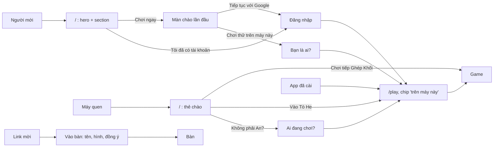

# E-08 — Bố cục từng màn và luồng: dễ chịu, ấn tượng, hiểu cách Tò He vận hành

- Status: **decided** — theo D-08 A, D-09 A + D, D-10 A; graduation ở [PLAN](../PLAN.md#graduation-list--đợt-2b)
- Kind: enhancement
- Blocks: E-03 (luồng đầu–cuối có e2e theo luồng mới) · Blocked by: D-08, D-09, D-10
- Decided: owner, 2026-10-25, chat: "duyet r nha" (đề xuất ở #166, owner merge)

## Why it matters

Owner, 2026-10-24: "nhìn chung func ổn k lỗi nha, còn về luồng và UI thì cần cải thiện cho xịn hơn nữa … bạn nên lập kế
hoạch research lên layout phù hộp cho các screen và đánh giá UIUX ấn tượng cùng luồng làm user dễ chịu và hiểu cách vận
hành nha".

## What is true today

Luồng và mười điểm đau xếp mức: [R-11](../research/R-11-surface-today-and-evaluation.md). Chức năng không lỗi (owner thử
máy thật 2026-10-24).

## "Ấn tượng" đo bằng gì

Mỗi màn được rà theo năm câu, thêm checklist [voice-and-look](../../../docs/conventions/voice-and-look.md):

1. **Một hành động chính**, nhìn là thấy (nút đặc, căn giữa ở màn giới thiệu, to nhất màn); hành động phụ là nút viền hay
   link.
2. **Người dùng biết mình đang ở đâu, là ai, tiến độ lưu ở đâu** (Nielsen 1) — chip hồ sơ, câu một dòng, không im lặng.
3. **Không ngõ cụt, có đường lui** — ← ở mọi màn con, "Không phải An?", "Để sau".
4. **Khổ nào cũng dùng hết chỗ** — điện thoại một cột; tablet hai cột; máy tính khổ ~1 100 px, không cột hẹp lệch trái.
5. **Phép thử 5 giây** — người mới nói được "đây là gì, bấm đâu"; người quay lại bấm đúng nút trong một lần.

## Bố cục từng màn (đề xuất)

| Màn | Mục đích | Hành động chính | Điện thoại | Tablet · máy tính | Trạng thái khác |
|---|---|---|---|---|---|
| `/` người mới | Hiểu Tò He, bắt đầu | *Chơi ngay* (phụ: *Tôi đã có tài khoản*) | Hero căn giữa, hai nút xếp chồng; section một cột | Hai nút cạnh nhau; section hai cột xen kẽ | — |
| `/` máy quen | Vào lại | *Chơi tiếp <game>* (phụ: *Vào Tò He*) | Thẻ chào thay hai nút | Như điện thoại, thẻ rộng ~480 px giữa hero | Chỉ có `tohe:returning`: thẻ không tên |
| Màn chào lần đầu (mới) | Chọn đăng nhập hay chơi thử | *Tiếp tục với Google* (phụ: *Chơi thử trên máy này*) | Một cột, logo trên | Thẻ ~480 px giữa màn | Email tắt: không nói gì về nó |
| "Bạn là ai?" (mới) | Đặt tên, chọn hình | *Vào chơi* | Tên, lưới hình 4 cột, nút dính đáy | Lưới 8 cột, nút dưới lưới | — |
| Trò chơi `/play` | Chọn game, chơi tiếp | Ô *Chơi tiếp* to ở đầu | Chip hồ sơ "An · trên máy này"; *Chơi tiếp* + *Gần đây*; lưới 2 cột | Rail trái; lưới 4–6 cột; *Chơi tiếp* rộng 2 ô | Đang tải: khung chờ đúng số game; mất mạng: dải báo |
| Chơi cùng `/together` | Vào bàn, mở bàn | *Nhập mã* | Ô mã to, "bàn của tôi" dưới | Hai cột: ô mã · bàn của tôi | Chưa có bàn: một câu và *Mở bàn Tiến Lên* |
| Tôi `/account` | Hồ sơ, cài đặt, tài khoản | Khách: *Đăng nhập để giữ tiến độ*; có tài khoản: hồ sơ | Hồ sơ trên cùng, nhóm cài đặt | Hai cột: hồ sơ · cài đặt | — |
| `/r/…`, `/s/…` | Vào bàn / nhận thách | *Vào chơi* | Giữ khuôn hôm nay; nút dính đáy để không nằm dưới nếp gấp | Thẻ ~480 px | Mã chết: nói ngay, có *Về Trò chơi* |
| `/games/`, `/games/<id>/` | Chọn game từ ngoài | *Chơi* | Giữ; nút *Chơi* căn giữa dưới ảnh | Lưới 2–3 cột | — |

## Luồng đề xuất

## Graduation (phác, chốt sau khi owner quyết D-08–D-10)

| PR | Nội dung | Cần trước | Song song |
|---|---|---|---|
| V0 Spec | Sửa ADR 0046 (cửa máy quen là thẻ chào; màn chào lần đầu trong khung), ADR 0047 (trang chủ theo section, không danh mục), ghi chú ADR 0043 (hồ sơ máy tạo có hỏi); `surfaces.md`, `identity.md` | owner quyết | — |
| V1 Trang chủ | `apps/web`: hero + section vi/en, thẻ chào đọc `tohe:greeting`, `check-build`, ảnh sáng/tối 360 · tablet · máy tính | V0 | V2 |
| V2 Cửa vào hub | `apps/hub`: `RequireSession` → màn chào; "Bạn là ai?"; ghi `tohe:greeting`; chip; bỏ câu "đang tạm tắt"; e2e smoke | V0 | V1 |
| V3 Bố cục | Trò chơi, Chơi cùng, Tôi trên tablet và máy tính; nút dính đáy ở `/r/`; đo và sửa tải lạnh của danh mục | V2 | — |

Sau V3: owner thử trên máy thật; E-03 viết e2e cho luồng mới.

## Decision

Theo đề xuất — owner, 2026-10-25: "duyet r nha". V0 là ADR 0055; V1–V3 ở graduation list đợt 2b của PLAN.
