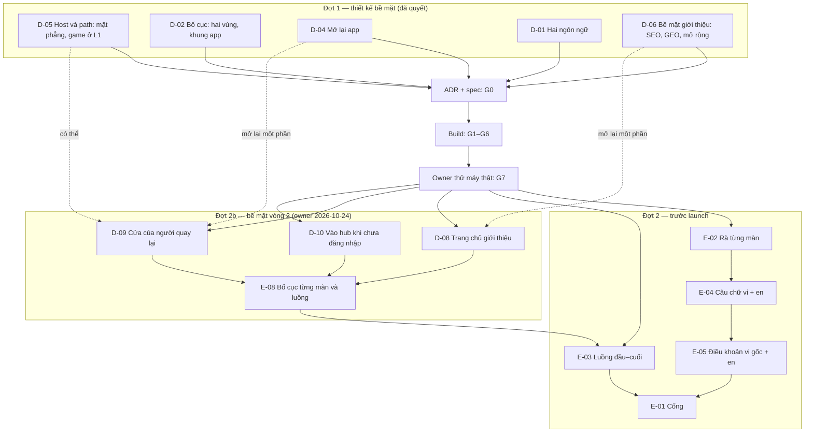

# Map — Review trước launch

Mọi item mục tiêu cần, và cái nào chặn cái nào. `A --> B` đọc là "xong A trước B". Trạng thái nằm ở bảng của
[PLAN.md](PLAN.md); trang này là hình dạng.

## Items

| ID | Câu hỏi / thay đổi | Vì sao mục tiêu cần | Trạng thái |
|---|---|---|---|
| [D-05](items/D-05-hosts-and-paths.md) | Host và path; mặt phẳng; mức cách ly của game ([R-04](research/R-04-hosts-and-paths-review.md)) | "subdomain hay path da hop ly chua" | decided — A, L1 |
| [D-02](items/D-02-layout.md) | Bố cục: hai vùng, khung app ba mục, `/` danh mục trước ([R-01](research/R-01-pages-and-ways-in.md), [R-02](research/R-02-layout-prior-art.md)) | "toi chua hinh dung dc trang gioi thieu vao tu dau" | decided — B |
| [D-04](items/D-04-coming-back.md) | Mở lại app: màn đầu, ai đang chơi, phiên hết hạn, cập nhật, link khi đã cài ([R-03](research/R-03-coming-back.md)) | "flow khi app intalled hay user enter lai app" | decided — B |
| [D-01](items/D-01-languages.md) | Hai ngôn ngữ: URL, SEO, chọn ngôn ngữ, tên game, Điều khoản | vi + en, tiếng Việt là mặt chính | decided |
| [D-06](items/D-06-introduction-surface.md) | Bề mặt giới thiệu: một nguồn cho mỗi game, GEO, mở rộng ([R-06](research/R-06-seo-geo-scale.md)) | "bề mặt giới thiệu sản phẩm, SEO GEO, và scale" | decided — B |
| E-02 | Rà từng màn: hub, console, trang công khai, game; điện thoại + máy tính, sáng + tối, vi + en | "review lai toan bo cai dang co" | open — đợt 2 |
| E-03 | Luồng đầu–cuối: người mới → chơi → cài app → account; link mời, mã bàn, "Thách bạn", chuyển máy, hồ sơ trẻ; e2e cho từng luồng | không ngõ cụt | open — đợt 2 |
| E-04 | Câu chữ toàn sản phẩm vi + en, gồm câu agent tự chọn ở Phase 1 | "review all" | open — đợt 2 |
| E-05 | Điều khoản + Quyền riêng tư, bản vi gốc + en, `TERMS_VERSION` mới | "chốt trước khi mở hẳn" | open — đợt 2 |
| [E-01](items/E-01-gate-before-outsiders.md) | Cổng: backup, load test, `/security-review`, thư, Alertmanager, `status.`, Access cho `console.`… | launch = Cổng qua | open — đợt 2 |
| [D-08](items/D-08-landing-introduces.md) | Trang chủ giới thiệu theo section, không lặp danh sách game ([R-10](research/R-10-surface-round-2-plan.md)) | "trang đầu tiên cho user mới cuộn xuống có thể đọc hiểu sản phẩm" | researching — đợt 2b |
| [D-09](items/D-09-the-way-back-in.md) | Người quay lại gõ domain vào hub một chạm; có đổi domain/path? | "nhấn thêm 1 nút để vào hub 1 cách thoải mái" | researching — đợt 2b |
| [D-10](items/D-10-entering-the-hub.md) | Vào hub khi chưa đăng nhập: hỏi đăng nhập hay chơi ngay bằng hồ sơ máy | "vào thẳng với profile tạm … k biết chuyện gì đang xảy ra" | researching — đợt 2b |
| [E-08](items/E-08-screens-layouts-and-flows.md) | Bố cục từng màn, luồng dễ chịu, hiểu cách vận hành | "luồng và UI thì cần cải thiện cho xịn hơn nữa" | researching — đợt 2b |
| [D-03](items/D-03-features-before-launch.md) | Tính năng trước launch ([R-05](research/R-05-learning-from-peers.md)) | — | **deferred** → backlog sản phẩm |
| E-06 | Console toàn tiếng Anh | — | → backlog sản phẩm (PB-12) |

## Ghi chú mang sang (đầu vào cho đợt 2)

- I4: điểm Ghép Khối từ 1.000.000 (viết "1.234.567") làm hub gửi câu mặc định thay câu của game (E-04).
- I4: câu mặc định của hub "Chơi {game} với mình trên Tò He nhé!" khác ADR 0045 "Chơi {game} với mình nhé!" (E-04).
- I4: một link tạo trước khi game nâng `identity.play` mất một lượt trước cổng ở `/play/<game>` (E-03).
- I4: trên Safari, "Gửi" có thể cần chạm hai lần (E-02).
- Thẻ xem trước `/s`, `/r` chỉ có tiếng Việt — sửa ở G6.

## Considered and left off

- **Ngôn ngữ thứ ba** cho hub và trang công khai — owner chỉ duy trì vi + en; game tự thêm được vì `init.locale` tự do.
- **Tính năng mới** (thử thách hôm nay, bàn của gia đình, màn hình chung, bàn theo lượt, mùa Tết…) — backlog sản phẩm
  (`docs/roadmap/product-backlog.md`).
- **Game ở domain riêng (L2/L3)** — chỉ khi có game không do owner thêm (PB-14).
- **Trang giới thiệu hay game trên `vinetic.io.vn`** — không (D-05).
