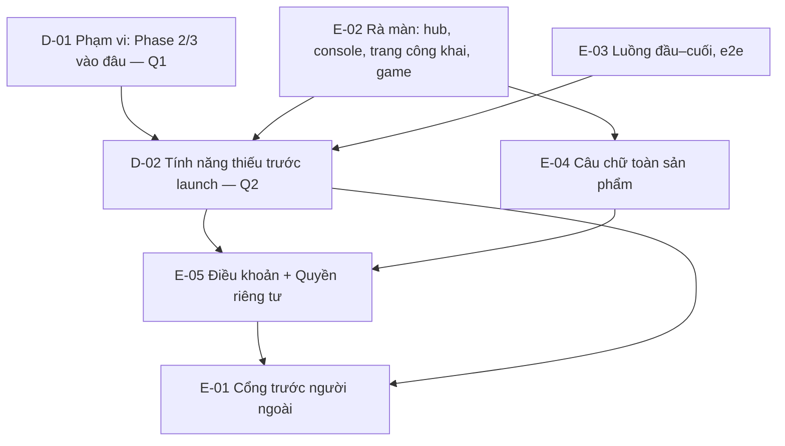

# Map — Review trước launch

Every item the goal depends on, and what blocks what. An edge `A --> B` reads "decide A before B".
Status lives on the [PLAN.md](PLAN.md) board, not here — this page is the shape.

**Nháp** (2026-10-21, agent): các item dưới đây là đề xuất, dựa trên [brief.md](brief.md) chưa chốt. Phase Map bắt đầu khi
owner xác nhận brief. Q1 có thể thêm item (Phase 2/3), Q2 sinh các item tính năng.

## Items

| ID | Question / change | Why the goal needs it | Blocks |
|---|---|---|---|
| E-01 | Cổng: 14 dòng từ Phase 1 (backup, load test, `/security-review`, thư, Alertmanager, `status.`…) | Launch chính thức = Cổng qua | — |
| D-01 | Phạm vi: Phase 2 (hub) và Phase 3 (game) gộp vào đâu (brief Q1) | Quyết map lớn hay nhỏ | D-02 |
| E-02 | Rà từng màn: điện thoại + máy tính, sáng + tối; ảnh chụp vào `research/` (brief Q3) | "về các mặt": UI/UX | D-02, E-04 |
| E-03 | Luồng đầu–cuối: người mới → chơi → cài app → account; link mời, mã bàn, "Thách bạn", chuyển máy, hồ sơ trẻ em; e2e cho từng luồng | "về các mặt": luồng; không ngõ cụt | D-02 |
| D-02 | Danh sách tính năng thiếu trước launch — owner chọn (brief Q2) | Owner chọn, agent không bịa | E-01, E-05 |
| E-04 | Câu chữ toàn sản phẩm, gồm câu agent tự chọn ở Phase 1 (brief Q4) | Owner: "review all" | E-05 |
| E-05 | Điều khoản + Quyền riêng tư nói đúng hôm nay; `TERMS_VERSION` mới | Owner: "chốt trước khi mở hẳn" | E-01 |

## Ghi chú mang sang từ Phase 1

Đầu vào cho các item trên, chưa phải quyết định:

- I4: nếu điểm Ghép Khối từ 1.000.000 trở lên (viết "1.234.567"), luật chặn số điện thoại làm hub gửi câu mặc định thay
  câu của game (E-04).
- I4: câu mặc định của hub là "Chơi {game} với mình trên Tò He nhé!", còn ADR 0045 ghi "Chơi {game} với mình nhé!" (E-04).
- I4: một link tạo trước khi game nâng `identity.play` mất một lượt trước cổng ở `/play/<game>` (E-03).
- I4: trên Safari, nút "Gửi" có thể cần chạm hai lần vì link được tạo sau một lần chờ mạng; K2 không báo lỗi (E-02).

## Considered and left off

- (chờ Q1)
