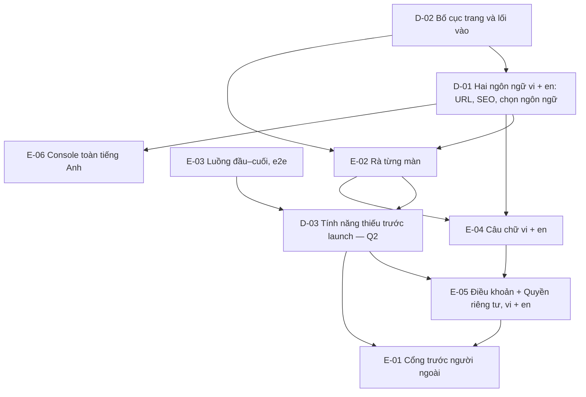

# Map — Review trước launch

Every item the goal depends on, and what blocks what. An edge `A --> B` reads "decide A before B".
Status lives on the [PLAN.md](PLAN.md) board, not here — this page is the shape.

**Nháp** (agent, 2026-10-22): theo [brief.md](brief.md) với câu trả lời Q1, Q4, Q5 của owner. Phase Map bắt đầu khi owner
xác nhận brief; Q2 có thể sinh thêm item tính năng.

## Items

| ID | Question / change | Why the goal needs it | Blocks |
|---|---|---|---|
| D-02 | Bố cục: trang giới thiệu dành cho ai, người ta tới nó từ đâu, app có đường ra các trang công khai không (menu hub hôm nay không có), `/` làm gì với người quay lại ([R-01](research/R-01-pages-and-ways-in.md)) | Owner: "toi chua hinh dung dc trang gioi thieu vao tu dau" | D-01, E-02 |
| D-01 | Hai ngôn ngữ: URL cho trang công khai tiếng Anh (namespace mới trong `@tohe/routes`, ADR 0042), `hreflang`, sitemap, `og:locale`; hub chọn ngôn ngữ thế nào (trình duyệt, nút đổi, nhớ theo hồ sơ hay máy); game nhận `init.locale` như hôm nay. **ADR** — URL đã được index thì đắt để đổi | Owner: vi + en, trang giới thiệu có SEO | E-02, E-04, E-06 |
| E-02 | Rà từng màn: hub, console, trang công khai, game; điện thoại + máy tính, sáng + tối, vi + en; ảnh chụp vào `research/` (cách làm: brief Q3) | "review lai toan bo cai dang co" | D-03, E-04 |
| E-03 | Luồng đầu–cuối: người mới → chơi → cài app → account; link mời, mã bàn, "Thách bạn", chuyển máy, hồ sơ trẻ em; e2e cho từng luồng | "xem xet o cac goc do"; không ngõ cụt | D-03 |
| D-03 | Tính năng thiếu trước launch — owner chọn (brief Q2) | Owner chọn, agent không bịa | E-01, E-05 |
| E-04 | Câu chữ toàn sản phẩm, vi + en, gồm câu agent tự chọn ở Phase 1 | Owner: "review all" | E-05 |
| E-05 | Điều khoản + Quyền riêng tư nói đúng hôm nay, bằng vi và en; `TERMS_VERSION` mới (mọi người đồng ý lại) | Owner: "chốt trước khi mở hẳn", "cung 2 ngin ngu" | E-01 |
| E-06 | Console toàn tiếng Anh (hôm nay tiếng Việt viết thẳng trong code) | Owner: "console ... english toan bo" | — |
| E-01 | Cổng: 14 dòng từ Phase 1 (backup, load test, `/security-review`, thư, Alertmanager, `status.`…) | Launch chính thức = Cổng qua | — |

## Ghi chú mang sang từ Phase 1

Đầu vào cho các item trên, chưa phải quyết định:

- I4: nếu điểm Ghép Khối từ 1.000.000 trở lên (viết "1.234.567"), luật chặn số điện thoại làm hub gửi câu mặc định thay
  câu của game (E-04).
- I4: câu mặc định của hub là "Chơi {game} với mình trên Tò He nhé!", còn ADR 0045 ghi "Chơi {game} với mình nhé!" (E-04).
- I4: một link tạo trước khi game nâng `identity.play` mất một lượt trước cổng ở `/play/<game>` (E-03).
- I4: trên Safari, nút "Gửi" có thể cần chạm hai lần vì link được tạo sau một lần chờ mạng; K2 không báo lỗi (E-02).
- Thẻ xem trước của link mời (`/s/…`, `/r/…`) cho crawler hôm nay chỉ có tiếng Việt (`services/api/src/Tohe.Api/Modules/Links/LinkPreviews.cs:54–130`) (D-01).

## Considered and left off

- **Ngôn ngữ thứ ba** cho hub và trang công khai: owner chỉ duy trì vi + en. Game tự thêm ngôn ngữ được vì `init.locale`
  là chuỗi tự do — không cần item.
- **Phase 2/3 như tính năng mới**: ngoài plan, trừ những gì owner chọn ở D-03.
