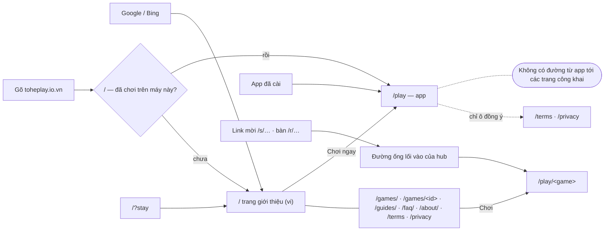

# R-01 — Bản đồ trang và lối vào: người ta tới trang giới thiệu từ đâu

- Date: 2026-10-22 · Feeds: D-02 (bố cục), D-01 (ngôn ngữ), E-02 (rà màn)

## Question

Owner (2026-10-22, gõ không dấu): "review xem viec cac trang dang bo cuc hop ly chua (toi chua hinh dung dc trang gioi
thieu vao tu dau)". Hôm nay có những trang nào, chúng nối với nhau ra sao, và một người tới trang giới thiệu bằng đường nào?

## Findings

**Ba host cho người** (ADR 0042, `docs/architecture/hosts-and-paths.md`): `toheplay.io.vn` (trang công khai ở gốc + app
ở `/play`, `/account`, `/s`, `/r`), `console.` (người vận hành), `docs.` (tài liệu kỹ thuật, tiếng Anh). `games.` chỉ
phục vụ file game; mở gốc của nó thì bị chuyển về `/play`.

| Lối vào | Tới đâu | Nguồn |
|---|---|---|
| Tìm trên Google/Bing | `/` hay `/games/<id>` (được index, có `sitemap.xml`, JSON-LD) | `apps/web/src/pages/index.astro`, `check:prod` |
| Gõ domain, **lần đầu** trên máy | `/` trang giới thiệu | `apps/web/src/scripts/returning.js` |
| Gõ domain, máy **đã từng chơi** | chuyển ngay sang `/play`, trước khi trang hiện (một trong ba khoá `tohe:returning`, `tohe:guest`, `tohe:telemetry:device` ở localStorage) | `returning.js` |
| `/?stay` | luôn hiện trang giới thiệu | `returning.js` |
| App đã cài (PWA) | `/play` (`start_url`) — không bao giờ thấy `/` | `apps/hub/vite.config.ts:93` |
| Link mời `/s/…`, mã bàn `/r/…` | thẳng vào game hay bàn qua hub; crawler (Zalo, Messenger) thấy thẻ xem trước, không thấy trang giới thiệu | `docs/architecture/entry-links.md` |
| Từ trong hub | **không có đường** tới `/`, `/about/`, `/faq/`, `/guides/`, `/games/`; chỉ `/terms` và `/privacy` trong ô đồng ý | `apps/hub/src/legal/Consent.tsx:39`, `session/AtTables.tsx:304`; menu hub: Cài app, Góp ý, Nhập mã, Link của tôi (`i18n.ts` `menu`) |
| Trong trang công khai | thanh điều hướng: Trò chơi, Hướng dẫn, Hỏi đáp, Giới thiệu; chân trang: Điều khoản, Quyền riêng tư, Tài liệu kỹ thuật, GitHub; nút "Chơi ngay" → `/play`, trang game → `/play/<id>` | `apps/web/src/content/site.ts`, `pages/games/[id].astro:66` |

**Ngôn ngữ hôm nay**:

| Phần | Ngôn ngữ | Nguồn |
|---|---|---|
| Hub (`/play`…) | vi + en, chọn theo ngôn ngữ trình duyệt (`en*` → en, còn lại vi); không có nút đổi | `apps/hub/src/i18n.ts:1607` |
| Game | nhận `init.locale` (chuỗi tự do) — game tự thêm ngôn ngữ được, không cần đổi contract | `packages/contract/src/protocol.ts:325`; `games/*/src/strings.ts` có vi + en |
| Trang công khai | chỉ vi (`<html lang="vi">`, `og:locale vi_VN`) | `apps/web/src/layouts/Page.astro:34,45` |
| Điều khoản + Quyền riêng tư | chỉ vi, một nguồn `documents.ts` (`TERMS_VERSION 2026-10-18.4`) | `apps/hub/src/legal/documents.ts` |
| Console | tiếng Việt viết thẳng trong code, không qua i18n | `apps/console/src/pages/*.tsx` |
| Docs | tiếng Anh | `docs/` |

## Assumptions

- Người quay lại hiếm khi cần trang giới thiệu nữa — đúng với ý của B3 (ADR 0042), chưa kiểm với người dùng thật.
- Một máy đã chơi mà muốn đọc Hỏi đáp hay Hướng dẫn cài app thì chỉ tới được bằng Google hay gõ đường dẫn — chưa có số
  liệu bao nhiêu người cần.

## So what

- **Trang giới thiệu chỉ dành cho người lần đầu** (từ tìm kiếm, gõ domain, hay một link tới `/games/<id>`); người đã chơi
  và app đã cài không bao giờ thấy nó. Đây là chủ ý của ADR 0042 — D-02 cần owner xác nhận còn đúng không.
- **Lỗ hổng một chiều**: từ hub không có đường tới Giới thiệu, Hỏi đáp, Hướng dẫn, trang game. D-02 nên quyết: thêm vào menu
  hub (đề xuất: "Về Tò He", "Hỏi đáp", "Hướng dẫn cài app") hay không.
- **Hai ngôn ngữ cho trang công khai** (owner 2026-10-22) là một namespace mới trong `@tohe/routes` (ví dụ `/en/…`) cùng
  `hreflang`, `sitemap.xml` theo ngôn ngữ, `og:locale` — D-01, cần ADR (URL công khai đắt để đổi khi đã được index).
- Script đưa người quay lại sang `/play` phải theo ngôn ngữ (`/en/` → app tiếng Anh?) — D-01 và D-02 quyết cùng nhau.

## Sources

- Code tại `main` 5c37d1c (2026-10-21); `pnpm check:prod` 2026-10-21 (23/23).
