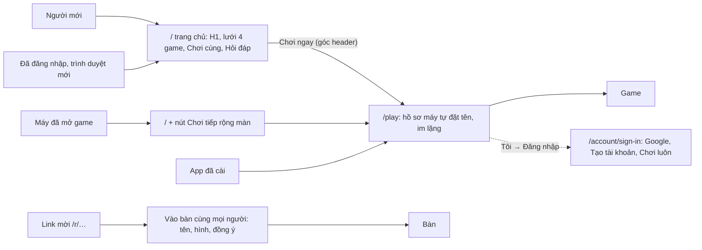

# R-11 — Bề mặt hôm nay: luồng, ảnh chụp, đánh giá

- Date: 2026-10-24 · Feeds: [D-08](../items/D-08-landing-introduces.md), [D-09](../items/D-09-the-way-back-in.md),
  [D-10](../items/D-10-entering-the-hub.md), [E-08](../items/E-08-screens-layouts-and-flows.md) · Bước 1 và 3 của
  [R-10](R-10-surface-round-2-plan.md)

## Question

Người mới, người quay lại và người được mời đi qua những màn nào hôm nay, và chỗ nào làm họ không hiểu chuyện gì đang
xảy ra?

## Findings

**Cách chụp.** Prod `prod-2026-10-24.3`, chỉ đọc, Playwright 1.64: Pixel 7, 768×1024, 1366×820; sáng và tối; vi và en;
máy mới và máy đã mở game (`tohe:returning`). Không tạo dữ liệu trên server (không gửi form nào). Trạng thái "đã đăng
nhập" đọc từ code, không chụp. Ảnh lưu ngoài repo.

**Luồng hôm nay** (code: `apps/hub/src/router.tsx`, `apps/web/src/scripts/returning.ts`, ADR 0043, 0044, 0046):

**Từng màn.**

| Màn | Quan sát |
|---|---|
| `/` máy mới, điện thoại | Trên nếp gấp: H1 "Tò He", "Mấy trò chơi nhỏ cho cả nhà. Mở là chơi, không quảng cáo.", rồi lưới game. Hero không có nút; *Chơi ngay* chỉ ở góc header. Cao 1 552 px, trong đó 4 ô game chiếm khoảng một nửa |
| `/` máy tính 1366 | Một cột ~930 px căn trái trong khung giữa; lưới 4 ô một hàng; hai bên trống; nút vẫn chỉ ở header |
| `/` tablet 768 | Như máy tính, lưới 2×2 |
| `/` máy đã mở game | Nút *Chơi tiếp* cam rộng cả màn ở trên H1, header cũng *Chơi tiếp*. Không có tên hồ sơ, không có game, nên trông như một dải quảng cáo |
| `/en/` | Cùng khuôn, chữ tiếng Anh |
| `/play` máy mới | Vào thẳng danh mục; góc trái một chip "🐰 Thỏ Hiền Khô" — tên và hình tự đặt, không lời nào nói đây là ai, tiến độ lưu ở đâu. Máy tính: khung chờ, "Đang tải…" còn ở 2,5 s, game hiện trước 5 s (một lần đo, tải lạnh) |
| `/account` máy mới | Cũng tự tạo một hồ sơ máy ("Koala Thông Thái · Đang chơi"); có các mục Cài đặt, Cài Tò He, Trợ giúp, Giấy tờ, Tài khoản |
| `/account/sign-in` | Thẻ "Chào mừng đến Tò He" mở đầu bằng **"Đăng nhập bằng email và mật khẩu đang tạm tắt."**; rồi *Tiếp tục với Google*; "Chưa có tài khoản? Tạo tài khoản"; **"Chơi luôn, không cần tài khoản"** — màn chọn này đã có, nhưng người mới không bao giờ được đưa tới |
| `/r/<mã>` máy mới | "Vào bàn cùng mọi người — Mọi người ở bàn sẽ thấy tên và hình này": tên gợi ý, 16 hình, ô đồng ý, câu về dữ liệu, *Vào chơi*. Rõ ràng nhất trong các màn; nút *Vào chơi* nằm dưới nếp gấp trên Pixel 7 |
| `/games/` | Danh sách công khai 4 game, mỗi game một khối có nút *Chơi* |
| Mọi trang | Console báo CSP chặn `static.cloudflareinsights.com/beacon.min.js`: Cloudflare vẫn chèn beacon cho request `Accept: text/html` (curl mặc định không thấy — kết luận "đã tắt" hôm nay là sai) |

**Đánh giá** (Nielsen 10, [voice-and-look](../../../docs/conventions/voice-and-look.md), phép thử 5 giây):

| # | Điểm đau | Ở đâu | Nguyên tắc | Mức |
|---|---|---|---|---|
| 1 | Hồ sơ tạm được tạo im lặng: người chơi không biết mình là ai, tiến độ ở đâu, đăng nhập ở đâu (owner gặp) | `/play`, `/account` máy mới | Nielsen 1 (trạng thái nhìn thấy được), 2 (khớp đời thật) | cao |
| 2 | Trang chủ không giải thích sản phẩm: 5 giây đầu biết "trang game cho cả nhà", không biết chơi thế nào, có an toàn không, chơi cùng ra sao | `/` | Nielsen 8 (đúng thứ cần), D-06 GEO | cao |
| 3 | Hero không có nút; nút duy nhất nhỏ ở góc | `/` | Nielsen 6 (nhận ra hơn nhớ ra) | cao |
| 4 | Cửa người quay lại không có ngữ cảnh: không tên, không game; trông như quảng cáo | `/` máy quen | Nielsen 1, 3 (quyền kiểm soát: "không phải tôi") | cao |
| 5 | Danh sách game lặp ở ba chỗ (`/`, `/games/`, `/play`) | `/` | Nielsen 8 | vừa |
| 6 | Màn đăng nhập mở đầu bằng một câu từ chối nội bộ ("đang tạm tắt") | `/account/sign-in` | voice-and-look "có gì nội bộ lộ ra?" | vừa |
| 7 | Máy tính và tablet: một cột hẹp, hai bên trống | `/` | voice-and-look "khoảng trống vô lý" | vừa |
| 8 | Danh mục tải lạnh trên máy tính còn "Đang tải…" ở 2,5 s | `/play` | — (cần đo lại nhiều lần) | vừa |
| 9 | Nút *Vào chơi* dưới nếp gấp sau lưới 16 hình | `/r/…` | Nielsen 6 | thấp |
| 10 | Avatar là emoji | mọi chỗ có hồ sơ | ADR 0049 — làm ở S3 | thấp (đã có kế hoạch) |

## Assumptions

- Thời gian tải ở hàng 8 là một lần đo trong lúc mạng vừa đổi (`ERR_NETWORK_CHANGED` ở lượt chụp trước); R-09 đo 1,9 s.
- Người đã đăng nhập mở `/` trên trình duyệt mới thấy trang của người mới — suy từ code, chưa chụp.

## So what

Ba điểm đau cao nhất (1, 3, 4) là chuyện *nội dung của hai cửa*, không phải chuyện path: cửa `/` không nói người này là
ai và đi đâu, cửa `/play` tạo người chơi mà không hỏi. Hub đã có sẵn hai mảnh để dùng lại: màn chọn ở `/account/sign-in`
và bước "tên + hình + đồng ý" của link mời.

## Sources

- Ảnh chụp prod 2026-10-24; `apps/hub/src/router.tsx`; `apps/web/src/pages/index.astro`; `apps/web/src/scripts/`;
  [identity.md](../../../docs/architecture/identity.md); ADR [0043](../../../docs/decisions/0043-device-profiles-and-identity-levels.md),
  [0044](../../../docs/decisions/0044-entry-links.md), [0046](../../../docs/decisions/0046-player-surfaces-two-zones-one-frame.md).
