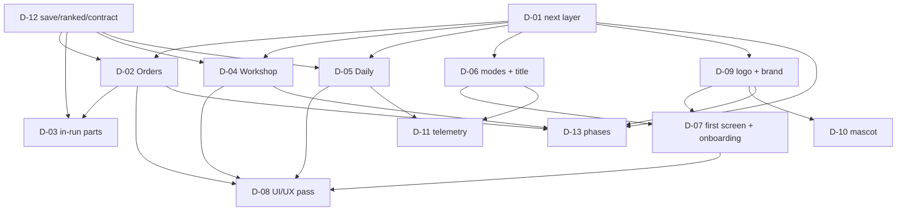

# Map — Ghép Khối: the evolution

Every item the goal depends on, and what blocks what. An edge `A --> B` reads "decide A before B".
Status lives on the [PLAN.md](PLAN.md) board, not here — this page is the shape.

## Items

| ID | Question / change | Why the goal needs it | Blocks |
|---|---|---|---|
| D-01 | Which layer comes first: Orders + Workshop, Daily, brand, or a mix? | The slice must fit a small game and the owner's priority; doing all at once dilutes the core | D-02, D-04, D-05, D-06, D-09, D-13 |
| D-02 | The Orders: how many, what goals, how the run ends, rewards, story | The reason to start a run and a ramp that teaches the machine | D-03, D-08, D-13 |
| D-03 | In-run parts: one choice of three after an order; which parts; the balance | The reason a second run differs; the build; the fun of the machine | D-13 |
| D-04 | The Workshop: scrap, blueprints, machine levels, cosmetics, sidegrades | The reason to come back; the identity; no IAP; no grind | D-08, D-13 |
| D-05 | The Daily Shift: local seed/date, streak, share, board (local now, server later?) | The reason to come back tomorrow; the family's daily ritual | D-08, D-11, D-13 |
| D-06 | The modes (Classic, Orders, Daily, Zen, Versus later) and the title/mode select | The one screen that sells the choice; the first impression | D-07, D-11 |
| D-07 | The first screen, the mode cards and the four-beat onboarding | A newcomer must understand and start in seconds | D-08 |
| D-08 | The UI/UX pass: HUD/Orders, Workshop, Daily, game over, accessibility | The layers must feel like the same machine, at 320 px, light/dark, one hand | — |
| D-09 | The logo/brand: mascot + wordmark lockup, symbol only, or wordmark only; the sizes | The owner's "impressive, higher-quality logo that pulls players in" | D-07, D-10, D-13 |
| D-10 | The mascot "Máy Ghép": design, personality, reactions, animation | The character that makes the machine a brand and the loops warm | — |
| D-11 | The funnel and retention telemetry: events, privacy, the health report | To know whether Orders/Daily/Workshop work without guessing | — |
| D-12 | The save schema, the ranked/verify boundary, the challenge/entry version, the daily seed | The new layers must not break the classic ranked run or the platform contract | D-02, D-03, D-04, D-05 |
| D-13 | The phase split and the first slice (2.1/2.2/2.3) | The owner's time; a playable slice before the full brand | — |

## Considered and left off

- **Real-time versus / rooms.** The platform has rooms for turn-based games; a merge survival game
  would need a different netcode and a new ADR. The async challenge/ghost already gives a versus
  feeling for a family. Leave it for a later plan.
- **A server-side daily board in the first slice.** It needs an API/board definition, a timezone
  rule and an integrity story; the local daily + share is enough to test the habit. D-05 decides.
- **IAP/ads/coins/push.** Against the platform's promise. The scrap is earned by play, the
  cosmetics by scrap; no purchase.
- **A full campaign/story world, voice acting, mascot shorts.** Not needed to prove the loops;
  the mascot can be one character with a few reactions first.
- **Changing the core.** The owner said the MVP is good; the new layers sit on top, and the
  classic stays the same game (and the ranked one).
